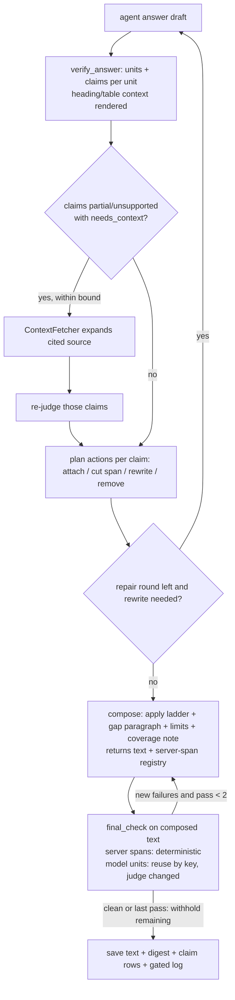
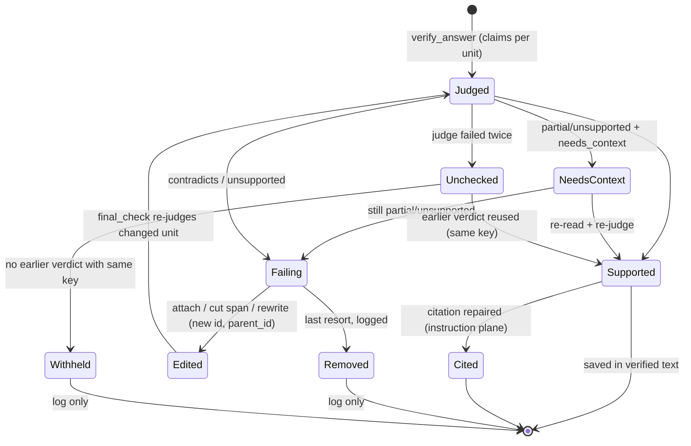

# Claim-level verification, separated checks, and a verified final text - Plan

## Goal Capsule

- **Objective:** An appraiser receives an answer whose supported information survives verification even when part of a sentence fails, whose computations can be checked, whose citations open the exact place, and whose gaps name exactly what is missing and why. The text they see, the text that is saved and the text after a refresh are the same version, and that version was checked as a whole.
- **Means:**
  - claims verified inside sentences, as exact spans returned by the judge in the same call (KTD1, KTD2);
  - three separate check planes: content, instructions (citations among them), completeness (KTD3);
  - span-level edits, with a sentence rewrite or removal only as a checked last resort (KTD4);
  - a bounded re-read of the source before a claim is given up (KTD5);
  - one composer for every server edit, with a record of server-written spans, and a bounded final verification of the exact saved text (KTD6, KTD7);
  - claim-id-linked records in the payload, the gated diagnostics and the UI (KTD8).
- **Authority hierarchy:**
  1. the user's request in this session;
  2. this plan's Product Contract;
  3. the KTDs;
  4. each unit's Approach.
- **Stop conditions:** stop and report instead of proceeding when any of these holds:
  - real reports, client data, addresses, private answers, screenshots or API keys would enter git, a public test or the PR;
  - a change would delete a database, a document, a backup, a good reading, or a prior human decision;
  - meaning, attribution, permission or office-isolation checks would have to be weakened to pass a test or a measurement;
  - the RAG system's own models would change, gain an automatic fallback to a more expensive model, or need unbounded repair or re-reading;
  - a merge, force-push or production deploy would be required.
- **Execution profile:** Deep. Verification, engine, coverage, API payload and UI changes, plus real-model and browser acceptance. Land units in Sequencing order as separate commits on `feat/general-question-engine`.
- **Who finishes:** the executing agent implements, tests on the host (never pytest inside Docker; `rag_test` only), runs the planned real-model measurement, and updates PR AriGabay/rag#2. Merging and deployment stay with the user.
- **Development-model split (Claude Code only):** the main agent (Opus) owns reasoning, planning, root-cause analysis, architecture decisions and the final review. Subagents are dispatched with an explicit `model`: `haiku` for defined tasks (code search, finding collection, test runs, documentation edits) and `sonnet` for complex fixes and reviews. This never changes the RAG system's models.

---

## Product Contract

### Summary

Round 8 changes how a chat answer is verified, edited and saved.

- **Claims, not sentences:** verification works on claims inside a sentence. Each claim has a stable id, a verdict, a citation state and an action.
- **Supported parts survive:** a sentence whose other parts are supported keeps them. Only the failing part is cut, fixed or qualified, and the edited sentence is checked again.
- **Re-read before giving up:** before a claim is given up, the relevant source is re-read once with its surrounding context.
- **One composer, one final check:** every server edit after the model's answer passes through one composer, and the exact text that is saved is verified before it is saved.
- **Three separate checks:** content, instructions and completeness are reported separately. A missing citation is repaired or reported as a citation defect, never treated as evidence that a datum is external or wrong.
- **An inspectable log:** each removed, corrected or qualified claim has a log entry, which the user can open behind the existing permission gate.

### Problem Frame

Round 7 made gaps precise and removals inspectable. Two defects in the active path still lose supported data or show unchecked text (verified at `9da69c1`):

- **Whole-sentence removal.** `verify.split_units` makes the sentence the verification unit, and `VerifyReport.apply` → `_sentence_cuts` removes the whole sentence of any failed unit. A sentence holding a supported area and an unsupported approval date loses both.
- **Unchecked edits after the last verification.** After the last `verify_answer` call, `engine.finish` produces the saved text through `coverage.state_components` and four more edits. `state_components` runs `report.apply` twice (cuts, partial marks, qualifiers, inserted citations, a removal note, a request-mismatch note), then `supersede` and the gap paragraph and `tidy`. The other four edits are `_state_limits`, `coverage.build` (a coverage or membership note), and the fallback to an earlier round's answer. None of the resulting text is checked again. The research found 13 such edit points.

Related gaps the same path shows:

- **The judge doesn't see a sentence's context.** It does not see the heading above a sentence or a table row's header context (`_render_batch` renders only the unit's text), so "proposed" versus "approved" under a heading is invisible to it.
- **An uncited factual sentence is removed, not repaired.** If the judge names no shown source for it, the sentence is removed (judge rule 9) instead of being treated as a citation defect.
- **A technical failure removes the claim.** A failed or omitted judge batch removes its units as `not_checked`. That kind mixes three causes: the call failed, the judge omitted the unit, or the judge did not classify it.
- **Model-declared claims are unused.** `FinalAnswer.claims` is declared by the model and never checked. Removal details pair with summaries by position (`Message.tsx` pairs `verification.removals[i]` with `diagnostics.removed[i]`).

### Requirements

**Separate checks**

- R1. Content verification decides whether each claim is supported by its source. For a computed result, it decides whether the result is derived correctly from verified inputs and an explicit formula. The result is never required to appear in the document.
- R2. Instruction checks are reported separately from content. They cover citations attached, table form, the approved/proposed separation, a requested formula, and language.
  - A missing citation on a datum that an authorized source already read in the turn supports is repaired: the citation is attached.
  - A datum that no read source supports is reported as "not linked to a read source". It is never attributed to an external source and never called wrong for lack of a citation.
- R3. Completeness is checked per request component on the final text, after every edit and removal. It is reported separately from instruction violations.

**Claims**

- R4. The answer is decomposed into claims that can be checked independently. One sentence may hold several claims with different verdicts.
- R5. Each claim keeps:
  - a stable id;
  - its text and its position in the final text;
  - its kind (datum, computed, inference, absence, instruction-bearing);
  - the sources checked;
  - a verdict;
  - a citation state;
  - the action taken.
- R6. Verdicts are supported, partially supported, contradicts the source, not supported by the source checked, and check could not complete. "Not supported" and "contradicts" are different verdicts.
- R7. A verdict accounts for subject, unit, period, date, VAT, area basis, caveats and context, including the heading and the table headers above the claim. A number found in the source is not enough to support a claim. A datum under a "proposed" heading never ends up presented as approved, even when its sentence is unchanged.

**Keeping supported parts**

- R8. A sentence is never removed whole when only part of it fails. The supported independent claims stay, and only the failing part is cut, fixed or qualified.
- R9. Negation, condition, date, unit and caveat stay bound to the claim they qualify. Text is never split blindly at commas.
- R10. When no safe span edit exists, the sentence is rewritten from its supported claims and the rewrite is verified. Removing the whole sentence is the logged last resort.
- R11. When a removed claim was an input of a computation or the basis of a conclusion, the dependent claims are checked again. A result never stays after losing the datum it rests on.
- R12. Tables and headings are checked after edits, so that no row, total or heading is left that changes the meaning of what remains.

**Re-reading**

- R13. When a claim's verdict is partial or the check is incomplete, one focused re-read of the relevant source runs before the claim is given up. The re-read covers the heading, neighbouring paragraphs, the section's continuation, row and column headers, units, footnotes, and a table continued on the next page. For table and image regions it uses their stored readings.
- R14. The reasons stay distinct: not located by the search, source read in part, source does not support, source contradicts, and technical failure of the check. A technical failure is never presented as a contradiction or as missing information.
- R15. Re-reads are bounded per claim and per turn. No external knowledge fills a gap.

**Final text**

- R16. Every change to the answer is followed by a check of the resulting text, including server edits made after the model's check. This covers gap notes, removal notes, qualifiers, inserted citations, tables, limit sentences and coverage notes.
- R17. The text that is saved, sent to the UI and shown after a refresh is the text that was checked, recorded with a digest.
- R18. A verdict is reused only for a claim whose text, sources, context (heading, table header) and dependencies did not change. Verdicts link to claims by stable ids, never by list position.
- R19. Repair stays bounded. When a complete answer cannot be reached within the bound, a checked partial answer with precise gaps is returned. Unchecked new text is never returned.

**Completeness and gaps**

- R20. A category is never marked "not found" when part of it is shown. The exact missing component is named (for example: "service areas of plot 1 were not verified"), with its reason from R14.
- R21. Details the user did not ask for are not required. A conditional requirement ("give the date if it appears") never forces an invented value and never makes the whole answer incomplete.

**Log and UI**

- R22. Every removed, corrected or qualified claim has a structured log entry with:
  - the claim id, the original text and the remaining text;
  - the verdict and the reason for the action;
  - the sources checked and the re-reads attempted;
  - the result of the post-edit check.
- R23. The UI shows each entry in an expandable details area, linked to its claim by id. Removal for contradiction, removal for lack of support and withholding after a failed check are distinguished. Unverified text shown for explanation is labelled as a rejected draft.
- R24. Verification records, diagnostics and history never expose content or sources the user may not see. No internal model reasoning is shown.
- R25. Citations keep opening the exact anchored place, and say honestly when only page- or table-level precision exists.

**Operation**

- R26. Verification, re-reading, repair and completeness run automatically, with no manual approval as a condition for an answer. Earlier human decisions, rejections among them, are kept, and nothing is marked human-approved after an automatic check only.
- R27. Office isolation, permissions, conversation history, table and image reading, calculations and precise citations keep working.
- R28. A follow-up turn reads the earlier answer without its server-written spans: removal notes, partial marks, gap lines and coverage notes. The conversation focus comes from the claims that survived, so the model never copies a server marker as a fact or takes a removed datum as context.
- R29. A clarification answer keeps its question and its status through every edit. A value the user gave in the conversation is a valid computation input, with the source "user".

### Key Decisions

- **session-settled: Three separate checks; a missing citation is a citation defect.** Rejected: one combined verdict in which a missing citation removes the datum. Governs R1–R3.
- **session-settled: Per-claim verification inside sentences, with stable ids and separate verdict, citation state and action.** Rejected: the sentence as the verification unit. Governs R4–R7.
- **session-settled: Keep supported parts; rewrite from supported claims and verify the rewrite when no safe edit exists.** Rejected: whole-sentence cut. Governs R8–R12.
- **session-settled: A bounded focused re-read before removal; a technical failure is never a contradiction.** Rejected: removal on the first partial verdict. Governs R13–R15.
- **session-settled: Mandatory re-verification of the exact final text after every change; verdict reuse only when text, sources, context and dependencies are unchanged, linked by stable ids; bounded repair, else a checked partial answer.** Rejected: verifying only the draft before `finish`/`apply`. Governs R16–R19.
- **session-settled: Completeness by request component after all edits; precise per-component gaps; conditional requirements are not forced.** Governs R20–R21.
- **session-settled: A structured per-claim log with gated UI detail.** Governs R22–R25.
- **session-settled: Automatic; no manual approval; human decisions kept.** Governs R26.
- **session-settled: The RAG system's models are unchanged (`gpt-6-luna`; no automatic fallback to a more expensive model).** Rejected: changing RAG models because of the development-model instruction.
- **session-settled: Computed results are verified through their inputs and formula, never by a literal match in the report** (also round 6).
- **session-settled: No merge, no production deploy, no private data in git; synthetic documents in public tests.**
- **session-settled: Measurement on the final build.**
  - Unit, regression and real-model results are reported separately, with the code version and build of each run.
  - A new held-out set, prepared and frozen before its run, runs on the final build; afterwards it is regression only.
  - Answers get a manual meaning check, and time and cost are measured.

### Acceptance Examples

- **AE1 (R8, R9, R10):** "השטח העיקרי בתא שטח 1 הוא 1,200 מ״ר, שאושר ביום 1.1.2020 [S1]." The source supports the 1,200 m² and has no approval date.
  - The final text keeps the 1,200 m² with its plot and unit.
  - The approval-date clause is cut, with a server marker.
  - The log entry says the date was not supported.
  - The edited sentence was verified.
- **AE2 (R2):** a correct datum with no citation, supported by a source already read in the turn, gets that source's citation attached. The instruction plane records a repaired citation. Nothing is removed and nothing is called external.
- **AE3 (R14, R19):** the judge call for one batch fails twice.
  - Those claims are withheld from the answer with the reason "the check could not complete", or kept under an earlier verdict whose key is unchanged.
  - None is called contradicted or missing.
  - The rest of the answer is shown verified.
- **AE4 (R7, R16, R18):** a sentence "תכסית 40%" sits under a heading "מצב מוצע". After an edit removes the heading line, the same sentence would sit under "מצב מאושר".
  - The changed heading context forces a new verdict.
  - The judge sees the heading.
  - The claim is not shown as approved.
- **AE5 (R11):** a claim stating an input value is removed as contradicting the source. A later claim concluding "therefore it exceeds the threshold" from that value is checked again and removed or qualified. A computation over workspace-verified inputs stays.
- **AE6 (R16, R17):** a gap paragraph, a limit sentence and a coverage note are added after the model's answer. The saved text equals the checked text (digest match). The server-written spans were checked by construction, and the model-written spans by verdicts whose keys match.
- **AE7 (R20):** the main areas of plot 1 are shown, but its service areas are not verified. Only the component "service areas of plot 1" is listed as missing, with its reason; the area category is not marked "not found".
- **AE8 (R17, R22, R23):** end to end, the answer displayed, the answer returned by the API and the answer after a page refresh are identical and carry the same digest. Each removal detail opens under the claim it belongs to, after the claims are reordered.

### Scope Boundaries

- No change to the RAG models, prompts' language, extraction pipeline or reading versions beyond what the verification context needs.
- No new storage table. Per-claim logs ride in the existing `message_diagnostics` JSONB and the message payload.
- The model's own `FinalAnswer.claims` stays a hint, never verification evidence.

#### Deferred to Follow-Up Work

- Running judge batches in parallel for latency.
- A UI that shows claim-level verdict highlights inline in the answer body. This round keeps them in the details area.

---

## Planning Contract

### Key Technical Decisions

- **KTD1 — the judge returns claims as exact spans in the same call.**
  - Each unit's verdict gains an additive `claims` list. Each claim carries `span`, which must be an exact substring of the unit's text. It also carries `kind`, its own verdict (R6), `failure`, `needs_context` (KTD5) and `depends_on` (claim spans, or ids of other units).
  - The judge policy requires a claim's span to include its own negation, condition, date, unit and caveat (R9).
  - The server validates every span. A span that is not an exact substring, or a unit without claims, falls back to one whole-unit claim carrying the unit's verdict.
  - The judge returns a `claims` list only for a unit holding two or more claims with different verdicts, or a claim with a `needs_context` value. Any other unit's verdict is its single whole-unit claim, which the server builds. This keeps verdict output within the call's 6000-token cap.
  - Registered server spans inside a unit (markers, partial marks, qualifiers, inserted citations) are rendered as marked server elements. A policy rule says they are not claims and never grounds for a verdict.
  - Every new field has a default, so older scripted replies stay valid.
  - Rejected:
    - a separate extraction call, which adds a model call per round;
    - server-side clause splitting, which would be blind splitting (R9);
    - `FinalAnswer.claims`, which the model wrote before verification and which no check ever touched.
- **KTD2 — stable claim ids from content, not position.**
  - A claim id is a short hash of a per-message salt, the unit's normalised model-written text, its heading and table-header context (so a repeated sentence under another heading is another claim), the normalised span, and its occurrence within the unit. It excludes cited-source digests, dependency verdicts and the judge version, which belong to the reuse key (KTD7), so an id never depends on a verdict. The salt keeps ids from revealing text.
  - The surviving claims of a cut unit keep their ids; the cut is recorded on the removed claim.
  - A claim that a repair or rewrite changed gets a new id, with a `parent_id` pointing to the claim it replaced, so the log follows it across rounds.
  - Positions (span offsets in the final text) are recorded separately and recomputed on every compose.
  - Unit ids follow the same scheme.
  - Every link between verdicts, log entries, UI rows and diagnostics uses ids. `Unit.index` stays only an index into the current split.
- **KTD3 — three planes in one report, with separate results.**
  - `VerifyReport` gains `claims`: per-claim content records (R5).
  - It gains `instructions`: instruction-component results, with the citation state per claim. The states are `cited`, `repaired` (attached by the server from `supported_by`, or from a deterministic match in an already-read authorized source), `missing` and `not_needed`.
  - It keeps `completeness`: component outcomes from the final text.
  - Judge rule 9 changes. An uncited factual claim is judged against every source shown in the call. If a shown source supports it, the claim is supported and its citation is repaired. If none does, the claim is `unsupported`, with the reason "not linked to a read source".
- **KTD4 — the edit ladder.** For a unit with failing claims, the first available step wins:
  1. **Attach.** A missing citation is attached and a server qualifier written; the text is otherwise unchanged.
  2. **Cut a span.** The failing claim's span is replaced by a short server marker, «[חלק שלא אומת הושמט]». This applies only when the span is one claim, the unit keeps at least one supported claim, and no supported claim's span overlaps or depends on it.
  3. **Rewrite.** While a repair round remains, the repair prompt lists the claims to keep verbatim and the ones to fix, and asks for that sentence only.
  4. **Remove the unit.** This is the logged last resort.
  - A problem that step 1 or 2 resolves is not `repairable` (as `annotatable` and `needs_citation` problems are today), so it neither fails `report.ok` nor starts a repair round. Step 3 is the existing REPAIR and REWRITE rounds in `engine.py`, started only for units that need a rewrite. Their prompts list the claims to keep verbatim and the ones to fix.
  - The span-cut marker carries an ordinal («[1: חלק שלא אומת הושמט]»), matching its log entry.
  - A cut or rewrite changes the unit's reuse key, so the final check (KTD6) re-judges it. If the cut changed the meaning (a lost negation, say), that verdict fails, and the unit falls back to step 4.
  - Contradicting spans are never kept as struck-through text in the body. Their original text lives only in the gated log (R23).
- **KTD5 — a bounded re-read through an injectable fetcher.**
  - It applies to a claim with verdict `partial` or `unsupported`, a `needs_context` other than `none` (heading, neighbours, continuation, table_headers, units_note, footnotes, next_page, region), and a cited readable source. "Check incomplete" in R13 means a verdict the judge could not settle for lack of context, which is what `needs_context` names. A claim left `unchecked` by a technical failure gets the batch retry, never a re-read, because a technical failure is not a gap in the source.
  - The server expands that source deterministically through a `ContextFetcher` interface. The DB implementation reuses the block, section, table and vision-reading readers under `tenant_tx`, with the permissions and anchors they already enforce. Unit tests inject a fake.
  - The expansion is registered as a turn source, so a repaired citation can point to it (the precedent is `meaning.Fetcher`).
  - Only those claims are re-judged, in one call.
  - Bounds: one expansion per claim, at most `CHAT_REREAD_CLAIMS` (4) claims per turn, and only within the verify time allowance.
  - A failed judge batch is retried once (as today). If it still fails, its claims are `unchecked`, and their action is `withheld`, with "the check could not complete" as the reason — or they are reused, if an earlier verdict has the same key. `unchecked` is never `contradicts` or `not_located`.
- **KTD6 — one composer and a bounded final verification of the saved text.**
  - All post-answer edits move into one `compose` step that returns the text plus a registry of server-written spans: removal markers, qualifiers, inserted citations, the removal note, the request-mismatch note, the gap paragraph, limit sentences, and the coverage or membership note.
  - `final_check` then splits the composed text into units:
    - Units made entirely of server spans are checked by one fixed-point assertion: recomputing every server span from the final state (component statuses, the log, the visible cited documents, the limits hit) reproduces the registered spans exactly. The per-kind cases are compose unit tests (U4).
    - Model-written units, server spans inside them included, reuse verdicts by key; units whose key changed are judged in one batch.
  - New failures go through the ladder, the components and the gap paragraph are recomputed, and the check runs again, up to `FINAL_PASSES` (2).
  - After the last pass, any unit still failing or unchecked is removed with the action `withheld`. The withholding cascades deterministically, with no judge call. Any kept unit whose heading chain, table header or `depends_on` changes because of a removal, and has no verdict for its new key, is withheld too. A table left without its header goes with its header, and a result goes with its removed input (R11). The server spans are then recomputed from that state, and the fixed-point assertion runs once more. Only that output, with its digest, is saved.
  - The fallbacks that today return `finish(*checked)` go through the same compose and final check.
  - Each iteration computes component outcomes, gap lines, the coverage note and the cited-document set as pure functions of the current text. Side effects (`ws.touch(..., "verified")`, `pending.found`) run once, after the last pass. `removal_documents` is the union over every pass.
  - The registry is saved with the message. Each entry holds only offsets in the saved markdown and a fixed kind, never text. `_turn_input` and the conversation summary use it to drop server spans from the history of a later turn (R28).
  - A clarification keeps its question line and its `clarification` status. Only the claims around it go through the ladder (R29).
  - An unedited text whose model units all reuse their verdicts costs no judge call.
  - The final check runs inside the existing verify allowance (`VERIFY_ALLOWANCE_SECONDS`). Without time or a judge, changed units are withheld; unchanged ones keep their verdicts.
- **KTD7 — reuse keys include context and dependencies.**
  - `unit_key` keeps its text, cited-source digests, unit context, heading and request.
  - Its text is the model-written text with the registered server spans excluded.
  - It gains the texts and spans of its `depends_on` claims (never their verdicts, which are outputs) and a `JUDGE_VERSION` constant, bumped this round (learning: cached readings must be versioned). At reuse time, the dependency verdicts stored with the cached verdict are compared with the current ones.
  - The rule "never cache a verdict that has `depends_on`" is replaced by those dependency inputs.
  - An attach edit (KTD4 step 1) whose citation is the source the judge named in `supported_by` for that claim reuses that verdict. The inserted citation is a server span, so the key does not change.
  - Verdicts with a `supported_by` beyond the unit's own ids stay uncached, because they depended on what else the call showed.
  - Heading and table-header context are now rendered to the judge as well as hashed (R7).
- **KTD8 — the payload, diagnostics and UI link everything by claim id.**
  - The message payload gets `verification.final_digest` (sha256 of the saved markdown) and `verification.actions` (counts of the content-affecting actions: removed, cut, rewritten, withheld; and of qualified and citation-repaired), both added to `public_verification`.
  - Each public removal or qualifier row gains its claim id, its action and its marker ordinal. Span offsets, kinds, verdicts and citation states stay in `message_diagnostics` until an inline-highlight UI needs them. The old `answer.claims` list is no longer filled for new messages.
  - The detailed log (R22) goes into `message_diagnostics.removed` and the claim rounds, which stay behind the existing document-visibility gate and audit. Every document behind a re-read or a checked source joins `removal_documents`, so the `_finish` permission recheck covers it.
  - The UI pairs summaries with details by claim id. Draft text appears only inside a "rejected draft" block of an expanded entry.
  - The round-7 invariant holds: a document behind any verdict, edit or log entry hides the whole message together with its details. Re-read and checked-source documents join `removal_documents`, so revoking one replaces the answer with the hidden marker and the diagnostics return 404. A kept claim that rests on a re-read source cites it, so that source is among the answer's documents anyway.
- **KTD9 — completeness from final claims.** Requirement votes name the claims (unit and span) that give a component, not only unit indexes. `requirement_outcomes` counts the components that surviving claims state, so a partly kept unit can still satisfy a component (R20). The final-check judge call carries the requirements block whenever a unit that voted for a component was cut or rewritten; otherwise votes are reused by claim id. Conditional requirements keep their round-7 handling (R21).
- **KTD10 — bounded cost.**
  - The final check costs no judge call when `compose` changed only server spans: removals, attached citations from the judge's `supported_by`, qualifiers, notes. A span cut, a rewrite or a changed heading context adds one judge call for the changed units, at most two over the passes.
  - A re-read adds at most one judge call.
  - Usage purposes gain `verify_final` and `verify_reread`, so a measurement can count them separately.
  - The exact-usage assertions in tests are updated deliberately, never loosened to "any".

### High-Level Technical Design



A claim's states across a turn:



Directional data shape for a claim record (not an implementation specification):

```
ClaimRecord: id, unit_id, span(start,end in final text), text, kind,
             verdict(supported|partial|contradicts|unsupported|unchecked),
             citation(cited|repaired|missing|not_needed), action(kept|cited|qualified|cut|rewritten|removed|withheld),
             sources_checked[ids], rereads[{source, scope, outcome}], depends_on[claim ids], post_check(verdict|n/a)
```

### Assumptions

- The judge (`gpt-6-luna` at its current effort) can return exact spans reliably enough. The whole-unit fallback (KTD1) keeps behaviour no worse than today when it cannot. The real-model acceptance measures the span validity rate.
- Synthetic fixtures from rounds 6 and 7 (the multi-page table, the vision table and the two-appraisal file) cover the image, multi-page and identical-number cases. New synthetic documents are added only where a case is missing.
- The new held-out set (v13) can be written from office A documents not used in v9–v12. If too few remain, it is written from the remaining documents with new question types and the overlap is stated.

### System-Wide Impact

- **Verification cost and latency.** The final check and the re-read are bounded, and both are measured (KTD10).
- **Payload shape.** `answer.claims` changes shape, and the frontend types and the e2e builders change with it. Old messages render as before: missing fields mean "no claim rows".
- **Diagnostics.** The JSONB grows and needs no migration. The permission recheck widens to re-read documents.

### Sequencing

1. U1: baseline and failing reproductions.
2. U2: judge contract and context rendering.
3. U3: claim records, planes and ids.
4. U4: edit ladder and composer.
5. U5: re-read.
6. U6: final check in the engine.
7. U7: payload and diagnostics.
8. U8: UI.
9. U9: real-model and browser acceptance.
10. U10: measurement, docs and PR.

U5 lands before U6; U7 depends on U5's re-read records.

---

## Implementation Units

### U1. Baseline and failing reproductions

**Goal:** record the starting build's behaviour on the regression sets, and pin each required behaviour as a failing test before the change.

**Requirements:** R1–R25 (reproductions); measurement (before column).

**Dependencies:** none.

**Files:**
- `backend/tests/integration/test_chat_round8_reproductions.py` (new)
- `backend/tests/fixtures/round8/` (new synthetic fixtures only where rounds 6–7 fixtures do not cover a case)
- private, outside git: `real_documents/eval/round8/` (baseline runs, failure map)

**Approach:**
1. Two baseline runs of v9, v10, v11 and v12 on the deployed `9da69c1` build, labelled with build and image. These are the before column.
2. A private failure map: for each defect named in the Problem Frame, the code path and a baseline example, with no private content in git.
3. Synthetic reproductions with the scripted judge, marked `xfail(strict=True)` against the current code (the round-7 pattern).

**Test scenarios:**
- A mixed sentence (supported area, unsupported approval date) loses the whole sentence today.
- A supported but uncited datum is removed today when the judge names no `supported_by`.
- A judge batch failing twice removes its units as `not_checked` today.
- A heading changed from "מוצע" to "מאושר" above an unchanged sentence: the judge does not see the heading today.
- A gap paragraph and a coverage note added after verification are saved unverified today (there is no digest and no final check).
- Claim reordering: removal details pair with summaries by position today.
- Covers AE7: one component of a category, missing — this baseline is expected to pass already. Confirm it and keep it as a regression test.

**Verification:** the reproductions fail for the stated reason on `9da69c1`; baseline runs are recorded with build labels.

### U2. Judge contract: claims, verdicts, needs_context, rendered context

**Goal:** the judge returns claims as exact spans with the round-8 verdicts, and sees the heading and table context.

**Requirements:** R4, R6, R7, R9, R14; implements KTD1, KTD7.

**Dependencies:** U1.

**Files:**
- `backend/app/chat/verify.py` (`JudgeVerdict`, `JudgeOutput`, `JUDGE_POLICY`, `_render_batch`, `unit_key`, failure-kind tables)
- `backend/app/chat/coverage.py` (`REMOVED_BECAUSE`)
- `frontend/lib/format.ts`, `frontend/lib/chatTypes.ts` (labels and types)
- `backend/tests/unit/test_verify_claims.py` (new), `backend/tests/unit/test_failure_kind_parity.py`, `backend/tests/unit/test_verify_cache.py`

**Approach:**
1. Add a `claims` list to `JudgeVerdict`, with the KTD1 fields and defaults. Add a `contradicts` verdict and an `unchecked` state.
2. Rewrite rule 9 per KTD3. Add rules for spans: an exact substring, including negation, condition, date, unit and caveat.
3. Render the heading chain and the table-header context inside each `<unit>` block.
4. Bump `JUDGE_VERSION` and add it to `unit_key`.
5. Keep the failure-kind tables in lockstep (parity test).

**Patterns to follow:** additive fields with defaults (`test_the_judge_schema_and_policy_name_the_defect_and_an_older_reply_stays_valid`); `_render_batch`; `test_failure_kind_parity.py`.

**Test scenarios:**
- An older reply with no `claims` still validates and yields one whole-unit claim.
- A span that is not an exact substring of the unit falls back to the whole unit, and the fallback is recorded.
- The rendered batch contains the heading and the table-header context of a row.
- A changed heading changes `unit_key`, and so does a changed `JUDGE_VERSION`.
- The parity test covers the new failure kinds in backend and frontend.
- A cut marker inside a supported sentence is rendered as a server element, and the unit stays supported.
- A unit with one claim gets no `claims` list from the judge, and the server builds its whole-unit claim.

**Verification:** unit tests pass; existing scripted judges still validate.

### U3. Claim records, three planes and stable ids

**Goal:** `VerifyReport` holds per-claim content records, instruction results with citation state, and completeness, all linked by stable ids.

**Requirements:** R1–R6, R11, R18, R20; implements KTD2, KTD3, KTD9.

**Dependencies:** U2.

**Files:**
- `backend/app/chat/verify.py` (`Unit` id, claim records, `Problem` mapping, `_remove_dependents` at claim level, `VerdictCache.reuse` by id, `requirement_outcomes`)
- `backend/app/chat/coverage.py` (`reason_of` with the R14 reasons)
- `backend/tests/unit/test_verify_claims.py`, `backend/tests/unit/test_coverage.py`, `backend/tests/unit/test_verify_cache.py`

**Approach:**
1. Assign unit and claim ids per KTD2.
2. Map each claim verdict to a `Problem` that carries `claim_id`.
3. Citation repair:
   - from the judge's `supported_by`;
   - from a deterministic match in an already-read authorized source: number plus meaning through `meaning.check` against `ws.sources` of the turn, never a first-occurrence search.
4. Cascade dependencies at claim level.
5. Count completeness from surviving claims (KTD9).
6. Split `not_checked` into its causes, `check_failed`, `omitted` and `not_classified`; none of them is a contradiction.

**Test scenarios:**
- Covers AE2. A supported, uncited datum gets a repaired citation. The instruction plane records `repaired`, and nothing is removed.
- An uncited datum that no read source supports is `unsupported` with "not linked to a read source". No external attribution is made.
- Covers AE5. A removed input claim cascades to the dependent inference claim. A computation over verified workspace values stays, and is re-checked only if it cites the removed claim.
- Identical numbers in different contexts. 500 appears in the source under "מוצע"; the claim "500 approved" is `contradicts`. The same 500 stated under its correct context is `supported`.
- Claim reordering. Two answers with the same claims in a different order map every verdict to the same claim id.
- Verdict reuse with a changed context. The same text under a different heading is re-judged; under the same heading it is reused.
- Covers AE7. One missing component in a category is listed alone, with its R14 reason.
- A conditional requirement with no value in the source does not make the answer incomplete.

**Verification:** unit tests pass; round-7 coverage tests stay green or are deliberately updated.

### U4. Edit ladder and one composer with a server-span registry

**Goal:** edits keep supported claims, and every post-answer edit goes through one composer that records the spans the server wrote.

**Requirements:** R8–R12, R16, R19; implements KTD4, KTD6.

**Dependencies:** U3.

**Files:**
- `backend/app/chat/verify.py` (`apply` → ladder, `_sentence_cuts` kept for the last resort, span cut)
- `backend/app/chat/compose.py` (new: `compose` and the registry)
- `backend/app/chat/coverage.py` (`state_components`, `build`, `tidy` through `compose`)
- `backend/app/chat/engine.py` (`_state_limits` through `compose`; the REPAIR and REWRITE prompts list the claims to keep and to fix; loop conditions with non-repairable cut and attach problems)
- `backend/tests/unit/test_compose.py` (new), `backend/tests/unit/test_verify_units.py`

**Approach:**
1. Implement the KTD4 ladder.
2. The span-cut marker is a server span.
3. Tables after edits:
   - A table left with no data rows goes.
   - A total or summary row whose component row was removed gets a server qualifier.
   - An orphan heading goes (the existing behaviour).
4. `compose` returns the text and the registry. Every editor that today returns a string returns its spans through it, in one pass over the original text, so no edit depends on matching text again (the existing span-edit pattern).
5. The coverage note's `ws.touch(..., "verified")` side effect runs only for the documents cited in the final composed text, after the final check.

**Test scenarios:**
- Covers AE1. The mixed sentence keeps "1,200 מ״ר" with its plot; the date clause becomes the marker. The registry holds the marker span.
- A negation inside the failing span. The judge-declared span includes «לא»; the cut keeps no negated supported claim. A cut whose result is re-judged as changed in meaning falls back to removing the unit.
- A unit with only failing claims is removed whole and logged as the last resort.
- Covers AE1. The mixed sentence finishes with no repair round: one agent call, one verify call, then the final check.
- A table row removed under a total row: the total row is qualified.
- A table left with its header only is removed.
- Every server-added string (removal note, gap lines, limit sentence, coverage note, inserted citation, qualifier) is inside a registered span, and nothing else is.

**Verification:** unit tests pass; the existing apply and cut tests are kept or deliberately updated.

### U5. Bounded re-read before giving up a claim

**Goal:** a partial or incomplete claim gets one context expansion of its source and a re-judge before it is given up.

**Requirements:** R13–R15; implements KTD5.

**Dependencies:** U3 (U4 for its records).

**Files:**
- `backend/app/chat/verify.py` (re-read stage, `ContextFetcher` interface)
- `backend/app/chat/tools.py` (DB fetcher: block window, section and heading chain, next-page table continuation, stored vision table reading)
- `backend/app/config.py` (`chat_reread_claims`)
- `backend/tests/unit/test_verify_reread.py` (new), `backend/tests/integration/test_chat_reread.py` (new, `rag_test`)

**Approach:**
1. Select claims per KTD5.
2. Expand through the injected fetcher. The DB fetcher reuses readers that enforce permissions and anchors.
3. Register the expansion as a turn source.
4. Re-judge the selected claims in one call (usage purpose `verify_reread`).
5. Record each re-read in the claim's log.

**Test scenarios:**
- A claim whose unit note sits in the heading above (the "באלפי ₪" pattern) is partial at first and supported after the heading is re-read.
- A table continued on the next page: the total on page 2 is supported after the continuation is read.
- An image (vision) table cell is supported from its stored reading.
- The bound: a fifth eligible claim is not re-read and keeps its verdict with reason "source read in part".
- A re-read that fails technically leaves the claim `unchecked`, never `contradicts`.
- A re-read never reaches a document the user cannot see (permission test).

**Verification:** unit tests with a fake fetcher; an integration test on `rag_test`.

### U6. Final check of the exact saved text in the engine

**Goal:** the saved text is the checked text, within bounds, on every path that returns an answer.

**Requirements:** R16–R19, R3, R20, R28, R29; implements KTD6, KTD7, KTD10.

**Dependencies:** U4 (U5 optional).

**Files:**
- `backend/app/chat/engine.py` (`finish` → compose + `final_check` loop; fallback paths; `_turn_input` history without server spans; `report.ok`/`settled` loop conditions)
- `backend/app/chat/verify.py` (`final_check`, deterministic server-span checks)
- `backend/tests/unit/test_verify_cache.py`, `backend/tests/integration/test_chat_engine.py`, `backend/tests/integration/test_chat.py`, `backend/tests/integration/test_usage_accounting.py`, `backend/tests/unit/test_verify_units.py` (usage assertions updated deliberately)

**Approach:**
1. Run the KTD6 loop, with `FINAL_PASSES` 2.
2. Run the deterministic checks of server spans:
   - each gap line against the final component statuses;
   - the removal note against the log;
   - the coverage note against the visible cited documents;
   - the limit sentences against the limits hit.
3. Recompute completeness and the gap paragraph from the final pass.
4. On no time or no judge, withhold the changed units.
5. Route the `checked` fallbacks through the same path.

**Test scenarios:**
- Covers AE6. A gap paragraph, a limit sentence and a coverage note are added; the saved text's digest equals the checked text's digest. No judge call is made when no model-written unit changed.
- Covers AE4. Removing a heading line changes the context of the units below it; they are re-judged, and "proposed" is not shown as approved.
- Covers AE3. The final-check judge fails: changed units are withheld with "the check could not complete", unchanged units are kept, and none is called contradicted.
- The fixed point. A final-pass removal changes a component's status, and the gap paragraph is recomputed. A second pass ends clean, or withholds the rest.
- The last-pass removal is a heading line. The unit below it, which has no verdict under the new heading, is withheld rather than saved under the wrong heading. The server spans are recomputed after that withholding, and the saved digest matches.
- A fallback to an earlier round's answer is composed and checked like any other.
- A clarification answer (server text only) is saved with a digest, and no judge call is made.
- A clarification whose surrounding claims all fail keeps its question and its `clarification` status.
- A computation that uses a value the user gave earlier in the conversation survives the final check, with that input's source marked "user".
- `ws.touch(..., "verified")` runs once, for the documents cited in the final text, and `removal_documents` holds every document checked in any pass.
- A follow-up turn's history excludes the earlier answer's server spans; its focus comes from the surviving claims.

**Verification:** engine and integration tests pass with deliberately updated usage sequences.

### U7. Payload, diagnostics log and permissions

**Goal:** the saved message carries the digest and claim-linked rows, and the gated diagnostics carry the full per-claim log.

**Requirements:** R17, R22, R24, R25; implements KTD8.

**Dependencies:** U5, U6.

**Files:**
- `backend/app/chat/api.py` (`_answer_payload`, `public_verification`, `public_removals` by claim id, `_removal_decisions`, `_diagnostics`, `removal_documents`)
- `backend/tests/integration/test_chat_verify.py`, `backend/tests/integration/test_chat_diagnostics.py` (or the existing diagnostics tests)

**Approach:**
1. Add the KTD8 fields.
2. Write the log entries per R22 into `message_diagnostics.removed`.
3. Widen the permission recheck to re-read and checked-source documents.
4. Old messages render: a missing field means no rows.

**Test scenarios:**
- The digest in the payload equals sha256 of `messages.content`.
- The log entry holds the claim id, original text, remaining text, verdict, reason, sources checked, re-reads and post-check result; the normal payload holds none of the draft or source text.
- A document reached only through a re-read is revoked for a user: the answer is replaced by the hidden marker and the diagnostics return 404, as with any removal document (extend the revoked-removal-document test in `backend/tests/integration/test_chat_permissions.py`).
- The serialized `_message_json` answer, the server-span registry included, contains none of a removed claim's draft text and no source text.
- Claim ids of two messages with the same text differ (per-message salt).
- An old message without claim rows still serializes and renders.

**Verification:** integration tests on `rag_test` pass.

### U8. UI: claim-linked details, rejected drafts, and same-version e2e

**Goal:** the user can see what was removed, corrected or qualified and why, linked to the right claim. The shown, saved and refreshed answers are the same verified version.

**Requirements:** R17, R22, R23, R25; implements KTD8.

**Dependencies:** U7.

**Files:**
- `frontend/components/chat/Message.tsx`, `frontend/lib/chatTypes.ts`, `frontend/lib/format.ts`, `frontend/app/chat/chat.css` (only as needed)
- `frontend/e2e/chat-gaps-removals.spec.ts`, `frontend/e2e/round8-final-text.spec.ts` (new)

**Approach:**
1. Pair by claim id instead of by index.
2. Show an action label: cut, rewritten, removed, qualified, citation repaired, withheld.
3. Each expanded entry follows its action:
   - **removed** (contradicts, or unsupported): the original in a "rejected draft" block, plus the reason;
   - **withheld:** the original under the existing "unverified draft" wording, with the reason "the check could not complete" — never "rejected";
   - **cut** and **rewritten:** the original with the failing part marked, plus the remaining text as kept;
   - **qualified:** the remaining text and the qualifier's reason, with no draft block;
   - **citation repaired:** only the attached source, with no draft block.
   - In every case the checked sources open the source viewer, and the toggle label follows the action ("details of the change" for non-removals).
4. Surfaces:
   - The default-visible notice counts and names only content-affecting actions (removed, cut, rewritten, withheld). It words a mixed outcome without the verb "removed" when nothing was removed.
   - Qualified and citation-repaired entries appear only in the collapsed details.
   - Completeness gaps keep their own separate line.
5. Entries are ordered by their position in the final text and keyed by claim id (not by array index). Each cut marker's ordinal in the body matches its entry, and markers render visually distinct from model text.
4. RTL and mobile as before. Read `frontend/node_modules/next/dist/docs/` before writing frontend code (`frontend/AGENTS.md`).

**Test scenarios:**
- Covers AE8. The displayed answer text equals the API's `markdown` and equals the text after reload, and the digest matches.
- With reordered claims, each detail opens under its own claim.
- Two cuts in one answer: each marker's ordinal opens its own entry.
- A citation-repaired claim does not appear in the default notice.
- A withheld claim shows "the check could not complete", never "contradicts".
- The rejected draft is labelled and is not part of the answer text.
- On mobile, no horizontal scroll.

**Verification:** Playwright against the stack in office B (synthetic data).

### U9. Real-model and browser acceptance

**Goal:** the required behaviours hold with the real model on synthetic documents, end to end.

**Requirements:** all; AE1–AE8.

**Dependencies:** U8.

**Files:**
- `backend/tests/integration/test_round8_real_model.py` (new, `-m real_model`, `rag_test`)
- `frontend/e2e/round8-acceptance.spec.ts` (new, office B)

**Approach:** synthetic documents for each acceptance example; bounded attempts per case; span-validity rate recorded.

**Test scenarios:**
- AE1–AE8 with the real model.
- The span-validity rate and the re-read rate are reported.

**Verification:** real-model tests pass within their bounded attempts; Playwright passes against the deployed final build.

### U10. Measurement, documentation and PR

**Goal:** before and after on the same model, plus a new held-out set run once on the final build, with build labels, a manual meaning check, time and cost.

**Requirements:** measurement decision; R26, R27 (regressions).

**Dependencies:** U9.

**Files:**
- `docs/evaluation/conversational-rag.md` (round-8 section, aggregates only)
- private: `real_documents/eval/real_v13_heldout.yaml` (+ sha256 and provenance), `real_documents/eval/round8/`
- the PR body

**Approach:**
1. Write v13 from original office A documents not used in v9–v12, freeze it with sha256 before any run, and run it once on the final build.
2. Run v9–v12 twice on the final build.
3. Do a manual meaning check of answers that fail or change status.
4. Record time, calls and cost per turn, and the counts of `verify_final` and `verify_reread`.
5. Docs and the PR give aggregates only, each labelled with its build.

**Test expectation:** none — measurement and documentation.

**Verification:** each result in the docs names its commit and image; v13's hash is verified before its run.

---

## Verification Contract

- **Backend (host only, `rag_test`):** run the full `backend/tests` suite with ruff clean. The units' tests are listed above. Never run pytest inside Docker.
- **Real model:** `-m real_model` acceptance (U9) on the host.
- **Frontend:** the Playwright specs above against the compose stack in office B.
- **Deployment for checks:** build the backend and worker image through the `migrate` service from the deploy worktree, recreate the services, and verify a changed constant inside both containers.
- **Measurement:** U10. No result from an earlier build is presented as validating the final build.

## Definition of Done

- Every unit's verification holds, and the reproductions of U1 pass, with their `xfail` markers removed.
- Unit, full-suite, real-model and browser results are recorded with their commit and build.
- v13 has been run once on the final build; the measurement and its limits are documented without private content.
- The PR body carries the round-8 section, the residual findings, and the development-model split as actually used.
- No abandoned-attempt code remains in the diff.

## Risks & Dependencies

- **Span reliability of the judge (KTD1).** Mitigation: the whole-unit fallback, plus a measured span-validity rate.
- **Judge output against the 6000-token cap and 40-unit batch.** Per-claim spans and claim-attributed requirement votes enlarge the reply; long answers may fall into the `incomplete` halving path more often. Mitigations:
  - claims lists only for mixed units (KTD1);
  - U9 records how often halving happens, and U2 retunes `JUDGE_MAX_UNITS` if it is frequent.
- **Latency on turns with edits (KTD6, KTD5).** Mitigation: the bounded passes, the verify allowance and withholding; measured in U10.
- **Brittle tests that pin exact usage sequences.** These are updated deliberately in U6.
- **The payload shape change for `answer.claims`.** The frontend and the e2e builders are updated in the same units.

## Sources & Research

- Flow and edge-case analysis gathered this session: the claim states across rounds, the fixed point between removals and server paragraphs, follow-up history, clarifications, permission changes between save and refresh. These shaped KTD2, KTD6, KTD8, R28 and R29.
- Code map, gathered this session: the active path `api.run_message` → `engine._run_turn` → `verify.verify_answer` → `engine.finish` → `coverage.state_components` / `build` → `api._answer_payload` / `_finish`; the 13 post-verification edit points; the cost shape (one judge call per round, 30k characters, 40 units, 6000 output tokens).
- Learnings:
  - `docs/solutions/workflow-issues/real-model-before-after-eval-on-the-local-stack.md`
  - `docs/solutions/database-issues/db-tests-inside-compose-containers-wipe-the-office-database.md`
  - `docs/solutions/logic-errors/stored-pdf-boxes-are-not-in-the-rendered-page-frame.md` (a re-read needs independent evidence; cached readings need a version bump)
  - `docs/solutions/logic-errors/hebrew-follow-up-entity-lookup-pitfalls.md`
- Prior plans:
  - `docs/plans/2026-10-09-0908-fix-request-gaps-removals-in-turn-tables-plan.md` (round 7)
  - `docs/plans/2026-10-09-0140-feat-precise-sources-computed-results-plan.md` (round 6)
