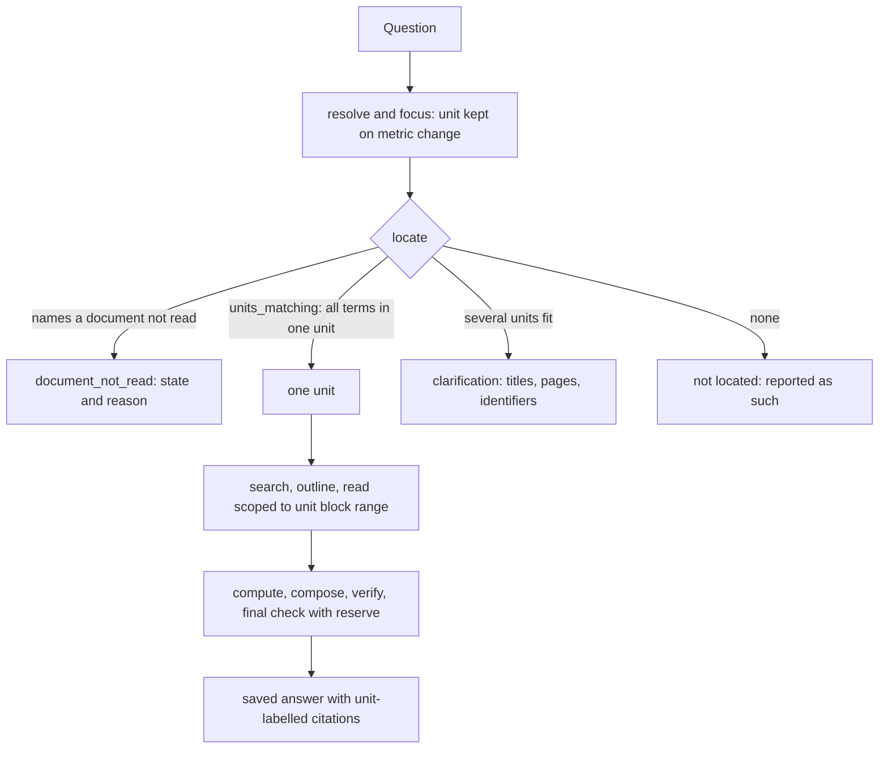
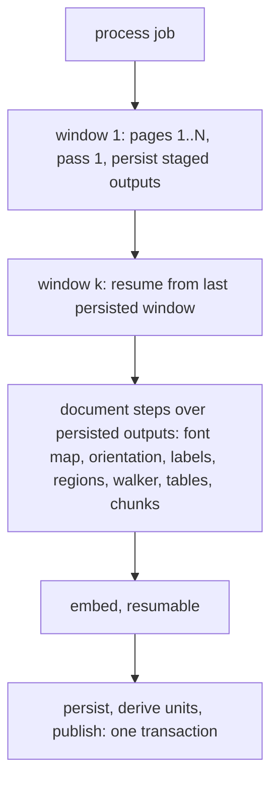

# Appraisal Units, Long Files and Focused Retrieval - Plan

## Goal Capsule

- **Objective:** an appraiser who asks about one appraisal inside a large office file — named by project, property or internal title — gets an answer drawn from that appraisal's own sources, with grounded information kept to the final saved answer; when the file or the appraisal cannot be read or located, the answer says exactly that instead of "not in the document".
- **Means:** ingest long files in resumable page windows (KTD2), cut search latency (KTD3), derive and store appraisal units below the file (KTD4, KTD5), retrieve in two levels (KTD7), and fix the verification false removals and gap wording the diagnosis found (KTD10).
- **Authority:** the Product Contract's R-IDs win on behaviour; KTDs win on mechanism within them; units never override either. Session-settled decisions are not reopened.
- **Stop conditions:** stop and report if long-file ingestion cannot stay within bounded memory and per-window time on the local stack (U4 measurement), or if the unit derivation cannot keep the round-7 single-appraisal regression files at exactly one appraisal unit (U7 gate).
- **Execution profile:** Opus orchestrates, defines acceptance, reviews every unit's diff and decides any diagnosis; Sonnet subagents implement and review units; Haiku subagents run tests, gather facts and update docs. Models are set per subagent call.
- **Who finishes:** `ce-work` implements and verifies locally and returns to the calling `lfg` run, which simplifies, reviews, commits, pushes and updates PR AriGabay/rag#2. No merge, no production deploy.

---

## Product Contract

### Summary

Round 9 makes long multi-appraisal files readable and searchable, gives each appraisal inside a file its own stored identity with source ranges and evidence, and retrieves in two levels: first the appraisal, then its sections, tables and images. It also removes the measured search latency that consumed the turn's time, and fixes the verification and gap-wording faults that hid or misreported grounded data.

### Problem Frame

The round-8 held-out set scored 2 of 15. The round-8 report blamed locating a sub-report inside compendium files. A per-stage diagnosis from the real traces (private; aggregate in `docs/evaluation/conversational-rag.md` after U14) shows a different first failing stage:

- Both compendium files (412 and 719 pages) were rejected at ingestion by the hard 300-page limit. They have no blocks, no chunks, and a failed version is never current, so the chat could not see them. 11 of the 15 conversations asked about these unread files and were told the data was "not found in the documents searched".
- One chat search call takes 10–34 s on an office of 18 documents and about 4,300 chunks. The trigram stage alone takes 10–13 s per query variant: its `word_similarity` predicate cannot use the trigram index. Turn time was 120–170 s, of which model time was only 30–50 s. The remainder, mostly search, used up the time and tool budgets before reading and computing.
- Verification removed supported claims. A date followed by a full stop ("01.11.1966.") is tokenized as the decimal 1.11, so the date looks unstated and the claim is cut. Confirmed in two sets.
- A table whose text layer is letter-spaced (64–79 % single-character tokens) was stored with status `read`, so a plan number and its in-force date could not be read.
- Among the 19 persistent failures of the earlier regression sets:
  - 8 are grading-pattern misses on answers that are correct in meaning;
  - 4 are answer-building or calculation choices;
  - 3 are verification false removals;
  - 2 are gap wording;
  - 1 is an entity/scope misread and 1 a retrieval miss.

Locating an appraisal inside a compendium could not be measured at all, because the files were never read. The current per-file context splitter (`backend/app/chat/contexts.py`) would derive one context for such a file anyway. It splits only on restated house-number addresses or block/parcel identifiers together with a numbering restart. Project names, internal titles and printed page-number restarts are not used, and nothing stores a unit that retrieval SQL can see.

### Requirements

**Long files and ingestion quality**

- R1. A PDF of up to at least 1,000 pages is ingested end to end on the local stack. The work runs in bounded memory and in resumable windows that each fit the job time budget; a crash or lease loss resumes from the last finished window.
- R2. A version that failed for a retriable reason, such as too many pages under the old limit or a time-out, can be processed again without a re-upload, and the document keeps its id.
- R3. Long processing shows real progress on the documents screen (pages read of total, current stage); a failure shows its reason.
- R4. Letter-spaced or otherwise damaged text-layer runs are either repaired to the words the page shows or stored as `read_uncertain`, never as `read`. Bidi control characters do not reach stored block or chunk text.
- R5. When a question names a document the user may see but that has not been read (failed, still processing, or partly read in the relevant range), the answer says so and gives the document's state. When no unit is located and the user can see files that are not read, the answer lists those files with their state as not checked. It never says the data is absent from the document.

**Appraisal units below the file**

- R6. Each current reading of a document has stored internal units. Each unit has: a stable id, a kind (appraisal, appendix, comparables, front matter, or undetermined document), a title, document-grounded aliases, identifying details, page and block ranges, the evidence that set its identity and boundaries, and a certainty marker.
- R7. Units come only from the document. A name, alias or boundary is recorded only with the blocks it was read from. A comparable property mentioned in a table or text never becomes a unit by itself. Appraisal, appendix and comparables are told apart by structure and source evidence.
- R8. Uncertain boundaries stay marked as uncertain, and reading may extend across them. A file is presented as one appraisal only when the evidence says so. A first heading without a recognised address is not such evidence.
- R9. Units are derived from the stored reading without re-reading the file. Any extra processing runs only for readings that need it, is incremental, and is recorded in the reading's report.

**Two-level retrieval**

- R10. Retrieval first locates the unit, then searches and reads sections, tables and images inside it. Every passage, value and citation the chat uses carries its unit id and source range as well as its file.
- R11. Question terms that match in different units of one file never count as a match for one unit (`documents_matching`, `find_documents`, entity lookup).
- R12. A unit can be located by its project or property name or internal title even when the file name and title do not contain it. Lexical and semantic search both stay available. No evaluation-question wording is coded into the matching.
- R13. A unique source-backed name selects its unit. Several plausible units lead to a clarification that lists distinguishing details (title, pages, identifiers, file). Candidates are never chosen or ordered by passage count.
- R14. A follow-up keeps the unit when the user changes the metric or asks another computation. Changing from price to rent is not a property change. A follow-up that names another unit or property moves to it.

**Focused reading and time**

- R15. Reading starts from the unit's structure (its sections, tables and pages) and widens only as needed. Long passages continue by cursor, and headings, units, notes and table continuations stay with what is read.
- R16. Turn time is accounted separately for locating, reading, computing, composing and verification. The final check of the saved answer keeps a reserved share. Identical searches and reads are not repeated within a turn. The turn's total time limit is not raised.
- R17. Long work shows progress that names what was found (the located unit, its pages) and what is being read.
- R18. A failure to locate or read is reported as such ("not located", "not read", "time limit reached"). It is never reported as "not in the document" or "not in the section".

**Preservation without weakening verification**

- R19. When the final check runs out of time, claims whose text, sources, context and dependencies are unchanged keep their verdicts. Only the changed addition is fixed or withheld, and the withholding names the time limit as its cause.
- R20. Supported non-numeric information is protected like numbers: dates, caveats, approved versus proposed status, conditions and calculation method. A repair that loses it does not replace the checked answer.
- R21. A verdict is never reused when a heading, negation or condition change alters a claim's meaning.
- R22. Verification does not remove a claim whose datum appears in its cited source. This covers a date written with different punctuation, an identifier or year treated as an amount, and a number-meaning check applied to an absence sentence.
- R23. A conditional or mixed-basis caveat appears once, at the calculation or component it belongs to. It is not repeated after every number.
- R24. A gap line names the missing component as a short noun phrase, never as a copy of the question or a clause from it, and states its cause: not located, not read, time limit, conflicting, or a technical failure. A technical failure is never presented as a contradiction.

**Constraints kept**

- R25. Final verification of the exact saved text, permissions (including verification records, clarification candidates and history), exact citations, and the separation of source data, assumptions and computations are unchanged in strength.
- R26. The RAG system's models are unchanged (`gpt-6-luna` for chat, extraction and verification), with no automatic fallback to a more expensive model. No manual approval is added to the normal answer path.
- R27. No customer documents, names, addresses or keys enter code, public tests, public docs or git history. Public tests use synthetic files.

**Measurement**

- R28. Tests cover:
  - a file with several appraisals;
  - a project name absent from the file name;
  - appraisals without a numbering restart;
  - similar names;
  - comparables appendices;
  - a title read from an image;
  - a table across pages;
  - question terms spread over different appraisals of one file, which must not match one appraisal;
  - the re-read path against the real model.
- R29. Evaluation reports these separately:
  - unit identification;
  - source location;
  - reading completeness;
  - calculation correctness;
  - answer completeness after verification;
  - per-stage time;
  - cost.
- R30. The round-8 held-out set (v13) is now diagnosis and regression only. A new set on appraisals and documents not used for this round's implementation is written and frozen (sha256) before its single run on the final build. Its answers are checked by hand for meaning. The tested code version, answer time, cost and remaining failures are recorded. Unit-test counts are never offered as proof of professional quality.

### Key Decisions

- **Fix retrieval and reading rather than extend verification.** (session-settled: user-directed — chosen over extending the verification mechanism further to raise scores: the last held-out set failed mainly before verification.) Governs R10–R18. Conflict call-out: the diagnosis shows that the first failing stage for most of that set was ingestion (files rejected by the page limit) and search latency, not locating inside a read file. The decision stands. Ingestion of long files (R1–R5) and search latency (R16) are added because retrieval cannot be fixed on unread files.
- **Diagnose each failure per stage before choosing fixes.** (session-settled: user-directed — chosen over classifying not-found as extraction, or a mismatch as a scoring issue, without checking.) Governs R29, R30.
- **A stored unit representation separate from the physical file.** (session-settled: user-directed — chosen over address/parcel/numbering heuristics only and a whole file as one appraisal: appraisals are identified by project name, property name, internal title or other details.) Governs R6, R8.
- **No invented names or boundaries; comparables and appendices are not appraisals.** (session-settled: user-directed — chosen over every mentioned property becoming an appraisal: false units mislead selection.) Governs R7.
- **Reuse the stored reading; extra processing is incremental and documented.** (session-settled: user-directed — chosen over re-ingesting the whole corpus: cost and time.) Governs R9. Ingesting the two never-read files is not re-ingestion.
- **Two-level retrieval; cross-part term matches in one file are not one appraisal.** (session-settled: user-directed — chosen over file-level matching: false matches across appraisals of one file.) Governs R10, R11.
- **Selection by a unique source-backed name; otherwise clarify; never by passage count.** (session-settled: user-directed — chosen over choosing the candidate with most passages: it picked the wrong property.) Governs R12, R13.
- **Follow-ups keep the unit across a metric or computation change.** (session-settled: user-directed — chosen over re-resolving the property on a metric change.) Governs R14.
- **Focused reading with per-stage time accounting and a reserve for the final check.** (session-settled: user-directed — chosen over a blanket timeout increase or reading hundreds of pages per question.) Governs R15–R18.
- **Preserve verified claims, including non-numeric ones, without weakening verification.** (session-settled: user-directed — chosen over the numeric-only loss guard and withholding a whole edited sentence on a final-check time-out.) Governs R19–R22.
- **One caveat per calculation or component; gap lines name the component.** (session-settled: user-directed — chosen over a note after every number and echoed question fragments.) Governs R23, R24.
- **Keep verification, permissions, citations and the data/assumption/computation separation.** (session-settled: user-directed — chosen over weakening any of them for score.) Governs R25.
- **No big architecture replacement and no big `verify.py` split before diagnosis.** (session-settled: user-directed — chosen over splitting `verify.py` now: risk without diagnosed benefit.) Governs the unit boundaries of this plan; structural change happens only where a fix needs it (the unit store, windowed ingestion).
- **RAG models unchanged; no customer data in the repo; no merge or deploy.** (session-settled: user-directed — chosen over changing RAG models or using real data in tests.) Governs R26, R27.
- **v13 becomes regression; a new frozen held-out set runs on the final build.** (session-settled: user-directed — chosen over reusing v13 as held-out or citing unit-test counts.) Governs R29, R30.

### Acceptance Examples

- AE1. Covers R5, R18. **Given** a file the user may see whose ingestion failed. **When** the user asks about a project inside it. **Then** the answer names the file, says it was not read and why, and does not say the data is absent.
- AE2. Covers R6, R7, R12, R13. **Given** a synthetic compendium of three appraisals, each titled only by a project name on its first page, followed by a comparables appendix. **When** the user names the second project. **Then** the second appraisal unit is selected and its pages are read. The appendix is not offered as an appraisal, and none of its comparable properties is a candidate.
- AE3. Covers R11. **Given** the same compendium. **When** a question's terms appear one in appraisal 1 and the other in appraisal 3. **Then** no unit matches both, and the answer asks which appraisal is meant or reports that no single appraisal holds both.
- AE4. Covers R13. **Given** two units whose names differ by one word. **When** the user's words fit both. **Then** a clarification lists both with their titles, pages and identifiers, ordered by name fit.
- AE5. Covers R14. **Given** an answer about a project's sale price. **When** the user asks "and the rent?". **Then** the same unit is used without a clarification.
- AE6. Covers R19, R21. **Given** a sentence with a supported datum and a cut clause. **When** the final check has no time to judge again. **Then** the remainder is kept when the cut clause carried no negation, condition, status, date or caveat word qualifying it, and is withheld with a time-limit cause otherwise.
- AE7. Covers R22. **Given** a source holding "מיום 01.11.1966," and an answer holding "מיום 01.11.1966.". **Then** the date is recognised as stated and the claim stays.
- AE8. Covers R18, R24. **Given** a turn that ran out of time before locating the unit. **Then** the gap line says the item was not located within the time limit, with no "not in the document" wording.

### Success Criteria

- On the re-ingested regression files, v13 is rerun on the final build. Each of its conversations that was previously failing reaches the right unit or asks a justified clarification. The per-stage timings show where the remaining time goes.
- The median search tool call on the local office is under 2 s, measured by the U1 timings before and after U2.
- The new held-out set's report carries the R29 metrics separately, with a manual meaning check per answer.

### Scope Boundaries

- No change to the RAG models, prompts' model choice, or pricing (R26).
- No replacement of the claim-level verification architecture of round 8, and no split of `verify.py`.
- No OCR or vision re-reading of documents that are already read, other than the never-read files and readings the R4 detector flags (see Assumptions).

#### Deferred to Follow-Up Work

- Answer-building choices found by the diagnosis that are not retrieval or verification faults. Each is recorded in the PR as a residual:
  - an area basis stated in another row of the same table was omitted;
  - a weighted contribution was given instead of the approach value;
  - a wrong formula base was used;
  - `assume` stores a per-m²-per-month rate as plain ILS.
  - Also recorded: stated reductions omitted in one case the diagnosis classified as grading-only.
- Grading-pattern misses on correct answers. The v9–v12 references are corrected in the private sets with `reference_corrected` as part of U14, not with code.
- A judge-side "qualifies" claim kind (needs `JUDGE_VERSION` bump). The round uses the deterministic lexicon rule of KTD10.

---

## Planning Contract

### Key Technical Decisions

- KTD1. **Order by first failing stage.** Search latency and long-file ingestion come before unit retrieval, because the measured time sink and the unread files block every later stage. Unit work is gated on measuring the derivation on the real files after they are ingested (U7 gate). (session-settled: user-directed — chosen over fixing retrieval before diagnosis: diagnosis decides the fixes.)
- KTD2. **Windowed, resumable PDF ingestion.**
  - Pass 1 of `extract_pdf` (per-page text layer, tables, OCR fallback, geometry) runs in page windows. Each window's light per-page output is persisted, and the job continues with the next window. The dense per-character glyph data is reduced to what placement and spans need before the window is persisted.
  - The staged per-page output keeps everything a later step reads: lines with their glyph spacing (for the letter-spacing check), tables, pictures, geometry, word samples with fonts (for font-map detection), and character boxes for pages that hold pictures or ink regions (for region reading). Only data no later step reads is dropped.
  - The document-level steps run after all windows, over the persisted outputs:
    - font-map detection and repair;
    - orientation;
    - printed labels;
    - region reading;
    - the block walker;
    - table assembly across window borders;
    - chunking.
  - Font-map suspect-page re-reads and region reading also run in resumable page batches, with their progress in the staged state; region results already resume through `image_readings`. The walker and chunking phase's peak memory is measured.
  - A job that stops cleanly at a window or batch boundary because of the deadline re-queues itself without consuming an attempt. Real errors still consume attempts. A job that finishes no new window or batch counts as a failed attempt, so no-progress loops end.
  - Embedding is already resumable. Persist and publish stay one transaction.
  - `max_pages` becomes a ceiling (default 2,000), not the 300 rejection.
  - A reading of a file under one window gives byte-identical blocks, tables and chunks to today's single pass. A golden test on the existing fixtures enforces this.
  - Staged outputs are keyed by version id plus a reading-attempt key: a hash of the file's sha256, `PDF_INGESTION_VERSION` and the window size. The key is recorded in the version's ingestion report, so every job attempt of the same reading finds them, and a changed version or window size starts a clean set. Keys are office-scoped and pass the same path-safety validation as `storage_key`.
  - The storage interface gains a delete-by-prefix operation. Staged files are purged on publish, on terminal failure, when a different key supersedes them, and when the document or version is deleted.
  - Rationale: the research shows one in-memory pass with one 900 s budget and no resume. A larger limit alone would fail by time or OOM.
- KTD3. **Search latency by indexable trigram and per-turn reuse.**
  - `_trigram` uses the `%>` operator, which the existing GIN trigram index serves, with its threshold set for the transaction instead of the `word_similarity(...) > th` predicate. Ranking still uses the similarity value.
  - The query embedding is cached per process by normalized query, and the model is loaded at startup.
  - Lexical IDF statistics are cached per data version and per visible-group set, never office-wide, so counts never leak the size of unseen groups.
  - The search tool memoizes identical (queries, scope) results within a turn.
  - A ranking-parity test on the fixture office requires an identical fused top-k order and the same trigram candidate ids within the top 40.
  - The trigram cause is confirmed before the change: `EXPLAIN (ANALYZE, BUFFERS)` of the exact trigram query, run as the application role and as the owner role on the local office, separates predicate cost from row-level-security and join cost. The fix targets whichever part the plans show. The IDF cache and the startup warm-up are added only if timings after the main fix still show them above the U2 target.
- KTD4. **Unit store as a reading-keyed RLS table.**
  - Migration `0017` adds `document_units`, keyed (version_id, reading_id, unit_no). Its columns:
    - `office_id`, `document_id`;
    - `kind`, `title`, `aliases` (normalized text array), `identifiers` (jsonb);
    - `page_first`/`page_last`, `block_first`/`block_last`;
    - `certainty`, `evidence` (jsonb of block indexes and rules);
    - `units_version`.
  - It has a GIN index on `aliases`, ENABLE and FORCE RLS with the `document_access` policy, and a `GRANT` to `rag_app`, as `region_readings` does.
  - Writers:
    - the worker, inside the publish transaction and inside the reindex swap transaction, so a `ready` version always has units;
    - a lazy single-flight build on first chat use, for readings published before this round.
  - The derivation key includes `UNITS_VERSION` and the reading's positions marker, so a positions backfill that adds geometry rebuilds them. A changed key rebuilds lazily. Rows of an old reading are deleted when the reading is replaced.
  - Units are visible only through the document-access policy (group permissions included).
  - An alias or title never appears in a clarification, notice or progress event of a user who cannot see the document.
  - Rationale: retrieval SQL must see unit ranges and aliases. The in-process `contexts._CACHE` cannot serve that.
- KTD5. **Structure-first unit derivation from stored blocks and pages.**
  - Boundary signals, each recorded as evidence:
    - a printed page-label restart (`pages.printed_label`);
    - a page-top title block whose layout repeats the first page's title block;
    - table-of-contents entries mapping titles to pages;
    - the existing restated-identifier plus numbering-restart rule.
  - A boundary needs at least two independent signals to be `certain`, one to be `probable`, and otherwise it is not cut. A `probable` boundary is what R8 calls an uncertain boundary: it stays marked, and reading may extend across it (KTD7). A file with no cut is one unit of kind `document` with certainty `unsplit`.
  - Identity is the unit's own title block on its first page(s):
    - the title is its longest prominent line;
    - aliases are quoted names, named-project phrases and addresses from those lines;
    - identifiers are addresses and block/parcel.
  - Image blocks with text (titles read from an image) count as weaker title evidence.
  - Kind comes from structure:
    - appraisal: own numbered chapters, or a valuation section;
    - comparables/appendix: a title-block or heading marking an appendix, or mostly comparables tables;
    - front matter: before the first appraisal.
  - Page furniture never counts as a boundary or alias.
  - Single-appraisal files derive one unit, which is the regression gate.
  - The derivation vocabulary (report-type and appendix words) lives in one documented constant. It never holds question words.
- KTD6. **`Contexts` reads units.** `contexts.of_version` builds its segments from stored units when they exist, so its roughly 20 callers keep one API (`segment_at`, `at_block`, `named`, `describe`, `key`). `Identity` gains a `names` kind matched by `named()` against aliases. Enforcement semantics (`chat_appraisal_context_enforced`) are unchanged. A unit of kind appendix or comparables is labelled as such and is never a "subject" context.
- KTD7. **Two-level retrieval surfaces.**
  - A new `units_matching` requires every distinctive question term inside one unit: in its aliases or title, or in chunks within its block range. For multi-unit files it replaces file-level AND in `find_documents`, `entities.lookup` and the coverage scope fallback.
  - `find_documents` lists units for multi-unit files (title, pages, identifiers, file).
  - `search`, `read` and `outline` accept a unit scope. Search filters chunks by `block_start`/`block_end` within the unit, and the outline lists units, then the chosen unit's sections, which removes the 150-section truncation.
  - The scope follows boundary certainty. An edge that is only `probable` extends the scope to the neighbouring unit's next `certain` edge. A scoped search with no hits in a unit with a `probable` edge widens once to the whole file, with every hit labelled by its unit, and the answer says it widened.
  - Clarification candidates carry the unit anchor (KTD8) as well as the document id. A reply is matched by ordinal or by an alias or identifier word that only some candidates hold, and the chosen unit becomes the focus unit.
  - Every hit, source and stored value carries `unit_id`.
  - `entities.choose` orders ambiguous candidates by name fit and document order, never by hits.
  - The follow-up vocabulary (`entities.title_tokens`) includes unit aliases.
- KTD8. **Unit in the conversation focus.**
  - `Focus` and `Request` carry `unit` as (document_id, reading_id, unit anchor). The anchor is reading-independent: the normalized title, aliases, first printed page label and identifiers. A unit number is never reused across readings.
  - A metric or computation change keeps it. A turn that ends on a time limit keeps the located unit for the next turn.
  - `entity_changed` compares units, not only documents, so a follow-up naming another unit of the same file moves to it.
  - A reading change re-resolves the unit by its anchor inside the same document; if no unit matches, the unit is dropped and the next answer clarifies.
- KTD9. **Stage clock and tool deadlines.**
  - `Workspace` keeps a stage clock (locate, read, compute, compose, verify, final) fed by `run_tool` and the engine.
  - Tools check the read deadline before starting, and refuse with a limit notice instead of overrunning.
  - `verify_answer` gets the allowance end minus a final-check reserve. `finalize` keeps the full allowance.
  - Progress events gain a timestamp, a done event and result-aware labels (unit located, pages read).
  - `chat_turn_seconds` is not raised.
- KTD10. **Verification and wording fixes.**
  - `numbers_in` reads a date followed by sentence punctuation as day, month and year.
  - The period and amount checks skip identifiers and years.
  - Number-meaning checks skip absence sentences.
  - The final check gains a `time_limit` not-checked cause and a claim-level no-time fallback. That fallback keeps a cut sentence's supported remainder only when the cut span holds no negation, condition, status, date or caveat word from one documented lexicon.
  - The repair guard protects supported non-numeric claims by salient-token coverage of their text and heading.
  - Conditional caveats move to one `conditional_note` server span per calculation, appended in `coverage.compose_components`.
  - The gap text uses the component's subject or a validated noun phrase.
  - New gap reasons cover document not read, unit not located and limit reached. They are chosen before `not_in_part_read` and `not_located`, from `ws.limits_hit` and the unit-located signal.
- KTD11. **Unread documents are visible to lookup.**
  - Document and unit lookup also consider the latest version of each document the user may see, whatever its status.
  - A match on a non-current, failed or processing version yields a `document_not_read` outcome with its status and reason. It never yields search hits.
  - A turn that locates no unit and no document appends one notice listing the visible files that are not read (title, state, reason) as not checked. A project named only inside such a file cannot be matched by content, so this notice is what keeps R5 true.
  - Group permissions apply as for current versions.
- KTD12. **Ingestion text quality.**
  - A text-layer run with a majority of single-character tokens is checked against glyph spacing. It is joined into words when the gaps show letter spacing; otherwise it is stored `read_uncertain`.
  - Bidi controls are stripped from stored block and chunk text.
  - Both changes bump `PDF_INGESTION_VERSION`. Older readings are not re-read automatically; the admin reprocess can do so.
- KTD13. **Measurement tooling.**
  - `chat_eval` records per-turn stage timings and the units and pages read.
  - It scores, separately:
    - unit identification, against an expected page range per turn;
    - source location, from cited pages inside that range;
    - reading completeness, from expected pages read;
    - calculation;
    - completeness.
  - A read-only, ids-only unit counting script follows `count_appraisal_contexts.py`.

### High-Level Technical Design

Two-level retrieval in a turn (KTD7, KTD9, KTD11):



Windowed ingestion (KTD2):



Unit derivation (KTD5), directional:

```text
for each page boundary candidate b:
    signals(b) = {label_restart, repeated_title_block, toc_entry, identifier_numbering_restart}
    certainty = certain if |signals| >= 2, probable if 1, else no cut
unit.identity = title block lines of the first page(s) -> title, aliases, identifiers (with block ids)
unit.kind     = appraisal | appendix | comparables | front_matter | document (no boundary evidence)
```

### Assumptions

- No unused office document exists locally. The new held-out set is therefore written on appraisals inside the two compendium files that no v13 question asked about. The implementation sees those appraisals only through ids-only counts (page ranges and kinds, no content); no fix is written from their content. This is weaker independence than new documents, and the report says so. If the user supplies new documents, those take precedence.
- Re-ingesting the two failed files in the local office (A) through the R2 retry path is allowed, because they were never read. Readings that the R4 detector flags as damaged are re-read through the admin reprocess with its regression gate, one document at a time, and recorded. No other office document is re-read for this round.
- A window size of 50 pages and a 2,000-page ceiling are starting values, set at the real-file checkpoint (Sequencing) from the 412-page file's timings.

### Sequencing

U1 → U2 measure first, then U3 fixtures. U4 and U5 change ingestion, and U6 makes unread files honest. U7 adds units.

**Real-file checkpoint (blocking, before U8).** After U4, U5 and U7 land on the local image:
- re-ingest the two failed local files through the R2 retry;
- record per-window time, the document-level phase's time, peak memory and vision-call count, and set the window size from them;
- run the U7 ids-only count script on office B fixtures and on the local office.

Both Goal Capsule stop conditions are evaluated here. U8 starts only if they hold.

Then U8 and U9–U10 add retrieval and focus. U11 adds time and reading. U12, U15 and U16 fix verification and wording. U13 and U14 measure. U12 has no dependency on units and can run beside U4–U8.

### Risks

| Risk | Mitigation |
|---|---|
| Windowed ingestion changes readings of existing files | Golden equality on all existing fixtures; reading-regression gate on reindex |
| Unit derivation splits a single appraisal | U7 gate: every round-7/8 regression file and fixture keeps one appraisal unit; certainty threshold KTD5 |
| A compendium's title blocks carry no signal | Units stay `document` with `uncertain`; retrieval falls back to passage search inside the file with unit labels; reported in measurement |
| Indexable trigram changes ranking | Ranking-parity test; lexical/semantic weights unchanged |
| Publish of a long file holds the office lock long | Measured in U4; records extraction already batched by version |
| Cost of measurements extraction for 1,100 pages | Recorded from `provider_usage` in U14; runs in the background job; no model change |

---

## Implementation Units

| U-ID | Title | Key files | Depends on |
|---|---|---|---|
| U1 | Stage clock, tool timings, progress events | `backend/app/chat/tools.py`, `backend/app/chat/engine.py`, `backend/app/chat/api.py` | — |
| U2 | Search latency | `backend/app/platform/search.py`, `backend/app/providers/embeddings.py` | U1 |
| U3 | Round-9 synthetic fixtures | `backend/scripts/generate_fixtures.py`, `backend/tests/fixtures/round9/` | — |
| U4 | Windowed long-PDF ingestion and retry of failed versions | `backend/app/extraction/pdf.py`, `backend/app/platform/pipeline.py`, `backend/app/platform/admin.py` | U3 |
| U5 | Ingestion text quality | `backend/app/extraction/pdf.py`, `backend/app/extraction/hebrew.py` | U4 |
| U6 | Unread documents in chat | `backend/app/chat/entities.py`, `backend/app/platform/search.py`, `backend/app/chat/tools.py` | U1 |
| U7 | Unit derivation and store | `backend/app/chat/units.py`, `backend/alembic/versions/0017_document_units.py`, `backend/scripts/count_units.py` | U3, U4 |
| U8 | Contexts built from units (after the real-file checkpoint) | `backend/app/chat/contexts.py` | U7 |
| U9 | Two-level retrieval | `backend/app/platform/search.py`, `backend/app/chat/tools.py`, `backend/app/chat/entities.py`, `backend/app/chat/reader.py` | U2, U8 |
| U10 | Unit in conversation focus | `backend/app/chat/resolve.py`, `backend/app/chat/engine.py`, `backend/app/chat/api.py` | U9 |
| U11 | Focused reading under a time budget | `backend/app/chat/engine.py`, `backend/app/chat/tools.py`, `backend/app/chat/final_check.py` | U1, U9 |
| U12 | Verification false removals | `backend/app/answering/verify.py`, `backend/app/chat/verify.py`, `backend/app/chat/engine.py` | — |
| U13 | Evaluation metrics | `backend/eval/chat_eval.py`, `backend/eval/scoring.py` | U1, U7 |
| U14 | Measurement, held-out set, docs | `docs/evaluation/conversational-rag.md`, `CONCEPTS.md` | all |
| U15 | Preservation under final-check time pressure | `backend/app/chat/final_check.py`, `backend/app/chat/verify.py` | U11 |
| U16 | Caveat once and gap wording | `backend/app/chat/coverage.py`, `backend/app/chat/compose.py`, `backend/app/chat/verify.py`, `frontend/lib/format.ts` | U9 |

### U1. Stage clock, tool timings, progress events

**Goal:** make time per stage and per tool visible in every turn's diagnostics and progress.

**Requirements:** R16, R17, R29.

**Dependencies:** none.

**Files:**
- Modify: `backend/app/chat/tools.py` (`run_tool`, `Workspace`), `backend/app/chat/engine.py` (`_announce`, `finish`, stage marks), `backend/app/chat/api.py` (diagnostics write, `_progress`).
- Modify: `frontend/lib/chatTypes.ts`, `frontend/components/chat/` progress display (timestamped label, done state).
- Test: `backend/tests/unit/test_chat_timing.py`, `backend/tests/integration/test_chat_limits.py`.

**Approach:**
1. Wrap `run_tool` with a monotonic clock and record (tool, stage, seconds, result size) in `ws.timings`; map tools to stages per KTD9.
2. Mark compose, verify and final stages in `engine`; store a per-stage summary in `message_diagnostics` (JSON; no migration needed if the existing jsonb column holds it — confirm at implementation).
3. Emit a progress event after each tool with a result-aware label (found N passages in unit X, read pages a–b) and a timestamp.

**Patterns to follow:** `_summary` usage aggregation in `engine.py`; `api._progress`.

**Test scenarios:**
- A scripted turn with two searches and one read records three tool timings and stage totals that sum to at most the turn time.
- Progress events carry increasing timestamps and a done label after each tool.
- Diagnostics are gated like the existing diagnostics (an employee without the gate sees none).

**Verification:** a local turn shows per-stage seconds in its diagnostics and the eval report prints them.

### U2. Search latency

**Goal:** one search call costs under 2 s median on the local office, with unchanged ranking.

**Requirements:** R16.

**Dependencies:** U1.

**Files:**
- Modify: `backend/app/platform/search.py` (`_trigram`, `_lexical` stats cache, `search_passages`), `backend/app/providers/embeddings.py` (query cache, warm load), `backend/app/main.py` (startup warm-up), `backend/app/chat/tools.py` (per-turn search memo).
- Test: `backend/tests/integration/test_search.py`, `backend/tests/unit/test_search_cache.py`.

**Approach:** per KTD3.
1. Run the KTD3 `EXPLAIN (ANALYZE, BUFFERS)` comparison first (application role versus owner role) and record both plans.
2. Fix the measured cause; then re-time and add the conditional caches only if still needed.
- The memo key includes queries, scope, and the data version.
- The IDF cache invalidates on `bump_data_version`.

**Execution note:** measure first with U1 timings on the fixture office and on the local office, then change; keep both numbers.

**Test scenarios:**
- The trigram stage returns the same candidate set as `word_similarity > th` on the search fixtures (parity of ids within the top 40).
- Fused top-k order on the existing retrieval fixtures is unchanged.
- An identical second search in one turn performs no SQL and no embedding call.
- A data-version bump invalidates the IDF cache.
- Two users of one office with different group sets never share an IDF cache entry.
- A query typo still matches through trigram (fuzzy recall kept).

**Verification:** U1 timings show the median search under 2 s on the local office; the retrieval tests pass unchanged.

### U3. Round-9 synthetic fixtures

**Goal:** synthetic files that exercise every R28 case without customer data.

**Requirements:** R27, R28.

**Dependencies:** none.

**Files:**
- Modify: `backend/scripts/generate_fixtures.py` (`Round9PdfRenderer`, `write_round9`, `--only round9`).
- Create: `backend/tests/fixtures/round9/*.pdf`, `backend/tests/fixtures/round9/manifest.json`.
- Test: `backend/tests/unit/test_fixtures_ground_truth.py`.

**Approach:**
- Each file carries the synthetic marker. The manifest is built from the generator's own layout: unit page ranges, titles, aliases and facts.
- The files:
  - R9a: a compendium of three appraisals titled by project name only, without a numbering restart, followed by a comparables appendix that names other properties.
  - R9b: two appraisals with similar names.
  - R9c: an appraisal whose title is a picture, with a table that continues across pages.
  - R9d: a long file of 1,000 pages, built by repeating synthetic appraisals with printed page labels that restart (it exercises R1's bound).
  - R9e: a letter-spaced, bidi-marked text-layer table.
- File names stay generic (no project names).

**Patterns to follow:** `Round7PdfRenderer`, `write_round7`, `Round8PdfRenderer`.

**Test scenarios:**
- Every round-9 fixture carries the synthetic marker and a manifest entry whose facts are found on the stated pages.
- Generation is deterministic (same bytes twice).

**Verification:** the fixtures exist and the ground-truth test passes.

### U4. Windowed long-PDF ingestion and retry of failed versions

**Goal:** long PDFs are read in resumable windows. Failed versions can be retried without a re-upload, and processing shows progress.

**Requirements:** R1, R2, R3, R9.

**Dependencies:** U3.

**Files:**
- Modify:
  - `backend/app/extraction/pdf.py` (windowed pass 1, light per-page outputs, `max_pages` ceiling);
  - `backend/app/platform/pipeline.py` (window loop, staging, resume, deadline per window);
  - `backend/app/platform/jobs.py` (continuation and retry enqueue);
  - `backend/app/platform/storage.py` (delete-by-prefix for staged outputs);
  - `backend/app/platform/admin.py` (reprocess accepts retriable failed versions);
  - `backend/app/platform/documents.py` (progress fields);
  - `backend/app/config.py` (`max_pages`, `ingest_window_pages`);
  - `backend/app/measurements/extract.py` (per-batch persistence and resume).
- Modify: `frontend/app/documents/page.tsx` (progress and retry state).
- Test: `backend/tests/integration/test_extraction_pipeline.py`, `backend/tests/integration/test_long_ingestion.py`, `backend/tests/integration/test_upload_jobs.py`.

**Approach:**
1. Split pass 1 into windows; persist each window's light outputs under storage keyed by version and attempt; reduce per-character data to what `_place` and spans need.
2. Run document-level steps over persisted outputs after the last window (KTD2); keep the walker's cross-window state for tables continuing over a window border.
3. A failed version whose `status_reason` is the page-limit or deadline reason is retriable by an office admin, from the existing admin reprocess and from a retry control the documents screen shows only to admins. The retry re-checks document visibility server-side, is idempotent (one queued retry per version and reading-attempt key), and writes the same audit entry as the reprocess. The document id is kept.
4. Progress (`pages_done`, `pages_total`, `stage`) is written to the version's ingestion report each window. The documents screen shows: the stage alone before `pages_total` is known; pages read of total during windows; the stage name during document-level steps; the reason, without a retry control, for a failure that is not retriable; and a pending state while a retry is queued.

**Execution note:** start with a golden test that reads every existing PDF fixture with one window and with a 2-page window and asserts identical pages, blocks, tables and chunks.

**Test scenarios:**
- Covers R1. The R9d fixture (1,000 pages) ingests with a 50-page window, its blocks cover every page, and its table continued over a window border is one table.
- A crash simulated after window 3 resumes at window 4 in the next job attempt (same reading-attempt key) and gives the same reading as an uninterrupted run.
- A deadline exit at a window boundary re-queues without consuming an attempt; a job that finishes no new window consumes one.
- No staged files remain after publish, after a terminal failure, after a retry with a new key, or after the document is deleted.
- The retry control is absent for non-admins, and a second retry click while one is queued changes nothing.
- Existing fixtures read identically with one window and with small windows.
- Covers R2. A version failed with the old page-limit reason is reprocessed through admin into `ready`, with the same document id and a new reading.
- A deadline inside a window ends that job and continues in the next job, never `failed`, until the ceiling or max attempts.
- Progress fields advance per window and the documents API returns them.
- A file over the new ceiling still fails with its reason.

**Verification:** the tests pass; the real-file checkpoint (Sequencing) ingests the 412-page and 719-page local files with per-window and document-level timings, peak memory and vision-call count recorded, before U8 starts.

### U5. Ingestion text quality

**Goal:** damaged text-layer runs are repaired or marked uncertain; bidi controls never reach stored text.

**Requirements:** R4.

**Dependencies:** U4.

**Files:**
- Modify: `backend/app/extraction/pdf.py` (`_text_layer`, `_read_page`), `backend/app/extraction/hebrew.py` (letter-spacing test, `strip_bidi_controls` on stored text), `backend/app/extraction/chunking.py` (heading detection after stripping).
- Test: `backend/tests/unit/test_letter_spacing.py`, `backend/tests/integration/test_extraction_pipeline.py`.

**Approach:** per KTD12; bump `PDF_INGESTION_VERSION`.

**Test scenarios:**
- The R9e table's letter-spaced plan number and date are stored as whole words and are found by search.
- A run of single-character tokens with irregular gaps is stored `read_uncertain` with a note.
- A numbered heading preceded by a bidi mark is detected as a heading and its label kept.
- Ordinary Hebrew text with single-letter words is unchanged.

**Verification:** the fixture tests pass; the reading report records the repaired runs.

### U6. Unread documents in chat

**Goal:** a question about a visible document that was not read gets that state, not "not found".

**Requirements:** R5, R18, R25.

**Dependencies:** U1.

**Files:**
- Modify:
  - `backend/app/platform/search.py` (a visible-latest-version title lookup);
  - `backend/app/chat/entities.py` (`document_not_read` outcome);
  - `backend/app/chat/resolve.py` (message);
  - `backend/app/chat/tools.py` (`list_documents`, `find_documents` show unread state and reason);
  - `backend/app/chat/coverage.py` (gap reason).
- Test: `backend/tests/integration/test_chat_entities.py`, `backend/tests/integration/test_chat_unread_documents.py`.

**Approach:** per KTD11.
- The document's status and reason come from `document_versions`.
- No search runs over its content.

**Test scenarios:**
- Covers AE1. A failed document named by title words yields an answer naming it with the reason, with status `not_found`-free wording.
- A processing document yields "still being read" with progress.
- A failed document in a group the user cannot see is never named (permission).
- A question naming a project held only inside a failed file gets the not-checked notice that lists that file with its reason, not "not found".
- A ready document is unaffected.

**Verification:** the integration tests pass in office B.

### U7. Unit derivation and store

**Goal:** stored, evidence-backed units for each current reading.

**Requirements:** R6, R7, R8, R9.

**Dependencies:** U3, U4.

**Files:**
- Create: `backend/app/chat/units.py` (derivation, store access, `UNITS_VERSION`), `backend/alembic/versions/0017_document_units.py`, `backend/scripts/count_units.py` (read-only, ids, counts, page ranges and kinds only).
- Modify: `backend/app/platform/pipeline.py` and `backend/app/appraisal/publish.py` (derive inside the publish transaction and inside the reindex swap; delete rows of replaced readings).
- Test: `backend/tests/unit/test_units_derive.py`, `backend/tests/integration/test_document_units.py`, `backend/tests/integration/test_migration_0017.py`.

**Approach:** per KTD4 and KTD5.
- The lazy build is single-flight per (version, reading).
- Evidence stores block indexes and rule names, never copied text beyond title and aliases.

**Execution note:** before enabling units for chat, run `count_units.py` on office B fixtures and on the local office at the real-file checkpoint, and keep every single-appraisal file at one appraisal unit (Goal Capsule stop condition).

**Test scenarios:**
- Covers AE2. R9a derives three appraisal units with the project names as titles and aliases, plus one comparables unit, with page ranges matching the manifest.
- R9a's comparables appendix properties are not units or aliases.
- R9b derives two units whose aliases differ.
- R9c's appraisal title read from the picture is an alias with weaker certainty.
- R7b (round-7 two-appraisal file) still derives two units; every round-7/8 single-appraisal fixture derives one.
- A file with no boundary signal derives one `document` unit with certainty `unsplit`, not `appraisal`.
- A boundary with one signal is cut and marked `probable`.
- Repeated letterhead lines do not open units.
- RLS: a unit of another office or an unseen group is not readable as `rag_app`.
- Migration up and down; the reindex swap replaces the units of the old reading.
- A version is never `ready` without units: publish writes them in its transaction.
- A positions backfill on a reading rebuilds its units when the derivation key changes.

**Verification:** tests pass; at the real-file checkpoint the count script shows the local compendia split into several units and every single-appraisal file at one.

### U8. Contexts built from units

**Goal:** every existing context caller uses the stored units.

**Requirements:** R6, R10.

**Dependencies:** U7.

**Files:**
- Modify: `backend/app/chat/contexts.py` (`of_version` from units, `Identity.names`, kinds).
- Test: `backend/tests/unit/test_appraisal_context.py`, `backend/tests/integration/test_chat_attribution.py`.

**Approach:** per KTD6. The current derivation stays as the fallback when no units exist for a reading.

**Test scenarios:**
- `named()` matches a unit alias in free text.
- An appendix unit is never returned as a subject context.
- Calculation still refuses combining values from two appraisal units unless the request compares them.
- The existing round-7 attribution tests pass unchanged.

**Verification:** the context and attribution suites pass.

### U9. Two-level retrieval

**Goal:** locate the unit, then search and read inside it, with unit-labelled sources.

**Requirements:** R10, R11, R12, R13, R15.

**Dependencies:** U2, U8.

**Files:**
- Modify:
  - `backend/app/platform/search.py` (`units_matching`, unit scope on `SearchScope`);
  - `backend/app/chat/tools.py` (`find_documents`, `search`, `read`, `outline` with unit scope; `unit_id` on hits, sources and values);
  - `backend/app/chat/entities.py` (`choose` ordering, unit candidates, alias vocabulary);
  - `backend/app/chat/reader.py` (unit-scoped outline and windows);
  - `backend/app/chat/coverage.py` (scope fallback);
  - `backend/app/chat/prompts` or the tool descriptions where the model is told the tools.
- Modify: `frontend/components/chat/SourcePanel.tsx`, `frontend/components/chat/SourceViewer.tsx`, the answer's scope line in `frontend/components/chat/Message.tsx` (unit title and page range beside the file name for any file with more than one unit), `frontend/lib/chatTypes.ts`.
- Test: `backend/tests/integration/test_chat_units.py`, `backend/tests/unit/test_entities_units.py`, `backend/tests/integration/test_search.py`, `frontend/e2e/round9-units.spec.ts`.

**Approach:** per KTD7. Single-unit files behave as today.

**Test scenarios:**
- Covers AE2. A question naming project 2 of R9a gets unit 2 candidates only, and search returns only unit 2 pages.
- Covers AE3. Terms split between units 1 and 3 match no unit.
- Covers AE4. R9b's similar names give a clarification listing both with pages and identifiers, ordered by name fit.
- A unique alias selects even when another unit has more passages.
- `outline` of R9a lists units, then the chosen unit's sections only.
- A passage, a stored value and a citation carry the unit id.
- A unit-scoped search with no hits says the unit was searched and nothing found; it does not search the whole file silently.
- Permissions: units of an unseen group never appear in candidates.
- A property that appears only as a comparable inside another appraisal is reported as a comparable of that appraisal, never as an appraisal of its own.
- A clarification lists every plausible candidate in name-fit order; the cut-off never drops a better-fitting candidate for one with more passages.
- Replying "the second" to a two-unit clarification picks unit 2; replying with an alias word only one candidate holds picks that unit; an ambiguous reply asks again; the chosen unit becomes the focus unit.
- A deliberately mis-cut `probable` boundary whose answer sits just past the cut is still answered, with the widening stated.
- Playwright (office B): a source from a multi-unit file shows the unit title and pages; a source from a single-unit file shows none.

**Verification:** tests pass; a scripted agent turn on R9a reaches unit 2's facts.

### U10. Unit in conversation focus

**Goal:** follow-ups keep the unit across metric changes and move on a property change.

**Requirements:** R14.

**Dependencies:** U9.

**Files:**
- Modify: `backend/app/chat/resolve.py` (`kept the focus` branch uses aliases; unit kept on metric change), `backend/app/chat/engine.py` (`Focus`, `_surviving_focus`), `backend/app/chat/api.py` (`_turn_input`, payload).
- Test: `backend/tests/unit/test_resolve.py`, `backend/tests/integration/test_chat_entities.py`.

**Approach:** per KTD8.

**Test scenarios:**
- Covers AE5. Price then "and the rent?" keeps unit 2 of R9a.
- "And for project 3?" moves to unit 3.
- A unit alias in a follow-up is an identifying word (not dropped by the title-only vocabulary).
- After a reindex with unchanged units, the focus re-resolves by its anchor; with the unit gone, the next answer clarifies, and an old unit number never selects a different appraisal.
- A turn that ended on a time limit leaves the located unit in focus, and "continue" reads on inside it.
- When the unit was kept from the previous turn, the answer's scope line names it.

**Verification:** tests pass.

### U11. Focused reading under a time budget

**Goal:** reading stays inside the unit and the time reserve. Repeated work is skipped, and a time limit is reported as such.

**Requirements:** R15, R16, R17, R18.

**Dependencies:** U1, U9.

**Files:**
- Modify:
  - `backend/app/chat/engine.py` (deadline split per KTD9; budget step still allows `calculate`, fixing the diagnosed lock-out);
  - `backend/app/chat/tools.py` (pre-start deadline check in tools, read memo);
  - `backend/app/chat/final_check.py` (reserve);
  - `backend/app/config.py` (`chat_final_reserve_seconds`).
- Test: `backend/tests/integration/test_chat_limits.py`, `backend/tests/unit/test_final_check.py`.

**Approach:** per KTD9.

**Test scenarios:**
- A slow tool started after the read deadline is refused with a limit notice and recorded in `limits_hit`.
- With the tool budget spent, `calculate` on inputs already read still runs.
- An identical read in one turn returns the cached window.
- `verify_answer` stops at its deadline, and the final check still has its reserve.
- A continued table read keeps its header and units.

**Verification:** tests pass; U14 timings show verification never starved.

### U12. Verification false removals

**Goal:** supported claims are not removed by tokenization or misapplied checks.

**Requirements:** R22.

**Dependencies:** none.

**Files:**
- Modify: `backend/app/answering/verify.py` (`numbers_in` date with trailing punctuation), `backend/app/chat/verify.py` (period/amount checks skip identifiers and years; meaning checks skip absence sentences).
- Test: `backend/tests/unit/test_numbers_in.py`, `backend/tests/unit/test_verify_claims.py`.

**Approach:** per KTD10 (first three items).

**Execution note:** write the failing tests from the diagnosed patterns first (synthetic text).

**Test scenarios:**
- Covers AE7. "מיום 01.11.1966." and "מיום 01.11.1966," give the same numbers; a claim with the date at sentence end stays.
- "28.12.2022." at sentence end is day, month and year.
- A real decimal "2.5." at sentence end stays the decimal 2.5.
- A permit number and its year are not checked as amounts.
- "לא צוין אם כולל מע״מ" with a number is not rewritten by the VAT check.

**Verification:** tests pass; the v13 M2-style and v12 L5-style claims survive in U14.

### U13. Evaluation metrics

**Goal:** the eval report measures each stage separately (the unit count script belongs to U7).

**Requirements:** R29.

**Dependencies:** U1, U7.

**Files:**
- Modify: `backend/eval/chat_eval.py`, `backend/eval/scoring.py`.
- Test: `backend/tests/unit/test_eval_scoring.py`.

**Approach:** per KTD13.
- A turn may name `expect_unit_pages` and `expect_read_pages`.
- The report adds a per-stage time table and keeps phrase, structure and calculation layers separate.

**Test scenarios:**
- A stored answer citing pages inside the expected range scores unit identification and source location as passed.
- An answer citing another unit's pages fails unit identification with the pages named.
- Stage timings aggregate into median and p90 per stage.

**Verification:** `--rescore` of the round-8 v13 results produces the new columns without model calls.

### U14. Measurement, held-out set, docs

**Goal:** prove the round on the final build with separate metrics and a frozen new set.

**Requirements:** R29, R30, R27.

**Dependencies:** all other units.

**Files:**
- Modify: `docs/evaluation/conversational-rag.md` (aggregates only), `CONCEPTS.md` (appraisal unit entry).
- Private only: `real_documents/eval/round9/`, `real_documents/eval/real_v14_heldout.yaml`.

**Approach:**
1. Report the real-file checkpoint's ingestion timings, memory, cost and unit counts, rerun on the final image if ingestion changed after it.
2. Run the unit count script on the final image.
3. Rerun v13 (regression) twice and v9–v12 once each in full on the final build with build labels; compare with the two round-8 runs per set.
4. Correct the v9–v12 references that the diagnosis classified as grading-only misses, using `reference_corrected`.
5. Write v14 on unused appraisals and documents, freeze it by sha256, and run it once.
6. Do a manual meaning check of every v14 answer.
7. Report the R29 metrics, time and cost per turn.

**Test expectation:** none — measurement and documentation; correctness is carried by the other units' tests.

**Verification:** the evaluation doc's round-9 section carries every R29 metric with the build id. The PR body links it and lists the remaining failures.

### U15. Preservation under final-check time pressure

**Goal:** a final check without time keeps verified claims and withholds only what changed, with a time cause.

**Requirements:** R19, R20, R21.

**Dependencies:** U11.

**Files:**
- Modify:
  - `backend/app/chat/final_check.py` (`time_limit` cause; claim-level no-time fallback);
  - `backend/app/chat/verify.py` (`lost_supported` widened to supported kept, qualified or cited claims and non-numeric salient tokens; removal sentence for `time_limit`);
  - `frontend/lib/format.ts`, `frontend/lib/chatTypes.ts` (cause wording).
- Test: `backend/tests/unit/test_final_check.py`, `backend/tests/unit/test_verify_cache.py`, `frontend/e2e/round8-final-text.spec.ts`.

**Approach:** per KTD10 (final-check and guard items).

**Test scenarios:**
- Covers AE6. A sentence whose cut clause carries no qualifier keeps its supported remainder without a judge call.
- The same sentence whose cut clause carried "מוצע" is withheld with the time-limit cause.
- The heading-removal case still re-judges or withholds; "proposed" never shows as approved.
- A repair that drops a supported date-only claim gives way to the checked answer.
- A repair that rephrases a supported caveat with the same salient words is adopted.
- The time-limit removal reads as a time limit, not a technical failure, in the UI.

**Verification:** tests pass; the inverted pinned test documents the new behaviour.

### U16. Caveat once and gap wording

**Goal:** one caveat per calculation, and gap lines that name the component and the true cause.

**Requirements:** R18, R23, R24.

**Dependencies:** U9.

**Files:**
- Modify:
  - `backend/app/chat/compose.py` (`conditional_note` span kind);
  - `backend/app/chat/coverage.py` (`compose_components`, `gap_text`, `reason_of` new reasons from `ws.limits_hit` and the unit-located signal);
  - `backend/app/chat/verify.py` (no per-number qualifier; `valid_missing` rejects clauses);
  - `frontend/lib/format.ts`, `frontend/lib/chatTypes.ts` (reason maps).
- Test: `backend/tests/unit/test_coverage.py`, `backend/tests/unit/test_verify_computed.py`, `backend/tests/unit/test_final_check.py`, `frontend/e2e/chat-gaps-removals.spec.ts`.

**Approach:** per KTD10 (caveat and gap items).

**Test scenarios:**
- Covers R23. Two results of one conditional calculation give one caveat line naming both results; no number carries the long qualifier.
- Each conditional result still reads as conditional (a short tag), so nothing looks certain.
- Covers AE8. A turn with `time_limit` and no located unit gives "not located within the time limit" for its component.
- A component whose text is the whole question gets its subject as the gap label.
- `not_in_part_read` appears only when the read section lies inside the located unit.
- The caveat line is a fixed point of the final check (no judge call, same digest).

**Verification:** tests pass; the round-8 e2e gap specs pass with updated expectations.

---

## Verification Contract

| Gate | Command or check | Applies to |
|---|---|---|
| Backend tests (host, `rag_test` only, never in Docker, one process at a time) | `cd backend && env -u DATABASE_URL -u OWNER_DATABASE_URL .venv/bin/pytest` | every backend unit |
| Lint | `cd backend && .venv/bin/ruff check .` | every backend unit |
| Frontend types and lint | `cd frontend && npx tsc --noEmit && npm run lint` | U1, U4, U15, U16 |
| Migration | `test_migration_0017.py` up/down on `rag_test` | U7 |
| Image | build through the `migrate` service from the worktree, recreate backend, worker and frontend, check a changed constant inside the container | before U14 runs and Playwright |
| Playwright (office B, synthetic) | the round-8 specs plus new specs for unit clarification and unread documents | U6, U9, U15, U16 |
| Real-model acceptance | the round-8 real-model tests plus a re-read case that the real model must trigger, and a compendium-unit case on R9a | U9, U15 |
| Measurement | `chat_eval` with `--build` and `--image`: v13 twice, v9–v12 once each, v14 once (frozen) | U14 |

## Definition of Done

- Every unit's tests pass on the host against `rag_test`, ruff and the frontend checks are clean, and Playwright and real-model acceptance pass on the final image.
- The two long local files are ingested, and units are counted. v13 and the regression sets are rerun, and v14 is frozen before its single run on the final build. The evaluation doc reports the R29 metrics separately, with the build id, time and cost.
- No customer data in the diff; synthetic fixtures only; RAG models unchanged.
- No abandoned-attempt code left in the diff; deferred items are listed in the PR body.
- PR AriGabay/rag#2 updated; nothing merged or deployed.
