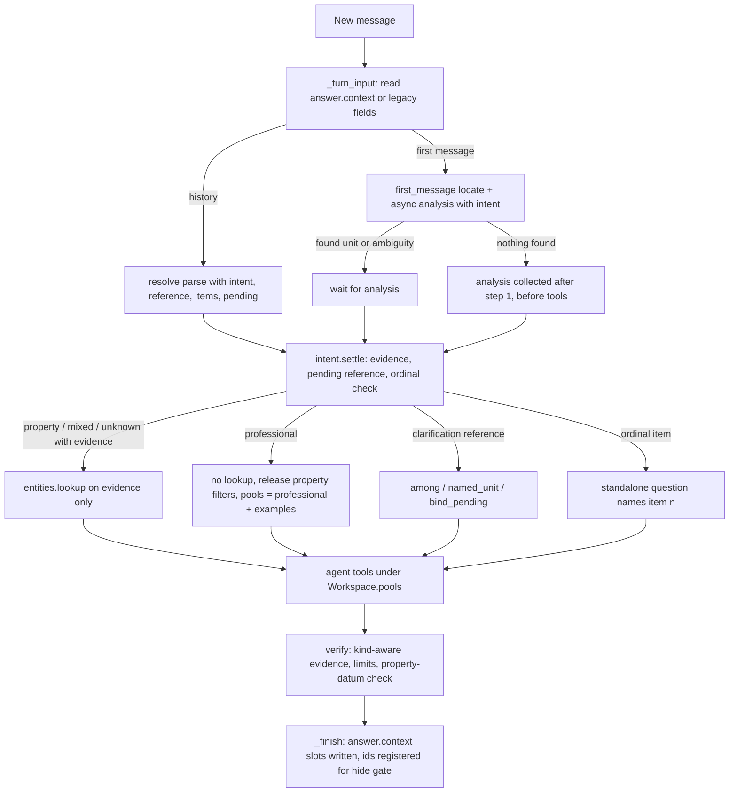
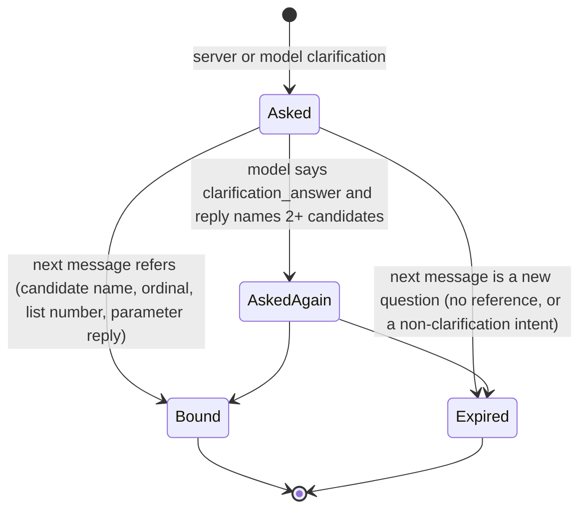
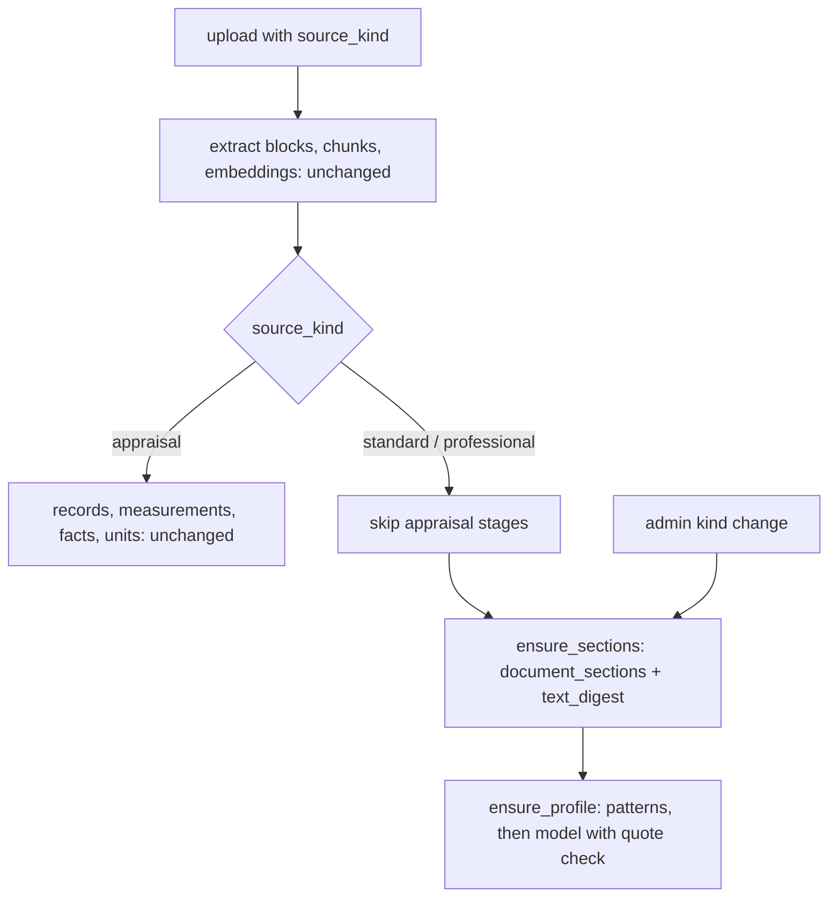

# Professional Sources, Question Intent and Conversation Context - Plan

## Goal Capsule

- **Objective:** An office can upload appraisal standards and professional documents and get professional answers grounded in them, with edition and section citations. A general professional question, asked anywhere in a conversation, is answered as a professional question and never turns into a choice between properties because a general word appears in a document title.
- **Means:** an explicit, server-validated question intent on both parse paths (KTD1, KTD2). Conversation context is kept as separate slots on each answer (KTD4). A stored source kind enforces search pools on the server (KTD8, KTD12). Standards get a lazily derived section structure and provenance-backed metadata (KTD9, KTD10).
- **Authority hierarchy:** the user's round-10 request, then this plan's Product Contract (R-IDs, session-settled Key Decisions), then KTDs, then unit text. Existing project rules also bind: host-only DB tests, office B or `rag_test` for tests, office A data read-only through app code or the API (new evaluation conversations there are allowed, as in round 9), no customer data in git.
- **Stop conditions:**
  - Stop if a change would need deleting or resetting appraisals, conversations, permissions or stored data. Report the scope, the reason and the alternatives first.
  - Stop if the RAG model or its settings would change.
  - Stop if Surya OCR work would enter this round.
  - Stop if a settled decision proves infeasible.
- **Execution profile:** Claude Code. Opus does planning, diagnosis and decisions. Sonnet implements and reviews. Haiku handles simple gathering and test runs. Implementation follows U-ID order and dependencies.
- **Who finishes:** the LFG pipeline. That covers implementation, simplification, review, browser tests, commits, pushing to the existing PR AriGabay/rag#2 and the CI watch. No merge and no production deploy.

---

## Product Contract

### Summary

Add a source kind for appraisal standards and professional documents. It is chosen at upload and stored. Standards keep their sections, conditions, exceptions and editions, and are cited by number, edition and section. Search pools follow the question's intent, enforced on the server.

Make question intent an explicit part of every parsed request. Entity lookup and property selection then run only for a question that refers to a property or document, and only with identifying evidence.

Keep the professional topic, the selected property, the sources and the task parameters as separate conversation slots. A follow-up then keeps what it needs, releases what it does not, and a pending clarification never swallows a new question.

### Problem Frame

The failure, reproduced on office A's real data:

- Conversation `2c6ad0b6` asked about proper rent, then income capitalisation, then "מה הן שלושת גישות השומה הבסיסיות ?". The third turn was parsed `scope: entity`, `relation: new_question`, with no changed fields.
- `resolve.validate` then ran its follow-up fallback. `entities.identifying(message, titles)` marks any message word whose stem appears in some visible title as a name. "השומה" became the lookup query, `entities.choose` found three titles holding "שומה" and returned `ambiguous`, and `engine` returned the server's property-choice clarification with no model call.
- The same question as a first message (conversation `56c1fc07`) never reached that fallback. `first_message` filters `GENERIC_NAME_WORDS` and has no title-word lookup, so it was answered from the professional glossary.

The class is old. Rounds 4, 7 and 9 each patched one generic word ("metric words never name a document", "one shared word of a long name asks nothing"). Round 9 still left "מתי"/"איפה" and a three-clarification loop (conversation `2514f9e1`). The parse has no way to say "this is a professional question", so every follow-up is treated as a possible property reference.

Context is also too coarse. `chat/api.py::_turn_input` rebuilds focus, candidates and pending parameters from the last assistant message only. A general answer with no focus therefore erases the property the conversation was about. `bind_pending` binds any reply holding one number to a pending parameter. Ordinals bind only to a clarification's candidate list, never to the items of an answer.

On the documents side there is no notion of a standard:

- `documents` has no kind.
- Titles feed the entity vocabulary, so uploading standards would make the generic-word failure worse.
- Office A already holds a professional glossary in group "ידע כללי" and six appraisal files whose titles start with "תקן 19". Those are appraisals, not standards.
- The user's real standards are decimal-numbered PDFs and DOCX files with appendices, clarifications and some spreadsheets. They stay gitignored and the user uploads them after this round.

### Key Decisions

- KD1. **Intent is an explicit, server-validated field of the request.** (session-settled: user-directed — chosen over a prompt-only instruction, a stopword list or routing by test questions: the failure came from server-side lookup on a general word.) Governs R5, R6, R7.
- KD2. **A title-word match is not identity.** Selection needs referring intent plus identifying evidence. Standard number, section number, year, house number and parcel number are distinguished. (session-settled: user-directed — chosen over title-word matching: "השומה" listed three unrelated appraisals.) Governs R8, R9.
- KD3. **Conversation slots stay separate, and history is never deleted to fix context.** (session-settled: user-directed — chosen over clearing history or carrying every filter forward: irrelevant constraints were dragged into new questions.) Governs R10, R11, R12, R15.
- KD4. **A pending clarification binds only a message that refers to it.** (session-settled: user-directed — chosen over treating a short message as the answer: new questions were swallowed.) Governs R13.
- KD5. **Ordinals and pronouns bind to the matching conversation element.** One focused question is asked only when two substantive readings remain. (session-settled: user-directed — chosen over re-resolving from scratch or asking by default: follow-ups lost their referent.) Governs R14.
- KD6. **The kind is chosen at upload, stored, and never inferred from the file name.** (session-settled: user-directed — chosen over filename classification: office A holds appraisals named "תקן 19 …".) Governs R16, R17.
- KD7. **Metadata is extracted automatically, with a source for every field.** Unknown stays unknown, and nothing is marked official or current from the file name or upload date. (session-settled: user-directed — chosen over a mandatory manual approval or inferring currency from upload date: reliability without manual gates.) Governs R18, R19.
- KD8. **Standards stay inside the uploading office's permissions.** (session-settled: user-directed — chosen over a global cross-office repository: permissions.) Governs R20.
- KD9. **Search scope follows the question type and is enforced on the server.** (session-settled: user-directed — chosen over letting the model pick the pool or always searching both: correctness and separation.) Governs R25, R26, R27, R28.
- KD10. **Standard structure is preserved.** Provisions are never detached from their limits, and references to documents that were not uploaded are stated as gaps. (session-settled: user-directed — chosen over flat chunking only: rules read without their exceptions mislead.) Governs R21, R22, R23.
- KD11. **Identical text is counted once, and files and versions are kept.** (session-settled: user-directed — chosen over deleting duplicates: preservation.) Governs R24.
- KD12. **Upload date never decides which edition prevails.** Requirement, recommendation, example, alternative and exception stay distinct. (session-settled: user-directed — chosen over latest-upload-wins: professional correctness.) Governs R29, R30, R31.
- KD13. **Citations and verification separate standards from appraisals, with no weakening and no manual approval.** (session-settled: user-directed — chosen over treating a term match as support or weakening verification: reliability.) Governs R32, R33, R34, R35.
- KD14. **No appraisal re-reading, no deletion or reset, the RAG model unchanged, and no Surya this round.** (session-settled: user-directed — chosen over re-ingesting the corpus, resets, a model switch or adding Surya now: preservation, cost and a separate task.) Governs R1, R2, R3.
- KD15. **Tests use labelled synthetic documents and assert request type, scope and chosen sources.** The user's conversation runs on the real model with limited repeats, and browser tests continue after a refresh. (session-settled: user-directed — chosen over word-only assertions or mocks-only proof: prove behaviour.) Governs R36, R37, R38, R39.
- KD16. **The existing PR is updated with no merge, no deploy and no customer data in git. The development-model policy goes into the new `CLAUDE.md`.** (session-settled: user-directed — chosen over real data in the public repo or an implicit policy: the repo is public and the user asked for the policy to be saved.) Governs R4, R40.

### Requirements

**Preservation and process**

- R1. No appraisal, conversation, permission, document version or stored derivation is deleted or reset. Kind changes and new derivations are additive.
- R2. The RAG chat, extraction and verification models and their settings stay as they are (`gpt-6-luna` by default), with no automatic fallback.
- R3. Adding the standards repository re-reads no appraisal file. Professional structure is derived from stored blocks.
- R4. The repo gains a `CLAUDE.md` with the Claude Code development-model policy and the standing data-safety rules, with no private data.

**Question intent and identity**

- R5. Every parsed request carries an intent: `professional`, `property`, `document`, `mixed`, `set` or `unknown`. It is validated on the server against the message and the conversation, and it drives lookup, search scope and answer framing.
- R6. A `professional` request never runs entity lookup, never asks to choose a property, and never inherits a property, document, unit, address, year, monetary-index or measure filter.
- R7. Intent works for concepts and professional questions beyond the tested ones. No routing is keyed to test phrases, and no stopword list decides it.
- R8. Lookup or selection of a property or document runs only for `property`, `document` or `mixed` intent, and only on identifying evidence. Evidence is an address (a title word with its house number), a block/parcel pair, a Latin unit label, a complete document or unit name stated as a phrase, or a model-claimed subject change whose quoted words contain one of these. A single word shared with titles is never evidence.
- R9. A standard number or section number ("תקן 1.1", "סעיף 3.2") is a professional reference, never a property change or a house number. A year is never a house number.

**Conversation context**

- R10. Each answer stores the conversation's slots apart: the professional topic with the items its answer listed, the selected property (documents, unit, subject), the sources, and the task parameters (metric, unit, period, VAT, area basis). The next turn reads them back after a refresh or reload.
- R11. A follow-up keeps only the slots its intent needs. A professional question leaves the property slot dormant without dropping it, and a later "בנכס הזה" restores it.
- R12. A correction or a metric or computation change on the same property keeps the property identity. An explicit property change, with evidence per R8, replaces it.
- R13. A pending clarification (candidates or a missing calculation parameter) binds only the next message, and only when that message refers to it. Referring means one of: it names a candidate or uses an ordinal among them, it gives the asked parameter as a reply rather than a new question, or the model marks it `clarification_answer` and the reply matches. Otherwise the message is answered as the new question, and the pending clarification expires without being asked again.
- R14. "השנייה", "אותה" and "זה" bind to the matching element: an item of the previous answer's list, the professional topic, or the selected property. When two substantive readings remain, the server asks one focused question.
- R15. The summary and the stored slots never re-introduce a slot that was released or whose documents are no longer visible. A message hidden by permissions contributes no slot.

**Source kind, ingestion and metadata**

- R16. A document is uploaded as `appraisal` (the default), `standard` (an appraisal standard) or `professional` (another professional document). An admin can change the kind of an existing document without re-uploading or deleting it.
- R17. The kind is never inferred from the file name, the title or the group. An appraisal named "תקן 19 …" stays an appraisal.
- R18. For `standard` and `professional` documents the system extracts these fields when the document states them: number, name, issuing body, edition or version, publication date, effective date, scope of application, and a link to a previous edition or to the document it amends or clarifies. Each value carries its page, block and verbatim quote.
- R19. A field the document does not state is stored and shown as unknown. Nothing is marked official, current or latest from the file name, title or upload date.
- R20. Standards are visible exactly as other documents of the uploading office are, through its document groups. No other office sees them.
- R21. A standard keeps its structure: headings, section numbers, definitions, provisions, conditions, exceptions, notes and appendices.
- R22. A search hit inside a standard comes with its section label and the conditions and exceptions that limit it. The full section, with its subsections and continuation, can be read on demand.
- R23. An internal reference to a section or appendix opens that section when it can be identified. A reference to a document not in the repository is reported as a gap, never filled in.
- R24. When the same text is stored more than once, it is counted once in search and listings. All files and versions are kept, and different editions are never treated as duplicates.

**Search, answers and citations**

- R25. A `professional` question searches the professional pool. Appraisals may appear only as labelled examples of a specific property's choice, never as a professional rule.
- R26. A `property` question searches appraisals. A standard can explain a method but is never a source for a property's area, rent or value.
- R27. A `mixed` question gets the property's data and the relevant sections. The answer keeps the standard's requirement, the appraisal's data and the application or conclusion apart.
- R28. The pool restriction holds on the server for every search, listing and read tool. Entity vocabularies, appraisal counts, unit locating and measurement listings exclude non-appraisal kinds.
- R29. When the repository holds no standard text the answer needs, the answer says so precisely, and still answers from the sources it has.
- R30. With several editions of a standard, an answer about current requirements uses the edition the sources support and says when nothing establishes it is the latest. A historical appraisal is not held to a newer edition without the applicability shown in the sources. A material difference between editions is shown when it affects the answer.
- R31. A recommendation, example, alternative or exception is never presented as a binding requirement. An appraisal's departure from a standard is reported with both sources and the applicability checks, never as non-compliance by default.
- R32. A standard citation shows the number or name, the edition or date when known, and the section or page, and opens at that place. An appraisal citation keeps the property identity and the datum's location.
- R33. Verification checks a professional rule against its section's conditions and exceptions. A claim that widens the rule is not supported.
- R34. A property datum supported only by a standard is unsupported. A standard describing a method does not verify the inputs of a calculation.
- R35. Final verification stays fail-closed. A supported sentence of a general answer is never removed because no appraisal was located, and no manual approval enters the normal path.

**Proof and delivery**

- R36. Synthetic test documents are labelled as tests and invent no real standard content. They include a professional document with definitions, conditions, an exception and an appendix, two editions with a material difference, and an appraisal titled with a standard number.
- R37. Tests assert the request intent, the search scope and the sources chosen, not only answer words. They cover the sequences in AE1–AE9.
- R38. The user's conversation runs against the real model on the fixed build. Traces and answer meaning are checked, with limited repeats for model variance.
- R39. Browser tests cover upload by kind, a professional question after a property question, continuing after a refresh, and opening a standard citation. The existing locating and calculation tests stay as regression.
- R40. The existing PR is updated with no merge and no production deploy. No customer document, private detail or key enters git.

### Acceptance Examples

- AE1. **Covers R5, R6, R8.** Given a conversation that discussed proper rent and income capitalisation, when the user asks "מה הן שלוש גישות השומה הבסיסיות?", then the intent is `professional`, no lookup runs, there is no clarification, the search pool is professional (plus labelled examples), and the answer's meaning matches the same question asked in a new conversation.
- AE2. **Covers R14.** Given an answer listing three approaches as a numbered list, when the user writes "הסבר את הגישה השנייה", then the request names the second item and is answered as a professional question about it.
- AE3. **Covers R11, R27.** Given a conversation about a property, followed by a general explanation, when the user asks "איך מיישמים אותה בנכס הזה?", then the intent is `mixed`, the topic is the approach just discussed, the property slot is restored, and the answer separates requirement, data and application.
- AE4. **Covers R11, R6.** Given a conversation centred on a property, when the user asks a general professional question, then no property filter applies, and the following "ומה השווי שם?" returns to that property.
- AE5. **Covers R12.** Given a property in focus, when the user changes the metric ("ומה דמי השכירות?") or corrects it, then the property is kept. When the user names another address with its house number, the property is replaced.
- AE6. **Covers R13.** Given a pending clarification between two appraisals, when the next message is "מה זה שווי שוק?", then it is answered as a professional question, the clarification is not repeated, and the pending clarification expires. When the next message is instead "השנייה", the second candidate is chosen.
- AE7. **Covers R13.** Given a pending calculation parameter, when the next message is "ומה היה השווי ב-2024?", then it is not bound as the parameter's value.
- AE8. **Covers R9, R26.** Given an appraisal titled "תקן 19 - …" and a standard numbered 19, when the user asks "מה דורש תקן 19 בסעיף 3?", then the intent is `professional`, the standard is searched, and the appraisal is not treated as the standard.
- AE9. **Covers R29, R30.** Given two editions of a synthetic standard whose section differs, when the user asks about the current requirement, then the answer cites the edition the sources support, states whether that edition being the latest is known, and shows the difference. Given no standards, the answer says the standard text is not in the repository.

### Scope Boundaries

- Surya OCR integration is a separate task. `backend/extrenal_api/` and the user's uncommitted dependency changes stay untouched.
- Uploading the user's real standards is out of scope, as is reclassifying existing office-A documents (the glossary stays `appraisal` until an admin changes it).
- No global cross-office standards repository.
- `.xlsx` attachments of standards stay unsupported. Upload already rejects them with a clear reason.
- No rewrite of `verify.py` or the engine loop beyond what the requirements need.

#### Deferred to Follow-Up Work

- A new frozen held-out set (v15) on unused office-A documents for the locating and answer layers. This round measures the intent/context behaviour and runs the round-9 sets as regression.
- An office-wide visibility branch for standards, if the user wants standards visible to employees outside their groups. This round keeps group visibility (KTD8).
- Round-9 residuals not caused by intent: matching Latin script against Hebrew script, and the trigram scan across offices.

---

## Planning Contract

### Key Technical Decisions

- KTD1. **One intent structure, carried by both parse paths and validated in a new `backend/app/chat/intent.py`.** `ResolvedRequest` (follow-ups) and the first-turn `RequestAnalysis` both gain the same nested object:
  - `intent`, one of the R5 values;
  - `reference`: `none`, `conversation_property`, `named_entity`, `prior_answer_item`, `topic` or `clarification`;
  - `item`, an ordinal or null;
  - `topic`, the professional subject in the user's words;
  - `standard_refs`, a list of `{standard, section}` as written.

  `intent.settle(...)` turns the model's claim into the turn's `Intent` with decisions recorded in `resolution.decisions`:
  - a `professional` claim with identifying evidence in the message (R8) becomes `mixed`;
  - a `property` or `document` claim with no evidence and no property slot keeps its intent but runs no lookup;
  - a failed or invalid parse with hard R8 evidence in the message settles as `property`. Without such evidence it settles as `unknown`, which searches both pools labelled and runs no lookup or selection (R8).

  The existing `scope` stays: `set` is still decided by it, and intent `set` mirrors it. (session-settled: user-directed — chosen over a prompt-only instruction or stopword list: the failure came from the server lookup.) Governs R5, R7.
- KTD2. **Two lookup paths, both behind the settled intent.**
  - **(a) The unquoted fallback.** Today it turns any title word of the message into a lookup query. It is replaced by `intent.evidence(message, vocabulary)`, which returns only hard R8 evidence:
    - address pairs and block/parcel pairs;
    - Latin unit labels;
    - complete names stated as phrases (`contexts.Identity.name_spans`, `entities.named_unit`).
  - **(b) The model-quoted subject change.** This is a referring intent (`reference: named_entity` with intent `property`, `document` or `mixed`). It runs a lookup only when the quoted words themselves contain hard R8 evidence (an address, a block/parcel pair, a Latin unit label, or a complete document or unit name stated as a phrase). A single title word, generic or not, is never enough. The answer then says which property it used and asks for an address or full name if another was meant, with no clarification list.
  - **Number classes** are told apart by pattern and neighbours:
    - "תקן"/"סעיף" + a number is a professional reference;
    - a four-digit year, a floor or a duration is a non-name;
    - a house number counts only beside a title word.
  - **Further reference evidence:** an ordinal into a stored list or into clarification candidates, and a slot reference ("הנכס הזה", "שם") when a property slot exists. These are references, not lookups.

  (session-settled: user-directed — chosen over title-word identity: "השומה" listed three appraisals.) Governs R8, R9.
- KTD3. **On a first message, intent is settled before anything it would change.** The request analysis already starts with the agent's first step.
  - **Hard evidence found.** When `entities.first_message` finds a unit or an ambiguity on hard evidence (a complete unit name stated, an address, block/parcel or Latin label), it applies at once, as today.
  - **Weaker evidence found.** A pin from passages (`_unit_by_passages`), or an ambiguity built on name words without a complete name, is provisional. The engine waits for the analysis. A `professional` intent drops the pin or the clarification, and any other intent applies them.
  - **Nothing found.** The analysis is collected right after step 1 returns and before its tool calls execute, so every tool sees the settled pools.

  Every first turn therefore waits for the analysis before step 1's tools run. The wait is bounded by a new setting, `chat_intent_wait_seconds` (default 8 s, shorter than the reading window), and recorded in `timing`. A timed-out analysis yields `unknown`: a provisional pin or ambiguity is dropped (it is not hard evidence, R8), and the tools run with both pools labelled. Chosen over a sequential intent call on every first turn, which round 7 rejected for latency.
- KTD4. **Context slots live in `answer.context` on each assistant message.** Schema version 1, JSONB with no migration:
  - `topic`: text, items, and the message id they came from;
  - `property`: the focus snapshot with `document_ids`, `located_unit` and `subject`;
  - `params`;
  - `sources`: the sources the answer cited (document id, source kind, standard label and section), read back by the next turn like the topic;
  - `pending`: kind `candidates` or `parameter`, with its payload, created at the turn it was asked.

  Each turn writes the full slot set, carrying unchanged slots forward. A professional answer therefore still carries the property slot and its task parameters (both dormant, reactivated together). Topic items persist until a later answer lists new ones.

  `_turn_input` reads slots from the latest assistant message, chosen *before* the hidden-message filter:
  - When that message is hidden, the turn gets no slot at all: no pending clarification, topic, property, parameters or sources. An older message's slots are never revived.
  - `context` is server-only. `_message_json` removes it from every message the client receives.
  - Older messages without `context` fall back to the legacy `focus`/`request`/`pending`/`unit` fields.
  - The property slot is not registered in `_answer_documents`, so a later professional answer is not hidden by it. It is re-authorized each turn instead (`entities.authorized`): a slot with any invisible document is dropped whole, its subject text included, and the drop is recorded in decisions.

  Topic items are labels the answer itself printed, capped at 10 items of 80 characters each, never document passages.

  Chosen over a persisted `conversations.state` row: per-message state follows the existing visibility rules and survives reload without a second source of truth.
- KTD5. **Pending lifetime is exactly one message.** Binding needs reference evidence (R13):
  - **Candidates:** `entities.among` runs when the model says `clarification_answer` or the reply is an ordinal or number in the list. `entities.named_unit` runs on a complete stated name. A reply that matches no candidate, or that has a non-clarification intent, is a new question, and the "ask again" path runs only when the model says `clarification_answer` and the reply names two or more candidates.
  - **Parameters:** `bind_pending` runs when the model says `clarification_answer` and the intent is not `professional`, or when the whole message is a number with at most a unit (`number_only_reply`'s pattern, a form test), whether or not the resolve call succeeded. Message length plays no part, so the `NUMBER_ONLY_CHARS` cap is dropped.
  - Otherwise, after a failed resolve, the message is a new question.

  An expired pending is recorded in decisions and dropped from `context`. Its candidates stay out of the next resolve input, and the original question is not restated.
- KTD6. **Answer items are extracted on the server from the stored answer markdown.** Only top-level numbered or bulleted items are taken, each labelled by its bold lead or the text before "—" or ":". Resolve's input shows them as "items of the previous answer". The model returns `reference: prior_answer_item`, `item: n`, and the server checks two things:
  - an ordinal form, a digit or "האחרון/ה" is in the message;
  - item n exists.

  The standalone question then names the item. An ordinal that also fits a candidate list or a listing source of the previous turn gets one focused server question. An ordinal with no stored list is answered on the topic as asked, and the answer says no list was given.
- KTD7. **Release follows intent.** For `professional`, the request carries no `document_ids` and no `located_unit`. The workspace has no `unit_focus`, the measure fields come from the parse only, the focus block is left out of the context message, and the property slot is carried to the next turn unchanged. `mixed` and `property` reinstate the property slot unless evidence names another. `document` limits search to the named document.
- KTD8. **`documents.source_kind`** is text, NOT NULL, default `appraisal`, with a CHECK over `appraisal`, `standard` and `professional`. Migration 0019 backfills nothing: the existing rows are appraisals by default. Visibility is unchanged: a standard lives in a document group under the existing `document_access` policy. The upload form takes `source_kind`. `PATCH /api/documents/{id}` lets an admin change it, with an audit entry, a `bump_data_version` call, and no re-read. Chosen over an office-wide policy branch: it keeps one access model and respects group permissions. The report suggests a group every employee belongs to. (session-settled: user-directed — chosen over a global repository: permissions.) Governs R16, R20.

  A change from `standard` or `professional` to `appraisal` runs the skipped appraisal stages from the stored reading: units, records and transactions, and measurements. It is refused with a clear reason when a stage would need the file read again.

  Upload of any kind is open to anyone allowed to upload, into a group they belong to. Changing the kind is admin-only.
- KTD9. **`document_sections` (migration 0019) stores a standard's structure per `(version_id, reading_id)`.** It is derived lazily from `document_blocks` by `backend/app/professional/sections.py` under `SECTIONS_VERSION`, single-flight like `units.ensure`. Each row holds:
  - label, title, parent, depth and role (`chapter`, `section`, `definitions`, `definition`, `appendix`, `note`, `preamble`);
  - block and page range;
  - `limits` (the condition and exception sentences, with block indexes);
  - `refs` (internal targets or external standard numbers);
  - `modality` (counts of requirement, recommendation, example, alternative and exception markers).

  Labels come from the stored `block.label`, `section_path` and heading level (`extraction/chunking.heading_label`), plus "נספח" headings. Appraisal-only stages skip professional kinds at ingestion: transactions and records, measurements, facts and units. Version publishing, chunks and embeddings run as before. A document whose kind changes after ingestion keeps its earlier derivations, which kind filters exclude (R1, R3). (session-settled: user-directed — chosen over flat chunking: limits must stay with their provisions.) Governs R21, R22, R23.
- KTD10. **`standard_profiles` (migration 0019) stores one profile per `(version_id, reading_id)`.** `fields` is JSONB: per R18 field, `{value, status: stated|unknown, source: {page, block, quote}, method: pattern|model}`, plus `amends: {standard, relation: clarifies|amends|replaces|appendix_of}`. Extraction runs in two passes:
  - deterministic patterns over the first pages' blocks: standard number, edition or version, dates, "בתוקף"/"תחילתו";
  - one structured `Purpose.EXTRACT` call, only when the office's cloud use is enabled, returning value and quote per field.

  A value is accepted only when its normalized quote occurs in the cited block and the value occurs in the quote. An edition is a separate document. A document's versions are re-readings or replacements of the same edition, so `is_current` never chooses between editions, and every ready edition is searchable. Editions group by normalized standard number. They are ordered by stated effective date, then publication date, and are otherwise reported "order unknown". (session-settled: user-directed — chosen over manual approval or upload-date currency.) Governs R18, R19, R30.
- KTD11. **Text duplicates are detected by `text_digest`**, the sha256 of the normalized concatenated block text, stored in `document_versions.ingestion` when sections are derived. Search and listings over professional kinds collapse versions sharing both the digest and the profile's edition value to the earliest-created visible one, so different editions never collapse. A listing names the others as "same text as …". Nothing is deleted. Governs R24.
- KTD12. **Pools are enforced in the tools layer.** `SearchScope` gains `source_kinds`, applied in `_scope_conditions` and in the version resolution that feeds `trigram_candidates`. `Workspace.pools` is set from the settled intent:
  - `professional`: the professional pool plus `examples`, meaning appraisal hits labelled as a property's example;
  - `property`: appraisals, plus the professional pool for method explanation only, labelled as method and never as property data;
  - `document`: the named document;
  - `mixed` and `unknown`: both, labelled.

  Other tools change as follows:
  - `search` gains an optional `pool` argument, clipped to the allowed pools.
  - `find_documents`, `list_documents`, `find_measurements`, `entities.titles_of`, `_unit_names`, the first-message units SQL and `documents_matching` are restricted to appraisals.
  - A new `find_standards` lists professional documents with their profiles, editions and duplicates as a listing source.
  - `read(section=…)` on a professional document returns the full section with its subsections, limits and resolved references.

  `memoized_search` keys include the kinds. (session-settled: user-directed — chosen over the model choosing the pool.) Governs R25, R26, R27, R28.
- KTD13. **`Source` gains `source_kind` and `standard`** (`{number, title, edition, effective, section, section_title}`). `title` and `location` render the standard's identity, for example "תקן 1.1 (מהדורה …) — סעיף 3.2, עמוד 4", so the existing number check in `verify` finds a cited section or edition. `anchors` snapshots `standard`, with `SNAPSHOT_VERSION` 2 and version-1 snapshots still readable. The frontend shows it beside the title.
- KTD14. **Verification adds evidence, not leniency.** The changes:
  - A deterministic check marks a claim unsupported when it states a property datum and every citation is professional. A property datum is a number with a money or area unit, or a measurement kind, in a sentence attributed to the property. That means the sentence names the property slot's subject, a unit label, or a pronoun bound to the property ("הנכס", "שם"). A number in a sentence that attributes it to a standard ("לפי התקן", "התקן קובע", a section reference) or quotes a standard's worked example does not trigger the check, and the judge decides it.
  - The judge's evidence header carries `source_kind` and, for a standard, the section's `limits` and modality.
  - `JUDGE_POLICY` gains rules: widening a rule beyond its limits, stating a recommendation as a requirement, and presenting one appraisal's choice as a professional rule are each not supported.
  - `JUDGE_VERSION` is bumped. Fail-closed handling, repair and the final check are unchanged.

  (session-settled: user-directed — chosen over treating a term match as support.) Governs R31, R33, R34, R35.
- KTD15. **An empty professional pool is a stated gap, not a failure.** `search` on the professional pool with nothing stored returns a fixed message. The coverage ledger records a component gap "נוסח התקן אינו במאגר", and the answer may still use other permitted sources. Governs R29.
- KTD16. **Synthetic standards come from `backend/scripts/generate_fixtures.py`, written to `backend/tests/fixtures/round10/`.** Each page says "תקן בדיקה סינתטי — אינו תקן אמיתי". Most integration tests build professional documents from blocks through a new `tests/support/professional_files.py`, in the `unit_files.py` pattern. Governs R36.

### High-Level Technical Design

Turn flow with intent and slots (follow-up and first message):

Pending clarification lifecycle:

Search pool by settled intent:

| intent | appraisal pool | professional pool | appraisal hits labelled as example | entity lookup |
|---|---|---|---|---|
| professional | examples only | yes | yes | never |
| property | yes | method explanation only, never property data | no | on evidence |
| document | the named document | the named document | no | on evidence |
| mixed | yes | yes | no | on evidence |
| set | appraisal listings | no | no | no (set tools) |
| unknown | yes | yes | yes | on evidence |

Professional ingestion and derivation:

### Assumptions

- Office A's glossary stays kind `appraisal` until an admin changes it with the new control (Scope Boundaries). Until then, professional answers in office A can cite it only under R25's example labelling, which is weaker than citing it as a professional source. The final report recommends that an admin mark it `professional`. That is one reversible metadata change with no deletion or re-read, and it is the user's to make.

- The user wants standards visible through document groups. Placing them in a group every employee belongs to is their choice, and the report explains it.
- Metadata extraction may call the RAG extraction model only for offices with cloud use enabled. Otherwise only deterministic patterns run, and unknown fields stay unknown.
- An expired pending clarification is not offered again later. The user can re-ask.
- "השנייה" binds to the previous answer's list only. Older answers' lists are not searched.
- The real-model run of the user's conversation in office A creates new conversations there, as the round-9 evaluation runs did. It reads data and writes nothing else.

### Sequencing

Phase A comes first: U1, then U6 and U7, which fix the reported failure on the existing schema. Phase B is U2, U3, U4, U5, U8 and U9 (the source kind, structure, pools and verification). Phase C is U10 and U11 (frontend, fixtures, sequences and real-model and browser proof), then U12 (measurement and docs). U6 does not need the kind column. Its pool effects land with U8.

### System-Wide Impact

- **Prompt context:**
  - `engine.POLICY` gains a short section on answering by intent: professional, mixed (requirement, data, application) and examples.
  - `resolve.POLICY` and `request.COMPONENTS_POLICY` gain the intent fields.
  - Scripted-test helpers (`ScriptedAgent`, `_resolved`, `_resolution`) must emit the new fields.
- **Permissions:** no RLS policy change on `documents`. The new tables follow the 0018 pattern with `ENABLE` and `FORCE ROW LEVEL SECURITY` and `document_access` through `documents`. `trigram_candidates` keeps receiving version ids resolved under RLS.
- **Data:** an additive migration with a default. A backup (`scripts/backup.sh`) runs before applying it to the office database. Rebuild via `migrate`, then confirm the new constant inside the container.
- **Legacy `answering/*`:** its routers stay registered and read documents without a kind filter. They are untouched this round. The chat engine is the product path.

### Risks & Dependencies

- **Model drift on intent labels.** Mitigation: server validation by evidence (KTD1, KTD2), plus the real-model repeats in U11.
- **First-turn waiting.** Every first turn waits up to `chat_intent_wait_seconds` for the analysis before step 1's tools run (KTD3). The analysis usually finishes during step 1, so the wait is near zero in most turns. It is recorded in `timing`, and the U11 real-model run reports it.
- **Scripted-test breakage.** The many integration tests that script `resolve` and the request analysis need the new fields. A default-filling helper keeps old scripts valid where the field is absent: `unknown` intent behaves like today's evidence-gated path.
- **Section derivation quality on real standards** is unknown until the user uploads them. This round proves it on synthetic documents only, and the report says so.

---

## Implementation Units

| U-ID | Title | Main files | Depends on |
|---|---|---|---|
| U1 | Project instructions with the development-model policy | `CLAUDE.md` | — |
| U6 | Question intent and evidence-gated lookup | `backend/app/chat/intent.py`, `resolve.py`, `request.py`, `entities.py`, `engine.py` | U1 |
| U7 | Conversation slots, pending lifetime and ordinal binding | `backend/app/chat/api.py`, `engine.py`, `resolve.py`, `intent.py` | U6 |
| U2 | Source kind column, upload and admin change | `backend/alembic/versions/0019_professional_sources.py`, `backend/app/platform/documents.py` | U1 |
| U3 | Appraisal-only surfaces and ingestion stages exclude professional kinds | `backend/app/chat/entities.py`, `tools.py`, `platform/pipeline.py`, `platform/search.py` | U2 |
| U4 | Standard structure and text digest | `backend/app/professional/sections.py` | U2 |
| U5 | Standard metadata with provenance and editions | `backend/app/professional/profile.py` | U4 |
| U8 | Server-enforced pools, standard tools and citations | `backend/app/chat/tools.py`, `platform/search.py`, `chat/anchors.py`, `chat/engine.py` | U3, U4, U5, U6 |
| U9 | Kind-aware verification | `backend/app/chat/verify.py`, `coverage.py` | U8 |
| U10 | Frontend: kind at upload, metadata, admin change, standard citations | `frontend/components/UploadPanel.tsx`, `frontend/app/documents/page.tsx`, `frontend/components/chat/SourceViewer.tsx` | U2, U5, U8 |
| U11 | Synthetic fixtures, sequence suites, real-model and browser proof | `backend/scripts/generate_fixtures.py`, `backend/tests/integration/test_round10_*.py`, `frontend/e2e/round10-*.spec.ts` | U7, U9, U10 |
| U12 | Measurement, evaluation record and glossary | `docs/evaluation/conversational-rag.md`, `CONCEPTS.md` | U11 |

### U1. Project instructions with the development-model policy

- **Goal:** Create `CLAUDE.md` stating the Claude Code model split and the standing safety rules future sessions must follow.
- **Requirements:** R4.
- **Dependencies:** none.
- **Files:** `CLAUDE.md`.
- **Approach:**
  1. Record the model split:
     - Opus: planning, diagnosis, problem solving, architecture decisions.
     - Sonnet: implementation and review.
     - Haiku: simple gathering, test runs and doc edits.
     - No duplicate agents. Subagent models are set explicitly.
     - The RAG system's models are a separate setting and are not changed by this policy.
  2. Record the rules:
     - host-only pytest against `rag_test`, never two at once;
     - tests in office B or `rag_test`;
     - no customer data, addresses or keys in git;
     - no deletion or reset without explicit approval;
     - rebuild compose images via `migrate`.
  3. Keep the file short, in English, with nothing private.
- **Test expectation:** none, because this is documentation only.
- **Verification:** the file exists and holds no office names, addresses, people or keys.

### U6. Question intent and evidence-gated lookup

- **Goal:** Fix the reported failure at its root. Every parsed request carries a validated intent, and lookup runs only for intents that refer to a property or document, and only on evidence.
- **Requirements:** R5, R6, R7, R8, R9; KTD1, KTD2, KTD3, KTD7.
- **Dependencies:** U1.
- **Files:**
  - `backend/app/chat/intent.py` (new)
  - `backend/app/chat/resolve.py`
  - `backend/app/chat/request.py`
  - `backend/app/chat/entities.py`
  - `backend/app/chat/engine.py`
  - `backend/tests/support/scripted_agent.py`
  - `backend/tests/support/scripted_provider.py`
  - `backend/tests/unit/test_intent.py` (new)
  - `backend/tests/unit/test_resolve.py`
  - `backend/tests/integration/test_chat_intent.py` (new)
- **Approach:**
  1. Define the intent sub-schema once in `intent.py` and embed it in `ResolvedRequest` and `RequestAnalysis`. Extend `resolve.POLICY` and `request.COMPONENTS_POLICY` with general definitions only, no example questions.
  2. Implement `intent.evidence` per KTD2, reusing `entities.title_tokens`, `contexts.Identity.name_spans` and `entities._AMOUNT`. Classify standard and section numbers and years before house numbers.
  3. Implement `intent.settle`. In `resolve.validate`, replace the `unnamed` fallback (`identifying(message, …)`) and gate the `words` path behind the settled intent and its evidence. Record decisions.
  4. Apply KTD7 release in `validate` and in `engine._context_message` (no focus block for `professional`).
  5. Sequence the first message per KTD3 in `engine._run_turn`. The `first_message` result becomes provisional until intent settles. `settle_analysis` moves to right after step 1, before its tool calls execute, bounded by `chat_intent_wait_seconds`.
  6. Gate the follow-up branch of `engine._run_turn` that calls `entities.first_message` for a `new_question` with no unit focus. It never runs for `professional`. For other intents its passage pins and name-word ambiguities apply only on hard R8 evidence.
  7. Store `request.intent` in `Request.as_dict()` and in diagnostics.
- **Execution note:** start with failing tests that reproduce the conversation-`2c6ad0b6` shape on synthetic titles holding "שומה" (offline, scripted resolve). They must fail on the current code before any change.
- **Patterns to follow:** the evidence rule in `resolve.evidence` and `validate`, `unknown` on failed evidence (round 4 R8), and `test_resolve.py`'s `_resolved`/`lookup_in` helpers.
- **Test scenarios:**
  - Covers AE1. Three synthetic appraisal titles contain "שומה", a property focus exists, and the parse says `professional`. The result: no lookup call, no clarification, `document_ids` empty, intent `professional` in the resolution.
  - The same message with the parse saying `property` and no evidence: no lookup (no single title word), and the focus is kept.
  - The parse says `professional`, but the message holds "הנרקיס 4" where "הנרקיס" is a title word: settled `mixed`, and lookup runs on "הנרקיס 4".
  - Covers AE8. "מה דורש תקן 19 בסעיף 3?" with an appraisal titled "תקן 19 - …": evidence yields a standard reference, not a house number or a title name, so no lookup.
  - "ב-2024" and "בקומה 3" beside a title word give no evidence. "גוש 6995 חלקה 46" gives evidence.
  - A failed parse (resolve returns None) gives `unknown`: lookup only on hard evidence, and the turn continues.
  - The model-quoted subject "בזה" or "השומה" is rejected as evidence (regression for `test_resolve.py:148/346`).
  - First message, professional: "מה הן שלוש גישות השומה?" in an office whose units hold unique words of the question does not pin a unit after the analysis says `professional`. With the analysis saying `property`, the pin applies.
  - First message where the analysis times out (`chat_intent_wait_seconds` elapsed): intent `unknown`, the provisional passage pin is dropped, tools run with both pools labelled, and the wait is recorded in `timing`.
  - Follow-up gate: after a professional turn released the property filters, a professional follow-up whose words are unique to one unit pins no unit and produces no server clarification.
  - A failed parse on "ובהנרקיס 4?" settles as `property` from the address evidence and runs the lookup. A failed parse on a message with no evidence runs no lookup.
  - Integration (scripted provider, rag_test). After rent and capitalisation turns, the approaches question produces a model-answered turn whose diagnostics show intent `professional` and no `lookup` key.
- **Verification:** the new and existing resolve, entities and chat tests pass, and diagnostics of the reproduction sequence show the settled intent and the absence of a lookup.

### U7. Conversation slots, pending lifetime and ordinal binding

- **Goal:** Keep the topic, property, parameters and pending clarification as separate slots that survive professional turns and reloads. Bind a pending clarification only on reference, and bind ordinals to the previous answer's items.
- **Requirements:** R10, R11, R12, R13, R14, R15; KTD4, KTD5, KTD6, KTD7.
- **Dependencies:** U6.
- **Files:**
  - `backend/app/chat/api.py`
  - `backend/app/chat/engine.py`
  - `backend/app/chat/resolve.py`
  - `backend/app/chat/intent.py`
  - `backend/tests/unit/test_context_slots.py` (new)
  - `backend/tests/integration/test_chat_context.py` (new)
- **Approach:**
  1. Add `context` to `_answer_payload`, built from the previous `context`, this turn's settled request and the final answer. Do not register `context.property.document_ids` in `_answer_documents`: `_turn_input` re-authorizes the property slot each turn (KTD4). Remove `context` from the payload `_message_json` returns.
  2. In `_turn_input`, read `context` with a legacy fallback. Pass `property`, `topic.items` and `pending` to the engine (`TurnInput` gains `slots`). The property slot becomes the `focus` input only when the intent will need it, which `validate` decides.
  3. Extract items per KTD6 when composing `context.topic`. Add an items block to resolve's `_input`. Validate `prior_answer_item` in `intent.settle`.
  4. Apply the pending rules from KTD5: gate `entities.among` and `named_unit`, and gate `bind_pending` in the engine on the settled intent and the reference. Expire the pending clarification on an unrelated message.
  5. Have the summary builder (`_maybe_summarize`) use only visible messages, as now, and confirm in tests that slots from hidden messages never return.
- **Patterns to follow:** `_with_unit`/`_request_focus` legacy reads in `api.py`; `_answer_documents` hide gate; `entities.among` ordinals.
- **Test scenarios:**
  - Covers AE4. Property turn, then a professional turn (no focus in its answer), then "ומה השווי שם?". The third turn's request carries the property's `document_ids` and unit.
  - Covers AE3. A property turn, then a professional answer listing three items, then "איך מיישמים אותה בנכס הזה?": intent `mixed`, topic set to the item discussed, property restored.
  - Covers AE2. An answer with a three-item numbered list, then "הסבר את הגישה השנייה": the standalone question names item 2. With no list in the previous answer, `prior_answer_item` is rejected and recorded.
  - Two lists in play: a numbered answer plus a listing source of three appraisals in the previous turn, then "השנייה" gets one focused server question.
  - Covers AE5. A metric change keeps the property and unit. "ובהיסמין 3?" with evidence replaces them.
  - Covers AE6. A server clarification between two units, then "מה זה שווי שוק?": a professional answer, no clarification, `context.pending` gone. Then "השנייה" on the next turn binds nothing (expired), and the question is answered as asked.
  - Covers AE6. A server clarification, then "השנייה": the second candidate is chosen. Then "כולן", with the model saying `new_question`: no repeated clarification (regression for conversation `2514f9e1`).
  - Covers AE7. A pending parameter, then "ומה היה השווי ב-2024?": not bound. "8%" alone: bound.
  - Reload: after a professional turn, a fresh `_turn_input`, built from the DB with no in-memory state, yields the same slots.
  - A revoked document: when the property slot's document becomes invisible, the slot is dropped whole, subject text included, and the decision is recorded. Later professional answers stay visible.
  - Hidden latest answer: when the newest assistant message is hidden, the turn has no slot at all, and an older message's pending clarification is not revived.
  - Server-only state: the messages API payload of any message contains no `context`, so after a property document is revoked, a visible professional answer exposes neither its subject nor its ids.
  - Items persist: "הסבר את השנייה" and then "ואת השלישית" both bind to the same stored list.
  - Legacy message: an answer without `context` still yields focus, unit, candidates and pending exactly as before.
- **Verification:** the sequence suites pass, and the stored `answer.context` of each turn shows the expected slots.

### U2. Source kind column, upload and admin change

- **Goal:** Store a document's source kind, take it at upload, list it, and let an admin change it without re-reading.
- **Requirements:** R1, R16, R17, R20; KTD8.
- **Dependencies:** U1.
- **Files:**
  - `backend/alembic/versions/0019_professional_sources.py` (new)
  - `backend/app/platform/documents.py`
  - `backend/tests/conftest.py`
  - `backend/tests/factories.py`
  - `backend/tests/helpers.py`
  - `backend/tests/support/professional_files.py` (new)
  - `backend/tests/integration/test_migration_0019.py` (new)
  - `backend/tests/integration/test_documents_kind.py` (new)
- **Approach:**
  1. Write migration 0019. It adds `documents.source_kind` with its CHECK and default, plus the `document_sections` and `standard_profiles` tables (KTD9, KTD10) following the 0018 RLS shape, with grants to `rag_app` and indexes on `(office_id, document_id)` and `(version_id, reading_id)`. The downgrade drops only what 0019 added.
  2. Upload: add an optional form field `source_kind` (validated, default `appraisal`), applied to new documents only. A new version of an existing document keeps that document's kind.
  3. Add `PATCH /api/documents/{id}` for `{source_kind}`, admin only, with audit, `bump_data_version`, and a job or lazy flag so the structure derives on first use (KTD9).
  4. List and detail responses include `source_kind`.
  5. Add the new tables to `conftest._TABLES`, and give `make_document` a `source_kind` parameter.
  6. Create `tests/support/professional_files.py` (KTD16), which builds synthetic professional documents from blocks so the U3–U9 tests can use it.
- **Patterns to follow:** migration `0018_document_units.py` with `test_migration_0018.py`; `_store_one` and `_can_use_group`; `audit(conn, …)`.
- **Test scenarios:**
  - Migration up/down round trip. The tables have `relforcerowsecurity`. Existing documents read `appraisal`, and the downgrade leaves the documents' rows intact.
  - An upload with `source_kind=standard` stores it. An upload without the field stores `appraisal`. An invalid value gets a 422 with a Hebrew reason.
  - A file named "תקן 19 - X.pdf" uploaded with no kind is `appraisal` (R17).
  - An admin PATCH to `professional` succeeds and is audited. An employee PATCH is refused. A PATCH in another office's document returns 404.
  - Group visibility: an employee outside the group cannot see the standard. Another office never sees it.
  - A same-hash file in another group still returns `duplicate` or clone as today, and the clone keeps its own kind field.
- **Verification:** the migration test and the document API tests pass, and existing upload tests are unchanged.

### U3. Appraisal-only surfaces and ingestion stages exclude professional kinds

- **Goal:** Standards never enter the property vocabulary, appraisal counts, unit locating or appraisal extraction.
- **Requirements:** R3, R9, R28; KTD9, KTD12.
- **Dependencies:** U2.
- **Files:**
  - `backend/app/chat/entities.py`
  - `backend/app/chat/tools.py`
  - `backend/app/platform/search.py`
  - `backend/app/platform/pipeline.py`
  - `backend/app/appraisal/publish.py`
  - `backend/app/chat/units.py`
  - `backend/tests/integration/test_kind_exclusion.py` (new)
- **Approach:**
  1. Add `d.source_kind = 'appraisal'` to the appraisal surfaces:
     - `_visible_titles`, `_unit_names` and `_UNIT_NAMES_SQL`;
     - `documents_matching`, `units_matching` and `unread_matching`;
     - `find_documents`, `list_documents` and `find_measurements`;
     - `contexts`/`units` building for chat.
  2. In `pipeline.publish_stage`, skip transactions and records, measurements enqueueing, facts and `units.replace` for non-appraisal kinds, keeping the current-version publishing and status refresh.
  3. Enumerate every SQL site touched in the unit's PR description. The research dossier lists them, and none is skipped silently.
- **Patterns to follow:** `_Sql.joins`/`_scope_conditions` central filter.
- **Test scenarios:**
  - A standard whose title holds "שומה" and "גישת ההשוואה" adds no word to `titles_of`, and a follow-up naming its title words runs no property lookup.
  - `find_documents("שומה")` and `list_documents` count appraisals only. The listing says nothing about standards.
  - Ingesting a synthetic standard creates no `document_units`, `measurements` or transactions, and its version becomes current and ready.
  - A kind change from appraisal to standard after ingestion: the old units stay in the table but no longer appear in `_UNIT_NAMES_SQL` results.
  - A kind change from standard to appraisal runs the skipped stages from the stored reading (units built, the document listed among appraisals), with no file read. When a stage needs the file, the change is refused with a reason and the kind stays as it was.
  - An appraisal titled "תקן 19 …" is still found by `find_documents("תקן 19")`.
- **Verification:** the exclusion tests and the full existing entity and unit suites pass.

### U4. Standard structure and text digest

- **Goal:** Derive and store each professional document's sections, limits, references and modality, plus its text digest, from stored blocks.
- **Requirements:** R3, R21, R22, R23, R24; KTD9, KTD11.
- **Dependencies:** U2.
- **Files:**
  - `backend/app/professional/__init__.py` (new)
  - `backend/app/professional/sections.py` (new)
  - `backend/tests/unit/test_sections.py` (new)
  - `backend/tests/integration/test_sections_store.py` (new)
- **Approach:**
  1. `derive(blocks)` is a pure function.
     - Sections come from heading blocks, `label` and `section_path`.
     - An appendix comes from a heading that starts with "נספח" plus a letter or number.
     - A definitions section comes from a heading "הגדרות" and the term-dash-text paragraphs under it.
     - Limits are sentences with condition or exception markers ("למעט", "אלא אם", "בכפוף ל", "על אף האמור", "בתנאי ש", "חריג"), attached to their own section.
     - Modality comes from requirement, recommendation, example and alternative markers.
     - References are "סעיף N", "נספח X" or "תקן N".
     - Nothing is invented: a document with no headings becomes one `preamble` section with that uncertainty recorded.
  2. `ensure(ctx, version_id)` is lazy and single-flight, keyed by `(version_id, reading_id, SECTIONS_VERSION)`. It runs after ingestion of professional kinds and on first use after a kind change. It also stores `text_digest`.
  3. `section_of(block)` and `section_text(label)` serve the tools in U8.
- **Patterns to follow:** `chat/units.py` `derive`, `ensure` and `_insert`, with evidence and certainty; `extraction/chunking.heading_label`.
- **Test scenarios:**
  - A synthetic standard with sections 1, 2, 2.1, 2.2, a "הגדרות" section with three terms, and appendix א gives sections with correct parents, depths and block ranges.
  - A provision whose next sentence starts with "למעט": the limit is attached to that section and the provision's text is not split from it.
  - "ראה סעיף 2.1" resolves to the 2.1 section. "כמפורט בתקן 99" becomes an external ref with no target.
  - A document with no headings becomes one preamble section marked uncertain.
  - The same text as PDF-derived blocks and as DOCX-derived blocks yields the same `text_digest`. Edited text yields a different digest.
  - Re-running `ensure` on an unchanged reading writes nothing. A new reading derives anew.
- **Verification:** unit and store tests pass, and the derivation runs on a stored synthetic standard with no file re-read.

### U5. Standard metadata with provenance and editions

- **Goal:** Extract and store standard metadata with a quote per field, and group editions without using upload date.
- **Requirements:** R18, R19, R30; KTD10.
- **Dependencies:** U4.
- **Files:**
  - `backend/app/professional/profile.py` (new)
  - `backend/tests/unit/test_profile.py` (new)
  - `backend/tests/integration/test_profile_store.py` (new)
- **Approach:**
  1. Run the deterministic patterns over the blocks of the first two pages, plus the last page for dates.
  2. When the office allows cloud use, make one structured call (`Purpose.EXTRACT`, the existing provider and model) that returns value and quote per field.
  3. Accept a value only through the quote check. Record the method.
  4. Add `editions(ctx, number)` with ordered editions and an explicit `order_known` flag, and `amends` resolution to a visible document when the number matches.
- **Patterns to follow:** `call_structured` with strict pydantic, `prompt_text`, round 6 R25 status labels (automatically verified, never "approved").
- **Test scenarios:**
  - A synthetic standard stating "תקן מס' 98.1", an edition, a publication month and year and an effective date gets each field stated, with its page and quote.
  - A synthetic standard with no issuer line leaves issuer unknown. The file name "תקן 98.1 מעודכן.pdf" does not set any field.
  - A model value whose quote is not in the cited block is rejected and stays unknown. A model value not inside its quote is rejected.
  - With cloud disabled, there is no model call and only pattern fields are set.
  - Two editions with stated effective dates are ordered by date, not by upload order. Two editions with no dates give `order_known=false`.
  - A clarification document saying "הבהרה לתקן 98.1" gets `amends.relation=clarifies`, linked to the visible standard 98.1, and stays unlinked when that standard is not uploaded.
- **Verification:** unit and store tests pass, and the stored profiles show quotes for every stated field.

### U8. Server-enforced pools, standard tools and citations

- **Goal:** Search, read and list by the settled intent's pools, cite standards with number, edition and section, and say when a needed standard is absent.
- **Requirements:** R22, R23, R24, R25, R26, R27, R28, R29, R30, R31, R32; KTD12, KTD13, KTD15.
- **Dependencies:** U3, U4, U5, U6.
- **Files:**
  - `backend/app/chat/tools.py`
  - `backend/app/platform/search.py`
  - `backend/app/chat/anchors.py`
  - `backend/app/chat/engine.py`
  - `backend/app/chat/coverage.py`
  - `backend/tests/integration/test_tools_pools.py` (new)
  - `backend/tests/integration/test_standard_citations.py` (new)
- **Approach:**
  1. Add `SearchScope.source_kinds` and the `memoized_search` key. Set `Workspace.pools` from the request's settled intent, or after `settle_analysis` on a first turn. Add the `search` `pool` argument with clipping and a note when clipped.
  2. Enrich professional hits with the section label and title, the limits and an `read(section=…)` hint. Apply the dedup collapse (KTD11).
  3. Add `find_standards` as a listing source with profiles, editions, `order_known` and duplicates. Make `read(section=…)` on a professional document return the full section, its subsections and its continuation, with references resolved or marked "לא במאגר".
  4. Fill `Source.source_kind` and `standard`, with title and location rendering per KTD13. Bump the anchors snapshot with a back-compatible reader.
  5. Add an `engine.POLICY` section, in general terms, on how to answer by intent:
     - a professional answer is grounded in professional sources;
     - examples are named as a property's choice;
     - a mixed answer separates requirement, data and application;
     - editions and their dates are named, and "the latest" is never claimed without a basis;
     - an absent standard is reported;
     - an appraisal prepared under an earlier edition is not judged against a newer edition unless the sources show it applies;
     - an appraisal's departure from a standard is reported with both sources and the applicability checks (edition, effective date, purpose, conditions), never as non-compliance by default.
  6. Add the coverage gap component for an empty professional pool.
- **Patterns to follow:** `tool_find_documents` listing sources, `_location`, `_render_source`, `anchors.attach`/`_location`, and `unread_text.tool_block` messages.
- **Test scenarios:**
  - With professional intent, `search("גישת ההשוואה")` returns only professional hits plus appraisal hits tagged as examples. A model-supplied `pool="appraisal"` under professional intent is clipped to examples, with a note.
  - With property intent, `search` never returns standard passages for a value question. `pool="professional"` is allowed and labelled as method.
  - A hit inside a section that has a limit carries the limit text and the section label. `read(section=§)` returns the subsections and the "למעט" sentence.
  - Two identical-text standards produce one hit and one listing row that names the other as the same text.
  - `find_standards` lists editions with dates and `order_known`. An office with no standards gets the explicit "אין במאגר" message, and coverage records the gap component.
  - A cited standard source's public payload includes `source_kind` and `standard`. The anchor opens the right page and block in a synthetic PDF and in a DOCX.
  - An employee outside the standard's group gets nothing from any tool, and an invisible id is refused.
  - A historical appraisal dated before the newer edition's stated effective date, asked "האם השומה עומדת בתקן?": the scripted answer path receives both editions with dates. A scripted answer stating non-compliance with the newer edition is caught by the judge rule (U9), and the expected answer shows both sources and the applicability gap.
- **Verification:** the tool tests pass, and the existing tool and search suites pass unchanged for appraisal intents.

### U9. Kind-aware verification

- **Goal:** Verify professional claims against their sections' limits and keep property data from being verified by standards, with no weakening.
- **Requirements:** R31, R33, R34, R35; KTD14.
- **Dependencies:** U8.
- **Files:**
  - `backend/app/chat/verify.py`
  - `backend/app/chat/coverage.py`
  - `backend/tests/unit/test_verify_professional.py` (new)
  - `backend/tests/integration/test_verify_professional.py` (new)
- **Approach:**
  1. Add the deterministic property-datum check after `_misattributed`, as `check="property_datum_from_standard"`.
  2. Add the source kind, limits and modality to the evidence header that `_source_parts` builds.
  3. Add the `JUDGE_POLICY` rules from KTD14 and bump `JUDGE_VERSION`.
  4. Confirm that coverage and gap logic create no "property not located" gap when the intent is `professional`.
  5. Add a judge rule: non-compliance of an appraisal with a standard is supported only when the evidence shows the edition and applicability (R31).
- **Patterns to follow:** existing deterministic checks with `Problem(..., check=...)`; `_source_parts` heading; round 8 claim-level verdicts.
- **Test scenarios:**
  - "שווי הנכס 2,400,000 ₪ [S1]" where S1 is a standard is unsupported with the new check. The same number cited to the appraisal is untouched.
  - "לפי סעיף 2.1 יש להתאים את מחירי ההשוואה [S1]" where 2.1 is limited by "למעט …" and the answer omits it: the scripted judge sees the limit in its evidence. A judge that rules not supported causes removal or repair, as today.
  - A professional answer whose sentences cite standard sections, with no appraisal located, keeps all supported sentences, and no gap line about a property appears.
  - A calculation whose formula sentence cites a standard and whose inputs cite the appraisal: the inputs are verified against the appraisal only.
  - "חובה לבצע …" cited to a section whose modality is recommendation only: the judge evidence shows modality, and the scripted verdict path removes or repairs it.
  - A mixed answer sentence "לפי סעיף 4, שטח מינימלי של 12 מ"ר [S1]" cited only to a standard does not trigger the property-datum check, because the sentence attributes the number to the standard. "שטח הנכס 12 מ"ר [S1]" does trigger it.
  - An answer calling an appraisal's departure non-compliant without the applicability checks: the judge evidence includes both sources and editions, and the scripted not-supported verdict removes or repairs the claim (R31).
- **Verification:** the new verify tests pass, and all existing verify suites pass, with the judge-version bump reflected in cache keys.

### U10. Frontend: kind at upload, metadata, admin change, standard citations

- **Goal:** Users choose the kind at upload, see standards' metadata and editions, admins change a kind, and standard citations show their identity and open at the section.
- **Requirements:** R16, R18, R19, R32, R39.
- **Dependencies:** U2, U5, U8.
- **Files:**
  - `frontend/components/UploadPanel.tsx`
  - `frontend/app/documents/page.tsx`
  - `frontend/lib/api.ts`
  - `frontend/lib/types.ts`
  - `frontend/lib/chatTypes.ts`
  - `frontend/components/chat/SourceViewer.tsx`
  - `frontend/components/chat/Message.tsx`
  - `frontend/e2e/round10-ui.spec.ts` (new)
- **Approach:**
  1. In `UploadPanel`, add a three-way choice with radio-group semantics: שומה (default), תקן שמאות, מסמך מקצועי. It applies to the whole batch, like the group, and the selected-files summary shows it. Add a one-line hint that the kind is not inferred from the file name.
  2. In the documents list, add a kind badge and a kind filter. For standards, show number, edition and dates with "לא ידוע" for unknown fields, plus editions and "אותו נוסח כמו …". Each field's source (page, block, quote) opens through a focusable disclosure (a button with `aria-expanded`), never a hover-only tooltip.
  - Derivation state is shown apart from unknown values: "הנתונים בחילוץ" while sections and profile are pending, and a failure note when derivation failed. "לא ידוע" appears only for a field the finished extraction did not find (R19).
  3. For admins, add a kind change control with a confirmation that says nothing is deleted or re-read. While the change runs it shows a busy state. A server refusal (standard to appraisal needing a re-read) shows its reason inline and leaves the badge unchanged.
  4. In the citation chip and the viewer header, show the standard label and section, using the existing `viewer-unit` pattern.
  5. Read `frontend/AGENTS.md` and the Next docs it points to before writing components. Keep the RTL and mobile rules.
- **Patterns to follow:** `round9-units.spec.ts` fixed-payload specs (`answer-fixtures.ts`); `UploadPanel` group select; `ViewerHeader` unit label.
- **Test scenarios:**
  - Fixed-payload: an answer with a standard source shows "תקן … — סעיף …" on the chip and in the viewer header.
  - The upload panel sends `source_kind`, and the default is appraisal.
  - The documents list shows the badge and the metadata with "לא ידוע". On a mobile viewport there is no horizontal scroll.
  - The source disclosure opens by keyboard (Enter or Space) and by tap, and shows page and quote. A standard whose derivation is pending shows "הנתונים בחילוץ", not "לא ידוע".
  - A refused kind change shows the server's reason, and the badge stays.
  - Admin kind change: the confirmation appears and, after it, the badge changes. An employee does not see the control.
- **Verification:** lint and typecheck are clean and the UI specs pass.

### U11. Synthetic fixtures, sequence suites, real-model and browser proof

- **Goal:** Prove the behaviour end to end on labelled synthetic documents, on the real model and in the browser, and keep existing locating and calculation tests as regression.
- **Requirements:** R36, R37, R38, R39; KTD16.
- **Dependencies:** U7, U9, U10.
- **Files:**
  - `backend/scripts/generate_fixtures.py`
  - `backend/tests/fixtures/round10/` (generated, with `manifest.json`)
  - `backend/tests/fixtures/README.md`
  - `backend/tests/integration/test_round10_sequences.py` (new)
  - `backend/tests/integration/test_round10_real_model.py` (new)
  - `frontend/e2e/round10-professional.spec.ts` (new)
  - `frontend/e2e/helpers.ts`
- **Approach:**
  1. Generate the fixtures, each page marked as a synthetic test standard:
     - a synthetic standard with definitions, conditions, an exception and an appendix;
     - two editions with one materially different section and stated dates;
     - a clarification document;
     - an appraisal titled with a standard number;
     - three synthetic appraisals whose titles hold "שומה".
  2. Write scripted sequence suites for AE1–AE9, asserting the intent, the pools of every tool call, the sources cited and `answer.context`.
  3. Write the real-model test (opt-in `real_model`, rag_test, synthetic office). It runs the user's sequence (rent, capitalisation, three approaches), "הסבר את הגישה השנייה", a pending-clarification sequence and a mixed sequence, exactly three attempts each. A sequence passes only when all three pass, and all attempts are recorded, and results go to the gitignored `real_documents/eval/round10/real-model/`.
  4. Write the Playwright spec (office B):
     - upload a synthetic standard as `standard`;
     - a property question, then the professional question, with no clarification;
     - reload the page and continue with "הסבר את השנייה";
     - open a standard citation.
- **Patterns to follow:** `test_round9_real_model.py` (attempts, probes, private output), `frontend/e2e/helpers.ts` (`ensureOfficeBDocuments`, `deleteOfficeBDocsByTitle`, which only deletes office-B synthetic e2e uploads it created).
- **Test scenarios:**
  - Covers AE1. The same professional question in a new conversation and after rent, value, property and calculation turns: intent `professional` each time, no clarification, and professional sources cited each time.
  - Covers AE2, AE3, AE4, AE5, AE6, AE7, AE8, AE9 as sequences, asserting scope and sources, not wording.
  - Real model: in each attempt, the approaches question after the rent and capitalisation turns gets no property list. Every attempt is reported, and a failure in any attempt is reported, not hidden by a later pass.
  - Browser: after a reload, the next message keeps the slots (no clarification, correct item).
  - Regression: the round-9 acceptance real-model cases, the model-free locate checker over the 86 questions, and the full host backend suite.
- **Verification:** all suites pass on the final build. The real-model and browser results are recorded with the build SHA.

### U12. Measurement, evaluation record and glossary

- **Goal:** Record what was diagnosed, fixed and measured, and add the new terms.
- **Requirements:** R38, R40.
- **Dependencies:** U11.
- **Files:**
  - `docs/evaluation/conversational-rag.md`
  - `CONCEPTS.md`
  - `docs/operations/` (an upload note for standards, if one exists for uploads)
- **Approach:**
  1. Run the user's conversation in office A on the fixed build through the API: a new conversation per repeat, three repeats. Read the traces and answers, and keep both privately under `real_documents/eval/round10/`.
  2. Add a round-10 section with the root cause, the fix, the tests, the real-model results, what is still untested (real standards), and the build SHA. Keep customer names out.
  3. Add `CONCEPTS.md` entries for source kind, professional pool, question intent and conversation slots, and refine "Conversation focus".
- **Test expectation:** none, because this is documentation and a measurement record.
- **Verification:** the docs carry no customer data, and the measurement files are gitignored.

---

## Verification Contract

| Gate | Command or check | Applies to |
|---|---|---|
| Backend tests | `cd backend && env -u DATABASE_URL -u OWNER_DATABASE_URL .venv/bin/pytest` (host only, `rag_test`, one process at a time) | U2–U9, U11 |
| Lint | `cd backend && .venv/bin/ruff check .` | all backend units |
| Real model | the same pytest with `-m real_model -k round10` and `-k round9` (key from `.env`, never printed) | U11 |
| Frontend | `cd frontend && npm run lint` and `npx tsc --noEmit` | U10 |
| Browser | Playwright against the rebuilt stack, office B only (`docs/evaluation/browser-tests.md`) | U10, U11 |
| Deploy for tests | `scripts/backup.sh`, then `docker compose build migrate frontend`, then force-recreate backend, worker and frontend, then confirm `SECTIONS_VERSION` and `JUDGE_VERSION` inside the container | U11, U12 |
| Office-A run | API script, read-only apart from new conversations, three repeats, private output | U12 |

## Definition of Done

- Every R-ID is implemented and covered by a test, or recorded as deferred in Scope Boundaries.
- In the office-A conversation `2c6ad0b6` shape, the professional question gets no property list in any of the three real-model repeats on the final build.
- Standards can be uploaded by kind, carry metadata with quotes or "unknown", have sections and editions, and are cited by number, edition and section. This is proven on synthetic documents.
- The existing backend suite, the round-9 real-model acceptance and the Playwright suites pass on the final build.
- No deletion, reset or reclassification of existing data happened. The user's uncommitted Surya files are untouched.
- No dead or experimental code from abandoned attempts remains in the diff.
- The PR body states the root cause, the fix, the tests run on the final SHA, what remains untested (the user's real standards), and how to upload standards.

---

## Appendix

### Sources

- Reproduction: office A conversations `2c6ad0b6` (clarification, `resolution.lookup.query = "השומה"`) and `56c1fc07` (first message, answered). These are private and not in git.
- Root-cause code:
  - `backend/app/chat/resolve.py`: `validate`, the lookup branch with `unnamed = identifying(message, …)`.
  - `backend/app/chat/entities.py`: `identifying`, `choose`, `first_message`, `GENERIC_NAME_WORDS`.
  - `backend/app/chat/engine.py`: `_run_turn`, the server clarification short-circuit and `settle_analysis`.
  - `backend/app/chat/api.py`: `_turn_input`, which reads the last answer only.
- Prior learnings:
  - `docs/solutions/logic-errors/hebrew-follow-up-entity-lookup-pitfalls.md`
  - `docs/solutions/database-issues/force-rls-security-definer-lookups-need-bypassrls-owner.md`
  - `docs/solutions/database-issues/force-rls-keeps-pg-trgm-off-its-gin-index.md`
  - `docs/solutions/logic-errors/stored-pdf-boxes-are-not-in-the-rendered-page-frame.md`
  - `docs/solutions/workflow-issues/real-model-before-after-eval-on-the-local-stack.md`
- Prior plans:
  - `docs/plans/2026-10-11-1612-fix-appraisal-units-long-files-retrieval-plan.md` (units, first-message locating)
  - `docs/plans/2026-10-09-0908-fix-request-gaps-removals-in-turn-tables-plan.md` (request analysis, pending parameter)
  - `docs/plans/2026-10-08-0127-fix-reliable-reading-cheaper-model-plan.md` (R25/AE6: a general question searches every authorized document)
