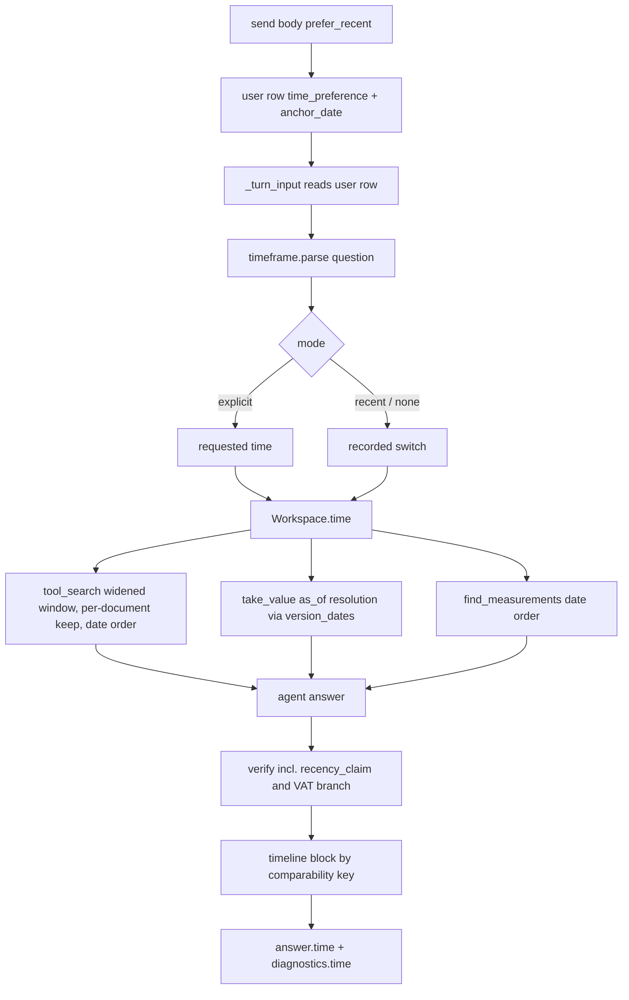
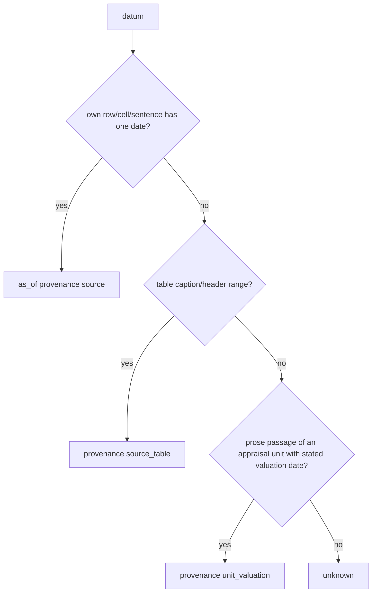

# Recency Preference and Round-10 Fixes - Plan

## Goal Capsule

- **Objective:** In the chat, a user who asks about data that changes over time sees the latest relevant datum first, followed by earlier relevant data with their dates and sources. Nothing older is hidden, and data that is not comparable is never mixed into one history. Three defects left by round 10 are closed:
  - a correct value lost to the VAT check;
  - search-only results that present standards as answers to property questions;
  - an office glossary stored as an appraisal.
- **Means:** one switch per conversation, recorded on each user message (KTD1, KTD2). Datum dates come from a lazily derived dates record and from date text the server finds itself (KTD3, KTD4). The server re-orders search and tool output within relevance (KTD6, KTD7). A server-built timeline block asserts the order (KTD8).
- **Authority hierarchy:**
  1. The user's round-11 request.
  2. This plan's Product Contract: R-IDs and the session-settled Key Decisions.
  3. KTDs.
  4. Unit text.

  Project rules in `CLAUDE.md` also bind:
  - pytest runs on the host only, never in compose containers;
  - tests use office B or `rag_test`;
  - office A is read-only, except the authorized glossary kind change through the API;
  - no customer data goes into git;
  - a backup is taken before a migration on the office database.
- **Stop conditions:**
  - Stop if a change would delete or reset appraisals, conversations, permissions or stored data. Report the scope, the reason and the alternatives first.
  - Stop if the RAG models or their settings would change.
  - Stop if Surya OCR or `.xlsx` work would enter this round.
  - Stop if a settled decision proves infeasible.
- **Execution profile:** Claude Code. Opus plans, diagnoses and decides. Sonnet implements and reviews. Haiku handles lookups and test runs. Units run in U-ID dependency order.
- **Who finishes:** the LFG pipeline. That covers implementation, simplification, review, browser tests, commits, pushing to the existing PR AriGabay/rag#2 and the CI watch. No merge and no production deploy.

---

## Product Contract

### Summary

The chat gains a switch beside the message box, "העדף נתונים עדכניים", on by default in new conversations.

When the switch is on:
- the server ranks data by the date each datum refers to;
- it keeps earlier relevant data in the answer;
- the answer opens with the latest datum and shows a dated timeline with sources.

Each message records the switch state that produced it, so retry and refresh never change an answer.

Three round-10 defects are fixed:
- a VAT check that ignored the VAT the source attaches to a registered value;
- search-only mode, which ignored question evidence and source kind;
- a standards listing that was labelled as an appraisal.

The office glossary is reclassified through the admin route.

### Problem Frame

Appraisals of the same property, and rents and transactions around it, accumulate over years. A question such as "מה שווי הנכס?" today returns whatever passage ranks highest. It may be the older appraisal, while a newer one sits below the search cut. No datum in the chat path carries a date the server can rank on:
- search passages, registered values and units have no date field;
- measurement dates are free text the model never sees;
- the normalized dates in `transactions` and `occurrences` are read only by the legacy answering path.

Round 10 left three defects:
- **Reproduced removal** (21 runs on the real model, `gpt-6-luna`, plus 1 of 9 in round 10): verification removed "שווי הנכס … 2,450,000 ₪, כולל מע״מ". The cited value's record carried `vat: included` with source provenance. `_vat_problems` reads VAT for a registered value only from its quote words.
- **Search-only mode** (office cloud sending off): it searches with no intent and no evidence. A property question listed five standard passages before the appraisal's.
- **Mislabel:** the `find_standards` listing source is tagged `appraisal`, so it mixes kinds in citations and escapes the standards check.

The office-A glossary is a published professional glossary stored as an appraisal. Content and identity were checked read-only.

### Key Decisions

- **The switch sits beside the message box, is on by default in new conversations, and is stored per conversation.** (session-settled: user-directed — chosen over an office-wide setting or off by default: the user specified it.) Governs R1, R2.
- **Recency is a ranking, never a filter.** (session-settled: user-directed — chosen over showing only the latest datum: old information must not disappear.) Governs R4, R12.
- **Rank by the datum's own reference date.** (session-settled: user-directed — chosen over the upload, processing or report date as a proxy: correctness.) Governs R5, R6, R7.
- **Relevance beats recency, and comparability is strict.** (session-settled: user-directed — chosen over date-only ranking: other properties are not one property's history.) Governs R9, R10.
- **An explicit date or range overrides the switch. Off means no preference, and dates are still shown.** (session-settled: user-directed — chosen over the switch overriding an explicit period.) Governs R3, R11.
- **The server enforces the preference, and search limits never hide needed earlier data.** (session-settled: user-directed — chosen over a prompt-only instruction.) Governs R12, R13.
- **Each message stores the state that produced it.** That state is part of every cache and of retry, and toggling never changes old answers. (session-settled: user-directed — chosen over reading the conversation's current state at render or retry.) Governs R14, R15.
- **The switch changes only time preference.** (session-settled: user-directed — chosen over letting recency reshape intent or the property slot.) Governs R16.
- **The VAT fix checks the datum against its source and keeps the anti-mixing protection.** (session-settled: user-directed — chosen over loosening verification.) Governs R18.
- **Search-only mode uses evidence and explicit selection, labels by kind and claims no intent.** (session-settled: user-directed — chosen over leaving it unfiltered.) Governs R19, R20.
- **The glossary changes kind through the existing admin route, with no deletion and no re-read.** (session-settled: user-directed — chosen over a direct DB update or a re-upload.) Governs R22.
- **Synthetic tests and a new frozen sample.** v15 is frozen before its run, and regression is kept apart from new evaluation. (session-settled: user-directed — chosen over reusing consumed sets as held-out.) Governs R24, R25.
- **Out of scope:** Surya OCR, `.xlsx`, model changes, mandatory manual approval, deletion or reset, and merge or deploy. (session-settled: user-directed — chosen over including them.)

### Requirements

**The switch and its state**
- R1. The composer shows a switch "העדף נתונים עדכניים" with the explanation "מציג תחילה נתונים עדכניים, לצד נתונים קודמים רלוונטיים". It is operable by keyboard, correct in RTL and usable at phone width.
- R2. A new conversation starts with the switch on, including before its first message. The conversation keeps the last chosen value and restores it after a refresh. Conversations created before this round keep the switch off, so their behavior does not change silently.
- R3. With the switch off, the server applies no recency preference, and answers still show the dates the sources give.

**What a datum's date is**
- R4. Recency orders data, newest first. Earlier relevant data stays in the search window, in the tool output and in the answer.
- R5. A datum's date is the date it refers to. That is:
  - the valuation date (המועד הקובע) of the appraisal unit whose own conclusion it is;
  - a date stated in the datum's own row, cell or sentence;
  - a range stated in its table's caption or header.

  The upload date, the processing date and the report-writing date never date a datum.
- R6. A date the sources do not give stays unknown. Undated data is shown, labelled "מועד לא ידוע", and placed after dated data.
- R7. A datum worded as a forecast or estimate of the future is never presented, or ranked, as measured. A date later than today never ranks first.
- R8. For standards, the edition applied to a property question is the one in force at the property's valuation date. With an unknown valuation date the answer says so and never falls back to the newest edition. Edition ordering stays as round 10 built it.

**Comparability and explicit time**
- R9. Only data with the same property identity, metric kind, unit, periodicity, area basis, VAT basis and scenario form one timeline. An unknown attribute never matches another unknown.
- R10. Two values of one comparable group with the same date and different amounts are shown as a conflict between sources, not as a trend.
- R11. An explicit date, range or relative period in the question overrides the switch. Data inside the requested time comes first and answers the question. Data outside it may follow, labelled as outside the requested time. When nothing falls inside, the answer says so and shows the nearest data.

**Server enforcement**
- R12. The preference reaches search, the tools and answer building on the server. Every relevant document in the search window keeps at least its best passage, so a limit never hides the earliest or the latest dated datum.
- R13. When the answer cites two or more comparable dated values, the server adds a timeline, newest first, with each value's date, the kind of date and its source. A claim that calls a value the latest must cite the latest-dated value of its group.

**Per-message state**
- R14. Each user message records the switch state and the anchor date used for relative periods. Retry, regenerate and resend use the recorded state, never the conversation's current value. A message created before this round retries with the switch off.
- R15. Each answer shows the time preference it was produced with. The per-turn memos key on it, and diagnostics record the decision taken.
- R16. The switch never changes the question intent, the property identity, the conversation slots or the search pools.

**Round-10 defects**
- R17. *(reserved; merged into R18)*
- R18. A registered value's VAT basis, stated by its source, backs a claim with the same VAT for that value. A VAT basis the source does not give, or gives differently, is still removed. The same blind spot is closed for area basis and periodicity where the record carries source provenance.
- R19. In search-only mode, hard evidence and an explicit document selection narrow the search as they do in a model turn. Without them, the results are grouped by source kind with headings, and no intent is claimed.
- R20. A standard or professional passage in search-only results is labelled as not being a source for a property's data.
- R21. A listing of standards is labelled with its professional kind, never as an appraisal.
- R22. The office-A glossary becomes "מסמך מקצועי" through `PATCH /api/documents/{id}` as office A's admin, after a backup. Its search availability updates without deleting anything or re-reading the file.
- R23. Round-10 behavior holds: a professional question after a property question gets no property list, "הסבר את השנייה" binds after a refresh, and the mixed sequence answers.

**Proof**
- R24. Tests use synthetic, clearly labelled documents with several dates, plus scripted and real-model sequences that assert ranking, sources and search scope, not wording.
- R25. A new frozen sample, v15, is prepared before its run. It holds time questions and mixed questions, with references fixed and its sha256 recorded. The documentation keeps the v15 evaluation apart from the regression runs, and never presents synthetic results as quality proof on the real standards.

### Acceptance Examples

- AE1. **Covers R4, R5, R13.**
  - **Given:** three synthetic appraisals of one property with valuation dates 2022, 2024 and 2025, and the switch on.
  - **When:** the user asks for the property's value.
  - **Then:** the answer opens with the 2025 value. A timeline lists 2025, 2024 and 2022 with dates and sources.
- AE2. **Covers R5.**
  - **Given:** an appraisal whose report-writing date is 2025 and whose valuation date is 2024.
  - **Then:** its value is dated 2024. A comparable transaction row in it is dated by the row's own date.
- AE3. **Covers R11.**
  - **Given:** the switch on, and the question asks "מה היה השווי ב-2022?".
  - **Then:** the 2022 datum answers. The later ones are labelled as outside the requested time.
- AE4. **Covers R9.**
  - **Given:** rents of the same address, one per month including VAT and one per year excluding VAT.
  - **Then:** they form two timelines, never one.
- AE5. **Covers R14.**
  - **Given:** a message sent with the switch off, and the user later turns the switch on.
  - **When:** the user retries that message.
  - **Then:** it runs with the switch off and shows that state.
- AE6. **Covers R18.**
  - **Given:** a value record "שווי הנכס 2,450,000 ₪" with `vat: included`, provenance source.
  - **Then:** a claim "2,450,000 ₪ כולל מע״מ" citing it is kept, and the same claim "לא כולל מע״מ" is removed.
- AE7. **Covers R19, R20.**
  - **Given:** search-only mode and "מה דמי השכירות בשומה של רחוב התמר 9?".
  - **Then:** the appraisal's passages come first under an appraisal heading. Any standard passage appears under its own heading, labelled not to be a source of property data.

### Scope Boundaries

- No re-extraction or re-reading of stored documents. Dates come from stored text with no model call.
- No change to `POLICY`, to `T.TOOLS` beyond new optional fields, or to the RAG models. The time instructions live only in the context block (KTD2).
- `verified_values` keeps its key. A recorded value is question-independent.
- **Deferred to Follow-Up Work:**
  - Dating measurement table rows, which needs re-extraction.
  - Paginating `_cached_listing`, which is capped at 40.
  - Tightening `_computation_vat` to source provenance only. No failure was observed, and tightening risks removing calculation answers. It is recorded with tests that pin today's behavior.
  - A "repeat with the current setting" action on old messages.

---

## Planning Contract

### Key Technical Decisions

- KTD1. **The switch state lives on three rows.**
  - `conversations.prefer_recent` holds the current preference. It is added with `false` for existing rows and then defaults to `true` for new rows.
  - The send body carries `prefer_recent`, and the server records it on the user message as `messages.time_preference` (jsonb: `prefer_recent`, `anchor_date`, `version`). A body without the field falls back to the conversation value. A send that carries it also updates the conversation.
  - The assistant row gets a copy for display.
  - Retry deletes only the assistant row, so the user row is the durable home (R14). Resend with the same `client_id` returns the stored pair, so the first send's state wins. `PATCH /conversations/{id}` also accepts the field. The API accepts a toggle on an archived conversation and during a running turn; the running turn keeps its recorded state. KTD14 governs what the composer allows.

  (session-settled: user-directed — chosen over reading the conversation's current state at render or retry: toggling must never change old answers.) Governs R2, R14, R15.
- KTD2. **"Cache" means every cache the chat path has.** The chat engine has no cross-turn answer cache; `answer_cache` serves only the legacy path. The recorded state therefore enters:
  - the per-turn `search_memo` and `read_memo` keys;
  - the `_context_message` time block (never `POLICY` or `T.TOOLS`, so the prompt-cache prefix stays stable);
  - the message JSON;
  - `message_diagnostics.resolution.time`.

  `verified_values` stays out, because a value's record does not depend on the question. No new answer cache is added; a cache with a key missing a real input serves stale answers (`docs/solutions/logic-errors/stored-pdf-boxes-are-not-in-the-rendered-page-frame.md`). (session-settled: user-directed — chosen over reading current state at retry.) Governs R15.
- KTD3. **The dates record is derived lazily from stored text, per version.**
  - A new table, `version_dates`, holds one row per stated valuation date. It carries `office_id`, `document_id` and `version_id` with the `document_access` policy exactly as 0019's `_secure`, so a user outside a document's group reads none of its rows. A `DATES_VERSION` constant marks the derivation. Its fields are the ISO text with its precision (day, month or year), the written text, the block index and the status (`stated` or `conflict`).
  - The owning unit is not stored. It is found at read time from the current `document_units` ranges, because units are re-derived and renumbered.
  - It is derived on first use from stored blocks with the label vocabulary of `app/appraisal/extract.py` ("המועד הקובע", "מועד קובע לשומה"). Derivation makes no model call and no re-read.
  - Report-writing and signature labels ("תאריך עריכת השומה", a signature date) are recognized only so their dates are never taken as valuation dates. They are not stored.
  - Two differing valuation dates in one unit are stored as `conflict`, rank as unknown, and are shown as both.
  - Only appraisal-kind versions derive dates (`APPRAISALS_SQL`). A version changed to a professional kind keeps its rows unread.

  Alternatives rejected:
  - re-extraction, which is model cost on every document and goes against round 10's no-re-read rule;
  - the legacy `occurrences` dates, which are per version, not per unit, and absent in narrative reports;
  - a model-typed valuation date, which is unverifiable.
- KTD4. **Datum dates are resolved by the server, never typed by the model.** At `take_value`, and for each passage and measurement, the server tries three sources in order:
  1. A single date in the datum's own row, cell or sentence; provenance `source`.
  2. A range in the table's caption or header; provenance `source_table`.
  3. The unit's valuation date, for a value that is the unit's own conclusion: its stance is `adopted` with source provenance, whether it sits in prose, a heading or a table cell, and its sentence or row holds no other date. Provenance `unit_valuation`.

  Any other value without its own date is unknown, including a comparables row without a date column and a quoted figure whose stance is not source-backed `adopted`. The value's `as_of` carries `{date, precision, provenance, locator}`.
  - **Measurements:** the same resolution runs on the measurement's own quote and block. The stored `effective_date`, which the extraction model typed, is used only when the shared parser finds the same date text inside the measurement's quote. A measurement table row whose stored text holds no date stays unknown; dating those rows is deferred (Scope Boundaries).
  - **Forecast:** set when the sentence holds a forecast marker ("צפוי", "תחזית", "יהיה", "בעתיד", "הערכה ל…"), or when the datum's date is later than the turn's anchor date. Stance is not used: the `estimate` stance means a party's estimate, not a forecast.
  - **Partial dates** keep their precision. "03/2024" is a month and never the 1st of March. Unsupported formats give unknown: two-digit years, Hebrew-calendar dates and quarters.
  - **Parsing** is one shared parser built on `app/professional/profile.py` `parse_date`. It also accepts anchored `yyyy.mm.dd`, `mm/yyyy` and a bare four-digit year with a date word.
- KTD5. **Explicit time in the question is parsed deterministically.** A new module, `app/chat/timeframe.py`, yields one of these kinds:
  - none;
  - point ("נכון ל-", "ב-<date>");
  - range ("בין … ל…", "מ-… עד …");
  - open range ("מאז", "לפני");
  - relative period ("השנה", "בשנה שעברה", "בשנתיים האחרונות"), resolved against the user row's `anchor_date` in Asia/Jerusalem time;
  - compare (two points).

  "השומה מיום D" parses as a point under R11: data dated D comes first, and the property slot is untouched (R16).

  Numbers that intent evidence reads as block, parcel, house, standard or section numbers are masked first (`intent.py` masks), and so are prices and areas. The result decides the turn's time mode: `explicit` when the question gives time, otherwise `recent` or `none` from the recorded switch. It never carries to the next turn through the slots.
- KTD6. **Search re-orders documents by date within the fused candidate depth.** In `recent` and `explicit` modes, `tool_search` reads the fused ranking down to the stage candidate depth (`search.CANDIDATES`, 40 per stage; 200 in a small scope) through an opt-in parameter, so other callers of `search_passages` are unaffected. The shown limit is not the window.
  - It keeps the best passage of every document in that depth.
  - It orders documents. `recent`: dated ones not later than the anchor date, newest first; then later-dated ones; then unknown dates, in relevance order. `explicit`: in-range first, then dated ones nearest to the requested time, then unknown dates, in relevance order.
  - Hits keep relevance order inside each document.
  - The output covers one hit per document up to `SEARCH_MAX` documents, then the remaining best hits.
  - Each hit shows its date line ("למועד הקובע 15/04/2026", "מועד לא ידוע").

  `none` mode keeps today's order and still shows the date lines (R3). The order is applied before the cut, so a relevant document anywhere in the candidate depth cannot fall out. A document beyond that depth is not relevant enough to reach any answer today either; R12's guarantee is stated for the candidate depth.
- KTD7. **Measurements and standards follow the same rule.**
  - `find_measurements` always shows the date resolved by KTD4. In `recent` and `explicit` modes it orders by that date (the KTD6 order), with unknown dates last. The sort runs over the whole filtered set: ids and date text are read, parsed and sorted (date, then id), and the page's rows are fetched by id. The page boundary therefore follows the date order and never skips a row. `none` mode keeps today's SQL order.
  - The standards edition for a property question with a known valuation date is the latest edition whose stated `effective` (else `published`) date is on or before it. This is applicability: it runs with the switch on or off, and it never touches `profile._ordered`.
  - A purely professional question ignores the switch.
- KTD8. **A server-built timeline asserts the order.** After verification, the server takes every comparability group (R9) that holds at least one value the answer cites, and fills it from all values registered in the turn (V# and M#), cited or not. It adds a "ציר זמן" block for every such group with two or more dated values. Earlier and later comparable data therefore appear even when the prose cited one value.
  - The block lists date, date kind, value, source citation and a forecast, conflict or outside-requested-time mark.
  - Its order is the KTD6 order for the mode: newest first in `recent` (a date later than the anchor date never first), requested time first in `explicit`, chronological when the switch is off and no time was asked.
  - Undated values follow, with "מועד לא ידוע".
  - It is part of the structured payload (`answer.time.timeline`). The markdown carries a plain-text copy, so copying the answer keeps it.

  A deterministic check, `recency_claim`, flags a claim that calls a value "העדכני" or "האחרון" when a later-dated comparable value is registered in the turn. That claim is repaired, not silently kept. The prose answer is asked, in the time block, to open with the latest datum. The block is the guarantee.
- KTD9. **The comparability key uses property identity and provenance-backed record fields.** The key is: property identity, label or metric family, unit, periodicity, area basis, VAT, scenario and stance.
  - **Property identity** comes from the identifiers of the value's appraisal unit (`document_units.identifiers`: address, block and parcel), normalized, so appraisals of one property in different documents share it. A unit with no identifiers keeps its own unit identity and matches no other.
  - **Fields** count only with source provenance. A field that is not stated or only model-asserted never equals another (R9), which is the same provenance rule as KTD10.
  - **Not applicable** is not unknown. Area basis does not apply to a total amount, and periodicity does not apply to a one-time value. Such a field is left out of the key for that metric family rather than blocking the group.
  - `coverage.conflicting` and the timeline share this one key. Values with different known dates in a group are a history, not a conflict (R10). Same-date different amounts stay a conflict.
- KTD10. **The VAT fix adds a branch for registered values.** In `_vat_problems`, a cited `V#` backs `(numbers_in(written), vat)` only when `provenance["vat"] == "source"`, as `M#` does for its record. The meaning check gets the same branch for area basis and periodicity where the value record carries source provenance. A model-asserted field backs nothing. (session-settled: user-directed — chosen over loosening verification: keep the anti-mixing protection.) Governs R18.
- KTD11. **Search-only mode runs the deterministic part of the turn.** It uses `entities.titles_of`, `intent.settle(None, …)` and `intent.evidence`, and `entities.first_message` with `T.locate_unit` for an explicit document or unit selection. It applies the pools that settle produces.
  - With unknown intent, it searches both pools and renders two headed groups: appraisals (at most 5) and standards and professional documents (at most 3). The second group carries the label that it is not a source of property data.
  - It states no intent.
  - It applies the recorded switch to the appraisal group's order (KTD6) and shows date lines.

  The existing contract stays: `kind: "search_only"`, the phrase "לא נוסחה תשובה מנותחת", and sources present. (session-settled: user-directed — chosen over leaving search-only unfiltered.) Governs R19, R20.
- KTD12. **Listing sources carry their kind.** `_listing` takes a `source_kind`, and `tool_find_standards` passes the professional kind. Listings of appraisals stay `appraisal`.
- KTD13. **The kind change runs through the API.** The glossary is changed with an authenticated admin-A `PATCH` after `scripts/backup.sh`. The route already bumps the data version, which moves every memo and stale flag, and it derives sections and the profile from stored blocks. `VocabularyIndex` re-keys on titles. No new invalidation is needed, so the unit verifies rather than builds. (session-settled: user-directed — chosen over a direct DB update or re-upload.) Governs R22.
- KTD14. **The frontend switch is a native button with `role="switch"` and `aria-checked`.**
  - **Placement:** a control row directly above the composer pill, outside the textarea and send row. The explanation is visible text beside the label, wired with `aria-describedby`, and stacks under the label below 768px. The touch target is at least 44px.
  - **Keyboard:** Space and Enter toggle it.
  - **Draft:** before the first send, the state lives in `ChatApp` and travels in the first send body; there is no PATCH-then-send race.
  - **Busy states:** the switch is disabled only while the send request itself is pending (`sending`). It stays enabled while a turn runs.
  - **Existing conversation:** a toggle updates optimistically and PATCHes. On PATCH failure it reverts to the last stored value and shows the existing notice alert.
  - Read the Next 16 docs under `frontend/node_modules/next/dist/docs/` before writing the component (`frontend/AGENTS.md`).
- KTD15. **Migration 0020 is additive only.** It adds `conversations.prefer_recent` (existing rows false, default true), `messages.time_preference jsonb NULL` and the `version_dates` table, with ENABLE and FORCE RLS, the `document_access` policy and grants like 0019. It sets `lock_timeout`.
  - **Backup gate:** in `docker-compose.yml`, `backend` and `worker` wait for `migrate`, which runs `alembic upgrade head`. The first recreate of the stack on a build that contains 0020 therefore applies it to the office DB. Run `scripts/backup.sh` and record its path before that recreate, whichever unit triggers it first (the U10 browser run, U11 or U13).

No Bake-off: the date source had distinct options, but each alternative was ruled out by a user rule (re-reading, report-date proxy, unverified model dates) rather than needing further development to compare.

### High-Level Technical Design

Turn flow with the time preference:

Time mode by switch and question:

| Question gives time | Switch | Mode | Search order | Timeline order |
|---|---|---|---|---|
| no | on | recent | newest dated first, unknown after | newest first |
| no | off | none | relevance (dates shown) | chronological |
| yes | on or off | explicit | requested time first, then nearest | requested time first |

Datum date resolution (KTD4):

### Assumptions

- **Existing conversations keep the switch off** (R2). This is a reading of "on by default in new conversations".
- **The timeline block appears only when two or more comparable values are dated.** A single dated value gets its date inline.
- **The explicit-range answer may list out-of-range data after the in-range answer.** It labels that data and never uses it as the answer.
- **v15 is drawn only from office-A documents not used in v13 and v14,** so it can be frozen before any fix. The round-11 synthetic cases are regression proof in U12. v15 includes at most two questions on the real standard already uploaded to office A, labelled as a first look, not as proof.
- **The comparability key leaves out VAT unknown on both sides (R9).** On real appraisals that state no VAT basis, timelines may form less often. The v15 report states how often they formed.

### Sequencing

U1 (v15 frozen) first, so the sample cannot be shaped by the fixes. The independent defect fixes come next: U2, U3 and U4. Then the time-preference data path in U5, U6, U7 and U8, the answer layer in U9, and the frontend in U10. U11 runs after the local stack is rebuilt on the round's build (backup gate, KTD15); there is no production deploy. Proof and measurement close the round: U12 and U13.

### System-Wide Impact

- **Data:** one migration adds columns and a table. No existing row changes, except `prefer_recent=false` on existing conversations.
- **Prompt cache:** the time block goes in the first user item, so the `POLICY` and `TOOLS` prefix stays cached. Adding optional fields to `take_value`'s schema invalidates the prefix once.
- **Shared search:** `search_passages` gains an opt-in window parameter. The legacy answering path and `/api/search` keep their behavior.
- **Round-10 contracts:** intent, slots, pools and edition ordering are untouched (R16, KTD7). Their suites stay as regression.

### Risks & Dependencies

| Risk | Mitigation |
|---|---|
| Valuation dates are missing in many real appraisals, so ranking rarely applies | Unknown stays unknown and is shown. The v15 report states the coverage of dated units in office A |
| The widened window raises search cost under FORCE RLS | Measure with `EXPLAIN ANALYZE` as `rag_app` and as owner (`docs/solutions/database-issues/force-rls-keeps-pg-trgm-off-its-gin-index.md`). The window stays at most `SEARCH_MAX` |
| The model ignores the time block and leads with an older value | The timeline block and the `recency_claim` check assert the order on the server (KTD8) |
| Date parsing reads a parcel or a price as a year | Intent masks run first, anchored formats only, and unsupported formats give unknown (KTD4, KTD5) |
| The provider's latency varies about 2x between runs | Compare stage times and time-limit hits before reading score changes (memory: v14 note) |

---

## Implementation Units

### U1. Freeze the v15 sample before any fix

- **Goal:** write a small held-out sample with fixed references and freeze it before the round's code changes, so the fixes cannot shape it.
- **Requirements:** R25.
- **Dependencies:** none.
- **Files:**
  - `real_documents/eval/real_v15_heldout.yaml` (gitignored);
  - `real_documents/eval/real_v15_heldout.sha256`.
- **Approach:**
  1. Choose about 10 to 12 questions on office-A documents not used by v13 or v14: time questions (latest value, a value at a stated year, a comparison across dates) and mixed questions (a professional requirement applied to a property).
  2. Fix each reference from the documents themselves.
  3. Record the sha256.
  4. Never run v15 until the final build.

  The public docs get only aggregates (memory: real-reports-office-a).
- **Patterns to follow:** `real_documents/eval/real_v14_heldout.yaml` and its `.sha256`; `docs/solutions/workflow-issues/real-model-before-after-eval-on-the-local-stack.md`.
- **Test expectation:** none — this unit produces a frozen evaluation input, not behavior.
- **Verification:** the sha256 file exists before the first implementation commit of U2, and the YAML parses with `backend/eval/chat_eval.py`.

### U2. The VAT and meaning checks read source-backed value records

- **Goal:** a registered value's source-backed VAT, area basis and periodicity back a matching claim. Anything else is still removed.
- **Requirements:** R18, R23. Implements KTD10.
- **Dependencies:** none.
- **Files:**
  - `backend/app/chat/verify.py` (`_vat_problems`, the meaning branch);
  - `backend/app/chat/meaning.py` if the blind spot exists there;
  - `backend/tests/unit/test_verify_units.py`;
  - `backend/tests/unit/test_verify_computed.py`.
- **Approach:** add the `ws.values` branch beside the `ws.measurements` one. Audit `meaning.check` for the same quote-only reading, and add the branch there only where the record has source provenance. Pin `_computation_vat`'s current behavior with a test, without changing it (Scope Boundaries).
- **Execution note:** start with a failing unit test built from the reproduced case.
- **Patterns to follow:** `test_vat_claim_backed_by_a_measurement_record` and the `_value` helper in `test_verify_computed.py`.
- **Test scenarios:**
  - Covers AE6. A V# with `vat: included` and provenance source, quote without VAT words; claim "2,450,000 ₪ כולל מע״מ [V2]". No problem is raised.
  - The same V#; claim "… לא כולל מע״מ". `wrong_unit` with check `vat` is raised.
  - A V# with `vat: included` and provenance `model_asserted`; the "כולל מע״מ" claim is removed.
  - A V# with `vat: not_stated`; the claim is removed.
  - A V# with source-provenanced area basis `net`; a claim "למ״ר נטו" is kept, and "ברוטו" is flagged by the meaning check.
  - A calculation over a V# with model-asserted VAT keeps today's outcome (pinned).
- **Verification:** the new tests pass. Every existing `test_verify_*` passes unchanged. The real-model diagnostic of the setup question (U13) shows no `vat` removal across its repeats.

### U3. Search-only mode uses evidence and labels by kind

- **Goal:** a property question in search-only mode reads the appraisal first. Unknown intent gets kind-grouped results that claim no intent.
- **Requirements:** R19, R20, R16. Implements KTD11, except the date lines and the switch order, which U8 adds.
- **Dependencies:** none.
- **Files:**
  - `backend/app/chat/api.py` (`_limited_answer`);
  - `backend/app/chat/tools.py` (labels);
  - `backend/tests/integration/test_chat_search_only.py` (new);
  - `backend/tests/integration/test_chat.py` (the existing contract).
- **Approach:**
  1. Settle intent deterministically.
  2. Locate an explicitly named unit or document.
  3. Run the pooled search.
  4. Render headed groups with the caps of KTD11 and the professional "not a property-data source" label.
- **Patterns to follow:** the round-10 `_plan` pools; `LABEL_*` constants; `test_chat.py:232`.
- **Test scenarios:**
  - Covers AE7. An office with a standard and an appraisal on "רחוב התמר 9", search-only. The appraisal's passages come first, and no standard sits in the appraisal group.
  - Unknown intent ("מה זה היוון?"). Two headed groups, the professional group labelled, and no sentence claims an intent.
  - An explicitly named unit in a multi-unit file. Only that unit's passages are in the appraisal group.
  - An office with no standards. One group, no empty professional heading.
  - The existing contract (`kind`, the phrase, sources) still holds.
- **Verification:** the new and existing search-only tests pass. The browser check of U13 shows the grouped page with office B's cloud setting off.

### U4. Listing sources carry their kind

- **Goal:** a standards listing is a professional-kind source in citations and in verification.
- **Requirements:** R21. Implements KTD12.
- **Dependencies:** none.
- **Files:**
  - `backend/app/chat/tools.py` (`_listing`, `tool_find_standards`);
  - `backend/tests/integration/test_tools_pools.py`;
  - `backend/tests/unit/test_verify_professional.py`.
- **Approach:** add the parameter and pass it from `tool_find_standards` only.
- **Test scenarios:**
  - A `find_standards` call. The listing source's `source_kind` is professional, and `Source.public()` shows it.
  - A claim of a property value citing only the standards listing. `property_datum_from_standard` flags it.
  - `find_documents` and `list_documents` listings stay `appraisal`.
- **Verification:** the tests pass, and the round-10 real-model mixed sequence shows no listing tagged `appraisal`.

### U5. Migration 0020 and the per-message state path

- **Goal:** the switch is stored per conversation and per user message, travels in send and PATCH, and reaches `TurnInput`.
- **Requirements:** R2, R14, R15, R16. Implements KTD1 and KTD15.
- **Dependencies:** none.
- **Files:**
  - `backend/alembic/versions/0020_time_preference.py`;
  - `backend/app/chat/api.py` (`SendBody`, `send_message`, `ConversationPatch`, `_conv_json`, `_message_json`, `_turn_input`, retry);
  - `backend/app/chat/engine.py` (`TurnInput` field with a default);
  - `backend/tests/integration/test_migration_0020.py`;
  - `backend/tests/integration/test_chat_time_preference.py` (new);
  - `docs/api-contract.md`.
- **Approach:**
  1. In the migration, add the column as `false` for existing rows, then set the default to `true`. Add `time_preference jsonb NULL` and the `version_dates` table, with RLS and grants.
  2. Write `{prefer_recent, anchor_date (Asia/Jerusalem date), version: 1}` on the user row at insert, and copy it to the assistant row.
  3. Make `_turn_input` read the user row. A NULL there means a pre-round message, which runs with the switch off.
- **Patterns to follow:**
  - `0019_professional_sources.py` (`_secure`, `lock_timeout`);
  - `test_migration_0019.py`;
  - `test_chat.py:204` (retry);
  - `test_chat.py:260` (PATCH).
- **Test scenarios:**
  - The migration on a DB with an existing conversation. That row reads `false`, a new conversation reads `true`, and RLS forbids another office.
  - Covers AE5. Send with `prefer_recent: false`, PATCH to true, retry. The retried turn's input has false, and the answer JSON shows off.
  - A send without the field. It takes the conversation value.
  - A send with the field. It updates the conversation.
  - Resend with the same `client_id` and a different switch value. The stored pair returns unchanged.
  - Retry of a message with NULL `time_preference`. It runs with the switch off.
  - PATCH during a running turn. It succeeds, and the running message keeps its recorded state.
  - PATCH on an archived conversation. It succeeds.
  - Another user's conversation. PATCH returns 404.
  - The conversation JSON after reload. It contains `prefer_recent`.
- **Verification:** the tests pass, and an alembic upgrade on a copy of the office DB applies cleanly.

### U6. Dates record and datum-date resolution

- **Goal:** the server knows, for each appraisal unit, its valuation and report dates, and resolves a datum's `as_of` with provenance.
- **Requirements:** R5, R6, R7, R10. Implements KTD3 and KTD4.
- **Dependencies:** U5 (table).
- **Files:**
  - `backend/app/chat/dates.py` (new: derivation, cache, `as_of` resolution, forecast markers);
  - `backend/app/platform/dates.py` (new shared parser, delegating to and extending `professional/profile.py` `parse_date`);
  - `backend/tests/unit/test_dates_parse.py`;
  - `backend/tests/integration/test_version_dates.py`.
- **Approach:**
  1. Derive per version on first use: scan stored blocks for labelled dates.
  2. Assign each date to the unit whose block range holds it.
  3. Mark conflicts.
  4. Store the rows with `DATES_VERSION`.
  5. Resolve `as_of` in the KTD4 order.

  Reprocess creates a new version, so its rows are fresh. A kind change filters through `APPRAISALS_SQL`.
- **Execution note:** write the parser tests first. The format table is the contract.
- **Patterns to follow:** the lazy derivation and cache in `app/professional/sections.py` (round 10); the label vocabulary in `app/appraisal/extract.py`.
- **Test scenarios:**
  - Covers AE2. A unit with "המועד הקובע: 15/04/2024" and "תאריך עריכת השומה: 22/04/2025". The stored valuation date is 2024-04-15, and the report date is never taken. An adopted prose value gets `as_of` 2024-04-15 with provenance `unit_valuation`.
  - An adopted conclusion in a summary table cell of the same unit. `as_of` 2024-04-15, `unit_valuation`.
  - A prose sentence quoting a party's claim (stance `claim`) with no date. `as_of` unknown.
  - A measurement whose stored `effective_date` is "2023" but whose quote holds no date. Unknown; with "בשנת 2023" in the quote, 2023 with provenance `source`.
  - A value dated after the anchor date with no forecast marker. Marked forecast.
  - A user outside the document's group. Reads no `version_dates` rows of it.
  - A re-derived unit range. The date is assigned to the unit that holds its block now.
  - A table row "12/2023 | עסקה | 1,900,000". `as_of` is 2023-12, precision month, provenance `source`.
  - A table row with no date column. `as_of` is unknown.
  - A table caption "עסקאות 2021–2022" with undated rows. Provenance is `source_table`, with range 2021 to 2022.
  - A multi-unit file with different valuation dates. Each unit gets its own, and a block outside every unit gets none.
  - Two differing valuation dates in one unit. Status is `conflict`, and the value is unknown for ranking.
  - A sentence "דמי השכירות צפויים לעמוד ב-2027 על…". Marked forecast.
  - A sentence with a past date and no forecast marker. Not a forecast.
  - Parser formats: "15/04/2024", "15.4.2024", "2024.04.15", "04/2024", "אפריל 2024", "2024" beside "בשנת". Each is parsed with the right precision.
  - Unsupported formats give unknown: "15/04/24", "תשפ״ד", "Q1 2024". So does a parcel "חלקה 2024".
  - A professional-kind version derives no dates.
- **Verification:** the tests pass, and derivation on the office-A documents (read-only, U13) reports how many units have a stated valuation date.

### U7. Question timeframe and the turn's time mode

- **Goal:** each turn has a time mode (none, recent or explicit) with its requested time, recorded in diagnostics.
- **Requirements:** R3, R11, R16. Implements KTD5.
- **Dependencies:** U5, U6 (parser).
- **Files:**
  - `backend/app/chat/timeframe.py` (new);
  - `backend/app/chat/engine.py` (Workspace time, the `_context_message` time block, diagnostics);
  - `backend/app/chat/tools.py` (the `Workspace.time` field);
  - `backend/tests/unit/test_timeframe.py`;
  - `backend/tests/integration/test_chat_time_mode.py`.
- **Approach:** parse after intent masks. The time block goes after the request block in `_context_message`. It names the mode, the requested time and the instruction to open with the latest datum and keep earlier ones. `ws.intent`, `ws.named_documents`, the unit focus and the slots are never written by this unit (R16).
- **Test scenarios:**
  - "מה היה השווי ב-2022?" is a point, year 2022, mode explicit with the switch on or off.
  - "בין 2020 ל-2023" is a range.
  - "מאז 2021" is an open range.
  - "בשנה שעברה" with anchor 2026-10-14 is the range 2025.
  - The same retry a year later uses the stored anchor and gives the same range.
  - "גוש 7001 חלקה 2024", "תקן 19", "סעיף 2.1", "2,450,000 ₪" and "80 מ״ר" give none.
  - "השומה מיום 15/04/2024" is a point, mode explicit, and the property slot is unchanged.
  - With the switch on and no time words, the mode is recent; with the switch off, none.
  - Round-10 intent sequences return the same intent and slots with the switch on and off.
  - The diagnostics `resolution.time` holds mode, source and requested time.
- **Verification:** the unit and integration tests pass, and `test_round10_sequences.py` passes unchanged.

### U8. Server ranking in search, values and measurements

- **Goal:** search, `take_value` and `find_measurements` carry dates and follow the mode's order, without hiding earlier relevant data.
- **Requirements:** R4, R6, R7, R8, R12, R15. Implements KTD6 and KTD7.
- **Dependencies:** U6, U7.
- **Files:**
  - `backend/app/chat/tools.py` (`tool_search` window and order, memo keys, hit date lines, `take_value` `as_of`, `find_measurements` date and order, `Value.public` and `Measurement.public`);
  - `backend/app/chat/api.py` (`_limited_answer`: date lines and the recorded switch order for the appraisal group, KTD11);
  - `backend/app/platform/search.py` (opt-in window parameter);
  - `backend/app/chat/calc.py` (`Value.as_of`);
  - `backend/app/chat/engine.py` (time policy section in the context block, never in `POLICY`);
  - `backend/tests/integration/test_tools_recency.py` (new);
  - `backend/tests/integration/test_search.py`.
- **Approach:**
  1. Apply the widened window and per-document keep before the cut (KTD6).
  2. Add the mode and requested time to the memo keys.
  3. Have `take_value` resolve `as_of` through U6.
  4. Add measurement dates through the shared parser.
  5. Pick the edition by valuation date as applicability (KTD7).
- **Patterns to follow:** `test_a_memoized_search_is_kept_per_pool_and_per_excluded_versions` (`test_tools_pools.py`); `diversify_rows`.
- **Test scenarios:**
  - Covers AE1. Three appraisals of one property (2022, 2024, 2025) plus nine other matching documents, limit 6, recent. The 2025 and 2022 documents are both in the output, and the 2025 one is first.
  - More than 12 matching passages, where the 2025 document's best passage ranks 14th by relevance. It is in the output, first.
  - A dated value later than the anchor date with no forecast marker. Ranked after every dated value not later than the anchor date.
  - Mode none with measurements. Today's SQL order.
  - Search-only mode with the switch on. The appraisal group follows the recent order, with date lines; with the switch off, relevance order with date lines.
  - Mode none. Relevance order as today, date lines present.
  - Explicit 2022. The 2022 document is first, the others follow.
  - All dates unknown. Relevance order, each line "מועד לא ידוע".
  - Equal dates. Relevance breaks the tie.
  - Two memo calls with the same query and different modes. Two memo entries.
  - `take_value` on a prose value of a dated unit gives `as_of` `unit_valuation`. On a dated table row it gives `source`.
  - `find_measurements` with three dated rows and one undated. Newest first, undated last, and pages never skip a row.
  - A property question on a unit valued 2025-03-01, with editions effective 2024-01 and 2025-06. Edition 2024 is applied, with the switch on or off.
  - An unknown valuation date. No edition is called applicable, and the line says the date is unknown.
  - A professional question. The edition output is the same with the switch on and off.
  - The legacy `/api/search` and `answering` callers give unchanged results (existing tests).
- **Verification:** the tests pass, `EXPLAIN ANALYZE` of the widened search as `rag_app` stays within the round-9 search time budget, and the round-10 suites pass.

### U9. Timeline block and the recency claim check

- **Goal:** the answer carries a server-built, correctly ordered timeline of comparable dated values. A "latest" claim must be true among what was registered.
- **Requirements:** R9, R10, R13, R11. Implements KTD8 and KTD9.
- **Dependencies:** U8.
- **Files:**
  - `backend/app/chat/timeline.py` (new: comparability key, grouping, block);
  - `backend/app/chat/verify.py` (the `recency_claim` check);
  - `backend/app/chat/api.py` (`_answer_payload` `answer.time` and the timeline);
  - `backend/app/chat/coverage.py` (`conflicting` on the shared key; labels);
  - `backend/tests/unit/test_timeline.py`;
  - `backend/tests/unit/test_verify_recency.py`.
- **Approach:**
  1. Group by the KTD9 key: every group holding a cited value, filled from all values registered in the turn.
  2. Order each group by mode.
  3. Mark conflicts and forecasts.
  4. Render after the answer body, before coverage lines.

  `recency_claim` is a repairable problem with a new check name. It is not a removal of supported content.
- **Patterns to follow:** coverage-line rendering in `coverage.py`; `deterministic()` problem shape in `verify.py`.
- **Test scenarios:**
  - Covers AE1. Three dated values of one property from three documents whose units share an address, recent. The block lists 2025, 2024, 2022 with sources, and the answer carries no sources-conflict coverage line.
  - The answer cites only the 2025 value while 2024 and 2022 were registered. All three are in the block.
  - Two total values, area basis and periodicity not stated, VAT included on both. One group (not applicable fields left out).
  - Units with no identifiers. Their values never share a group.
  - Covers AE4. A monthly rent including VAT and a yearly rent excluding VAT at the same address. Two groups.
  - Same address, different unit or floor. Separate groups.
  - Area basis net versus gross. Separate groups.
  - VAT not stated on both. Not grouped.
  - Two values with the same date and different amounts. A conflict mark, not a trend.
  - A forecast value. Marked, and never first.
  - Mode none. Chronological order.
  - Explicit 2022. 2022 first, later ones marked outside the requested time.
  - A single dated value. No block.
  - "השווי העדכני הוא 2,100,000 ₪ [V1]" while V3 (2025) is registered in the same group. A `recency_claim` problem.
  - The same claim when V1 is the latest. No problem.
- **Verification:** the tests pass, and the scripted sequence of U12 shows the block in the payload and on screen.

### U10. The frontend switch and per-answer state

- **Goal:** users toggle the preference beside the message box, it survives refresh, and each answer shows its state.
- **Requirements:** R1, R2, R15. Implements KTD14.
- **Dependencies:** U5; U9 for the timeline rendering.
- **Files:**
  - `frontend/components/chat/ChatApp.tsx` (`Composer`, draft state, send);
  - `frontend/components/chat/Message.tsx` (state note, timeline);
  - `frontend/components/chat/chat.css`;
  - `frontend/lib/chatTypes.ts`;
  - `frontend/lib/api.ts`;
  - `frontend/e2e/round11-recency.spec.ts` (new).
- **Approach:**
  1. Build the switch per KTD14, with its label and the explanation text from R1.
  2. A new conversation's draft starts on. An existing conversation reads `prefer_recent`.
  3. Toggling an existing conversation PATCHes (optimistic, revert on failure). Toggling a draft only changes the draft.
  4. The send body carries the value.
  5. Each answer shows its recorded preference in the `.msg-actions` row, worded as the setting, not as a claim that ordering happened: "העדפת זמן: עדכני תחילה", "העדפת זמן: ללא" or "לפי הזמן שביקשת". Search-only answers show it too.
  6. The timeline renders from `answer.time.timeline`: a table at desktop width, stacked rows below 768px (date and date kind, then value, then a citation that opens the source viewer through `onCite`). Forecast, conflict, outside-range and unknown-date rows carry a text badge, never colour alone. Dates are in `bdi`.
- **Patterns to follow:** `e2e/round10-ui.spec.ts` (stubbed payloads, mobile no-scroll); `e2e/keyboard.spec.ts`; `components/ui.tsx` `B`.
- **Test scenarios:**
  - A new conversation shows the switch on. The first send body carries `prefer_recent: true`.
  - Toggle off on an existing conversation, then reload. It is still off.
  - Keyboard. Tab reaches the switch, and Space toggles it with `aria-checked` updating.
  - A stubbed answer with the state "off". Its note reads "ללא העדפת זמן" while the switch is on.
  - A stubbed timeline. Rows are in the payload's order, with dates in `bdi`.
  - At 375px, no horizontal scroll, the switch and explanation are visible above the pill, and the textarea keeps its width.
  - A stubbed timeline at 375px. No horizontal scroll, and a row's citation opens the source viewer.
  - The switch stays enabled while a turn runs, and is disabled while the send request is pending.
  - A PATCH that fails. The switch reverts and the notice shows.
  - Dark mode contrast of the switch matches existing composer controls.
- **Verification:** the e2e spec passes against the rebuilt stack, and the existing chat specs pass.

### U11. Glossary kind change in office A

- **Goal:** the glossary is a professional document in office A, available to professional search, with nothing deleted or re-read.
- **Requirements:** R22. Implements KTD13.
- **Dependencies:** the local stack rebuilt on the round's build (after the KTD15 backup gate); a backup.
- **Files:** none in the repo. Operational, recorded in `docs/evaluation/conversational-rag.md` without the document's name.
- **Approach:**
  1. Run `scripts/backup.sh`.
  2. Log in through the API as office A's admin.
  3. PATCH the identified document to `professional`.
  4. Confirm the response, the badge, the derived sections and profile, and that a professional question in office A now cites it as a professional source.
- **Test expectation:** none — an operational change through a route covered by `test_documents_kind.py`.
- **Verification:**
  - the document lists with kind professional and its file and versions unchanged;
  - its version count did not grow, so there was no re-read;
  - a professional question answers from it, labelled by kind.

### U12. Round-11 fixtures, scripted sequences, real-model and browser proof

- **Goal:** synthetic multi-date documents, plus sequences that prove ranking, sources, scope and the round-10 regressions.
- **Requirements:** R24, R23, AE1–AE7.
- **Dependencies:** U2–U10.
- **Files:**
  - `backend/scripts/generate_fixtures.py` (`--only round11`);
  - `backend/tests/fixtures/round11/` (DOCX and manifest);
  - `backend/tests/integration/test_round11_sequences.py`;
  - `backend/tests/integration/test_round11_real_model.py`;
  - `frontend/e2e/round11-recency.spec.ts`.
- **Approach:** generate synthetic, clearly labelled appraisals:
  - one property at three valuation dates, each with a report date differing from its valuation date;
  - a comparables table with its own row dates and one table without;
  - a forecast sentence;
  - one appraisal with no valuation date;
  - a different property on the same street;
  - monthly and yearly rents with different VAT;
  - two synthetic standard editions reused from round 10.

  The real-model test runs each sequence three times in new conversations and records its results under `real_documents/eval/round11/real-model/`. Delete the temporary `backend/tests/integration/test_zz_r11_diag.py` once U13 has its replacement.
- **Patterns to follow:** `round10_*` builders and `write_round10`; `test_round10_real_model.py`.
- **Test scenarios:**
  - Covers AE1. Real model, switch on, "מה שווי הנכס ברחוב …?". The first value is the 2025 datum, the timeline lists all three with sources from the right documents, and the search scope includes the 2022 document.
  - Covers AE3. Real model, "מה היה השווי ב-2022?". The 2022 datum answers.
  - Switch off. No timeline order assertion, dates present.
  - Covers AE2. The answer dates the value by valuation date, not by report date.
  - Covers AE4. Two rent timelines.
  - A professional question after a property question. Intent professional, no property list, and the same with the switch on and off.
  - "הסבר את השנייה" after a refresh. Binds the second item.
  - The round-10 mixed sequence that failed. The setup answer keeps "2,450,000 ₪ כולל מע״מ", and the mixed answer separates requirement, data and application.
  - Scripted: retry after toggling. The recorded state is used.
  - Scripted: search-only grouped output for a property and an unknown question.
- **Verification:**
  - Scripted sequences pass.
  - The real-model sequences pass 3/3, or each failure is diagnosed with its trace and either fixed or reported with cause.
  - The browser spec passes.

### U13. Measurement and the round record

- **Goal:** the final build is measured: v15 once, the regression sets, and the round written up honestly.
- **Requirements:** R25, R23.
- **Dependencies:** all other units and the final build.
- **Files:**
  - `docs/evaluation/conversational-rag.md` (round-11 section);
  - `CONCEPTS.md` ("Time preference", "Datum date");
  - `docs/api-contract.md`;
  - `real_documents/eval/round11/` (private results).
- **Approach:**
  1. Run `scripts/backup.sh` and record its path, unless the KTD15 gate already did so for this build.
  2. Rebuild the stack through `migrate`, which applies 0020, and check a changed constant in the container.
  3. Confirm U11 is done (the glossary is professional).
  4. Run v15 once.
  5. Run the round-10 user conversation in office A, three times.
  6. Run the round-9 and round-10 real-model suites and the locate checker as regression.
  7. Report dated-unit coverage in office A.
  8. State plainly that real standards were not evaluated beyond any labelled first look.
- **Test expectation:** none — this unit measures and records.
- **Verification:** the evaluation section lists the build SHA, each set's role (new evaluation or regression), the results and what stays open.

---

## Verification Contract

| Gate | Command or check | Applies to |
|---|---|---|
| Backend unit and integration | `cd backend && env -u DATABASE_URL -u OWNER_DATABASE_URL .venv/bin/pytest` on the host, one process at a time, against `rag_test` | U2–U9, U12 |
| Real model | the same with `-m real_model` and the two round-11 and round-10 modules; the key comes from `.env` and is never printed | U12, U13 |
| Frontend types and lint | `cd frontend && npx tsc --noEmit` and the repo's lint script | U10 |
| Browser | `cd frontend && npx playwright test` against the stack rebuilt with `docker compose -p appraisal-rag --env-file .env build migrate frontend` | U10, U12 |
| Migration | upgrade on `rag_test` (conftest) and on the office DB after `scripts/backup.sh` | U5, U13 |
| Search cost | `EXPLAIN ANALYZE` of the widened search as `rag_app` and as owner | U8 |

Never run pytest inside a compose container. Never run two pytest processes at once.

## Definition of Done

- Every R-ID is implemented and covered by a passing test or a recorded measurement.
- All suites pass on the final SHA: the full backend suite, the round-10 sequences and the Playwright specs.
- The real-model round-11 sequences run 3 times each, with results recorded and failures diagnosed.
- v15 was frozen before U2 and run once on the final build. Regression and new evaluation are reported separately.
- The glossary is professional in office A, and the backup path is recorded.
- No deletion or reset happened, the RAG models are unchanged, and no Surya or `.xlsx` work was added.
- The temporary diagnostic test and any abandoned-attempt code are removed from the diff.
- The PR body carries the round-11 section and the unapplied findings. No merge and no deploy.

---

## Appendix

### Sources

- Diagnosis of the VAT removal: the real-model repro on the round-10 build, `backend/app/chat/verify.py` `_vat_problems`.
- Repo research: Workspace, Source and Value fields; the search window path (`backend/app/platform/search.py` `search_passages`, `search_evidence`, `diversify_rows`); the retry path (`backend/app/chat/api.py` retry); `find_measurements` ordering; `_listing`.
- Learnings:
  - `docs/solutions/logic-errors/hebrew-follow-up-entity-lookup-pitfalls.md` (APPRAISALS_SQL surfaces, intent evidence);
  - `docs/solutions/logic-errors/stored-pdf-boxes-are-not-in-the-rendered-page-frame.md` (cache keys must hold every real input);
  - `docs/solutions/database-issues/db-tests-inside-compose-containers-wipe-the-office-database.md`;
  - `docs/solutions/database-issues/force-rls-keeps-pg-trgm-off-its-gin-index.md`;
  - `docs/solutions/workflow-issues/real-model-before-after-eval-on-the-local-stack.md`.
- Prior plan: `docs/plans/2026-10-13-1906-feat-professional-sources-intent-context-plan.md` (intent, slots, pools, editions).
