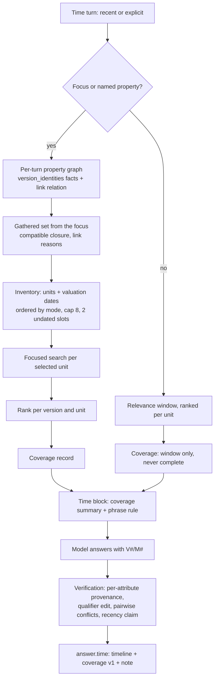
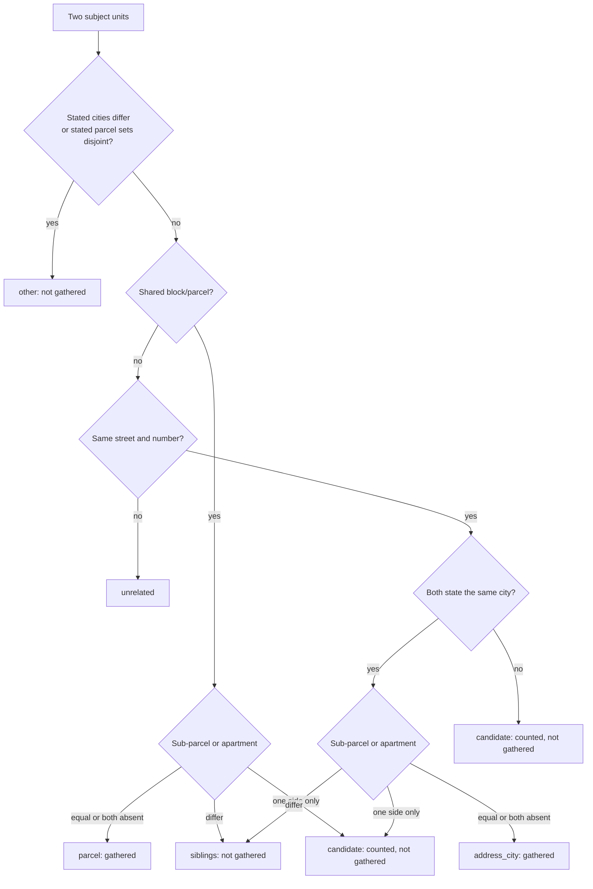
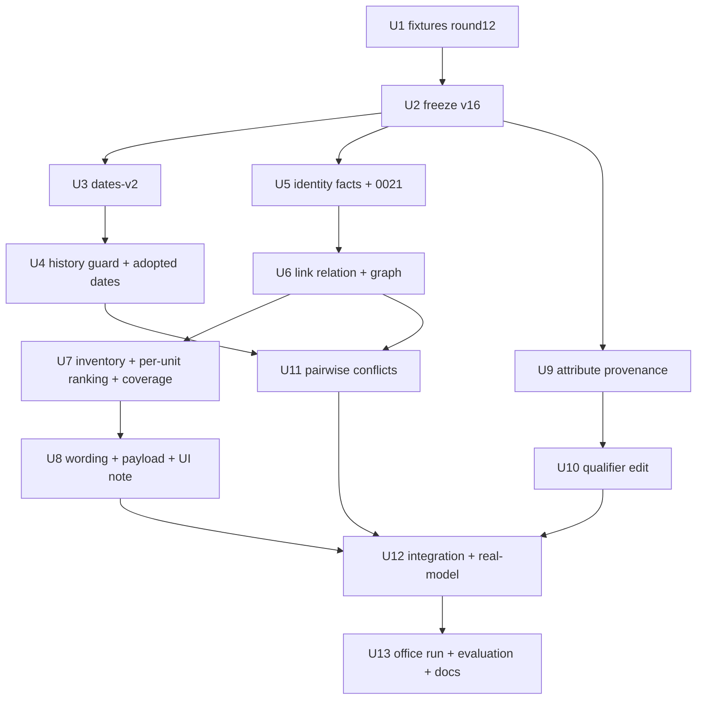

# Time Ranking Reliability - Plan

## Goal Capsule

- **Objective:** When a user asks the chat about a property's data over time, every appraisal that answer draws on is truly an appraisal of that property. The latest datum shown comes from the newest appraisal that was actually checked, earlier data keeps its own dates, and each attribute shown (area basis, period, VAT) is one the source states. When not every appraisal of the property was checked, the answer says so and names the gap instead of calling its datum the latest in the repository.
- **Means:**
  - an identity record read from each appraisal's own identification text, linked by proving evidence with a stored reason (KTD1–KTD4);
  - an inventory of the property's appraisals and their dates before any search (KTD5–KTD7);
  - per-attribute provenance and the qualifier edit (KTD9, KTD10);
  - a second version of valuation-date extraction, the history guard and one pairwise conflict rule (KTD11–KTD13).
- **Authority hierarchy:**
  1. The user's round-12 request.
  2. This plan's Product Contract: R-IDs and the session-settled Key Decisions.
  3. KTDs.
  4. Unit text.

  Project rules in `CLAUDE.md` also bind:
  - pytest runs on the host only, never in a compose container;
  - tests use the synthetic office B or `rag_test`;
  - office A's documents, appraisals, conversations and permissions are read-only, except evaluation conversations; its derived caches (dates, identities, the value cache) are refreshed as in round 11, after a backup;
  - no customer data in git;
  - `scripts/backup.sh` runs before a migration on the office database.
- **Stop conditions:**
  - A step would delete or reset appraisals, documents, conversations, permissions or user data. Derived rows are the only exception: a document re-read already deletes its own derived rows through `pipeline._delete_outputs`, and the new table joins that path. The migration, the warm-up script and the lazy refresh never delete anything.
  - A settled decision proves infeasible.
  - The v16 sample was not frozen before the first change under `backend/app/` this round.
- **Execution profile:** Opus diagnoses and decides, Sonnet implements and reviews, Haiku runs searches, tests and small doc edits. The RAG system's own models (`gpt-6-luna`) stay unchanged.
- **Who finishes:** the LFG pipeline updates PR AriGabay/rag#2. Merge and deploy stay with the user.

---

## Product Contract

### Summary

Round 12 hardens the round-11 recency switch without adding capabilities.
- **Identity:** an appraisal's property comes from its own identification text, including the city. Appraisals are linked only by proving evidence, and each link records its reason.
- **Retrieval:** a time question about an identified property lists that property's appraisals and their valuation dates first. It then searches each selected appraisal, ranks per appraisal, and reports which appraisals were and were not checked.
- **Attributes:** an area basis, period or VAT basis counts only when the source states it, and keeps an anchor to where it does.
- **Dates and conflicts:** valuation dates are read from the further structures real reports use, and history data never takes the appraisal's date. A dated and an undated datum may still conflict.

### Problem Frame

Round 11 ranked data by its date, but three foundations under the ranking were weak.
- **Identity:** the property key joined street and number without a city. A parcel set had to match exactly. Identifiers came only from a unit's title lines, and most office units store none.
- **Retrieval:** ranking only reordered a 12-document relevance window. A file holding twenty appraisals was dated once. Nothing checked whether a newer appraisal of the property existed outside the window, so "the latest" could be false with no sign.
- **Attributes:** a registered value's area basis or period, even when only the model wrote it, backed the same claim in verification.
- **Dates:** a diagnosis of the office's sixteen real appraisals found that all nine "undated" ones state a valuation date the extraction missed. The patterns:
  - extra words between label and date;
  - a two-digit year;
  - a label in a table header with the date in the cell below;
  - a date written before its label;
  - the label word "תאריך הקובע".

  One file also lists earlier appraisals with their own dates, which must stay theirs.

### Key Decisions

- **No address-only merge; links need proof and keep their reason.** Governs R1, R2, R3. (session-settled: user-directed — chosen over address-only keys and over blanket separation: the user ruled out both a city-blind merge and a split that blocks real history)
- **A multi-parcel property and several appraisals of one property gather into one history.** Governs R4. (session-settled: user-directed — chosen over exact parcel-set matching: a property spanning parcels must still form one history)
- **A model-written attribute is never proof; an unsupported attribute never costs the grounded number.** Governs R6, R7, R8. (session-settled: user-directed — chosen over trusting model-asserted fields and over deleting the number: verify each attribute against its source part)
- **Enumerate the property's appraisals and their dates first, then locate the data; rank per appraisal or datum.** Governs R9, R10, R11. (session-settled: user-directed — chosen over reordering the already-selected window: a window cannot show the latest was found)
- **Partial coverage is stated with "הנתון המאוחר ביותר במקורות שנבדקו" and the gap.** Governs R12. (session-settled: user-directed — chosen over an unqualified "latest": never claim the latest in the repository on partial coverage)
- **The beyond-window test asserts the latest is found.** Governs R20. (session-settled: user-directed — chosen over an "if it was selected" condition)
- **Dates only from evidence; history keeps its own date; verification-added data keeps dates.** Governs R15, R16, R17. (session-settled: user-directed — chosen over guessing or a report-date fallback)
- **A dated and an undated datum may conflict.** Governs R18. (session-settled: user-directed — chosen over the round-11 date-keyed rule: differing or missing dates alone do not cancel a conflict)
- **v15 is regression; v16 is frozen before the run; UI tests are not proof of reliability.** Governs R19, R22. (session-settled: user-directed — chosen over reusing v15 as new evaluation)
- **Preserve data; refresh only affected derived rows and caches; no merge or deploy; no new OCR or capabilities; RAG models unchanged.** Governs R21. (session-settled: user-directed — chosen over deletion, resets or scope growth)

### Requirements

**Property identity**
- R1. Two appraisals whose stated cities differ are never one property, whatever their street and number.
- R2. A street-and-number match where either side states no city never links two appraisals by itself. Such an appraisal is reported as an unlinked candidate, unless other evidence shows it is another property.
- R3. Appraisals link only through proving evidence: a shared block and parcel with the sub-parcel or apartment absent on both sides or equal, or the same street, number and city with no conflicting parcels. Every link carries its reason into the turn's record and the persisted answer.
- R4. One property's several appraisals, and a property spanning several parcels, gather into one history. Two separate lots never merge only because a third appraisal names both.
- R5. An appraisal's identity is read only from its own identification parts: the title lines, the identification or legal-status sections, and labelled fields. Comparables, cover or index tables, appendices and other units never contribute.

**Meaning of data**
- R6. A registered value's area basis, period or VAT backs a claim only when its source states it. The value keeps an anchor per attribute: the part (cell, header, caption, note, row, sentence, paragraph) and the words.
- R7. When the source is silent on an attribute the answer gives, the source-backed number stays, and the attribute is removed or written as unstated. When the question itself asked about that attribute, it is marked rather than removed. An attribute the source states differently keeps the existing correction or removal path.
- R8. Values whose attributes are unknown or differ never join one comparison, timeline group or calculation as if comparable.

**Locating the latest datum and the history**
- R9. For an identified property in a recent or explicit-time turn, the server lists the property's visible appraisals and their valuation dates before searching. It then searches each selected appraisal on its own, in an order set by the turn's mode, up to a stated cap.
- R10. Search ranking is per appraisal unit. A file holding several appraisals is never dated by one date.
- R11. Earlier relevant data stays in the answer's material with its own dates. Recency orders it and never drops it.
- R12. Each time answer carries a coverage record of the appraisals searched, searched without a match, not searched (and why), undated, and unlinked candidates.
  - **Partial coverage:** the answer says "הנתון המאוחר ביותר במקורות שנבדקו" and states the gap.
  - **Complete coverage:** completeness is relative to the appraisals visible to the user. Neither case claims the latest in the repository.
- R13. When the identification reader finds no identity for the focus appraisal, the server searches only that appraisal and says the property was not identified.
- R14. With the switch off and no requested time, search and the time wording behave as in round 11: no inventory, no coverage record, no coverage wording. The meaning, date and conflict corrections (R6–R8, R15–R18) apply in every turn, because the switch changes only the time preference.

**Dates and conflicts**
- R15. Valuation-date extraction reads the further evidenced structures:
  - extra words between the label and the date;
  - the label "תאריך הקובע";
  - a date immediately before its label;
  - a label heading followed by a block that starts with the date;
  - a one-row table whose header names the label;
  - a label-anchored two-digit year.

  Report and signature dates stay excluded. No date is ever guessed.
- R16. A datum that belongs to history never takes the appraisal's valuation date: a prior appraisal, a purchase, a row of a multi-row dated table, or data under a history section. Without its own date it stays unknown.
- R17. Values and measurements added during verification carry their resolved dates.
- R18. Two data of the same property and comparable fields with different amounts are a conflict when their periods overlap or either is undated. A datum undated only because it is history or a comparable is not. Coverage and the timeline use the same rule.

**Tests, evaluation and delivery**
- R19. A new small held-out sample (v16) of time and mixed questions is frozen before the first change to the application code. v15 is run as regression. Real-model tests on synthetic fixtures check meaning, sources and completeness, not only order. The fixtures cover several cities, several parcels and several dates per file.
- R20. A test places the property's latest relevant appraisal beyond the initial search window and asserts it is found and ranked first, with no conditional.
- R21. Appraisals, conversations, history and permissions are preserved. Only affected derived rows and caches are refreshed, a backup precedes the office migration, and the PR is updated without merge or deploy. No new OCR or capabilities, and the RAG models are unchanged.
- R22. The round's report states the tested version, the results and the remaining gaps, and does not claim reliability from UI tests.

### Acceptance Examples

- AE1. **Covers R1, R2.** Given two appraisals of "הצאלון 7", one stating city X and one city Y, a time question about the first never ranks the second. Given a third with "הצאלון 7" and no city, it is not ranked either, and the coverage note counts it as an unlinked candidate.
- AE2. **Covers R3, R4.**
  - Given appraisal A of parcels 24 and 40 in block M, B of parcel 40, and C of parcel 42, a question focused on B gathers A with the reason "parcel M/40" and never gathers C.
  - Given two appraisals of the same parcel with sub-parcels 3 and 4, neither gathers the other.
- AE3. **Covers R9, R10, R20.** Given fourteen linked appraisals of the same property that match the query words better than its 2026 appraisal (fifteen appraisals in all, more than the 12-document window), a recent-mode question about the property lists the 2026 appraisal's datum first.
- AE4. **Covers R12.** Given a property with ten dated appraisals and a cap of eight, where the two skipped are older than the newest datum found, the answer is complete for "latest" in recent mode. Given one undated appraisal that was not searched, the answer says "הנתון המאוחר ביותר במקורות שנבדקו" and names it.
- AE5. **Covers R6, R7.**
  - Given V1 registered from a quote "שכר דירה 5,000 ₪" with a model-asserted period "month", the answer "5,000 ₪ לחודש [V1]" keeps 5,000 ₪ and does not assert "לחודש" as the source's.
  - Given a source "לשנה" and an answer "לחודש", the claim follows the existing correction or removal path.
- AE6. **Covers R15, R16.**
  - Given "המועד הקובע לשומה - 31.12.23" and, under "שומות קודמות", "לתאריך הקובע 31.12.19 הוערך ...", the unit's date is 2023-12-31.
  - The 2019 sentence's value is dated 2019-12-31 by its own text and never by the unit's date.
- AE7. **Covers R18.**
  - Given V1 (2025-03-31, 2,450,000 ₪) and V2 (undated, 2,300,000 ₪) for the same property's value, the answer flags a conflict.
  - Given V2 under "שומות קודמות", the answer does not.

### Scope Boundaries

- No new OCR engine, no `.xlsx` support and no new chat capabilities. The coverage note is part of the existing time block.
- No change to `document_units` content or `UNITS_VERSION`, so unit numbers, handles and conversation focus stay stable.
- No global table of property links. Links are recomputed per turn over what the user can see.
- No change to the RAG system's models or to the judge prompt; `JUDGE_VERSION` stays 7.

### Deferred to Follow-Up Work

- A full locality vocabulary for unlabelled city detection beyond the existing `KNOWN_CITIES` list.
- Apartment and floor discrimination when neither appraisal of one parcel states a sub-parcel or an apartment number. Such appraisals still link as one parcel, as in round 11. The residual is recorded in the PR.
- Office-scale cost work for very large offices: precomputed identity graphs, a multi-range search scope.

---

## Planning Contract

### Key Technical Decisions

- KTD1. **A new derived table `version_identities` (migration `0021`), in the `version_dates` mold.**
  - It holds identification facts per block: `block_index`, kind, block, parcel, sub-parcel, apartment, street core, number, city, written words, section.
  - Facts are assigned to units at read time by block range, so unit re-derivation needs no rewrite.
  - It has a marker row for "derived, none found", `IDENTITY_VERSION` "identity-v1", the `document_access` RLS policy, flight plus advisory-lock writes in a savepoint, and it is listed in `pipeline._delete_outputs` and `_DERIVED_TEXT_TABLES`.

  `document_units.identifiers` and `UNITS_VERSION` are untouched. A units bump would re-derive every appraisal file on first use and renumber the handles that conversations store. Governs R5, R21.
- KTD2. **The identification reader scope is positive, never "anywhere not excluded".**
  - **Where it reads:** the unit's title run; blocks under identification or legal-status headings ("זיהוי הנכס", "פרטי הנכס", "תיאור הנכס", "הנכס הנדון", "נשוא השומה/חוות הדעת", "מיקום", "רישום", "מצב משפטי", "נסח"); and labelled `label: value` lines or table cells (גוש, חלקה, תת חלקה, דירה, כתובת, עיר, ישוב/יישוב).
  - **What it never reads:** comparables sections and tables (`is_comparables_table`), appendices, cover or index tables, and text before the first unit. A fact inside an uncertain unit edge is withheld.
  - **Parcels:** lists and ranges ("חלקות 24, 40, 42-44", "ו-" joiners) expand, capped at 30 parcels per statement. Each parcel pairs with its nearest preceding block. "גובלת"/"סמוכה"/"שכנה" sentences are excluded.

  Governs R5.
- KTD3. **City rules.**
  - A labelled city (`עיר:`, `ישוב:`, a city column) is accepted without a vocabulary.
  - An unlabelled "STREET N, CITY" or "STREET N CITY" form is accepted only when CITY is in `answering.places.KNOWN_CITIES` or equals a labelled city of the same unit. "שדרות" counts as a city only after the house number, never as a street label.
  - Normalization reuses `appraisal.normalize.normalize_place` and `answering.metadata.place_matches`.
  - A single-unit file may take the labelled header city (`answering.metadata.report_header(conn, version_id)["city"]`, the "עיר:" field of the first pages) when it is exactly one city. `VersionMetadata.cities` is never used, because its fallback mixes in comparables' cities. A multi-unit file never donates a header city.
  - A unit stating two different subject cities is treated as cityless for linking.

  Governs R1, R2.
- KTD4. **Linking is a relation computed per turn over the visible subject units, and a property is the focus's compatible closure.**

  | Pair evidence | Relation | Gathered |
  |---|---|---|
  | Shared block/parcel and both sub-parcel/apartment absent or equal | `parcel` (reason "parcel B/P") | yes |
  | Same street, number and city, parcels absent or overlapping, sub-parcel/apartment absent on both sides or equal | `address_city` | yes |
  | Same parcel, or same address and city, with different stated sub-parcels or apartments | `siblings` | no |
  | Same parcel, or same address and city, where one side states a sub-parcel/apartment and the other none | `candidate` (reason "אותה חלקה, תת-חלקה לא צוינה") | no (counted in coverage) |
  | Same street and number, a city missing on either side, no parcel link | `candidate` (reason "עיר לא צוינה") | no (counted in coverage) |
  | Stated cities differ, or both state disjoint parcel sets | `other` | no |

  - **Closure:** starting from the focus unit, a unit joins the gathered set through a gathered link only if it is compatible with every member already gathered: no differing city, no disjoint stated parcel sets, no differing sub-parcel or apartment. So A{24,40} gathers B{40}, but C{42} never joins through A when B is the seed.
  - **Determinism:** traversal is breadth-first in (relation strength, document id, unit number) order.
  - **Storage:** links are not stored as a table, because they depend on the caller's permissions and the visible set. The reasons persist in the answer's coverage record.

  Governs R1–R4. (session-settled: user-directed — chosen over address-only keys and over blanket separation: links need proof, history must still gather)
- KTD5. **One per-turn property graph serves retrieval, the timeline and conflicts.**
  - `property.py` builds it once per turn over the visible subject units, memoized in `ws.property_memo` by data version.
  - The turn's coverage is built from the same snapshot.
  - The timeline's `_UnitIdentity` reads a group id and label from the graph. For the focus property, the group is the inventory's gathered set. Units outside it form a group only when they are connected by gathered links and every pair in the component is compatible. Otherwise each stays its own group, so the grouping never depends on seed or document order. A unit without identity stays its own group.
  - `property_label` reads labels from the graph instead of parsing `addr:`/`bp:` keys.
  - `_named_property` resolves named documents to one property only when all their subject units fall in one gathered set.

  Governs R4, R8, R10.
- KTD6. **Inventory first, then focused per-unit search.**
  - **When it runs:** the switch is on and the turn is recent, or the question requests a time (explicit), and the turn has an identified property. Off mode means the switch is off and no time is requested.
  - **The identified property:** the conversation's focus unit, a call naming the focus unit, or named documents whose subject units fall in one gathered set. A question naming an address or parcel resolves through the existing entity lookup to a focus unit. When that lookup finds none, the question's identifiers are matched against the identity facts (KTD1) under the same relation rules.
  - **Inventory:** the gathered set's units with their valuation dates (`chat.dates.valuation_dates`, assigned per unit), ordered by `tools.time_key`.
  - **Order by mode:** recent searches newest first. Explicit searches units dated in the range first, then later units (they may list earlier data), then undated ones.
  - **Cap:** eight units per turn, with up to two slots reserved for undated units in document order.
  - **Scope:** each selected unit gets its own `memoized_search` scoped to its version and block range. Only hits with lexical support count, as in `_unit_search`. Each search records searched-with-hit or searched-without-match.
  - **Ranking:** `ranked_by_time` groups hits by (version, unit) instead of by document, and `SEARCH_MAX` counts those groups. The number of hits per call is unchanged.
  - **Off mode:** none of this runs.

  Governs R9, R10, R11, R14, R20. (session-settled: user-directed — chosen over reordering the selected window: the window cannot show the latest was found)
- KTD7. **The coverage record and its completeness rule.**
  - The record (`ws.time_coverage`, persisted as `answer.time.coverage` with `v: 1`) lists:
    - the property label and its link reasons;
    - each inventory unit with its date, an `undated` flag, its search status (`hit`, `no_match`, `not_searched_cap`) and its title;
    - unlinked candidates with their reasons, up to three named and the rest counted;
    - the count of undetermined units: visible subject units whose identity facts are empty, or cannot exclude this property (no city and no parcel to compare).
  - A message without `coverage` reads as "not recorded", never as complete.
  - **Recent mode is complete** only when the unit holding the newest datum found is the newest dated inventory unit (or ties it), and no undated unit, unlinked candidate or undetermined unit remains. A newer unit with `no_match` or `not_searched_cap` makes it partial and is named with its date. Older units left unsearched do not (AE4).
  - **Explicit mode is complete** when every unit whose date can fall in or after the range was searched, and no undated, candidate or undetermined unit remains.
  - **A turn with no identified property is never complete:** its coverage is the search window.
  - **Several search calls in one turn:** the answer reports the coverage of the calls whose results produced its cited time-ranked data. When several did, a unit counts as searched only if all of them searched it.

  Governs R12, R13. (session-settled: user-directed — chosen over an unqualified "latest")
- KTD8. **Honest wording is server-guaranteed, without the judge.**
  - The time block in `_context_message` (`timeframe.BLOCK_RECENT` and the explicit rules) carries the coverage summary and the required phrase.
  - The server builds a deterministic coverage note from the record. The note does not depend on timeline rows: it is in the payload and the copy text whenever the turn recorded coverage, including passage-only answers.

    | Coverage state | Visible note |
    |---|---|
    | Partial, recent | "הנתון המאוחר ביותר במקורות שנבדקו." followed by one line per reason group |
    | Partial, explicit | "הנתונים לתקופה שביקשת נמצאו רק במקורות שנבדקו." followed by one line per reason group |
    | Not identified | "הנכס לא זוהה; נבדקה רק השומה שבמוקד." |
    | Complete | "נבדקו כל השומות של הנכס הזמינות לך (N)." — never "the latest in the repository" |
    | Not recorded (old message, off mode) | nothing |

  - **Reason groups:** not searched (cap), searched without a match, undated, unlinked candidates and undetermined. Each group names at most three units, newest first, with their dates, then "ועוד N". Undetermined units are counted only.
  - `verify._recency_claim` flags a "latest" claim without the qualified phrase under partial coverage as repairable, partial severity, never a removal.
  - The judge prompt and `JUDGE_VERSION` stay unchanged, so no verdict cache or evaluation re-baseline is needed.

  Governs R12.
- KTD9. **Per-attribute provenance with anchors.**
  - **Recording:** `_settle_meaning`, `_cell_of` and `_take_quote` record, for period, area basis, VAT and kind, the part that states each (cell, header, caption, note, row, sentence, paragraph) and the words. They go into `calc.Value.meaning_from`, and `Qualifiers.found` entries carry the part.
  - **Cache:** `VALUE_VERIFIER_VERSION` becomes "value-v4", so value-v3 cache rows are inert, never deleted.
  - **Evidence for V#:** `meaning._evidence` builds a V#'s qualifiers only from fields whose provenance is `source`. Otherwise it attests from the V#'s own quote words.
  - **Evidence for M#:** an M#'s period, basis or VAT counts only when `timeline._record_states` holds for that field and the stored attribute's own words appear in the measurement's quote, its table caption or its column header. The check reuses the extraction's quote checks in `measurements.extract` (`period_quote`, `qualifier_quote`). The timeline keeps its weaker predicate for grouping, which only separates data and never backs a claim.
  - Calculations and comparability read only source-provenanced attributes, as `timeline._fields` already does.

  Governs R6, R8. (session-settled: user-directed — chosen over trusting model-asserted fields)
- KTD10. **A qualifier edit replaces claim removal only when the source is silent.**
  - **When it applies:** a blocking meaning problem on a number that passed its number check, where the source states nothing for that attribute.
  - **What it does:** a deterministic edit removes the unsupported qualifier words. If the question asked about that attribute, it instead writes "(התקופה/בסיס השטח/המע\"מ לא צוינו במקור)".
  - **What it never touches:** a source that states a different value keeps the existing repair, correction or removal path. A unit with a number-level problem is not edited.
  - **Afterwards:** the edited unit gets a fresh judge verdict like any repaired unit, and the removal note records each edit.

  Governs R7.
- KTD11. **Dates-v2 readings live inside `_date_after`, so `report_dates` shares them.**
  - **Label and gap:** the label vocabulary adds "(ה)תאריך (ה)קובע". The gap words add "זו", "זה", "קרי", "כלומר", "דהיינו", and the phrase "מועד הביקור (בנכס)". The visit phrase counts only between a label and its date and is never a label alone.
  - **Two-digit years:** a two-digit year is read only at the gap's end after a valuation or report label: 00–69 becomes 20YY, 70–99 is refused, day-first only, never in a range. The shared parser `app/platform/dates.py` keeps refusing two-digit years everywhere else.
  - **Date before the label:** read only with a direct connector ("שהינו", "שהוא", "והוא", "גם") and no report label within the preceding words.
  - **Heading then block:** a label-only heading followed by a block that starts with a date reads that date.
  - **Tables:** `derive` takes an optional table structure, joined through `document_blocks.table_index`. A header cell holding the label gives the date in the same column only for a table with one data row. More rows count as history.
  - **History guard in `derive`:** `_BLOCKS_SQL` also selects `section_path`, and `derive` skips any labelled date — of every reading, old and new — that the shared history predicate (KTD12) marks. So a prior appraisal's "לתאריך הקובע 31.12.19" never becomes the unit's date or a conflict with it.
  - `DATES_VERSION` becomes "dates-v2". Older rows are kept and never read.

  Governs R15, R16.
- KTD12. **One history predicate withholds the unit's date and marks the reason.**
  - **The predicate** (in `chat.dates`, shared by `derive` and `resolve_as_of`) marks a sentence as history when:
    - it sits under a history or prior-appraisal heading ("שומות קודמות", "שומות מקרקעין קודמות", "היסטוריה", "רכישות קודמות", "עסקאות קודמות"); or
    - its sentence carries "נרכש", "נמכר", "שומה קודמת" or "שומות קודמות"; or
    - it carries "הוערך" together with an explicit past cue ("בעבר", "קודם", "קודמת").

    A bare "הוערך" outside history keeps the unit's date, because current conclusions are written that way ("שווי הזכויות בנכס הוערך ב-X ₪ נכון למועד הקובע").
  - **In `resolve_as_of`:** the unit-valuation fallback is withheld from a history datum, which gets `date_origin: "history"` (`AsOf` gains the field). A comparable or a comparables-table row that stays undated gets `date_origin: "comparable"`.
  - A datum's own date still wins.

  Governs R16.
- KTD13. **One pairwise conflict function.**
  - `coverage.conflicting_pairs` compares two data of the same property group and comparable fields (family, unit, period, basis, scenario, stance class) with different amounts.
  - **Conflict:** their periods overlap (`tools.bounds`), or one is undated with neither a history nor a comparable origin.
  - **Not a conflict:** both dated with no overlap is history.
  - The property group comes from KTD5 for cross-unit pairs. The context key still separates different properties within one file.
  - `coverage.conflicting` and the timeline's `conflict` mark both use it. The timeline builds a block when a conflict involves an undated member, so the mark is visible.

  Governs R18. (session-settled: user-directed — chosen over the round-11 date-keyed rule)
- KTD14. **Adopted measurements get dated.** `meaning.Fetcher` reads each adopted measurement's table caption in its existing subject-measurement query. `adopt` stamps `as_of` through `tools.measurement_date`. Governs R17.
- KTD15. **Refresh without deletion.** Identity and dates are derived lazily on read in the caller's transaction, and at publish through the hook `run_skipped_stages` and `units.replace` already use. The idempotent script `backend/scripts/derive_time_records.py` warms one office's current versions. It writes only new rows of the new versions, never deletes, and runs only after `scripts/backup.sh` and migration `0021`. A document re-read deletes its `version_identities` rows through `pipeline._delete_outputs` and `_DERIVED_TEXT_TABLES`, like its other derived rows. Governs R21.
- KTD16. **The v16 sample.**
  - **Content:** twelve questions — six time questions and four mixed (property plus professional or standard) on office-A appraisals not used in v13–v15, and two on the round-12 synthetic fixtures.
  - **Freeze:** references are fixed and the file's sha is recorded before any round-12 code change.
  - **Runs:** v16 runs once on the final build. v15 runs twice on the same build as regression.
  - **Fitted vs held out:** the dates-v2 patterns were derived from all sixteen office-A appraisals. So the office-A date recount, and any v16 question over a document examined in that diagnosis, are reported as "fitted". They are kept apart from held-out results, and each v16 question records whether its document was examined.
  - Questions and answers stay in gitignored `real_documents/eval/`; the docs record only counts, failure kinds and the sha.

  Governs R19, R22.

### High-Level Technical Design

The time-question flow after this round:

How two appraisal units relate (KTD4):

Each inventory unit has one search status: `hit` or `no_match` after a search, or `not_searched_cap` at selection. `undated` is a separate flag. The completeness rule in KTD7 reads them per mode, together with candidates and undetermined units.

### Assumptions

- The cap of eight units and two undated slots fits the office's sizes: the largest property history seen is under ten appraisals. A larger office would see partial coverage stated rather than wrong answers.
- Two-digit years 00–69 are 2000–2069 in valuation labels. Valuation dates in the 1970s–1990s written with two digits are refused rather than guessed.
- Two apartment appraisals that state only the same parcel and the same street, number and city remain linked, as in round 11. Without a sub-parcel or apartment number the text gives no basis to separate them.
- Linking reads cities with the existing `KNOWN_CITIES` list for unlabelled forms. A town missing from the list leaves such a unit cityless, and that shows as partial coverage.
- An office-A recount after dates-v2 reports counts only, never document content.

### Sequencing

### System-Wide Impact

- **Data lifecycle:**
  - new derived table `version_identities`;
  - new `version_dates` rows under dates-v2;
  - new value-cache rows under value-v4.

  Older rows stay unread. A re-read deletes the derived rows through `_delete_outputs` as before.
- **Permissions:** identity and dates are read under RLS. The graph covers visible units only, so a hidden appraisal never bridges two visible ones. Coverage stores titles only of units the asking user saw, the same convention `answer.sources` follows.
- **Prompt context:** the time block grows by the coverage summary, a few lines, in time turns only.
- **Payload:** `answer.time.coverage` is new and versioned. Old messages render their persisted `time` unchanged, and the frontend treats a missing coverage as not recorded.
- **Cost:**
  - first-use derivation reads every visible appraisal's blocks once per office, mitigated by the warm-up script;
  - per-unit searches add up to eight scoped searches to a timed property turn.

### Risks & Dependencies

| Risk | Mitigation |
|---|---|
| The identification reader picks up a neighbouring or comparable parcel and links wrong properties | Positive scope (KTD2), negative fixtures ("גובלת בחלקה", comparables table, index table), links reported with reasons |
| Most units stay cityless, so coverage is partial on many answers | Candidates exclude units provably another property; partial wording is short and factual; office-A rate of partial answers is reported |
| dates-v2 finds more dates and so more in-unit conflicts | Conflict stays unknown and shown, the office-A recount reports the conflict count, and history readings never produce unit dates |
| Per-attribute gating moves values out of round-11 timeline groups | Deliberate change; round-11 tests that relied on model-asserted attributes are updated with the reason; v15 regression is read for this |
| The qualifier edit produces awkward Hebrew | Edit removes only the qualifier's own span or appends the unstated marker; the edited unit is re-judged |
| First timed turn after deploy is slow | Warm-up script on the office after migration; lazy derivation stays correct without it |

---

## Implementation Units

| U-ID | Title | Key files | Depends on |
|---|---|---|---|
| U1 | Round-12 synthetic fixtures | `backend/scripts/generate_fixtures.py`, `backend/tests/fixtures/round12/` | — |
| U2 | Freeze v16 | gitignored `real_documents/eval/v16/`, `docs/evaluation/conversational-rag.md` | U1 |
| U3 | Dates-v2 extraction | `backend/app/chat/dates.py` | U2 |
| U4 | History guard and adopted-measurement dates | `backend/app/chat/dates.py`, `backend/app/chat/meaning.py`, `backend/app/chat/tools.py` | U3 |
| U5 | Identity facts, migration 0021, refresh | `backend/app/chat/identity.py`, `backend/alembic/versions/0021_*`, `backend/app/platform/pipeline.py` | U2 |
| U6 | Link relation and per-turn graph | `backend/app/chat/property.py`, `backend/app/chat/tools.py`, `backend/app/chat/timeline.py` | U5 |
| U7 | Inventory, focused search, per-unit ranking, coverage | `backend/app/chat/tools.py` | U6 |
| U8 | Coverage wording, payload and UI note | `backend/app/chat/timeframe.py`, `verify.py`, `api.py`, `frontend/components/chat/Message.tsx` | U7 |
| U9 | Per-attribute provenance | `backend/app/chat/tools.py`, `calc.py`, `meaning.py` | U2 |
| U10 | Qualifier edit | `backend/app/chat/verify.py` | U9 |
| U11 | Pairwise conflicts | `backend/app/chat/coverage.py`, `timeline.py` | U4, U6 |
| U12 | Integration, sequence and real-model tests | `backend/tests/integration/test_round12_*.py` | U8, U10, U11 |
| U13 | Office run, evaluation and records | `docs/evaluation/conversational-rag.md`, `docs/api-contract.md` | U12 |

### U1. Round-12 synthetic fixtures

**Goal:** Synthetic DOCX fixtures that hold every identity, date and attribute case this round must prove.

**Requirements:** R19, R20; AE1, AE2, AE3, AE6.

**Dependencies:** none.

**Files:**
- Modify: `backend/scripts/generate_fixtures.py` (a `round12` spec set and `--only round12`)
- Create: `backend/tests/fixtures/round12/` (DOCX files and generated `manifest.json`)

**Approach:**
- **Spec rows**, each mapped to a KTD4 relation or a KTD11 pattern:
  - same street and number in two synthetic cities;
  - the same address with no city;
  - a property over parcels {24, 40} plus a later appraisal of parcel 40, and a separate lot {42};
  - two apartments of one parcel with sub-parcels 3 and 4, and a third appraisal of that parcel with no sub-parcel;
  - a compendium file with six appraisal units of two properties at different dates, plus a cover index table listing all addresses;
  - a compendium file with six appraisal units of one property at six valuation dates, with each unit's expected date in the manifest;
  - fourteen linked appraisals of one property that match the query words well, and its latest appraisal written in different words (beyond-window, AE3);
  - identification only in the body under "זיהוי הנכס";
  - each missed date pattern: "זו הינו מועד הביקור בנכס – קרי", two-digit year, header-label one-row table, date before "התאריך הקובע", a label-only heading followed by a block starting with the date, a multi-row "מועד קובע" history table, a "שומות קודמות" section with "לתאריך הקובע", and a current conclusion written as "הוערך ב-X ₪ נכון למועד הקובע";
  - a rent quote with no period, for model-invented attributes.
- Keep the round-11 files and manifest untouched as v15-era regression fixtures. Every file carries the synthetic marker and synthetic place names only.

**Patterns to follow:** `ROUND11_APPRAISALS`, `round11_document_blocks`, `render_round10_docx`, and the manifest generation in `generate_fixtures.py`.

**Test scenarios:**
- Test expectation: none -- fixture data; U3–U12 tests consume it, and the manifest is generated, never hand-edited.

**Verification:** `generate_fixtures.py --only round12` regenerates identical files, and the manifest lists every spec row with its expected identity relation, dates and attributes.

### U2. Freeze v16 before any fix

**Goal:** A held-out v16 sample whose questions and references are fixed before the first round-12 code change.

**Requirements:** R19, R22.

**Dependencies:** U1.

**Files:**
- Create: `real_documents/eval/v16/` (gitignored: questions, references, sha)
- Modify: `docs/evaluation/conversational-rag.md` (round-12 heading with the frozen sha and counts only)

**Approach:**
1. Pick office-A appraisals not used in v13–v15 and write six time questions and four mixed questions per KTD16. Add two questions on the round-12 fixtures.
2. Write each reference from the source before any run.
3. Record the sha. Corrections later go under `reference_corrected`, never by silent edit.

**Patterns to follow:** the v15 freeze record in `docs/evaluation/conversational-rag.md` and `docs/solutions/workflow-issues/real-model-before-after-eval-on-the-local-stack.md`.

**Test scenarios:**
- Test expectation: none -- an evaluation set; it is run in U13.

**Verification:**
- the sha is committed in the docs before any commit touching `backend/app/` this round;
- each question records whether its document was examined in the round-12 diagnosis;
- no question or reference text is in git.

### U3. Dates-v2 extraction

**Goal:** The valuation date is read from the structures the office's reports use, and report dates stay excluded.

**Requirements:** R15, R21; AE6.

**Dependencies:** U2.

**Files:**
- Modify: `backend/app/chat/dates.py` (`_VALUATION`, `_GAP_WORDS`, `_date_after`, `derive`, `_BLOCKS_SQL`, `DATES_VERSION`)
- Test: `backend/tests/unit/test_chat_dates.py`, `backend/tests/integration/test_version_dates.py`

**Approach:**
- Implement every new reading inside `_date_after` or a helper both `derive` and `report_dates` call (KTD11).
- Pass the table structure as an optional argument to `derive`, so unit tests calling `derive(blocks)` keep working.
- Change `test_chat_dates.py`'s two-digit case from "not stored" to stored under a label. The shared parser's refusal tests stay.

**Patterns to follow:** existing `derive`, `_agreeing`, `report_dates`, and the new-`DATES_VERSION` test in `test_version_dates.py`.

**Test scenarios:**
- "המועד הקובע להערכה זו הינו מועד הביקור בנכס – קרי 16.08.2026" -> 2026-08-16, day precision.
- "המועד הקובע לשומה - 31.12.23" -> 2023-12-31. "המועד הקובע 31.12.75" -> no date. "המועד הקובע 31.12.23, ועד 15/3/2024" -> 2023-12-31.
- "17.08.2025, שהינו גם התאריך הקובע להערכה" -> 2025-08-17. "נחתם ביום 05.01.2024. המועד הקובע ..." -> the signature date is not taken.
- Heading "המועד הקובע" followed by a paragraph "31.5.2021." -> 2021-05-31.
- A table whose header holds "מועד קובע" and one data row "7.11.2020" -> 2020-11-07. The same header with three data rows of different dates -> no unit date.
- "מועד הביקור בנכס: 15/03/2023" alone -> no valuation date. "תאריך הפקה: 22/03/23" -> excluded as a report date.
- "1.1.23-31.12.23" after a label -> no date (a range).
- Covers AE6. A unit with "המועד הקובע לשומה - 31.12.23" and, under "שומות קודמות", "לתאריך הקובע 31.12.19 הוערך ..." -> derives only 2023-12-31, with no conflict.
- A round-11 label under a history heading ("המועד הקובע 30.6.22" under "שומות מקרקעין קודמות") -> not a unit date.
- Integration: a version with only dates-v1 rows derives dates-v2 on first read and keeps the v1 rows unread. A read-only transaction still gets the dates.

**Verification:** every missed pattern from the office diagnosis has a passing synthetic test, and the round-11 date tests still pass.

### U4. History guard and adopted-measurement dates

**Goal:** History data never takes the appraisal's date, and data added during verification is dated.

**Requirements:** R16, R17; AE6.

**Dependencies:** U3.

**Files:**
- Modify: `backend/app/chat/dates.py` (`resolve_as_of`, `AsOf.date_origin`), `backend/app/chat/meaning.py` (`Fetcher._subject_rows` caption, `adopt`), `backend/app/chat/tools.py` (`_stamp_date` passes the section path)
- Test: `backend/tests/unit/test_chat_dates.py`, `backend/tests/unit/test_meaning.py`, `backend/tests/integration/test_tools_recency.py`

**Approach:** Per KTD12 and KTD14. `_stamp_date` passes the value's section path to `resolve_as_of`. A datum's own date still wins, as in round 11.

**Patterns to follow:** the round-11 U15 exclusions in `resolve_as_of` (`_is_unit_own`), and `find_measurements` setting `m.as_of` after `add_measurement`.

**Test scenarios:**
- A value under "שומות קודמות" with "הוערך הנכס בשווי X" and no date -> `as_of` None with `date_origin` "history".
- The same with "לתאריך הקובע 31.12.19" -> 2019-12-31, provenance `source`.
- A header-line "שווי הנכס: X ₪" outside history -> the unit's valuation date, unchanged from round 11.
- "שווי הזכויות בנכס הוערך ב-X ₪ נכון למועד הקובע" outside history -> the unit's valuation date, with `date_origin` not "history".
- "בעבר הוערך הנכס ב-X ₪" with no date -> `as_of` None, `date_origin` "history".
- An undated row of a comparables table -> `as_of` None, `date_origin` "comparable".
- A measurement adopted by the meaning check from a table whose caption states "לשנת 2023" -> `as_of` 2023. The same with no date anywhere -> `as_of` None, and the timeline row is marked "מועד לא ידוע".

**Verification:** no adopted M# leaves verification with `as_of` unset when its quote or caption gives a date.

### U5. Identity facts, migration 0021 and refresh

**Goal:** Each appraisal version has a derived record of its identification facts, read from its own identification parts.

**Requirements:** R1, R2, R5, R13, R21.

**Dependencies:** U2.

**Files:**
- Create: `backend/app/chat/identity.py` (reader, derivation, read-time assignment to units)
- Create: `backend/alembic/versions/0021_version_identities.py`
- Create: `backend/scripts/derive_time_records.py` (warm-up per KTD15)
- Modify: `backend/app/platform/pipeline.py` (`_delete_outputs`, `_DERIVED_TEXT_TABLES`), `backend/app/appraisal/publish.py` (derive at publish)
- Test: `backend/tests/unit/test_identity.py`, `backend/tests/integration/test_version_identities.py`, `backend/tests/integration/test_migration_0021.py`

**Approach:**
- Mirror `chat.dates`: `_derive_and_store`, `flight` plus advisory lock, a savepoint, a marker row, and per-turn cache keys.
- Reader scope per KTD2, cities per KTD3. Reuse `contexts.identifiers`' street regex and `normalize.parse_block_parcel` for sub-parcels.
- Assign facts to units at read time like `dates.assign`. A fact in an uncertain edge zone, or before the first unit, belongs to none.

**Patterns to follow:** `backend/app/chat/dates.py`, `backend/alembic/versions/0020_time_preference.py` (`_secure`), and `backend/tests/integration/test_migration_0020.py`.

**Execution note:** start from failing unit tests for the reader over synthetic blocks before writing the store.

**Test scenarios:**
- "גוש 7101 חלקות 24, 40, 42-44" in an identification section -> parcels 24, 40, 42, 43, 44 of block 7101.
- "גוש 7101 חלקה 15 תת חלקה 3" -> sub-parcel 3.
- "גוש 7101 חלקות 24, 40 וגוש 7102 חלקה 5" -> pairs keep their own block.
- "הנכס גובל בחלקה 17" -> no fact. A comparables table row naming a parcel -> no fact. A cover index table listing six addresses -> no fact for any unit.
- "עיר: עיר-סינתטית" -> city accepted without the vocabulary. "רחוב הצאלון 7, עיר-סינתטית-ב" -> city accepted only when the unit labels it.
- "שדרות X 5" -> a street, not a city.
- A unit naming two different subject cities -> treated as cityless.
- A single-unit file with header "עיר: X" and no city in its body -> city X. A six-unit file with the same header -> no city donated.
- A single-unit file whose only city comes from a comparable's occurrence row -> no city.
- Identification only under "זיהוי הנכס" on page 3 -> found, while the unit's `document_units.identifiers` stay as stored.
- Integration: the marker row is written for a version with no facts. A user outside the document's group neither reads nor builds rows. Re-reading a document leaves no stale `version_identities` rows.
- Migration: upgrade creates the table with FORCE RLS and the policy. Downgrade drops it, and other tables are unchanged.

**Verification:** the migration test passes up and down on `rag_test`, and every round-12 fixture's manifest identity is reproduced by the reader.

### U6. Link relation and the per-turn property graph

**Goal:** Appraisals are one property only through proving links with reasons, and retrieval, the timeline and conflicts read one graph.

**Requirements:** R1–R4, R8; AE1, AE2.

**Dependencies:** U5.

**Files:**
- Modify: `backend/app/chat/property.py` (relation, closure, graph, labels), `backend/app/chat/tools.py` (`_property_found`, `_property_search`, `_named_property`, `_named_property_units`), `backend/app/chat/timeline.py` (`_UnitIdentity`, `property_label`)
- Test: `backend/tests/unit/test_property_links.py`, `backend/tests/integration/test_property_scope.py`, `backend/tests/unit/test_timeline.py`

**Approach:**
- The relation and the closure follow KTD4, and the shared graph follows KTD5.
- `property_key` is removed together with every caller of it inside the round's scope. Tests that asserted street-and-number keys are rewritten to the relation, with the reason recorded in the commit.

**Patterns to follow:** `contexts.Identity.shares`, and the `property_memo` keying by data version.

**Test scenarios:**
- Covers AE1. Two units "הצאלון 7" in city X and city Y -> `other`. With no city on one -> `candidate`.
- Covers AE2. A{24,40}, B{40}, C{42} with focus B -> gathered {A, B}, with reason "parcel 7101/40" on the A–B link. C is excluded.
- Sub-parcels 3 and 4 -> `siblings`. Sub-parcel 3 against no sub-parcel -> `candidate` with reason "אותה חלקה, תת-חלקה לא צוינה", not gathered.
- Same street, number and city with sub-parcels 3 and 4 -> `siblings`, not gathered.
- Non-focus grouping: A{24,40}, B{40}, C{24} -> the same partition whatever the document order or the focus.
- Same street, number and city with disjoint stated parcels -> `other`.
- A hidden unit B with A{40} and C{40}: when the user cannot see B, A and C still link directly by parcel. A{24} and C{42}, both linked only through B, never link without B.
- Determinism: the same office built twice gives the same gathered set, order and reason strings.
- Timeline: two values from gathered units share one group, while two values from candidate units stay in separate groups.
- `_named_property` on a compendium of six units of two properties returns None.

**Verification:** `test_property_scope.py` passes with the round-12 fixtures, and no code path keys properties by street and number alone.

### U7. Inventory, focused search, per-unit ranking and coverage

**Goal:** A time question about an identified property finds the property's latest appraisal even outside the relevance window, and records what it checked.

**Requirements:** R9–R14, R20; AE3, AE4.

**Dependencies:** U6.

**Files:**
- Modify: `backend/app/chat/tools.py` (`tool_search`, `_property_search`, `_property_hits`, `ranked_by_time`, a new inventory helper, `Workspace.time_coverage`)
- Test: `backend/tests/integration/test_tools_recency.py`, `backend/tests/integration/test_property_scope.py`, `backend/tests/integration/test_round12_inventory.py`

**Approach:** Per KTD6 and KTD7.
- The inventory and coverage come from the same per-turn snapshot.
- A focus unit with no identity facts after U5's reader is searched alone, and the coverage record says "not identified" (R13). No second reader is added.
- `exact_limit` search-only behavior keeps its round-11 rule, applied per unit.

**Execution note:** write the beyond-window test (AE3) first and watch it fail on the round-11 path. The pre-fix failure is the 12-document cut in `ranked_by_time` over the property's fifteen appraisals.

**Test scenarios:**
- Covers AE3. Fourteen distractors and the latest appraisal in different words -> the latest unit's best hit is first and its coverage status is `hit`. The assertion is unconditional.
- A compendium of six units of one property at six dates -> six (version, unit) groups ordered by date, never one group for the file.
- Covers AE4.
  - Ten dated units, cap eight, the skipped two older than the newest hit -> recent coverage complete.
  - One undated unit unsearched -> partial.
  - The newest unit searched without a match -> partial, naming that unit's date.
- Explicit range 2022: a 2022 unit first, then a 2024 unit, then undated units. When the 2024 unit was not searched -> partial.
- A focus unit with no identification anywhere -> only that unit is searched, with coverage "not identified".
- A visible newer appraisal with no identity facts -> counted as undetermined, so coverage is partial.
- An appraisal of the same parcel without a sub-parcel, next to the focus with sub-parcel 3 -> a named candidate, so coverage is partial.
- A question naming an address that no stored unit identifier matches, but a `version_identities` fact does -> that unit becomes the identified property.
- Off mode: hits and their order are identical to round 11 for the same query and office (snapshot of the round-11 result).
- Two search calls in one turn covering different units -> the coverage reported for a datum is that of the call that produced it.

**Verification:** the AE3 test passes without conditions, and off-mode search output is unchanged.

### U8. Coverage wording, payload and the UI note

**Goal:** On partial coverage the user always reads the qualified phrase and the gap, and old messages keep rendering as they were.

**Requirements:** R12, R13, R14; AE4.

**Dependencies:** U7.

**Files:**
- Modify: `backend/app/chat/timeframe.py` (time block coverage summary), `backend/app/chat/verify.py` (`_recency_claim` under partial coverage), `backend/app/chat/timeline.py` (`payload`: coverage and note, `text`), `backend/app/chat/api.py` (persist `answer.time.coverage`), `frontend/components/chat/Message.tsx`, `frontend/lib/chatTypes.ts`, `docs/api-contract.md`
- Test: `backend/tests/unit/test_verify_recency.py`, `backend/tests/integration/test_chat_timeline.py`, `frontend/e2e/round12-coverage.spec.ts`

**Approach:**
- The note's wording per state and its reason groups follow KTD8. It is built from the coverage record and is independent of timeline rows.
- The frontend renders `answer.time.coverage.note` as its own element (`role="note"`, `data-testid="coverage-note"`). It sits in reading order after the answer body and the timeline slot, whether or not the timeline has rows, with no extra tab stop. It renders nothing when `coverage` is absent.
- The copy text appends the note even when there is no timeline text.

**Patterns to follow:** the round-11 `answer.time.text` and the `Timeline` component, and the server-stated gap paragraph in `verify`.

**Test scenarios:**
- Partial coverage and an answer saying "הנתון העדכני ביותר הוא X [V1]" -> a repairable `recency_claim` problem with partial severity and no removal.
- The same answer under complete coverage -> no problem.
- Payload: partial coverage -> `answer.time.coverage.v == 1` and a note naming the unsearched undated unit. The copy text contains the note.
- Old message: a stored round-11 payload without `coverage` renders exactly as before, with no note and no "complete" label.
- Off mode -> no `coverage` key.
- A passage-only answer (S# citations, no V#/M#) under partial coverage -> the payload carries the note, the copy text contains it, and the timeline is empty.
- Explicit mode with an unsearched later unit -> the explicit-mode note naming that unit.
- Not identified -> the not-identified note. Complete -> the complete note, which never says "the latest in the repository".
- A reason group with five units -> three named newest first, then "ועוד 2".
- E2E (stubbed payload): the note appears after the timeline in RTL at 375 px, is exposed as a note in reading order, adds no tab stop, and appears with an empty timeline too.

**Verification:** API contract updated, and the backend and Playwright tests pass.

### U9. Per-attribute provenance

**Goal:** A registered value's basis, period and VAT count as evidence only when the source states them, with an anchor per attribute.

**Requirements:** R6, R8; AE5.

**Dependencies:** U2.

**Files:**
- Modify: `backend/app/chat/tools.py` (`_settle_meaning`, `_cell_of`, `_take_quote`, the value-cache record, `VALUE_VERIFIER_VERSION`), `backend/app/chat/calc.py` (`meaning_from` shape, operand reads), `backend/app/chat/meaning.py` (`_evidence`, `Qualifiers.found` part)
- Test: `backend/tests/unit/test_meaning.py`, `backend/tests/unit/test_verify_units.py`, `backend/tests/integration/test_value_cache.py`

**Approach:**
- Per KTD9. The anchor shape is `{part, written}` per attribute.
- `calc.Value.operand` passes period and basis only when source-provenanced. Otherwise they count as unknown, so a calculation across unknown periods needs the existing assumption path.

**Patterns to follow:** the round-11 V# branch in `verify._vat_problems`, and `timeline._fields` and `_record_states`.

**Test scenarios:**
- Covers AE5. V1 with model-asserted period "month" and quote "שכר דירה 5,000 ₪" -> `_evidence` attests no period, so "5,000 ₪ לחודש [V1]" is an unsupported period.
- V1 with model-asserted period and a quote stating "לחודש" -> attested from the quote words.
- V1 with source period from the column header "דמי שכירות חודשיים" -> attested, with `meaning_from.period == {"part": "header", ...}`.
- M# adopted from a row whose stored `period` is "year" while neither its quote nor its header states it -> no period attested.
- A value-v3 cache row is not read, and a fresh take writes value-v4.
- A calculation summing V1 (source "month") and V2 (asserted "month") -> V2's period counts as unknown and the existing mixed-period guard applies.

**Verification:** `meaning._evidence` has no path that reads a non-source attribute as evidence.

### U10. Qualifier edit instead of claim removal

**Goal:** A source-backed number survives when only its qualifier is unsupported.

**Requirements:** R7; AE5.

**Dependencies:** U9.

**Files:**
- Modify: `backend/app/chat/verify.py` (the edit ladder, `MeaningProblem` routing, the removal note)
- Test: `backend/tests/unit/test_verify_units.py`, `backend/tests/unit/test_verify_edit_ladder.py`

**Approach:** Per KTD10. The edit runs after the repair rounds and before claim removal, and only for problems whose source is silent. It removes the qualifier's own span located by `meaning.attached`, or appends the unstated marker when the question named that attribute.

**Patterns to follow:** the round-8 edit ladder (`VerifyReport` edits, `supersede`), and the round-7 removal note.

**Test scenarios:**
- "שכר הדירה 5,000 ₪ לחודש [V1]" with the source silent on period -> "שכר הדירה 5,000 ₪ [V1]", and the removal note records the removed period.
- The question "מה שכר הדירה לחודש?" with the same answer -> "5,000 ₪ (התקופה לא צוינה במקור) [V1]".
- Source "לשנה", answer "לחודש" -> not edited, handled by the existing repair and removal path.
- "5,000 ₪ ברוטו לחודש" with the source stating only the period -> only "ברוטו" is removed.
- A unit whose number also fails its check -> no edit, the claim is removed as before.
- The edited unit gets a fresh verdict, and an unsupported verdict removes it.

**Verification:** no source-backed number is removed only for a qualifier the source does not state.

### U11. Pairwise conflicts

**Goal:** Conflicting amounts are flagged when dates overlap or one is missing, except for history data, consistently in coverage and the timeline.

**Requirements:** R18; AE7.

**Dependencies:** U4, U6.

**Files:**
- Modify: `backend/app/chat/coverage.py` (`conflicting_pairs`, `conflicting`), `backend/app/chat/timeline.py` (conflict marks, block for an undated conflict)
- Test: `backend/tests/unit/test_coverage.py`, `backend/tests/unit/test_timeline.py`

**Approach:** Per KTD13. The round-11 tests at `test_timeline.py` that pin date-keyed behavior are updated to the pairwise rule, keeping their history cases.

**Test scenarios:**
- Covers AE7. V1 dated 2025-03-31 at 2,450,000 and V2 undated at 2,300,000 for the same property and fields -> conflict, and both timeline rows carry the conflict mark.
- V2 with `date_origin` "history" -> no conflict. V2 with `date_origin` "comparable" -> no conflict.
- V1 in 2023 at 100 and V2 in 2024 at 120 -> history, no conflict.
- V1 year-precision 2023 and V2 2023-12-31 with different amounts -> conflict (overlap).
- A(2023) 100, B(2024) 120, C undated 100 -> C conflicts with B only, and the marks are on B and C.
- Two values from units of different gathered properties -> no conflict.
- `validate_requested` keeps "sources conflict" exactly when the timeline shows a conflict mark.

**Verification:** one function decides conflicts for both consumers (no second implementation).

### U12. Integration, sequence and real-model tests

**Goal:** End-to-end proof on the synthetic fixtures that the answer's meaning, sources and completeness are right, not only its order.

**Requirements:** R19, R20, R22; AE1–AE7.

**Dependencies:** U8, U10, U11.

**Files:**
- Create: `backend/tests/integration/test_round12_sequences.py` (scripted agent), `backend/tests/integration/test_round12_real_model.py` (`-m real_model`)
- Modify: `backend/tests/integration/test_round11_sequences.py` only where round-12 rules change expected output

**Approach:**
- Scripted sequences cover the full turn for AE1–AE7: the coverage record, the persisted payload, the note, the timeline groups and the sources cited.
- The real-model file runs each sequence three times in fresh conversations. It logs every search call's unit, document ids and scope to the gitignored `real_documents/eval/round12/`.
- The real-model file asserts:
  - the latest appraisal is cited first;
  - earlier data appears with its own dates and sources;
  - no value of an unlinked candidate is cited;
  - partial coverage wording appears when the fixture makes coverage partial;
  - no model-asserted qualifier survives as the source's.

**Patterns to follow:** `test_round11_sequences.py` and `test_round11_real_model.py`.

**Test scenarios:**
- Two cities with the same street and number: the answer cites only city X's appraisals, and the note counts the cityless one.
- The multi-parcel property: the history holds A and B in date order, and C never appears.
- Compendium: "ומה היה השווי ב-2022?" after a recent question answers from the 2022 unit of the same property.
- Beyond the window: the latest appraisal first in 3 of 3 runs.
- Invented attribute: a rent with no stated period keeps its number, and the answer never states a period as the source's.
- A history table: prior-appraisal values appear with their own dates, never the report's valuation date.
- Off mode: the round-11 sequences' search calls, result order and time wording are unchanged. Answer differences come only from the meaning, date and conflict corrections, which apply in every mode (R14).

**Verification:** scripted sequences pass on every run, and real-model sequences pass 3 of 3 runs each, or the gap is diagnosed and fixed before U13.

### U13. Office run, evaluation and the round record

**Goal:** The round is applied to the local office stack safely and measured honestly.

**Requirements:** R19, R21, R22.

**Dependencies:** U12.

**Files:**
- Modify: `docs/evaluation/conversational-rag.md` (round-12 section), `docs/api-contract.md` (if U8 left anything)
- Create: none in git beyond the docs (evaluation outputs stay in gitignored `real_documents/eval/`)

**Approach:**
1. `scripts/backup.sh`, then migrate the office database to `0021`.
2. Rebuild through the `migrate` service, force-recreate backend, worker and frontend, and check `DATES_VERSION`, `IDENTITY_VERSION` and `VALUE_VERIFIER_VERSION` inside the container.
3. Run `derive_time_records.py` for office A and office B.
4. Report office A's counts: versions with a stated valuation date (before 7 of 16), conflicts, identity facts per unit, linked groups, candidates and undetermined units. Report counts only, no content, and label the date recount "fitted" (KTD16).
5. Run v16 once on the final build and v15 twice as regression.
6. Re-run the round-11 user flows: the professional conversation after a property question, "הסבר את השנייה" after a refresh, and the mixed case. Check sources and search scope from diagnostics.
7. Write the round-12 section, keeping regression and new evaluation apart, and stating that synthetic tests are not proof on real standards and that UI tests are not proof of reliability.

**Test scenarios:**
- Test expectation: none -- an operational and evaluation unit; its outputs are measurements, not code.

**Verification:**
- the backup path is recorded;
- the migration is applied;
- the container constants are checked;
- v16 and v15 results are in the docs with failure kinds;
- no customer text is committed.

---

## Verification Contract

| Gate | Command or check | Applies to |
|---|---|---|
| Backend tests | `cd backend && env -u DATABASE_URL -u OWNER_DATABASE_URL .venv/bin/pytest` through the serialized host wrapper, one process at a time, `rag_test` only | U3–U12 |
| Real-model tests | the same command with `-m real_model`, reading the provider key from `.env` without printing it | U12, U13 |
| Lint | `cd backend && .venv/bin/ruff check app tests scripts` | all backend units |
| Frontend | `cd frontend && npm run lint && npm run typecheck`, and `npx playwright test e2e/round11-recency.spec.ts e2e/round12-coverage.spec.ts` | U8 |
| Migration | `test_migration_0021.py`, then `scripts/backup.sh` before applying to the office database | U5, U13 |
| Container check | a changed constant read inside the rebuilt backend container before any measurement | U13 |
| Evaluation | v16 once on the final build; v15 twice on the same build; real-model sequences 3 runs each | U12, U13 |

---

## Definition of Done

- Every R-ID is covered by a passing test or a recorded measurement, and AE1–AE7 each have a passing test.
- The beyond-window test asserts the latest appraisal is first with no condition.
- The full backend suite, lint, frontend typecheck and the Playwright specs pass on the final commit.
- Real-model round-12 sequences pass 3 of 3 runs each, and v16 and v15 results are recorded with failure kinds.
- The office database is backed up, migrated to `0021` and warmed, and no appraisal, conversation, permission or user row was deleted or reset.
- The PR body states the tested version, what was fixed, the test results, and what remains open (including the deferred apartment discrimination and the city vocabulary), without claiming reliability from UI tests.
- No abandoned-approach code remains in the diff, and no customer data is in git.

---

## Appendix

### Sources

- Round-11 learning: `docs/solutions/logic-errors/time-ranked-answers-need-server-resolved-dates.md` (the server owns scope, dates and grouping; read the record before removing).
- Held-out discipline: `docs/solutions/workflow-issues/real-model-before-after-eval-on-the-local-stack.md`.
- Cached-derivation versioning: `docs/solutions/logic-errors/stored-pdf-boxes-are-not-in-the-rendered-page-frame.md` (bump the version when a derivation's meaning changes).
- Test database rules: `docs/solutions/database-issues/db-tests-inside-compose-containers-wipe-the-office-database.md`.
- Code anchors:
  - `backend/app/chat/property.py` (key and same-property units);
  - `backend/app/chat/tools.py` (`ranked_by_time`, `_property_hits`, `_settle_meaning`, `_cell_of`);
  - `backend/app/chat/dates.py` (`_date_after`, `derive`, `resolve_as_of`);
  - `backend/app/chat/meaning.py` (`_evidence`, `Fetcher`);
  - `backend/app/chat/coverage.py` (`conflicting`);
  - `backend/app/chat/timeline.py` (`_UnitIdentity`, `_fields`, `_record_states`);
  - `backend/app/chat/units.py` (title-run identifiers);
  - `backend/app/answering/places.py` (`KNOWN_CITIES`);
  - `backend/app/answering/metadata.py` (`version_metadata`, `place_matches`);
  - `backend/app/appraisal/normalize.py` (`parse_block_parcel`, `normalize_place`).
- Office diagnosis (counts and patterns only; content stays outside git):
  - nine of sixteen appraisal versions had no stated valuation date recorded, and all nine state one in a pattern listed in KTD11;
  - most units store no identifiers;
  - two files hold twenty or more appraisal units.
