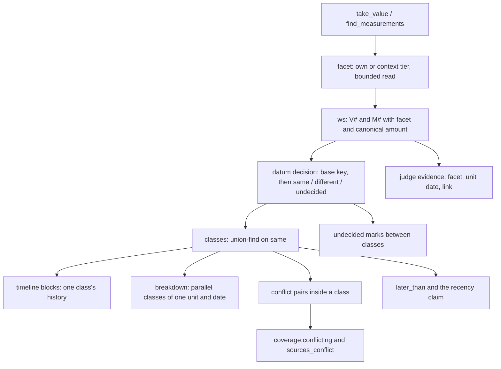
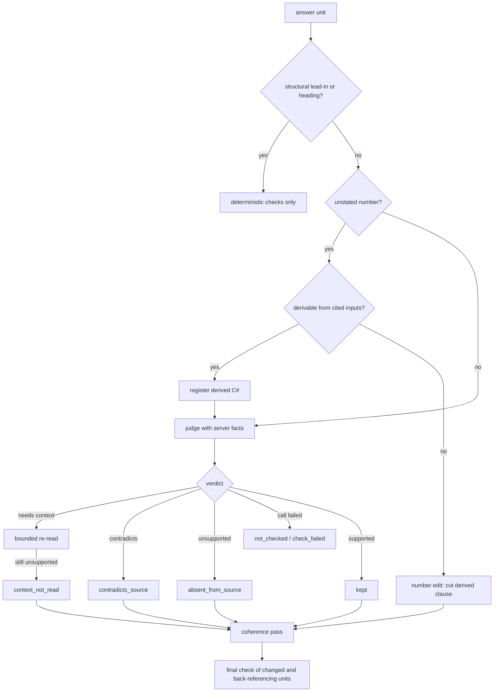

# Datum Meaning in Verification, Conflicts and the Timeline - Plan

## Goal Capsule

- **Objective:** When a user asks how an appraisal reached its values, every coefficient, rate and other component in the answer keeps the consideration or cash flow its source gives it. Parallel components of one appraisal are shown side by side, never as competing values. A conflict is reported only when two values of the same datum disagree. A grounded number, or a result correctly computed from grounded numbers, is never removed from the answer. Whatever was removed can be inspected by the people allowed to see it.
- **Means:**
  - a source-grounded facet on every datum and one shared same/different/undecided decision (KTD1–KTD5);
  - a components table beside the timeline (KTD7);
  - verification that reads server-held facts, verifies derived numbers by formula and repairs the answer's coherence after edits (KTD9–KTD13);
  - identity facts without party blocks, and coverage classes that separate candidates from unlinkable units (KTD8, KTD15, KTD16);
  - removal detail opened from the removal note by the message owner or an office admin (KTD14).
- **Authority hierarchy:**
  1. The user's round-13 request.
  2. This plan's Product Contract: R-IDs and the session-settled Key Decisions.
  3. KTDs.
  4. Unit text.

  Project rules in `CLAUDE.md` also bind:
  - pytest on the host only, through the serialized wrapper, never two at once;
  - tests use the synthetic office B or `rag_test`;
  - office A is read-only except evaluation conversations through the API;
  - no customer data in git;
  - `scripts/backup.sh` before any migration on the office database.
- **Stop conditions:**
  - A step would delete or reset appraisals, documents, conversations, permissions or stored data. Derived rows are only versioned beside the old ones or relabelled.
  - A settled decision proves infeasible.
  - v17 was not frozen before the first change under `backend/app/` this round.
- **Execution profile:** Opus diagnoses and decides, Sonnet implements and reviews, Haiku runs searches, tests and small doc edits. The RAG system's own models (`gpt-6-luna`) stay unchanged.
- **Who finishes:** the LFG pipeline updates PR AriGabay/rag#2. Merge and deploy stay with the user.

---

## Product Contract

### Summary

Round 13 makes the chat decide by what a datum means, not by its kind and unit alone.
- **Facets:** each value carries the component, consideration or cash flow its source states, read from the table row, column, caption, its own sentence or the nearest lead-in.
- **One decision:** the timeline, coverage and verification share one same/different/undecided decision over that identity.
- **Verification:** it keeps grounded numbers and verified derived results, reads server-held dates, separates its failure reasons, and repairs the answer's coherence after edits.
- **Identity and coverage:** identity no longer reads the appraiser's own address. Coverage separates possible candidates from unlinkable units, and a located passage from a read datum.

### Problem Frame

A user asked two questions about appraisals in the office. Both answers lost meaning that the sources state.

**Question 1: land value adjustments.** The appraisal's land table lists two reduction coefficients in two rows, each for a different consideration.
- **False conflict.** The timeline put both coefficients in one group, at the unit's valuation date, and marked them as conflicting sources with an uncertain reading.
- **Removals.** Verification removed both coefficients, because each bullet also gave its reduction as a percentage (one minus the coefficient), which no source states. It also cut the valuation date, which the server holds but the judge never saw, and withheld a structural lead-in sentence as "not classified".
- **What was left.** The answer opened with an omission marker and still referred to "the two coefficients above".
- **Group label.** The label joined the property's address with the appraiser's own office address, read from the expert declaration as if it identified the property.

**Question 2: capitalization rates.** The appraisal states a capitalization rate for each of several cash flows, each named in its own sentence.
- **False conflict.** The timeline grouped four rates as one datum and marked every pair a conflict.
- **Uncertain values.** Each value whose attribution the model wrote was flagged uncertain, while a value with the same number and no attribution was not.
- **Coverage note.** It counted 26 "undetermined" appraisals: every unidentified unit in the office.

**The root causes are shared.**
- **No component in the identity.** The comparability key has no component. The row label and the purpose phrase that state it are read and then dropped.
- **Three different "same datum" rules.** The timeline, coverage and verification each judge it differently, and amounts are compared as raw strings.
- **Verification without context.** The judge has no server-held facts and no formula for derived numbers, and the answer is never checked as a whole after edits.
- **The detail was hard to reach.** Diagnosis showed the removal detail exists and the endpoint returns it to the owner. The UI shows only counts in the body and hides the detail behind a collapsed section and a click on each row.

v16 (round 12) also left two failure classes.
- **Mixed questions without the glossary:** in W9–W12 the glossary was not cited, and W9 had no sources at all.
- **Multi-appraisal time questions:** in W6 and W7 the asked unit was found, but its valuation date and VAT basis were removed by verification.

### Key Decisions

- **The datum identity includes a source-grounded component.** (session-settled: user-directed — chosen over comparing by kind, unit and date alone: a model-invented label is not evidence, and parallel components are not one datum.) Governs R1, R2, R3.
- **Different components never conflict; a missing component is undecided; the same datum still conflicts across documents and wordings.** (session-settled: user-directed — chosen over one group per source to hide conflicts: real conflicts must stay visible.) Governs R3, R4, R6.
- **One identity and one decision for verification, coverage and the timeline.** (session-settled: user-directed — chosen over a display-only fix: the three disagreeing is the defect.) Governs R3, R4.
- **Numbers and units are normalized before any comparison.** (session-settled: user-directed — chosen over raw string comparison: a format difference is not a conflict.) Governs R5.
- **Verification separates its failure reasons and keeps what is grounded.** It distinguishes contradicts, not supported, context not read and technical failure. It reads more context, within a bound, before removing. It keeps the supported parts, and it verifies a computed result by its inputs and formula. (session-settled: user-directed — chosen over one "not supported" bucket and whole-claim removal: grounded numbers were lost.) Governs R12, R13, R14, R15.
- **Each rate or coefficient is shown with its component; parallel components go in a components table; a timeline is one datum's history.** (session-settled: user-directed — chosen over a timeline of every number: parallel components read as competing values.) Governs R8, R9, R10.
- **The final answer is re-checked after edits, and every removal's detail is reachable by an authorized user.** The existing mechanism was diagnosed before anything was added to it. (session-settled: user-directed — chosen over building a new mechanism without diagnosis: the store already holds the detail.) Governs R16, R17.
- **Coverage separates possible candidates, unlinkable units and other properties, and separates a located passage from a read datum.** (session-settled: user-directed — chosen over counting every unidentified office appraisal and treating a search hit as checked.) Governs R18, R19, R20.
- **Migration 0022 is fixed without deleting data.** (session-settled: user-directed — chosen over the round-12 review's DELETE: there is no approval to delete.) Governs R21, R22.
- **v16 becomes regression, and a new small frozen sample measures generalization. A glossary citation is never a fixed success id.** (session-settled: user-directed — chosen over keeping v16 as held-out.) Governs R23.
- **Real examples go in private tests only; no new OCR, no unrelated features, RAG models unchanged, no merge or deploy.** (session-settled: user-directed — chosen over growing the scope.) Governs R23, R25.

### Requirements

**Datum identity and the conflict decision**
- R1. Every registered value (V#) and listed measurement (M#) carries a facet: the component, consideration or cash flow its source states, with the part it came from and its tier. A label or subject the model wrote is never a facet.
- R2. When a value's own row or sentence states no facet, the server reads its defining context within a bound (its sentence, the list lead-in, the nearest heading in its section, the table caption and headers) before deciding. The outcome is recorded as `stated`, `none` or `not_read` (KTD1).
- R3. Two data are decided same, different or undecided by one rule. The timeline, the coverage conflict reason, the "latest" claim check and the judge's evidence all read that rule.
- R4. A conflict is marked only between two data decided "same" whose normalized amounts differ and whose periods overlap. Two values of one datum still conflict across documents and wordings.
- R5. Amounts and units are normalized before comparing: separators, trailing zeros, stated scale, percent versus fraction for rates and coefficients, and the written form of a stored measurement. A difference in representation never conflicts.
- R6. An undecided pair whose amounts differ and whose periods overlap is marked "השוואה לא הוכרעה", naming the other value, and is presented neither as a conflict nor as agreement.
- R7. A value whose number, kind and unit are grounded in its source is not marked uncertain because the model asserted an attribution or an attribute. That attribute counts as unknown everywhere.

**Answer and timeline**
- R8. A timeline block holds one datum's history. Parallel components of one appraisal at one date are shown as a components table: facet, value, unit and source.
- R9. Each rate or coefficient in the answer, in the components table and in a timeline label is named with its facet.
- R10. The same number in two different cells stays two rows when their facets differ.
- R11. A property's group label and its links come only from the subject's identification. Party blocks never supply identity facts. A party block is the appraiser's, expert's, client's or office's details, declaration or letterhead.

**Verification**
- R12. A number derived from cited, grounded inputs by a simple formula is verified by that formula, recorded as a server computation, and kept. If it does not verify, only the derived part is cut and the grounded number stays.
- R13. The judge and the date check receive the server-held facts about each cited source's unit: its valuation date with its anchor, and its link reason.
- R14. Removal reasons distinguish four cases: the source contradicts the claim, the source does not support it, the defining context was not read, and the check failed technically. A context-not-read removal happens only after a bounded re-read of that context: table headers, caption, notes, continuation, section lead-in and section notes.
- R15. A structural lead-in or heading is never removed as an unverified claim, and its numbers still pass the deterministic checks. A lead-in whose items were all removed goes with them.
- R16. After edits, the final answer has no paragraph made only of omission markers, no lead-in without items, no reference to removed content, and no dangling clause.
- R17. Every removal's detail can be opened from the removal note and from the markers by the message owner or an office admin. The detail holds the full original claim, the part kept, the reason and the sources checked. The answer also shows how many claims were edited.

**Coverage and recency**
- R18. Coverage separates three classes of appraisal units.
  - **Possible candidates:** unlinked units whose text mentions the property's identifiers, or that are partly read.
  - **Unlinkable units:** units with no identity and no such mention.
  - **Other properties:** units proven to be another property.

  Only candidates block completeness. The note names up to three candidates, counts all of them, and counts unlinkable units separately.
- R19. Coverage distinguishes a located passage from a read datum. A newer unit that was only located keeps the answer's recency wording qualified, and the note names what was not read.
- R20. With partial coverage the answer keeps "הנתון המאוחר ביותר במקורות שנבדקו" and says what was not checked.

**Data, migration and evaluation**
- R21. A rollback of 0022 never deletes rows and never leaves stale flags read as current. Dates are rebuilt under a new derivation version beside the old rows, and a downgrade and re-upgrade is tested with existing data.
- R22. No appraisal, document, conversation, permission or stored datum is deleted or reset. Derived records change only by new versions beside the old ones, and the office database is backed up before a migration.
- R23. Public tests use synthetic properties and numbers, and the two reported conversations are tested privately. v16 runs as regression. v17 is frozen before the first `backend/app/` change and run once on the final build. A mixed question needs a glossary citation only when its answer needs it.
- R24. A saved answer shown after a refresh holds the same timeline, components table, marks, coverage note and removal access as when it was answered. Older messages render as before.
- R25. The RAG models are unchanged. Nothing adds OCR or an unrelated capability. The PR is updated without merge or deploy.

### Acceptance Examples

- AE1. **Complementary coefficients.**
  - **Covers:** R1, R3, R8, R9.
  - **Given:** one appraisal table lists a coefficient 0.8 in a row naming one consideration and 0.9 in a row naming another, both at the unit's valuation date.
  - **When:** the answer cites both.
  - **Then:** no conflict or uncertain mark. A components table lists both with their row labels, and no timeline block joins them.
- AE2. **Rates for different cash flows.**
  - **Covers:** R1, R2, R3, R6, R10.
  - **Given:** one appraisal states four capitalization rates, each sentence naming its cash flow, two of them with the same number.
  - **When:** the answer cites them.
  - **Then:** four facets and a components table. The two equal numbers stay two rows.
  - **And when** one rate's quote names no cash flow but its preceding lead-in does: the facet comes from the lead-in. If neither does, that rate is undecided against the others, never conflicting.
- AE3. **A real conflict in one component.**
  - **Covers:** R4, R5.
  - **Given:** two appraisals of the same property at the same valuation date state a coefficient for the same consideration as 0.8 and 0.85, one written as "80%". A third states 0.80.
  - **Then:** the 0.8 and 0.85 pair is marked a conflict, and the 0.80 and "80%" pair is equal, not a conflict.
- AE4. **Different names for one component.**
  - **Covers:** R3.
  - **Given:** two rows name the same cash flow with a different prefix, plural and quote marks.
  - **Then:** they are decided "same" and compared.
- AE5. **A derived reduction.**
  - **Covers:** R12, R16.
  - **Given:** an answer bullet "מקדם 0.8 — הפחתה של 20%" cites the coefficient's cell.
  - **Then:** the 20% verifies as 1 − 0.8 and the bullet stays.
  - **And given** the bullet said 25%: only "הפחתה של 25%" is cut and 0.8 stays, with no marker-only line and no dangling "של".
- AE6. **The valuation date the server holds.**
  - **Covers:** R13.
  - **Given:** an answer says the appraisal's valuation date is 01.03.2023, which the server holds as the cited unit's stated valuation date.
  - **Then:** the date is supported, and it is not cut.
- AE7. **A lead-in and a back-reference.**
  - **Covers:** R15, R16.
  - **Given:** a lead-in naming a lot number introduces two bullets, and a later sentence refers to "the two coefficients above".
  - **When:** both bullets are removed.
  - **Then:** the lead-in goes with them, and the later sentence is re-judged and removed or repaired as dependent.
  - **When** the bullets stay: both sentences stay.
- AE8. **The appraiser's address.**
  - **Covers:** R11.
  - **Given:** a unit whose declaration block gives the appraiser's office address in another city.
  - **Then:** the unit's identity holds only the subject's address and city, there is no city conflict, and the group label names one address.
- AE9. **Undetermined appraisals.**
  - **Covers:** R18.
  - **Given:** an office with 20 unidentified units, two of which mention the property's street and number.
  - **Then:** the note names those two as candidates and counts 18 as unlinkable, and only the two block a complete record.
- AE10. **Rollback of 0022.**
  - **Covers:** R21.
  - **Given:** a test database with dated versions.
  - **When:** 0022 is downgraded and upgraded.
  - **Then:** every row is kept, no row of the current dates version holds a lost flag, and the next read derives fresh rows beside the old ones.

### Success Criteria

- On the final build, each of the two reported questions is run three times. Every coefficient or rate registered is shown with its source's facet, with no false conflict and no removed grounded number. Each remaining removal is justified against the source in the round record.
- The round record says which conflicts and removals of the reported answers were wrong, what fixed each, the tested commit and image, the v16, v15 and v17 results, and what stays open. Success is read from that distinction, not from fewer warnings or more passing tests.

### Scope Boundaries

- No new extraction model, OCR, upload path or document reader. The stored measurements table gets no backfill: a measurement's facet is derived when it is listed.
- No new removal store. The existing `message_diagnostics` record and its endpoint stay the single source of removal detail.
- No change to how the model chooses tools, beyond the facet text it now reads, one answer rule about naming a component, and the U14 rule that a mixed question searches the professional pool when no other cited source supports its professional statement.
- The W1 follow-up wording, an answer that should open by saying the asked date was not found, is not targeted. It is tracked by v16 regression.

#### Deferred to Follow-Up Work

- Splitting DOCX compendia into units in the reader (round-12 residual).
- Per-version bulkheads and lock timeouts for cold derivation (round-12 residual).
- Reading a unit's value-bearing sections by structure before query search in multi-appraisal files, if the final v16 or v17 run still shows misses after verification is fixed.

---

## Planning Contract

### Key Technical Decisions

- KTD1. **The facet is a stored, anchored record with two tiers.** `calc.Value` gains a `facet` record holding the written text, the source part, the tier and the status.
  - **Part:** `row`, `column`, `caption`, `sentence`, `lead_in` or `heading`.
  - **Tier:** `own` comes from the value's own row label, its column header in a matrix table, or the purpose phrase of its own sentence. `context` comes from the caption, the list lead-in or the nearest heading.
  - **Status:** `stated`, `none` (read, nothing stated) or `not_read`.

  The facet is source text only. `Value.label` and `Value.subject` never feed it. The code calls the concept `facet` because "component" already means a component of the user's request (`coverage.component_outcomes`, `ChatComponent`); the UI calls it "רכיב". (session-settled: user-directed — chosen over comparing by kind, unit and date alone: the component must be grounded in the source.) Governs R1.
- KTD2. **Facets are resolved once, when a datum enters the turn, and memoized in `ws`.**
  - **V#:** resolved in `tools.tool_take_value`, which already sees the cell's row label, header, caption and notes (`_cell_of`) and the quote's source line (`_take_quote`).
  - **M#:** resolved when listed, from `table_index` and `row_index` through `reader.table_structure` for table rows, and from the quote for text rows.
  - **The bounded read:** at most the value's sentence, three preceding blocks inside its section, and the table's caption, headers and notes. It is stored text only, with no model call.

  Verification has no database connection, so it reads only the stored facet. All three consumers therefore see one result. Governs R2.
- KTD3. **One pairwise decision: same, different or undecided.**
  - **Normalizing a facet:**
    - unify gershayim and geresh spellings;
    - strip one leading prefix letter (ה, ו, ל, ב, מ, ש) from words longer than three letters;
    - fold plural and construct endings (ים, ות, י);
    - drop the family's generic words and the metric word (מקדם, שיעור, היוון, הפחתה, בסיסי, שווי, נכס …);
    - keep digits.

    The family's word lists live in one table next to `resolve.family`.
  - **Purpose phrases:** a phrase whose head word is a period, unit, date or basis term (שנה, חודש, מ״ר, תאריך, מועד, לפי) is not a facet.
  - **Component families:** coefficient, and proportion (rates, percentages, adjustments) are marked as families whose datum needs a component (`FACET_FAMILIES`). In such a family an empty core counts as unresolved, unless the value is the only value of its base key in its appraisal unit: then it is that unit's headline datum. In other families an empty or absent facet is the unit's headline datum.
  - **The decision table, first match wins:**

    | Facets A and B | Decision |
    |---|---|
    | Both `own`, equal non-empty cores | same |
    | Both headline (no facet stated, and either a non-facet family or the only value of its base key in its unit) | same |
    | Each core keeps a content word the other lacks, and both are in one unit's same table, list or section | different |
    | Everything else: subset, disjoint across units, equal context-tier cores, unresolved, stated versus headline | undecided |

  (session-settled: user-directed — chosen over one group per source to hide conflicts: the same datum must still be flagged across documents and wordings.) "Different" needs structural evidence, because two wordings of one datum in two documents can share no words. A pair is therefore never dropped silently: when the facets establish one datum it is compared and can conflict; when they cannot, the pair is marked undecided (R6), and a newer undecided datum keeps the recency wording qualified (KTD4). Governs R3, R4, R6.
- KTD4. **Grouping is union-find on "same" edges inside the existing base key.**
  - **Base key:** today's `timeline._fields` with the normalized unit (KTD5), plus the property group.
  - **Classes:** "same" pairs inside a base key join into datum classes.
  - **Readers:** every reader takes the class as the datum: timeline blocks, `conflicting_pairs`, `_dedupe` (which adds the facet), the `alone` shortcut, `later_than` and the recency claim.
  - **Undecided marks:** between two classes of one base key, a pair whose amounts differ and whose periods overlap is marked `undecided` on both rows. Each mark carries the other row's sid.
  - **Recency:** `later_than` ignores a newer datum only when its class is decided "different" from the cited class. A newer, measured datum in an undecided class keeps the answer's recency wording qualified (R20), and the coverage note names it.
  - **Coverage:** `coverage.conflicting` stops deriving its own key. It returns true only for a conflict pair inside a class, read from the same classes.

  Decided this way because the facet rule is not transitive, so it cannot be a key field. (session-settled: user-directed — chosen over a display-only fix.) Governs R3, R4, R6.
- KTD5. **Amounts are compared in one canonical form.** A `Decimal` normalized and multiplied by its stated scale. Coefficients and proportions compare as fractions (a percent is divided by 100), so the unit `percent` and the unit `ratio` meet. A measurement's amount comes from `measurements.values.parse_amount`; a range compares by its bounds. Strings are never compared. Governs R5.
- KTD6. **Certainty follows the attributes that define the number.**
  - **When a value is uncertain:** `Value.certainty` is `model_asserted` only when the kind or the unit was asserted.
  - **An asserted attribute** (stance, stated_by, scenario, period, area basis, VAT) counts as not stated in every reader. The key, calculations and the coverage reason already treat it this way. A claim that states that attribute goes through the existing qualifier edit.
  - **Stance class:** an asserted stance falls into the appraisal's own class (`stance_class` maps unknown to "adopted"). That is the class a header-line value already has.

  Governs R7.
- KTD7. **The components table is a new payload block, `answer.time.breakdown`.**
  - **Block shape:** label, `as_of`, and rows. Each row holds the facet, value text, unit, sid, source and marks.
  - **When built:** one block per appraisal unit and date where two or more classes of one base key are "different" or "undecided".
  - **Row placement:** a row belongs to exactly one block. Rows at a unit and date that has a components block go only there. A class's timeline block holds its other dated rows, and it is still shown when it has a single other row.
  - **Facet display:** a breakdown row shows its own written facet. A timeline label shows the written facet of the class's first row in server order. A row with status `none` or `not_read` shows "רכיב לא צוין במקור". Long facets wrap, with no truncation.
  - **Wording:** the block is headed "רכיבי השומה" and the facet column "רכיב או שיקול (כלשון המקור)", so it is not confused with the request components ("רכיבי הבקשה").
  - **Where it reaches:** the payload, `timeline.plain_text`, `_answer_documents` (visibility on reload), `ChatAnswerTime` and a `Breakdown` renderer beside `Timeline` in `frontend/components/chat/Message.tsx`.
  - **Labels:** a timeline label names the class's facet.

  Governs R8, R9, R10, R24.
- KTD8. **Identity v2 skips party blocks.**
  - **Heading class:** `identity._section_of` gains a `party` class, closed like `excluded`. The headings are the expert's, appraiser's or client's details, the declaration, the signature and the office.
  - **Label guard:** in `pair()` and `table()`, an address or city row is skipped when the nearest preceding label row in its block or table is a party label, with no subject, parcel or identification label between them. The party labels are the expert's or appraiser's name, licence, phone, fax, e-mail and office. A bare "כתובת" or "עיר" row outside such a group is read as before.
  - **Exception:** a subject label ("כתובת הנכס" and its variants) is never skipped.
  - **Rebuild:** `IDENTITY_VERSION` becomes identity-v2, so units are re-derived lazily beside the v1 rows.

  Governs R11, R22.
- KTD9. **Derived numbers are server computations.**
  - **Scope:** before `unstated_number` removes a number, the server tries a bounded derivation from the unit's cited V#/M# of one appraisal unit, with at most two operands.
  - **Formulas:** 1 − x and (1 − x)·100 behind reduction wording (הפחתה, הנחה); x − 1 and (x − 1)·100 behind addition wording (תוספת, פרמיה); x·100 and x/100 only as the percent or fraction form of the same cited value. Two-operand forms (a + b, a − b, a·b, a/b) count only when the claim's own text names the relation (סך, סה״כ, הפרש, מכפלת, חלקי, ביחס ל). Each is evaluated through `calc.evaluate` and matched with `calc.display_matches` precision.
  - **A match** is registered as a C# with result kind `derived`, so `_computed_numbers`, the judge's `computation_text` and the final check all see it. The unit still goes to the judge with that computation shown. `JUDGE_VERSION` is bumped.
  - **A failed derivation** becomes a number edit, a new edit kind on the `QualifierEdit` range machinery. It cuts the derived clause to its clause boundary and keeps the grounded number.

  Governs R12.
- KTD10. **Server-held unit facts reach the judge.**
  - **Judge evidence:** `verify._source_parts` renders each cited source's `Source.date_line` and link phrase as server text.
  - **Date check:** `_date_backed` accepts a date equal to a cited source's stated unit valuation date.
  - **Guard kept:** date digits still never back other numbers (the existing `dated=False` path).

  Governs R13.
- KTD11. **Four failure classes, and context is read before a removal for missing context.**
  - **The new kind:** `context_not_read`, a new `FAILURE_KINDS` entry with its removal sentence and UI label.
  - **When it applies:** the judge asked for context and the bounded re-read returned `no_context`, `bound`, `not_found` or `no_time`.
  - **Contradicts:** `contradicts_source` stays only for a judge "contradicts" on shown evidence.
  - **Not checked:** `not_checked` with `check_failed` stays the technical failure.
  - **More kinds of context to re-read:** table header, caption, notes, continuation, section lead-in and section notes.
  - **Before a qualifier edit:** the same re-read runs before a VAT, basis or period edit. An attribute stated there counts as source-stated with its anchor.

  Governs R14.
- KTD12. **Lead-ins are structure, not claims.**
  - **Detection:** `structural_kind` recognizes a line of at most eight words ending with a colon and followed by list items, or a heading, even when it holds digits. A longer colon line is still judged.
  - **The judge:** that exemption covers the judge only. `deterministic` still checks the line's numbers.
  - **Removal:** a lead-in whose items are all gone is removed as a `dependency`.

  Governs R15.
- KTD13. **Coherence repair is a function of the final state.** Each rule keeps `assert_fixed_point` true.
  1. A cut that leaves no substantive words becomes a whole-unit removal with no marker.
  2. A lead-in without items is removed as a `dependency`.
  3. A kept unit that holds a back-reference (לעיל, הנ״ל, כאמור, האמור, "שני ה…", "שלושת ה…"), when a unit before it in its section was removed, is re-judged in the final check with the preceding kept text shown. A `depends_on` verdict removes or repairs it as a `dependency`.
  4. A cut ending in a connector (של, —, :, ו־, כי, אשר) is extended to the clause boundary.

  Governs R16.
- KTD14. **The removal detail is fixed where it was lost.**
  - **Diagnosis:** on the two real messages, `GET /api/chat/messages/{id}/diagnostics` returns 200 to the office admin, with every removal's draft, remaining part, reason and sources. The body shows only the count lines (the `removal_note` span, `AnswerQuality`), and the detail sits behind the collapsed "מקורות ופרטים" section and a click on each row.
  - **Fix:**
    - the removal note gets an action that opens the details with every removal expanded;
    - the stored `text` keeps up to 2,000 characters instead of 300;
    - `public_verification` passes `edited`.

    The endpoint's visibility rule is unchanged: 404 for the whole message when any document behind it is hidden, as `test_chat_permissions.py` pins. A visible message therefore has every removal's sources visible, so the note's action always opens complete detail. Row-level security (`owner_or_admin`) is unchanged.

  Governs R17.
- KTD15. **Coverage classes come from one bounded probe.** `PropertyGraph._gather`'s undetermined set is split by one lexical search, scoped to those units' blocks, for the focus property's identifiers: street core and number, block and parcel, and title aliases.
  - **Possible candidates:** units with a hit, and units with a partly read status. They are named (up to three) and counted, and they block completeness.
  - **Unlinkable units:** counted only, and they do not block.
  - **Proven other properties:** counted in the record only.
  - **Leaving the candidate class:** a possible candidate whose mention the turn read and whose text puts it under another subject (a comparables or transactions section, or an identity that differs from the focus) is recorded as read and stops blocking.

  The coverage record version becomes `COVERAGE_V = 2` with additive fields. `docs/api-contract.md` follows. Governs R18.
- KTD16. **"Located" and "read" are different statuses.**
  - **Located:** today's `hit` becomes `located`, a passage returned.
  - **Read:** a unit becomes `read` when the turn registered a datum of the cited datum's base key from it, or read its section or table.
  - **Blocking:** in recent mode, a newer unit that is only located blocks with a new reason, `B_LOCATED`. The model's coverage summary names it, so the model can read it.

  Governs R19, R20.
- KTD17. **0022 is fixed by a new dates version, plus a downgrade that relabels instead of deleting.**
  - **New version:** `DATES_VERSION` becomes dates-v5. Any database that already cycled re-derives lazily beside its v4 rows, and the v4 rows stay unread.
  - **Downgrade:** before dropping the column, 0022's downgrade relabels the rows written by versions that know it (`dates_version NOT IN ('dates-v1','dates-v2') AND dates_version NOT LIKE '%-rolled-back'`) to `<version>-rolled-back`. The UPDATE runs between `NO FORCE ROW LEVEL SECURITY` and `FORCE ROW LEVEL SECURITY` in the same transaction, as migration 0016 does, because the forced policy would otherwise match no row. A re-upgrade then finds no current rows and derives fresh ones.

  `version_dates` has no unique constraint, so the old rows stay as they are. (session-settled: user-directed — chosen over the round-12 review's DELETE: there is no approval to delete.) Governs R21, R22.
- KTD18. **Evaluation discipline.**
  - **v17 sample:** six to eight office-A questions on parallel components (coefficients, rates, adjustments) and two multi-appraisal time questions. They are written from the source files and frozen with a sha256 before the first `backend/app/` change, and `chat_eval.py` gains a `--sha` check.
  - **Private replay:** the two reported questions are replayed by a private script under the gitignored `real_documents/`, with expectations checked against their sources.
  - **Glossary scoring:** the eval's `source_docs` gains `if_needed` for mixed questions. Such a question passes when the glossary is cited, or when the answer makes at least one professional statement and every such statement is verified as supported by another cited source. An answer with no professional statement fails, unless the item's reference marks the professional part as not asked.

  (session-settled: user-directed — chosen over keeping v16 as held-out.) Governs R23.
- KTD19. **Every derived-record change is a version bump.** All of them are non-deleting: old rows stay inert.
  - `VALUE_VERIFIER_VERSION` becomes value-v5, because the facet enters the Q# cache record.
  - `JUDGE_VERSION` becomes 8.
  - `IDENTITY_VERSION` becomes identity-v2.
  - `DATES_VERSION` becomes dates-v5.
  - `COVERAGE_V` becomes 2.

  Governs R22.

No Bake-off was run. The facet rule is a judgment over text the system already holds, it is recomputed per turn, and it is stored only in versioned caches. A later change is therefore cheap.

### High-Level Technical Design

How one decision reaches every consumer:

How verification handles a unit, in the order it runs:

### Assumptions

- The family word lists (KTD3) start from the vocabulary seen in office reports and synthetic fixtures. A missed generic word yields "undecided", never a false "same", so the error is safe.
- Three blocks back inside the section is enough for a lead-in or heading facet. Beyond that the facet is `none`.
- The single coverage probe costs one search per timed turn on an identified property. That is within the current turn budget (round 12 measured per-unit searches at the same scale).
- A partly read unlinkable unit is treated as a possible candidate, because its unread part may hold the identifiers.
- A located-only older unit never blocks. Only a newer one does.
- The `if_needed` glossary rule is applied to v16's W9–W12 as a documented reference correction (`reference_corrected`), with the evidence written in the round record.

### Sequencing

1. U1 (v17 freeze and the private replay) lands before any change under `backend/app/`.
2. U2 (fixtures) and U3 (facets).
3. U4 (decision and classes), then U5 (certainty) and U6 (components table and UI).
4. U7 (identity v2) and U13 (0022) are independent and can run beside 2–3.
5. U9, U10 and U11 change `verify.py`, so they run in that order, one at a time.
6. U8 (coverage) after U4. U12 (removal detail) after U10.
7. U14 (mixed questions), then U15 (integration, e2e, real-model), then U16 (the office run and the record).

### System-Wide Impact

- **Persisted answers:**
  - New answers carry `time.breakdown`, facets on values, `undecided` marks and coverage v2.
  - Old answers render unchanged, because nothing is recomputed on reload.
  - Hidden-document checks (`_answer_documents`) must cover the new fields.
- **Caches:** the Q# value cache, identities and dates rebuild under new versions on first use. The first timed question in a large office pays the rebuild, unless `scripts/derive_time_records.py` is run after the backup.
- **Judge contract:** the new judge version invalidates cached verdicts, so the first answers after the deploy cost more judge calls.
- **Frontend contract:** `ChatAnswerTime`, `ChatTimelineMark`, `ChatFailureKind` and the coverage record types change, and `docs/api-contract.md` documents them.

### Risks & Dependencies

| Risk | Mitigation |
|---|---|
| The facet rule says "different" for a real conflict | "Different" needs structural parallelism (KTD3). Cross-unit pairs are at worst undecided, and AE3 pins the conflict case. |
| Generic-word stripping empties distinct facets | In a component family an empty core is unresolved, never "same" (KTD3). AE1 pins it. |
| The derived-number check accepts a coincidence | Every formula has a wording gate, operands come from cited data of one unit, and the unit still goes to the judge with the computation shown (KTD9). |
| Two sentences in one section restate one rate with different words and amounts | A restatement with no purpose phrase has no own facet, so the pair is undecided rather than different (KTD3). Accepted trade-off: two purpose phrases that name different flows in one section are decided different. |
| A coherence edit breaks the fixed point | Every edit is a function of the final state, recorded as a `dependency` removal (KTD13). The final-check tests assert the fixed point. |
| The party-label guard drops a subject address | The guard covers only the party's own label group, and subject labels are never skipped (KTD8). Synthetic tests keep a bare "כתובת" subject row below an appraiser row. |
| The coverage probe adds latency | One scoped search per turn (KTD15), measured in U16. |

---

## Implementation Units

| U-ID | Title | Main files | Depends on |
|---|---|---|---|
| U1 | v17 freeze and private replay | `real_documents/eval/` (private), `backend/eval/chat_eval.py` | — |
| U2 | Round-13 synthetic fixtures | `backend/tests/fixtures/round13/`, `backend/scripts/generate_fixtures.py` | U1 |
| U3 | Facets on values and measurements | `backend/app/chat/datum.py`, `tools.py`, `calc.py` | U2 |
| U4 | One datum decision and classes | `datum.py`, `timeline.py`, `coverage.py` | U3 |
| U5 | Certainty by defining attributes | `calc.py`, `tools.py` | U4 |
| U6 | Components table, labels and UI | `timeline.py`, `api.py`, `engine.py`, `frontend/components/chat/Message.tsx` | U4 |
| U7 | Identity v2 without party blocks | `identity.py` | U1 |
| U8 | Coverage classes and located versus read | `property.py`, `tools.py`, `timeframe.py` | U4, U7 |
| U9 | Server facts and derived numbers | `verify.py`, `calc.py` | U4 |
| U10 | Failure classes, context re-read, lead-ins | `verify.py`, `rereader.py` | U9 |
| U11 | Coherence after edits | `verify.py`, `compose.py`, `final_check.py` | U10 |
| U12 | Reachable removal detail | `api.py`, `frontend/components/chat/Changes.tsx`, `Message.tsx` | U10 |
| U13 | 0022 without deletion | `alembic/versions/0022_*`, `dates.py` | U1 |
| U14 | Mixed questions and glossary scoring | `engine.py` or `tools.py`, `backend/eval/` | U10 |
| U15 | Integration, refresh, e2e and real-model tests | `backend/tests/`, `frontend/e2e/` | U6, U8, U11, U12 |
| U16 | Office run, evaluation and the round record | `docs/evaluation/conversational-rag.md`, `CONCEPTS.md` | U15, U13, U14 |

### U1. v17 freeze and private replay

- **Goal:** freeze a held-out sample and a private replay of the two reported questions before any product change.
- **Requirements:** R23; KTD18.
- **Dependencies:** none.
- **Files:**
  - `real_documents/eval/real_v17_heldout.yaml` and its `.sha256` (private, gitignored)
  - `real_documents/tests/round13/replay.py` (private)
  - `backend/eval/chat_eval.py`
  - `backend/tests/unit/test_chat_eval_scoring.py`
- **Approach:**
  1. The orchestrator writes six to eight v17 items from office-A source files: parallel coefficients, rates or adjustments, and two multi-appraisal time questions. Each reference is written from the document, with no run first.
  2. Record the sha256 and its prefix in the round record before the first `backend/app/` commit.
  3. Add a `--sha <file>` check to `chat_eval.py` that refuses a set whose hash differs.
  4. Add the `source_docs` `if_needed` mode (KTD18).
  5. The private replay asks the two reported questions through the API in new office-A conversations, a bounded number of times. It writes the answers, the timeline, the breakdown and the diagnostics under `real_documents/`, and checks expectations taken from the sources: facets per value, no conflict mark between different facets, the coefficients kept, the valuation date kept, no orphan reference.
- **Execution note:** run the replay once on the round-12 image as a baseline before U3 lands. It must reproduce the reported defects.
- **Patterns to follow:** v16 freeze in `docs/evaluation/conversational-rag.md` (round 12), `chat_eval.py` grading layers.
- **Test scenarios:**
  - `--sha` with a matching file runs; with a changed file it exits with an error naming the mismatch.
  - `if_needed`: an answer citing the glossary passes.
  - `if_needed`: an answer citing no glossary but with every professional statement verified passes.
  - `if_needed`: an answer with a removed professional statement and no glossary fails.
  - `if_needed`: an answer that makes no professional statement fails, unless the reference marks the professional part as not asked.
- **Verification:** the sha is recorded in the round record before U3's first commit, and the baseline replay reproduces the false conflicts and the removals.

### U2. Round-13 synthetic fixtures

- **Goal:** synthetic appraisals that exercise every acceptance example, with invented names, places and numbers.
- **Requirements:** R23; AE1–AE9.
- **Dependencies:** U1.
- **Files:**
  - `backend/scripts/generate_fixtures.py` (`--only round13`)
  - `backend/tests/fixtures/round13/` (DOCX files and `manifest.json`)
- **Approach:** generate the following cases.
  - a land table with two reduction coefficients for different considerations;
  - a capitalization section with four rates for named cash flows, two of them equal, and one rate whose cash flow appears only in the preceding lead-in;
  - two appraisals of one property at one date with a conflicting coefficient for the same consideration, one written as a percent;
  - a row naming a component in a different form;
  - a declaration block with the appraiser's office address in another city;
  - an office with unidentified units, two of which mention the property.

  The manifest states each expected facet, decision and identity.
- **Patterns to follow:** round-12 fixtures and manifest (`backend/tests/fixtures/round12/`). Build multi-unit files with `backend/tests/support/unit_files.py`.
- **Test expectation:** none — fixtures only. They are exercised by U3–U15.
- **Verification:** `generate_fixtures.py --only round13` reproduces the files byte for byte. The manifest covers AE1–AE9.

### U3. Facets on values and measurements

- **Goal:** every V# and M# carries a source-grounded facet, resolved once per turn.
- **Requirements:** R1, R2; KTD1, KTD2, KTD19.
- **Dependencies:** U2.
- **Files:**
  - `backend/app/chat/datum.py` (new: facet reading, normalization, family word lists)
  - `backend/app/chat/tools.py` (`_cell_of`, `_take_quote`, `tool_take_value`, `_new_value`, measurement listing, cache record and `VALUE_VERIFIER_VERSION`)
  - `backend/app/chat/calc.py` (`Value.facet`, `public()`)
  - `frontend/lib/chatTypes.ts` (`ChatValue.facet`)
  - `backend/tests/unit/test_datum_facet.py`
- **Approach:**
  1. **Table cells:** the own facet is the row label, or the (row label, column header) pair when both name things. The caption and table title are the context facet.
  2. **Quote values:** the own facet is the purpose phrase in the value's own sentence: the words after ל, עבור, בגין or בעבור that follow the number or the metric word, up to the clause end. When that is empty, the bounded read (KTD2) looks for a lead-in or heading.
  3. **Measurements:** a table measurement uses its table's row and header through `table_index` and `row_index`. A text measurement uses its quote.
  4. **The model** sees the facet in the V# and M# lines its tools return.
  5. **Cache:** bump `VALUE_VERIFIER_VERSION`, so cached records hold the facet and older ones stay inert.
- **Patterns to follow:** the `meaning_from` `{part, written}` anchors and `_kind_anchor` in `tools.py`; `test_meaning.py` `_cell_value` builds table V# through `tools._cell_of`.
- **Test scenarios:**
  - A cell in a row labelled with a consideration gets that row label as an `own` facet, from part `row`.
  - A quote "שיעור היוון של X% ל<תזרים>" gets the cash-flow phrase as an `own` facet, from part `sentence`.
  - A quote holding only "שיעור היוון X%" under a lead-in naming a cash flow gets that lead-in as a `context` facet. With no lead-in or heading within three blocks it gets status `none`.
  - A value whose model label names a component the source does not state gets no facet from that label.
  - A quote "X% לשנה" or "X ₪ למ״ר" gets no facet from "לשנה" or "למ״ר".
  - A stored table measurement gets its row label. A text measurement whose quote names nothing gets status `none`.
  - A cached Q# record from value-v4 is not reused, and a value-v5 record round-trips its facet.
- **Verification:** every V# and M# in the round-13 fixtures carries its expected facet from the manifest.

### U4. One datum decision and classes

- **Goal:** one same/different/undecided decision, read by the timeline, coverage and the recency claim.
- **Requirements:** R3, R4, R5, R6, R10; KTD3, KTD4, KTD5.
- **Dependencies:** U3.
- **Files:**
  - `backend/app/chat/datum.py` (decision, canonical amount)
  - `backend/app/chat/timeline.py` (`datums`, `groups`, `_dedupe`, `build`, `later_than`, marks)
  - `backend/app/chat/coverage.py` (`conflicting` as a reader of the classes; `conflicting_pairs` kept as the pair rule within a class)
  - `backend/app/chat/verify.py` (`_recency_claim` through `later_than`)
  - `backend/tests/unit/test_datum_decision.py`, `backend/tests/unit/test_timeline.py`, `backend/tests/unit/test_coverage.py`
- **Approach:**
  1. Build the base key from `_fields` with the normalized unit.
  2. Inside it, decide pairs by the KTD3 table and union "same" pairs into classes.
  3. Mark conflicts inside a class and `undecided` between classes.
  4. Compare amounts in the canonical form (KTD5).
  5. Replace `coverage.conflicting`'s own bucket key with the classes. Keep `validate_requested` and reason 8 reading it.
- **Execution note:** start from failing tests for AE1–AE4 and for the existing parity test (`test_validate_requested_keeps_sources_conflict_exactly_when_the_timeline_shows_a_conflict_mark`).
- **Patterns to follow:** the `Office` helper and `as_of()` in `backend/tests/unit/test_timeline.py`; `calc.same_subject` for word handling.
- **Test scenarios:**
  - Covers AE1. Coefficients 0.8 and 0.9 from two rows of one table, at one date: no conflict mark, two classes, both rows decided different.
  - Covers AE2. Four rates with disjoint cash-flow facets in one section: four classes, no conflict. Two equal numbers stay two rows after `_dedupe`.
  - Covers AE2. A rate with an unresolved facet against a rate with a stated facet in another section: undecided mark, no conflict.
  - Covers AE3. The same consideration in two appraisals of one property at one date, 0.8 against 0.85: conflict. 0.80 against "80%": equal.
  - Covers AE4. Two facets differing only in prefix, plural and gershayim are decided same.
  - Two facets in a component family that both reduce to an empty core, in a unit that holds both, are undecided, never same.
  - Two appraisals of one property, each stating one unlabelled capitalization rate (7% in an earlier year, 8% later): both are headline data, decided same, and form a timeline block.
  - A newer rate whose facet is undecided against the cited one keeps the recency wording qualified and is named, while a newer rate of a different facet does not.
  - An undecided mark carries the counterpart's sid.
  - Two headline values (no facet, non-component family) of one property and date with different amounts: conflict, as today.
  - A stated facet against a headline value is undecided.
  - A V# 8.0 and an M# "8" of one datum compare equal. A value in a table "(באלפי ₪)" compares by its scaled amount.
  - `coverage.conflicting` is true exactly when the timeline shows a conflict mark, and false for undecided-only pairs.
  - `later_than` answers per class: a newer value of another facet does not make "the latest" false.
- **Verification:** timeline, coverage and recency tests pass with one decision, and no second key remains in `coverage.py`.

### U5. Certainty by defining attributes

- **Goal:** a grounded number is never marked uncertain because the model asserted an attribution or attribute.
- **Requirements:** R7; KTD6.
- **Dependencies:** U4.
- **Files:**
  - `backend/app/chat/calc.py` (`Value.certainty`)
  - `backend/app/chat/tools.py` (`value_uncertain`, `_settle_attribution`)
  - `backend/app/chat/coverage.py` (the `not_verifiable` limitation path)
  - `backend/tests/unit/test_value_status.py`, `backend/tests/unit/test_timeline.py`
- **Approach:**
  1. Certainty counts only `kind` and `unit` provenance.
  2. An asserted stance, stated_by, scenario, period, area basis or VAT is treated as not stated by every reader.
  3. Check that the request-component gap "נמצא ערך, אבל קריאתו או משמעותו אינן ודאיות" no longer fires for such values.
- **Patterns to follow:** round-12 U10 (`test_value_status` asserted VAT refused in calculations).
- **Test scenarios:**
  - A value with source kind and unit and an asserted stance: status automatic, no `uncertain` mark.
  - A value with an asserted kind stays uncertain.
  - An asserted VAT is still refused in a calculation (the round-12 regression).
  - An asserted stance puts the value in the own-data stance class and does not split its timeline.
  - A request component resting only on such values is not limited as `not_verifiable`.
- **Verification:** the Question 2 fixture's rates show no uncertain marks.

### U6. Components table, labels and UI

- **Goal:** parallel components are shown as a components table, and every rate or coefficient is named with its facet.
- **Requirements:** R8, R9, R10, R24; KTD7.
- **Dependencies:** U4.
- **Files:**
  - `backend/app/chat/timeline.py` (`breakdown`, `_label` with the facet, `plain_text`)
  - `backend/app/chat/api.py` (`_answer_payload`, `_answer_documents`)
  - `backend/app/chat/engine.py` (one answer rule: name a rate's or coefficient's component as its source states it)
  - `frontend/lib/chatTypes.ts`, `frontend/components/chat/Message.tsx`, `frontend/components/chat/chat.css`
  - `docs/api-contract.md`
  - `backend/tests/unit/test_timeline.py`, `frontend/e2e/round13-components.spec.ts`
- **Approach:**
  1. Build one breakdown block per unit and date with two or more parallel classes.
  2. The block's rows carry facet, value, unit, source and marks.
  3. A timeline label adds the class facet after the kind.
  4. `undecided` gets the badge "השוואה לא הוכרעה".
  5. The renderer mirrors `Timeline`: server order, RTL, mobile width.
- **Patterns to follow:** `Timeline` and `CoverageNote` in `Message.tsx`; `round12-coverage.spec.ts` fixtures through `page.route`.
- **Test scenarios:**
  - Covers AE1. Two parallel coefficients yield one breakdown block with two rows naming their row labels, and no timeline block.
  - A history of one facet over two dates yields a timeline block labelled with the facet, and no breakdown.
  - `plain_text` copies the breakdown rows.
  - One facet on two dates beside a second facet on the later date: the later date's two rows go to a components block, and the first facet's timeline block holds its earlier row only.
  - Covers AE4. Rows of one class with different written forms: each breakdown row shows its own wording, and the timeline label shows the first row's.
  - A row with facet status `none` shows "רכיב לא צוין במקור".
  - A hidden document behind a breakdown row hides the answer on reload, as for the timeline.
  - e2e: the breakdown renders under "רכיבי השומה" with facet, value and source link. The undecided badge names its counterpart sid, which opens the viewer, and reads to assistive technology as "השוואה לא הוכרעה מול" its counterpart. Both read correctly at 375px and in RTL.
  - e2e: an old message without `breakdown` renders as before.
- **Verification:** the Question 1 and Question 2 fixtures show components tables, and the e2e specs pass.

### U7. Identity v2 without party blocks

- **Goal:** party blocks never supply identity facts.
- **Requirements:** R11, R22; KTD8, KTD19.
- **Dependencies:** U1.
- **Files:**
  - `backend/app/chat/identity.py` (`PARTY_HEADINGS`, `PARTY_LABELS`, `_section_of`, `pair()`, `table()`, `IDENTITY_VERSION`)
  - `backend/tests/unit/test_identity.py`
  - `backend/tests/integration/test_version_identities.py`
- **Approach:**
  1. Add a party section class, closed like `excluded`.
  2. Skip an address or city that shares a block or table with a party label, unless its label is a subject label.
  3. Bump the version, so units are re-derived lazily beside the v1 rows.
- **Patterns to follow:** `test_a_comparables_heading_closes_its_section_to_labelled_lines_too`; `test_a_new_identity_version_derives_again_and_a_current_one_never_does` (it injects the next version, so its literal moves from identity-v2 to identity-v3 once identity-v2 is current).
- **Test scenarios:**
  - Covers AE8. A declaration line naming the expert, their licence and their office address in another city gives no address or city fact. The unit has no city conflict and links with its city.
  - The same declaration in a two-column key-value table gives no fact.
  - A subject "כתובת הנכס" line in a block that also names the appraiser is still read.
  - A cover table with an appraiser row above a block-and-parcel row and a bare "כתובת" subject row keeps the subject address.
  - Covers AE8. A bare "כתובת" office address directly under the expert's name and licence rows gives no fact.
  - A heading "פרטי השמאי" closes its section until the next heading.
  - `property.label_of` for the fixture names one address.
  - v1 rows stay in place, and the first read derives v2 rows.
- **Verification:** the round-12 manifest identity expectations still hold, and the round-13 declaration fixture links correctly.

### U8. Coverage classes and located versus read

- **Goal:** coverage names possible candidates, counts unlinkable units, and separates a located passage from a read datum.
- **Requirements:** R18, R19, R20; KTD15, KTD16, KTD19.
- **Dependencies:** U4, U7.
- **Files:**
  - `backend/app/chat/property.py` (`Gathered` with `possible`, `unlinkable` and `excluded`)
  - `backend/app/chat/tools.py` (the probe, `coverage_record`, `assess_coverage`, `_property_hits`, `unit_coverage`, `window_coverage`, `COVERAGE_V`)
  - `backend/app/chat/timeframe.py` (note wording, `B_LOCATED`)
  - `frontend/lib/chatTypes.ts`, `docs/api-contract.md`
  - `backend/tests/unit/test_property_links.py`, `test_coverage_note.py`, `backend/tests/integration/test_round12_inventory.py`
- **Approach:**
  1. After `_gather`, run one scoped lexical probe for the focus identifiers over the undetermined units, and classify them by KTD15.
  2. Statuses become `located` or `read` (KTD16). A unit is read when a V# or M# of the cited datum's base key came from it, or its section or table was read.
  3. The note names candidates (up to three), adds a separate count of unlinkable units, and names a newer unit that was only located.
- **Patterns to follow:** `_property_hits` (scoped `memoized_search`); `MSG_GROUP_UNDETERMINED` and `coverage_note`.
- **Test scenarios:**
  - Covers AE9. Two of twenty unidentified units mention the street and number: two named candidates, eighteen unlinkable, and only the candidates block completion.
  - A partly read unidentified unit with no mention is a possible candidate.
  - A record with only unlinkable units outside the focus closure is complete, and its note states the unlinkable count.
  - A newer unit whose search returned a passage, but from which no datum of the base key was registered or read, is `located` and blocks with `B_LOCATED`. The answer keeps "הנתון המאוחר ביותר במקורות שנבדקו".
  - Registering the datum from that unit makes it `read` and unblocks it.
  - A candidate whose mention the turn read inside its comparables section is recorded as read, stops blocking, and is counted apart.
  - A reads-only turn keeps its partial record (the round-12 regression).
  - Coverage v1 records in old answers render unchanged.
- **Verification:** the coverage note on the round-13 office fixture matches AE9, and the round-12 inventory tests pass with updated expectations.

### U9. Server facts and derived numbers

- **Goal:** the judge reads the cited unit's valuation date, and derived numbers are verified by formula instead of removed.
- **Requirements:** R12, R13; KTD9, KTD10, KTD19.
- **Dependencies:** U4.
- **Files:**
  - `backend/app/chat/verify.py` (`_source_parts`, `_date_backed`, `_unstated` and its derivation step, number edit, `JUDGE_VERSION`)
  - `backend/app/chat/calc.py` (`derived` result kind)
  - `backend/tests/unit/test_verify_units.py`, `test_verify_computed.py`, `test_verify_edit_ladder.py`
- **Approach:**
  1. Render `Source.date_line` and the link phrase for each cited S#.
  2. Let `_date_backed` accept the cited unit's stated valuation date.
  3. Before `unstated_number` is final, try the KTD9 derivations from the unit's cited inputs.
  4. Register a match as a C#.
  5. Otherwise plan a number edit to the clause boundary, keeping the grounded number.
- **Patterns to follow:** `_computed_numbers` and `bind_computations`; `plan_qualifier_edits` and `QualifierEdit` (generalize the label table rather than add a parallel one); the `_recording_judge` helper.
- **Test scenarios:**
  - Covers AE5. "מקדם 0.8 — הפחתה של 20%" citing the 0.8 cell: the 20% verifies as a derived C#, the unit is kept, and the judge input shows the computation.
  - Covers AE5. "הפחתה של 25%": the number edit cuts "— הפחתה של 25%", "מקדם 0.8" stays cited, no stub remains, and the edit is counted as `edited`.
  - "תוספת של 20%" on 0.8 does not derive (wording gate).
  - A number equal by chance to a sum of two cited values does not derive when the claim names no sum. It does derive when the claim says "סה״כ" and both values come from one unit.
  - A derived match still goes to the judge, and the judge input shows the computation.
  - Covers AE6. A claim naming the cited source's stated unit valuation date is supported. The judge input holds the server date line.
  - A date line's digits never back another number in the same unit.
  - The verdict cache misses under `JUDGE_VERSION` 8.
- **Verification:** the Question 1 fixture answer keeps both coefficients, both reductions and the valuation date.

### U10. Failure classes, context re-read and lead-ins

- **Goal:** removals say why, a missing context is read before a removal, and lead-ins are not claims.
- **Requirements:** R14, R15; KTD11, KTD12.
- **Dependencies:** U9.
- **Files:**
  - `backend/app/chat/verify.py` (`FAILURE_KINDS`, `REMOVAL_SENTENCES`, `FAILURE_LABELS`, `REPAIR_HINTS`, `_reread`, `structural_kind`, `_non_claim_accepted`, qualifier-edit pre-read)
  - `backend/app/chat/rereader.py` (header, caption, notes, continuation, section lead-in and section notes)
  - `backend/app/chat/api.py` (`public_removals`)
  - `frontend/lib/chatTypes.ts`, `frontend/lib/format.ts`
  - `backend/tests/unit/test_verify_reread.py`, `test_verify_units.py`
- **Approach:**
  1. Add `context_not_read` and set it when a `needs_context` re-read ends without support.
  2. Extend the re-read kinds.
  3. Run the same bounded read before a VAT, basis or period edit, and accept an attribute stated there with its anchor.
  4. Make colon lead-ins structural.
- **Patterns to follow:** `FakeFetcher`; the structural-kind tests at `test_verify_units.py` 70–100.
- **Test scenarios:**
  - A claim judged `needs_context` whose header re-read states the datum becomes supported.
  - The same with a re-read that finds nothing becomes `context_not_read`, with its own sentence, not `absent_from_source`.
  - A judge "contradicts" stays `contradicts_source`. A failed judge call stays `not_checked`/`check_failed`.
  - A VAT edit is skipped when the table's notes state "לא כולל מע״מ", and the VAT is kept with its anchor.
  - "הנתונים לחלקה 7 הם:" before two bullets is structural. A wrong lot number in it is still caught by the deterministic checks.
  - A colon line of more than eight words that asserts a fact before two bullets is still judged.
  - The frontend label exists for `context_not_read`, and `public_removals` passes it.
- **Verification:** no withheld lead-in remains in the fixture answers, and each removal carries one of the four classes.

### U11. Coherence after edits

- **Goal:** the final answer reads whole after removals and cuts.
- **Requirements:** R16; KTD13.
- **Dependencies:** U10.
- **Files:**
  - `backend/app/chat/verify.py` (`VerifyReport.edit`, the `dependency` removals)
  - `backend/app/chat/compose.py`
  - `backend/app/chat/final_check.py` (re-judging back-referencing units with the preceding text)
  - `backend/tests/unit/test_final_check.py`, `test_verify_edit_ladder.py`
- **Approach:** apply the four KTD13 rules. The back-reference lexicon lives in one tuple next to `QUALIFIER_LEXICON`. A back-referencing unit's final-check key includes the removed predecessors, so it is judged again.
- **Patterns to follow:** `_orphan_cuts`, `_remove_dependents`, `assert_fixed_point`.
- **Test scenarios:**
  - Covers AE7. Both bullets removed: the lead-in goes as `dependency`, and the "לעיל" sentence is re-judged and removed as dependent.
  - Covers AE7. Bullets kept: nothing changes.
  - A cut that leaves only a marker becomes a whole-unit removal, and no paragraph of markers remains.
  - A cut ending in "של" extends to the clause boundary.
  - A "כאמור" sentence with no removed predecessor is not re-judged.
  - Recomposition reproduces the text and the registry byte for byte after every rule.
- **Verification:** the Question 1 fixture answer, with removals forced, opens with substance and holds no orphan reference.

### U12. Reachable removal detail

- **Goal:** the owner or an office admin opens every removal's detail from the answer itself.
- **Requirements:** R17, R24; KTD14.
- **Dependencies:** U10.
- **Files:**
  - `backend/app/chat/api.py` (`public_verification` passes `edited`; `_diagnostics` and the endpoint's per-removal visibility)
  - `backend/app/chat/decisions.py` (`text` up to 2,000 characters)
  - `frontend/components/chat/Message.tsx` (removal-note action)
  - `frontend/components/chat/Changes.tsx` (expand all on open)
  - `frontend/e2e/chat-gaps-removals.spec.ts`
  - `backend/tests/integration/test_chat_permissions.py` (unchanged, run as regression)
- **Approach:**
  1. The note's action is a button "פירוט ההסרות" inside the removal note, with `aria-expanded` and `aria-controls`. It opens "מקורות ופרטים" with the removals expanded using one diagnostics fetch, scrolls the list into view and moves focus to the first removal.
  2. Loading and error states reuse the existing per-removal states.
  3. The endpoint's whole-message visibility rule and its 404 for other viewers stay as they are (KTD14).
- **Patterns to follow:** `RemovalsSection`, `RemovalItem`, `ChangeDetail`, and the marker click at `Message.tsx` (cut markers already open their entry).
- **Test scenarios:**
  - e2e: clicking the removal note opens the details with every removal showing the original claim, the kept part, the reason and the checked sources.
  - e2e: an edited count appears in the answer quality line.
  - A removal longer than 300 characters is stored and shown whole up to 2,000.
  - e2e: keyboard only, the note's button opens the removals and focus lands on the first one.
  - The existing revocation tests in `test_chat_permissions.py` pass unchanged: a hidden document behind the message still gives 404.
  - Another office member who is not an admin gets 404.
  - After a reload the same detail opens.
- **Verification:** on a fixture answer with removals, every removal's detail opens from the note in one click.

### U13. 0022 without deletion

- **Goal:** a rollback of 0022 never leaves stale flags read as current, and no row is deleted.
- **Requirements:** R21, R22; KTD17, KTD19.
- **Dependencies:** U1.
- **Files:**
  - `backend/alembic/versions/0022_version_dates_primary.py` (downgrade relabel)
  - `backend/app/chat/dates.py` (`DATES_VERSION` dates-v5)
  - `backend/tests/integration/test_migration_0022.py`, `test_version_dates.py`
- **Approach:** relabel in the downgrade before the column drop, and bump the dates version. Update the docstrings and the round-12 open note.
- **Patterns to follow:** migration 0016's `NO FORCE` / `FORCE ROW LEVEL SECURITY` bracket; `test_downgrade_drops_only_the_column_and_an_upgrade_again_keeps_every_row`; `test_a_new_dates_version_derives_again_and_a_current_one_never_does` (it injects the next version, so its literal moves from dates-v5 to dates-v6 once dates-v5 is current).
- **Test scenarios:**
  - Covers AE10. With dates-v2 rows and dates-v5 rows, some primary, the downgrade relabels only the v5 rows. The row count is unchanged and the v2 rows are untouched.
  - The upgrade re-adds the column. The first `valuation_dates` call derives fresh v5 rows with their primary flags, and the relabelled rows stay.
  - Two cycles in a row keep every row, and the second relabel does not double the suffix.
  - Run as the owner role, the relabelled count equals the number of rows of the relabelled versions, and afterwards `relrowsecurity` and `relforcerowsecurity` are both true.
  - Other tables are unchanged by the cycle.
- **Verification:** the migration tests pass on `rag_test` with existing data. No DELETE appears in the migration.

### U14. Mixed questions and glossary scoring

- **Goal:** mixed questions get adequate professional support, and the eval measures that rather than a fixed citation.
- **Requirements:** R23; KTD18.
- **Dependencies:** U10.
- **Files:**
  - `backend/app/chat/engine.py` or `backend/app/chat/tools.py` (only where the diagnosis points)
  - `backend/eval/chat_eval.py`
  - `backend/tests/unit/test_chat_eval_scoring.py`
  - an integration test in `backend/tests/integration/` on a synthetic mixed question
- **Approach:**
  1. Read the stored v16 diagnostics for W9–W12 and classify each:
     - glossary never searched;
     - searched but not cited;
     - professional statement removed;
     - supported adequately by another source.
  2. Fix in the product only the classes that leave an answer without adequate support, and only within the Scope Boundaries rule for mixed questions. W9's answer had no sources.
  3. Apply `if_needed` to the v16 references with `reference_corrected` and the evidence.
- **Execution note:** diagnosis first. Write the classification into the round record before changing code.
- **Patterns to follow:** `test_verify_professional.py`; the `ScriptedAgent` integration tests.
- **Test scenarios:**
  - A synthetic mixed question whose professional part has no other support searches the professional pool, and its answer cites the glossary.
  - A mixed question whose professional statement is supported by the appraisal's own cited text passes `if_needed` without the glossary.
  - A W9-shaped turn with no sources yields an answer that states the gap, not an empty answer.
- **Verification:** the W9–W12 classification is recorded, and v16 regression results are explained per item.

### U15. Integration, refresh, e2e and real-model tests

- **Goal:** each layer is tested on its own: verification, coverage, the timeline and the components table, and the saved answer after a refresh.
- **Requirements:** R3, R8, R12–R19, R24; AE1–AE9.
- **Dependencies:** U6, U8, U11, U12.
- **Files:**
  - `backend/tests/integration/test_round13_sequences.py`
  - `backend/tests/integration/test_round13_real_model.py` (opt-in `real_model`)
  - `frontend/e2e/round13-components.spec.ts`
- **Approach:**
  1. **Scripted sequences** on the round-13 fixtures in office B: assert the verification report, the coverage record, the timeline, the breakdown, and the stored answer after `GET /messages/{id}`, each separately.
  2. **Real-model sequences** for AE1, AE2, AE5 and AE8, three attempts each, logging tool calls.
- **Patterns to follow:** `test_round12_sequences.py` and `test_round12_real_model.py` (`run_sequence`, `ATTEMPTS`).
- **Test scenarios:**
  - Covers AE1, AE2. Stored answer after a refresh: the breakdown, marks and values match the live payload. No conflict mark between different facets.
  - Covers AE3. A conflict sequence across two appraisals shows the conflict mark and the `sources_conflict` reason.
  - Covers AE5, AE6. The verification report keeps the derived reductions and the date.
  - Covers AE7. A forced-removal sequence leaves no orphan reference.
  - Covers AE9. The coverage record on the office fixture has the candidate and unlinkable counts.
  - Real model: in each attempt every rate or coefficient registered carries its expected facet, and no grounded number is removed.
- **Verification:** the full host suite passes through the wrapper, and the real-model summary is saved under `real_documents/eval/round13/`.

### U16. Office run, evaluation and the round record

- **Goal:** measure the final build on the office data and record what was wrong, what changed and what stays open.
- **Requirements:** R21–R25; Success Criteria.
- **Dependencies:** U13, U14, U15.
- **Files:**
  - `docs/evaluation/conversational-rag.md` (round-13 section: counts only)
  - `CONCEPTS.md` (datum identity and facet; time coverage classes)
  - `docs/api-contract.md`
- **Approach:**
  1. Back up the office database (`scripts/backup.sh`).
  2. Rebuild through `migrate`, apply migrations, and recreate backend, worker and frontend. Check `DATES_VERSION`, `IDENTITY_VERSION` and `JUDGE_VERSION` inside the container.
  3. Warm the derived records with `scripts/derive_time_records.py`.
  4. Run the private replay three times per question, v16 and v15 as regression, and v17 once.
  5. Classify each original conflict and removal of the two reported answers as wrong or right, with the source evidence kept privately.
- **Test expectation:** none — measurement and documentation. The tests live in U1–U15.
- **Verification:**
  - The round record names the tested commit and image.
  - It holds the per-question replay results, v15, v16 and v17 scores with per-item explanations, and the open items.
  - No customer text is in git.

---

## Verification Contract

| Gate | Command or check | Applies to |
|---|---|---|
| Backend tests | `cd backend && env -u DATABASE_URL -u OWNER_DATABASE_URL .venv/bin/pytest` on the host, through the session's serializing wrapper (`rag_test` guard, one process at a time) | every backend unit |
| Real-model tests | the same wrapper with `-m real_model`; the provider key is read from `.env` and never printed | U15 |
| Lint and types | `cd frontend && npm run lint && npx tsc --noEmit`; backend `ruff check` on changed files | U3, U6, U8, U10, U12 |
| Frontend e2e | Playwright `round13-components.spec.ts`, `chat-gaps-removals.spec.ts`, `round12-coverage.spec.ts`, `round11-recency.spec.ts` against office B | U6, U12, U15 |
| Migration | `test_migration_0022.py` downgrade/upgrade with data on `rag_test` | U13 |
| Held-out discipline | v17 sha recorded before the first `backend/app/` commit; `chat_eval.py --sha` refuses a changed set | U1, U16 |
| Office run | backup, rebuild via `migrate`, constants checked in the container, private replay ×3, v16, v15, v17 | U16 |

## Definition of Done

- Every unit's verification holds, and every backend test passes through the wrapper.
- The two reported questions, three runs each on the final build:
  - each coefficient or rate carries its source facet;
  - no false conflict;
  - no grounded or correctly derived number removed;
  - no orphan reference or marker-only paragraph.
- The round record lists which original conflicts and removals were wrong, what fixed each, the tested commit and image, v15, v16 and v17 results, and what stays open.
- No row was deleted. Migration 0022 contains no DELETE. Version bumps leave the old rows in place.
- No customer text, address, name or conversation content is in git.
- Abandoned-attempt code is removed from the diff, and the PR is updated without merge or deploy.

---

## Appendix

### Sources

- Round-12 plan and learning: `docs/plans/2026-10-14-1839-fix-time-ranking-reliability-plan.md`, `docs/solutions/logic-errors/latest-datum-needs-property-relation-inventory-and-measured-extraction.md`.
- The comparability key: `backend/app/chat/timeline.py` (`_fields`, `groups`, `_dedupe`, `build`, `_label`).
- The coverage conflict key: `backend/app/chat/coverage.py` (`conflicting_pairs`, `conflicting`).
- The value record: `backend/app/chat/calc.py` (`Value`), and `backend/app/chat/tools.py` (`_cell_of`, `_take_quote`, `_settle_meaning`, `_settle_attribution`, `value_uncertain`).
- Verification:
  - number and date checks: `backend/app/chat/verify.py` (`_unstated`, `_computed_numbers`, `_date_backed`, `_source_parts`);
  - structure: `structural_kind`, `_non_claim_accepted`;
  - edits and the removal note: `plan_qualifier_edits`, `VerifyReport.edit`, `FAILURE_KINDS`;
  - final pass: `backend/app/chat/final_check.py`.
- Removal detail: `backend/app/chat/api.py` (`public_verification`, `_diagnostics`, diagnostics endpoint), `frontend/components/chat/Changes.tsx`, `frontend/components/chat/Message.tsx`.
- Identity and coverage: `backend/app/chat/identity.py`, `backend/app/chat/property.py` (`_gather`, `label_of`), `backend/app/chat/tools.py` (`coverage_record`, `assess_coverage`, `_property_hits`), `backend/app/chat/timeframe.py`.
- Dates: `backend/alembic/versions/0022_version_dates_primary.py`, `backend/app/chat/dates.py` (`DATES_VERSION`, `_stored`, `valuation_dates`).
- Evaluation: `backend/eval/chat_eval.py` (`source_docs` is a title-fragment match over cited sources), `real_documents/eval/round12/` (private).
