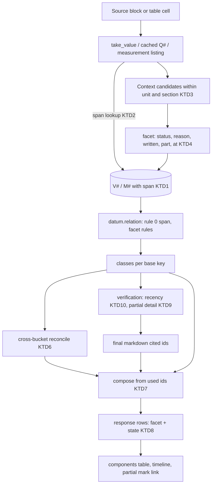
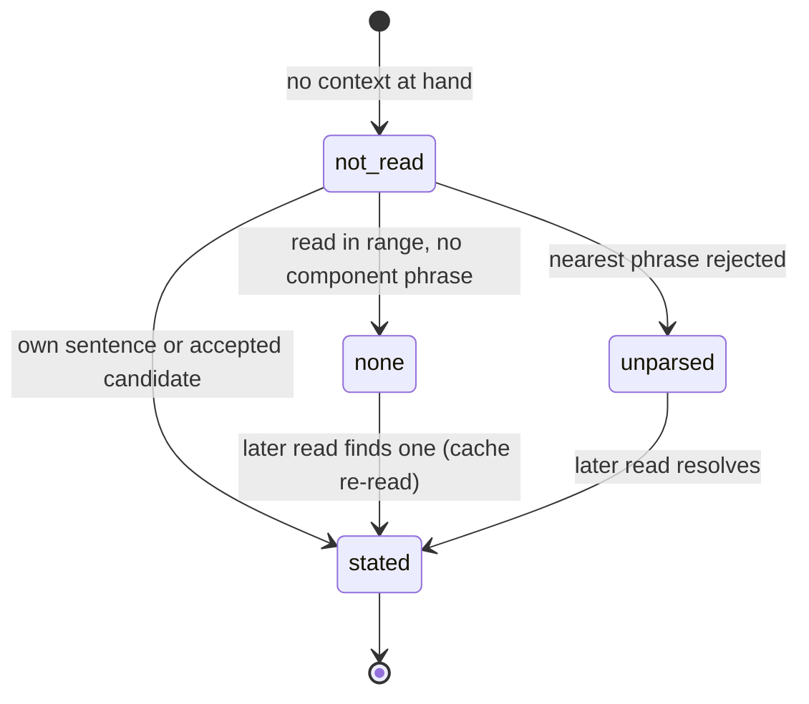

# Datum Context Kept End to End and One Decision for Answer, Verification and Components Table - Plan

## Goal Capsule

- **Objective:** When an answer explains an appraisal's adjustments, coefficients or rates, the components table shows the same values with the same consideration the answer gives, each once, with a link to the exact place in the document. When the system could not tell what a value is for, it says precisely why: it did not read the context, it read it and could not tell, or the document does not say. That is never shown as "the source does not state it". For the message owner or an office admin, a "verified in part" mark opens what was verified, what was not, why, and what was checked; other viewers see its reason class.
- **Means:**
  - one source-span identity and one decision for the body, verification, the table and the timeline (KTD1, KTD2, KTD6);
  - a bounded context reader with evidence rules, used on every extraction path, whose cached results never freeze a missing context (KTD3, KTD4, KTD5);
  - a structured row state in the response, rendered by the UI, with the main table restricted to what the final answer uses (KTD7, KTD8);
  - partial marks linked to the existing verification detail (KTD9);
  - a recency check that reads document nouns, and an audit of failed registrations (KTD10, KTD11).
- **Authority hierarchy:**
  1. The user's round-14 request.
  2. This plan's Product Contract: R-IDs and the session-settled Key Decisions.
  3. KTDs.
  4. Unit text.

  Project rules in `CLAUDE.md` also bind:
  - pytest on the host only, through the serialized wrapper, never two at once;
  - tests use the synthetic office B or `rag_test`;
  - office A is read-only except evaluation conversations through the API;
  - no customer data in git or public docs;
  - `scripts/backup.sh` before any migration on the office database.
- **Stop conditions:**
  - A step would delete or reset appraisals, documents, conversations, permissions or stored data. Cached records are only completed in place (KTD5), and new derived rows are added beside existing ones.
  - A settled decision proves infeasible.
  - A fix would need a new model call or judge round per turn.
- **Execution profile:** Opus diagnoses and decides, Sonnet implements and reviews, Haiku runs searches, tests and small doc edits. The RAG system's own models (`gpt-6-luna`) stay unchanged.
- **Who finishes:** the LFG pipeline updates PR AriGabay/rag#2. Merge and deploy stay with the user.

---

## Product Contract

### Summary

Round 14 makes one datum record carry its context from the source to the screen.
- **Context:** the reader finds the consideration in the value's paragraph and section, not only in its own sentence or a heading, and it keeps a separate locator for that context.
- **Identity:** a span of the document registered twice is one datum.
- **Linked representations:** a coefficient and the reduction derived from it are one adjustment.
- **Shared state:** the answer, verification, the components table and the timeline read one decision. The response carries a structured state per row, so the UI can tell "not read" from "not stated".
- **Partial marks:** each one opens the detail verification already keeps.

### Problem Frame

A user asked how an appraisal valued land zoned for public buildings and what justified its adjustments against residential land. This was asked on the final round-13 build. The answer was right and the components table contradicted it.
- **The body** gave two reductions, each with the consideration the appraisal states: 20% for one consideration and 10% for another.
- **The table** showed the 20% with its consideration. It also showed three rows of 10%, each "רכיב לא צוין במקור" and "השוואה לא הוכרעה", one of them naming a value that is not on the screen.
- **The 10% bullet** carried "*(אומת חלקית)*", with nothing that said what was not verified.

The private replay of the stored turn (office A, kept outside git) traced each record:
- **One datum, three rows.** The three 10% rows are one sentence of the document, registered three times. After failed registration attempts, the model registered the same span again under new labels. The failures' reasons are stored nowhere.
- **The consideration was never read.** It is written two sentences before the value, in an ordinary sentence of the same paragraph flow, with no other reduction between them. The context reader reads only the value's own sentence, a heading, or a paragraph ending with a colon.
- **Display joined two states.** "Read, nothing found" and "not read" render as the same "not stated in the source". Stored measurements from text pass an empty context and get the first. Cached values replay a missing context forever.
- **The table took every registered value.** It included two copies the answer does not cite. Its marks named a fourth value the answer never used.
- **A false partial mark.** The "verified in part" mark came from the recency check, which read "in the current opinion" as a claim that the value is the latest.
- **Cost.** The turn made 13 model calls in about 94 seconds.

### Key Decisions

- **One identity and one decision for the body, verification, the table and the timeline, built on `datum.relation` and its classes.** (session-settled: user-directed — chosen over a display-only fix or a parallel identity: the answer and the table must reflect the same grounded decision.) Governs R7, R8, R16.
- **Bounded context completion from the value's paragraph, section, table and notes, with evidence.** (session-settled: user-directed — chosen over reading only the value's own sentence and a heading or colon lead-in: the consideration is often stated in an ordinary sentence nearby.) Governs R1, R2, R3.
- **A structured state and reason per row in the response.** (session-settled: user-directed — chosen over the single display string: the UI must tell the states apart.) Governs R11, R12.
- **Not read, read but not interpreted, not found in the range checked, and a proven conflict are distinct.** (session-settled: user-directed — chosen over collapsing them: "not read" is never "not stated".) Governs R4, R11.
- **Occurrences merge only on evidence that they are one datum.** (session-settled: user-directed — chosen over deduplicating by equal numbers: different adjustments can share a rate.) Governs R6, R7.
- **A coefficient and its derived reduction are two representations of one adjustment.** (session-settled: user-directed — chosen over treating them as unrelated values: the link keeps formula and input.) Governs R8.
- **The main table holds data the final answer uses.** (session-settled: user-directed — chosen over showing every number registered during the search: a search hit is not part of the conclusion.) Governs R13.
- **Partial marks open the existing verification detail.** (session-settled: user-directed — chosen over a parallel detail mechanism.) Governs R14.
- **Caches never block completion.** Cached records are completed in place, never deleted, and earlier review decisions stand. (session-settled: user-directed — chosen over trusting a cached facet as final or rebuilding by deletion.) Governs R5.
- **No new model calls or judge rounds, and no weaker verification.** (session-settled: user-directed — chosen over extra judge rounds to settle context.) Governs R17.
- **Nothing is special-cased to the reported question,** and the RAG models are unchanged. (session-settled: user-directed — chosen over a targeted fix for one property or wording.) Governs R1–R17.

### Requirements

**Reading and keeping context**
- R1. When a value's own sentence or cell names no component, the reader looks further, nearest first, inside the value's appraisal unit and section. It reads the earlier sentences of the value's paragraph, then the earlier paragraphs of the section, then the heading or lead-in. For a table cell it reads the row label, the column header, the caption and the notes of that table.
- R2. A nearby phrase becomes the value's component only on evidence. It names the value's kind of metric with a purpose phrase, and no other value of the same kind stands between it and the value. The read stops at a table, at another section's heading, and at the appraisal unit's edge. A phrase that fails the evidence rule is never attributed.
- R3. Each datum keeps, as far as the source states them:
  - the appraisal unit and property;
  - its date;
  - its kind of metric;
  - its component or consideration;
  - its plot, calculation or section;
  - its unit and calculation basis.

  The value's locator and the locator of the context that interprets it are kept apart.
- R4. Every extraction path gives an honest component state: a fresh quote, a cached value, a table cell, a picture cell and a stored measurement from text or a table. The states are stated, read without a component, read but ambiguous, and not read. A path never reports "read" for context it did not read.
- R5. A cached or memoized result without a stated component never blocks a later read, and is upgraded in place when a read finds one. Nothing is deleted, no earlier review decision is undone, and reuse of earlier verified readings is kept.

**Identity and decision**
- R6. Two registrations of the same source span are one datum. A span is the same document version and reading, the same place and the same number. The second registration returns the first one's id. A stated component on either registration is kept: a component state only moves forward, from not read to read to stated, never back.
- R7. Different adjustments that share a rate stay separate rows, each with its own context. Equal numbers alone never merge two values.
- R8. A coefficient and a reduction of the same component that reconcile (the coefficient is one minus the reduction) are one adjustment. They show as one row with both forms, and the formula and its input are recorded. They are never a conflict.
- R9. A row's state separates four questions:
  - Was the number read correctly?
  - What component does it belong to?
  - Does the source support the claim?
  - Can it be compared with another value?

  An undecided comparison never makes a supported value unverified.
- R10. "Current" (נוכחי, נוכחית) that describes the document, as in "in the current opinion", is not a claim that the value is the latest. "The latest appraisal" is still a recency claim, because it says the appraisal is the latest.

**Display**
- R11. Every row of the components table and the timeline carries a structured state and a reason. The UI words each state differently. "Not read" is never shown as "not stated in the source".
- R12. Every row of the components table shows enough context to tell which adjustment, plot or calculation it belongs to. It has a reference that opens the value's exact place, and the context's exact place when the context came from elsewhere.
- R13. The main components table holds only values the final answer cites or its calculations use. A timeline row the answer does not cite is labelled as history, with its verification state. A mark that names another value names a row on screen, or says the value is not in the answer.
- R14. A "verified in part" mark leads to the existing verification detail of every claim it covers. That detail states what is supported, exactly what was not verified, why, and what was checked. Full detail stays with the message owner and office admins, as today. For other viewers the mark is not a button, and the fixed reason class is shown.
- R15. A failed registration is recorded with its reason and place in the message diagnostics.
- R16. After every verification edit or removal, the components table and the timeline are rebuilt from the final answer. A value whose only citing claim was removed leaves the main table, and a reload shows the same rows.

**Cost**
- R17. The changes add no model call and no judge round to a turn. Answer time and model calls are measured on the reported conversation before and after.

### Acceptance Examples

- AE1. **Covers R1, R2.**
  - **Given** a paragraph says "did not give a reduction for intensity of use. … In light of the above, an additional reduction coefficient of 10% was taken", with no other reduction between the two sentences.
  - **When** the 10% is registered.
  - **Then** its component is "intensity of use", with part `preceding_sentence`, and its context locator points at the earlier sentence.
- AE2. **Covers R2.**
  - **Given** the same text, but with "a reduction of 20% for marketability" between the consideration and the 10%.
  - **Then** the 10% is not given "intensity of use".
  - Its state is read but ambiguous, with the reason that another value stands between.
- AE3. **Covers R2.**
  - **Given** the nearest component phrase is in another table, another plot's section, or another appraisal unit.
  - **Then** the read stops at that edge, and the value's state is read without a component.
- AE4. **Covers R6, R16.**
  - **Given** the model registers the same quote and number three times with different labels.
  - **Then** the turn holds one value, and the table shows one row.
- AE5. **Covers R7.**
  - **Given** three different adjustments of one appraisal are each 10%, each with its own stated consideration.
  - **Then** the table shows three rows with three components, no conflict and no "undecided".
- AE6. **Covers R8.**
  - **Given** a table row gives the coefficient 0.9 for a consideration, and the text gives "a reduction of 10%" for the same consideration.
  - **Then** they are one adjustment row showing 0.9 and 10%, with the formula 1 − 0.9 and the coefficient's id.
  - **And** given the text says 15% instead, it is a conflict.
- AE7. **Covers R4, R5.**
  - **Given** a cached value whose stored component state is read without a component or not read.
  - **When** it is taken again in a later turn.
  - **Then** the context is read again, and a component found now is shown and cached under the new version.
- AE8. **Covers R11.**
  - **Given** a picture cell whose context was not read.
  - **Then** its row says the context was not read, never that the source does not state a component.
- AE9. **Covers R13.**
  - **Given** the turn registered values the answer does not cite.
  - **Then** they are not in the main components table, and no mark names them as if they were on screen.
- AE10. **Covers R14.**
  - **Given** a claim is marked "verified in part".
  - **When** the owner opens the mark.
  - **Then** the detail shows the supported part, the part not verified, why, and the sources and re-reads checked.
- AE11. **Covers R10.**
  - **Given** "in the current opinion a reduction of 10% was taken" with partial coverage.
  - **Then** no recency problem is raised.
  - **And** "the latest value is 10%" and "in the latest appraisal the value is 10%" still raise one.

### Success Criteria

- The reported conversation, three runs on the final build, private replay. In every run:
  - each reduction in the body has exactly one table row with the same component;
  - no row says "not stated in the source" for a component the body states from the document;
  - no conflict or "undecided" mark appears between parallel adjustments;
  - every mark names a row on screen, or says that the value is not in the answer.
- The new paths make no model call. Calls by purpose are unchanged on the scripted sequences, and on the replay against the round-13 build run in the same time window. Wall time is reported as information.
- On a private sample of values frozen before the change (U10), every component the reader marks as stated is the component the document gives that value.

### Scope Boundaries

- No new OCR, no new model, no change to the RAG models or prompts beyond the value line that already shows a datum's facet to the model.
- No change to how the agent chooses what to read or register beyond returning an existing id on a repeated span.
- No migration and no cache version bump: cached records gain fields inside their JSON, and diagnostics gain a key inside the existing JSON.

#### Deferred to Follow-Up Work

- Composing amounts written in words, and a year in a model-written heading (the two round-13 removals left open).
- Unit attribution in multi-appraisal files (round-13 residuals X1 and W9).

---

## Planning Contract

### Key Technical Decisions

- KTD1. **A source span on every datum, and rule 0 in `datum.relation`.** `timeline.Datum` and `datum.Site` gain a `span`.
  - **A quote value:** the document version, reading, the block holding the number and the number's character offset in that block's text, from the anchor (`anchors.locate_quote`). A quote index is not enough: one quote can hold one number twice, and two quotes can cover one number.
  - **A cell:** the version, reading, table, row and column.
  - **A measurement:** the version, reading, block and the number's offset, found with `anchors.locate_quote` on its stored quote and value in that block's text. The blocks come from the same batched read as its context (KTD5), independent of the facet cap. A table measurement uses the table, row and the column named by its quote's "header: cell" form. A row-level measurement with no column matches a cell only when the row holds one number of its kind.
  - **No span:** a quote located only to block precision (found more than once in the read range), and a measurement whose block was not read or whose quote is not found in it, have no span. Rule 0 does not apply to them, and they are decided by the existing rules.

  `relation` returns `same` for equal spans before any facet rule. The coverage, recency and timeline readers inherit it with no change. A span holds one kind for a V#, because a second registration either corrects a model-asserted field or fails (KTD2). (session-settled: user-directed — chosen over a parallel identity or equal-number dedupe: one decision reads the evidence that two values are one.) Governs R6, R7.
- KTD2. **A repeated span returns the existing value.** One registration function serves `tool_take_value` and `_take_cached`. It computes the span, looks up a value with that span, and registers in `ws.values` only as its last step, after the anchor, date and context are stamped. A later exception therefore leaves no orphan id and no stray S#.
  - **Same meaning:** the call returns the existing id with a short note that it is already registered. The first value's label and stance stay. Source-backed meaning that the second call adds fills only empty fields.
  - **Facet merge:** the stored facet moves forward only. A stated facet found by the second call replaces a weaker state, and never the reverse. The model often re-registers with a wider quote to fix a context, and this keeps what that read found.
  - **Contradicting meaning:** a contradiction is a different value in a defining attribute (`calc.DEFINING_ATTRIBUTES`: kind and unit) between the second call and the first value. When the first value's field is model-asserted, the second call corrects it and the value's family, fields and bucket are recomputed. When it is source-attested, the call fails with a message naming the first V#. Other differing fields (label, subject, role, stance, scenario) keep the first value's.
- KTD3. **The context reader takes ordered candidates with their places, and decides by evidence.** `tools` builds the candidates inside `cx.segment_at` and `reader.section_window` bounds, nearest first:
  1. the earlier sentences of the holder block;
  2. earlier paragraph blocks of the same section;
  3. the heading or lead-in;
  4. for cells, the table's notes, after `read_cell`'s own row label, column header and caption order, which stays as in round 13.

  The block before the value is read once per value, with no fixed three-block window. It is capped by characters (a `candidates` key in the existing `CONTEXT_CHARS` dictionary in `tools.py`), not by block count. Candidates beyond the cap are not read: a value whose search reached the cap with no accepted candidate is `not_read` with reason `cap`, never `none`. `datum.read_context` accepts a candidate when it holds a cue word of the value's family and a purpose phrase (`read_sentence`'s phrase rules). It rejects one when a number of the same family lies between the candidate and the value.
  - **Context locator:** the facet records `part` (`preceding_sentence`, `paragraph`, `heading`, `lead_in`, `table_note`, `caption`, `row_label`, `column_header`), `block` and `sentence` (indexes), and `at`, the stub from `anchors.locate_quote` for the context sentence. `part` names the context's kind everywhere; `tier` keeps its round-13 meaning (own or context).
  - **Ambiguity:** a rejected nearest candidate with a component phrase gives status `unparsed` and a reason (`intervening_value`, `two_components`).

  (session-settled: user-directed — chosen over reading only the own sentence and a heading or colon lead-in.) Governs R1, R2, R3.
- KTD4. **Four component states with reasons.** The states are `stated`, `none` (read, nothing names one), `unparsed` (read, ambiguous) and `not_read`. Each carries a `reason` key: `not_in_range`, `intervening_value`, `two_components`, `picture_cell`, `not_needed`, `cap`. `datum.core_of` stays empty for every state but `stated`, so classes do not change meaning. `timeline.unresolved` reads the state so marks can name it. A proven conflict is a comparison result (`state.comparison.status: conflict`, KTD8), not a component state. (session-settled: user-directed — chosen over collapsing `none` and `not_read`.) Governs R4, R11.
- KTD5. **Caches are completed in place and never trusted for a missing component.** `VALUE_VERIFIER_VERSION` stays `value-v5`. A bump would also drop `_known_clear` reuse of earlier verified readings, and the re-reads that follow can call a model. That breaks R17.
  - **Reader version:** cached records carry `facet_reader` (absent means the round-13 reader).
  - **Re-read:** a cached take whose facet is not `stated`, or whose `facet_reader` is older than `FACET_READER_VERSION` (a new constant in `tools.py`, value 2), reads the context again from stored blocks (KTD3, one DB read, no model).
  - **In-place update:** `_store_verified`'s upsert skips a row of the same verifier version, so a stated re-read writes a separate update of only `value.record.facet` and `value.record.facet_reader` on the existing row (`jsonb_set`, its own tenant transaction, failing soft). The rest of the cached document is left as it is.
  - **Span key:** new records key their locator with the span's offset, so two numbers of one quote stop colliding. A lookup that misses falls back to the quote-only locator of an older record when that quote holds a single number.
  - **Memo:** `_facet_memo` is keyed by span, shared by V# and M#, and keeps only `stated` results.
  - **Measurements:** stored measurements from text read their context through the same reader. Their blocks are read in one batched query per listing, capped per listing. A row beyond the cap is `not_read` with reason `cap`.

  (session-settled: user-directed — chosen over trusting a cached facet as final or rebuilding by deletion.) Governs R4, R5, R17.
- KTD6. **One adjustment, two representations, decided across the two families' buckets.** The metric family leads the base key (`timeline._fields`), so a coefficient and a proportion sit in different buckets and `datum.relation` never compares them. A cross-bucket step in `timeline` runs after `_classify`. It pairs each coefficient-family class with each proportion-family class whose key fields match except the family. A new pure `datum.reconciles(coefficient, proportion)` decides each pair:
  - **reconciled:** the same appraisal unit, equal facet cores, a reduction cue (הפחתה, הנחה, ניכוי) in the proportion's own words or facet, and the coefficient equal to 1 − the proportion within the shown precision;
  - **conflict:** the same unit, equal cores and the cue, with amounts that do not reconcile;
  - **unrelated:** anything else.

  A reconciled pair is one adjustment unit, which `compose` emits as one row: the coefficient first, then the reduction, and a reference to the derived C#. The server registers that C# through `register_computation` with formula `1 − Vn` when none exists. It does so while building the payload, before `used` is computed, so the C#'s inputs join `used`. A conflict pair carries `conflict` marks on both rows. (session-settled: user-directed — chosen over treating them as unrelated values.) Governs R8.
- KTD7. **The main table is built from the answer's used ids.** `compose` places components rows only for `used`: the cited ids plus their computations' inputs and leaves, read from the final markdown after every verification edit.
  - **Block size:** a components block needs two or more used rows of one unit and date. A used value left alone after a removal is shown in the answer text only, as in round 13, and is never a one-row table.
  - **No secondary list:** values the answer does not use never enter the components table.
  - **Uncited timeline rows:** they stay as one datum's history, with `support: history` and their verification state.
  - **Named counterparts:** `undecided_with` and `conflict_with` are filtered to rows on screen. A counterpart off screen moves to `not_in_answer_with`, shown as text saying the value is not in the answer, with its title and location (R13).
  - **Payload:** `api._answer_payload` stops adding uncited table rows' ids to the payload values. History rows keep their own entries.
  - **Model words never decide a component:** the body's own words are never used as a row's component. The body and the table agree because both read the same value and its source-grounded facet.

  (session-settled: user-directed — chosen over showing every number registered during the search.) Governs R13, R16.
- KTD8. **A structured row state in the response, with the old string kept.** Every timeline and breakdown row gains a `state`:
  - `reading`: `verified` (the server matched the number in the source);
  - `component`: `{status, reason, written, part, tier, context}`, where `context` holds the location label, a clipped quote of the interpreting text, and its resolved anchor when the context is not the value's own sentence;
  - `claim`: the verification result of the claim that cites the value (`supported`, `partial`, `unsupported`, `not_checked`) with its reason class;
  - `support`: `cited` or `history`;
  - `comparison`: `{status: same|different|undecided|conflict|single, with: [sid…]}`;
  - `reason`: one row-level reason key, the component's reason when the component is not stated, else the comparison's.

  `facet`, `marks` and the existing keys stay, so older clients and stored messages read as before. The facet keeps the raw stub from `anchors.locate_quote` in `at`. `anchors.attach` is extended so that every value and measurement placed in a timeline or breakdown row has its context stub resolved through `snapshot` and `bound` in the same transaction. The resolved snapshot goes in `state.component.context.anchor`, and the raw stub is never sent. (session-settled: user-directed — chosen over the display string alone.) Governs R9, R11, R12.
- KTD9. **Partial marks link to their diagnostics entry.**
  - **Server span:** a mark belongs to a text unit. It is written as a link target with an ordinal (`#partial-n`, like `#cut-n`), and its span carries that ordinal and the unit's failing `claim_ids`.
  - **Structured fields:** `decisions.decision` adds `supported` (the kept text), `not_verified` (the failing claim span or attribute), `why` (failure kind and check), and `checked` (sources checked and re-reads). The existing `text`, `remaining`, `reason`, `sources_checked` and `rereads` feed them.
  - **Public rows:** `public_verification` adds `partials` rows: claim id, failure kind, check, and the fixed reason sentence. This mirrors `removals`, so every viewer sees the reason class.
  - **Opening the detail:** the response says whether the viewer may open diagnostics. For the owner or an admin the mark is a button that expands the existing `OtherChanges` detail, scrolls to its entries and moves focus there. It falls back to the reason sentence on a 404 or failed load, reusing the existing expanded-state handling. Diagnostics answer 404 to anyone else, and an admin's read is audited as today. For other viewers the mark is plain text, and the reason sentences are listed in the verification summary, one per mark in mark order.

  (session-settled: user-directed — chosen over a parallel detail mechanism.) Governs R14.
- KTD10. **"Current" after a document noun ends a recency match.** `_calls_latest` skips a נוכחי or נוכחית match whose preceding word is a document noun, prefixes allowed: שומה, חוות/דעת, דוח, הערכה, מסמך, תחשיב, נספח. Other recency words after a document noun ("the latest appraisal") still count. This sits beside `_TIME_NOUNS`. Governs R10.
- KTD11. **Failed registrations are audited.** `run_tool` records each failed `take_value` in `ws.registration_log`: tool, source id, a clipped locator, the error message key, and the time. It is stored as `resolution["registrations"]` in `message_diagnostics`, owner-only like the rest. No migration. Governs R15.
- KTD12. **No new calls.** All context reads are stored-text reads in the same transaction as today's take. The judge's value line already shows the facet (`datum.line`) and shows the new state words without a new call. Governs R17.

### High-Level Technical Design

The datum record from source to screen, with the places this round changes:

The component state of one value:

### Assumptions

- Tools run one after another on a turn's workspace. The shared state across turns is the `verified_values` cache, which is completed in place by the facet-only update (KTD5).
- The holder block's text and the blocks before it carry their sentence boundaries as `professional.sections.sentences` already splits them.
- A reduction cue word in the proportion's own sentence or facet is enough to treat 1 − x as its coefficient (KTD6). A proportion with no reduction cue is never reconciled.
- Picture cells keep `not_read` with reason `picture_cell`, because no context text is stored for them.
- No customer document is needed for tests. Synthetic DOCX fixtures generated by `backend/scripts/generate_fixtures.py` cover the shapes.

### Sequencing

1. U10 (the frozen sample) comes first. U1 and U2 (identity and reader) are independent.
2. U3 depends on U2, and U4 depends on U1.
3. U5 is independent.
4. U6 depends on U1–U4.
5. U7 is independent of U6 on the backend.
6. U8 depends on U6 and U7.
7. U9 closes the round.

### System-Wide Impact

- **Shared decision:** `datum.relation` feeds the timeline, `coverage.conflicting`, `timeline.later_pairs` (recency) and coverage notes, so rule 0 changes all four at once. That is the intended single decision. KTD6 runs over the same classes and changes the rows and marks.
- **Response contract:** `docs/api-contract.md` and `frontend/lib/chatTypes.ts` gain optional fields. Stored messages without them render as before.
- **Caches:** the value cache keeps its version. Records are completed in place as values are taken again, so reuse of earlier verified readings, and their cost, stays as it is.

### Risks & Dependencies

| Risk | Mitigation |
|---|---|
| The wider context read attributes a neighbour's component | Evidence rule (cue + purpose phrase, no intervening same-family number), unit/section/table bounds, tests AE2 and AE3 |
| Returning an existing id confuses the model | The note names the id and says it is already registered. The scripted sequence and the real-model replay check the answer cites it |
| Reconciling coefficient and reduction hides a real conflict | Same unit and same facet core, a reduction cue, and the tolerance of the rounding shown; non-reconciling amounts stay a conflict (AE6) |
| Batched block reads for measurements slow listings | One query per listing, only for rows of a family that needs a facet and whose own sentence names none; measured in U9 |
| A negated earlier sentence ("no reduction was given for X") is taken as the value's component when the value's sentence does not refer back | The evidence rule plus the U10 precision sample; a wrong attribution found there becomes a rule before the round closes |
| "In the current appraisal" for a value taken from an older appraisal of the same file is no longer a recency problem | Accepted; unit attribution in multi-appraisal files is deferred, and the coverage note still states what was checked |
| A completed cached facet is wrong | The same evidence rule decides fresh and cached reads; the record keeps `facet_reader`, so a later reader can redo it |

---

## Implementation Units

### U1. Source-span identity and repeated registration

- **Goal:** One datum per source span, from registration to classes.
- **Requirements:** R6, R7, R15, R16; KTD1, KTD2, KTD11.
- **Dependencies:** none.
- **Files:**
  - `backend/app/chat/datum.py` (Site.span, rule 0)
  - `backend/app/chat/timeline.py` (Datum.span, `datums`)
  - `backend/app/chat/tools.py` (span of a value and a measurement, lookup in `tool_take_value` / `_take_cached`, registration order, `ws.registration_log`, `run_tool`)
  - `backend/app/chat/api.py` (diagnostics `resolution.registrations`)
  - `backend/tests/unit/test_datum_decision.py`
  - `backend/tests/unit/test_timeline.py`
  - `backend/tests/unit/test_datum_facet.py`
  - `backend/tests/integration/test_round14_sequences.py` (new)
- **Approach:**
  1. Compute the span once from the anchor (block and character offset), and keep it on the value. For M#, use the stored row's block and offset, or its table, row and column.
  2. In `relation`, an equal non-empty span decides `same` first.
  3. Fold `tool_take_value`'s and `_take_cached`'s registration into one function that looks up the span and registers last (KTD2), with the forward-only facet merge.
  4. Record failed calls in `run_tool`, with the `ToolError` message key.
- **Patterns to follow:** `_known_clear` (reuse of an earlier reading), `_facet_memo` keys, `timeline.Datum` construction in `datums`.
- **Test scenarios:**
  - Covers AE4. Three registrations of one quote and number with different labels give one V#; the second and third calls return the first id and the note.
  - Two numbers of one quote are two spans and two values; the same number twice in one paragraph is two spans.
  - A second registration of a span with a wider quote whose context reads a stated component upgrades the first value's facet; a weaker second read never downgrades it.
  - A registration that fails after the anchor step leaves no value and no new source in the workspace.
  - The same quote in two document versions is two spans.
  - Covers AE5. Three values of 10% from three sentences with three stated components form three classes, with no conflict and no undecided.
  - A registration whose meaning contradicts the existing value of its span fails as today, and no new id is made.
  - A failed `take_value` appears in `resolution.registrations` with its reason key and clipped locator; a successful call does not.
  - Integration: a scripted turn that registers a span three times answers with one row in `answer.time.breakdown`, and a reload returns the same rows.
- **Verification:** Repeated spans never produce a second V#, and the decision tests pass for every rule.

### U2. Context reader with evidence and bounds

- **Goal:** Find a value's component in its paragraph, section, heading or table notes, only on evidence, and keep where it was found.
- **Requirements:** R1, R2, R3, R4; KTD3, KTD4.
- **Dependencies:** none.
- **Files:**
  - `backend/app/chat/datum.py` (`read_context`, `read_quote`, `read_cell` with notes, states and reasons, `facet` record with `reason` and `at`)
  - `backend/app/chat/tools.py` (`_preceding_blocks` → bounded candidates via `contexts_of` / `section_window`, holder-block sentences, table notes in `facet_in`)
  - `backend/app/chat/reader.py` (if a block-window helper is needed)
  - `backend/scripts/generate_fixtures.py` and `backend/tests/fixtures/round14/` (synthetic DOCX and manifest)
  - `backend/tests/unit/test_datum_facet.py`
  - `backend/tests/integration/test_datum_facet_db.py`
- **Approach:**
  1. Build the candidate list in `tool_take_value` after `cx` is known, which moves the read below the `contexts_of` call.
  2. Pass the candidates with kinds and places to `read_quote`.
  3. `read_context` walks nearest first and applies the KTD3 evidence rule.
  4. Cells keep `read_cell`'s row label, column header and caption order, and also pass the table notes; `read_cell` reads a note that names the row label.
  5. The cap is a `candidates` key in the existing `CONTEXT_CHARS` dictionary.
  6. The facet record gains `reason`, `block`, `sentence` and `at`. `datum.line` shows the new states in the model's value line.
- **Patterns to follow:** `read_sentence` phrase rules, `_context` cue check, `reader.section_window`, `contexts.Contexts.segment_at`.
- **Test scenarios:**
  - Covers AE1. The component two sentences before the value in the same block is stated, with part `preceding_sentence` and `at` on that sentence.
  - The component in the previous paragraph block of the same section is stated, with part `paragraph`.
  - Covers AE2. A same-family number between the candidate and the value gives `unparsed`, reason `intervening_value`, and no component.
  - Covers AE3. A candidate across a table block, another section's heading, or the appraisal unit's first block is not read, giving `none` with reason `not_in_range`.
  - A candidate naming two components ("for intensity and for flexibility") gives `unparsed`, reason `two_components`.
  - A table cell whose table note names its row label's consideration is stated, with part `table_note`.
  - A header-only table context (caption naming the component) still gives the caption facet, as in round 13.
  - The candidate list is capped by characters; a search that reaches the cap with no accepted candidate gives `not_read` with reason `cap`, never `none`.
  - A value whose component is a context sentence and a parallel value with its own phrase, in two sections of one appraisal unit, come out `different`, not `undecided`, when their cores differ.
  - DB-backed: a synthetic DOCX with two plots in two sections, where the second plot's 10% must not take the first plot's consideration.
- **Verification:** The round-13 facet tests still pass, and each new shape in the round-14 manifest reads as its expected state.

### U3. Every extraction path and the caches

- **Goal:** No path reports a context it did not read, and no cache freezes a missing component, without losing reuse of verified readings.
- **Requirements:** R4, R5; KTD4, KTD5.
- **Dependencies:** U2.
- **Files:**
  - `backend/app/chat/tools.py` (`_quote_facet`, `_measurement_facet_of`, `tool_find_measurements`, `_facet_memo`, `_take_cached`, the facet-only cache update, `FACET_READER_VERSION`, locator keys)
  - `backend/tests/unit/test_datum_facet.py` (cache version test)
  - `backend/tests/unit/test_cache_keys.py`
  - `backend/tests/integration/test_datum_facet_db.py`
- **Approach:**
  1. Text measurements read their blocks in one batched query per listing, and only for rows that need a facet and whose own sentence states none.
  2. Picture cells get `not_read`, reason `picture_cell`.
  3. A cached take with a non-stated facet, or a `facet_reader` older than `FACET_READER_VERSION`, rebuilds the candidates and reads again. A stated result is written by the facet-only update (KTD5), because `_store_verified`'s upsert skips rows of the same version.
  4. New records key the locator with the span offset; lookups fall back to the quote-only locator for an older single-number quote.
- **Patterns to follow:** `_store_verified`'s tenant transaction and soft failure, `_known_clear`, `_measurement_facet_of` memo.
- **Test scenarios:**
  - Covers AE7. A cached record stored with `none` is re-read on take; the new `stated` facet is shown, and only `value.record.facet` and `value.record.facet_reader` of that row changed.
  - A cached record with a stated facet is reused with no block read, and `_known_clear` still reuses its verified reading (no model call in the turn).
  - Two numbers in one quote are cached under two keys; an older quote-only record with one number is still found.
  - No cached row is deleted; the row count of `verified_values` never drops.
  - A text measurement whose component is in the previous sentence gets it from the batched read, and the listing makes one block query.
  - A text measurement gets its span from the same batched read; one whose quote is not found in its block has no span.
  - A listing beyond the per-listing cap marks the extra rows `not_read` with reason `cap`.
  - Covers AE8. A picture cell's facet is `not_read` with reason `picture_cell`.
  - `_facet_memo` does not keep a `none` result; a second value at the same place after a wider read gets `stated`.
- **Verification:** `VALUE_VERIFIER_VERSION` is unchanged, `FACET_READER_VERSION` is 2, and no path builds a facet from an empty candidate list for a family that needs one.

### U4. Coefficient and reduction as one adjustment

- **Goal:** A coefficient and its reduction reconcile into one row with formula and input, and a mismatch stays a conflict.
- **Requirements:** R8, R9; KTD6.
- **Dependencies:** U1.
- **Files:**
  - `backend/app/chat/datum.py` (pure `reconciles`)
  - `backend/app/chat/timeline.py` (`_fields`, `buckets`, the cross-bucket step after `_classify`, one row per reconciled pair, `derived` reference)
  - `backend/app/chat/api.py` (derived C# registered before `used`)
  - `backend/app/chat/verify.py` (derived C# registration reuse)
  - `backend/tests/unit/test_datum_decision.py`
  - `backend/tests/unit/test_timeline.py`
  - `backend/tests/unit/test_verify_computed.py`
- **Approach:**
  1. After `_classify`, pair coefficient-family classes with proportion-family classes whose key fields match except the family, and decide each pair with `datum.reconciles` (KTD6). The tolerance is half a unit of the last digit shown.
  2. `compose` emits one row for a reconciled pair, with both values and a reference to the derived C#; a conflict pair gets `conflict` marks on both rows.
  3. Register the C# through the existing derivation, `1 − Vn`, while building the payload and before `used` is computed.
- **Patterns to follow:** `verify._derivations` (`1 - Vn`, `(1 - Vn) * 100`), `calc.Computation.leaves`.
- **Test scenarios:**
  - Covers AE6. 0.9 in a table row for a consideration and 10% "reduction" in the text for the same consideration form one row with both forms; the C# formula is `1 − V…` with the coefficient's id; there is no conflict mark.
  - Covers AE6. 0.9 and 15% for the same consideration are a conflict, with `conflict` marks naming each other.
  - A coefficient and a proportion in two different appraisal units are unrelated, whatever their amounts.
  - 0.9 and 10% for different considerations are two rows, not reconciled.
  - A 10% proportion with no reduction cue is not reconciled with a 0.9 coefficient.
  - Rounding: 0.85 and 15%, and 0.833 shown as 0.83 with 17%, reconcile within the shown precision.
- **Verification:** No reconciled pair produces a conflict, and no non-reconciling pair loses one.

### U5. Recency check reads document nouns

- **Goal:** "Current" or "latest" describing the document is not a recency claim.
- **Requirements:** R10; KTD10.
- **Dependencies:** none.
- **Files:**
  - `backend/app/chat/verify.py` (`_calls_latest`, a document-noun set)
  - `backend/tests/unit/test_verify_recency.py`
- **Approach:** Reuse the preceding-word check of `_TIME_NOUNS` with a second set, prefixes allowed.
- **Patterns to follow:** `_TIME_NOUNS` handling in `_calls_latest`.
- **Test scenarios:**
  - Covers AE11. "בחוות הדעת הנוכחית הובאה בחשבון הפחתה של 10%" with partial coverage raises no recency problem.
  - "בשומה הנוכחית" (in the current appraisal) raises none.
  - Covers AE11. "בשומה האחרונה נקבע שווי של 10%" (in the latest appraisal) still raises one.
  - Covers AE11. "השווי העדכני הוא 10%" still raises one.
  - A sentence with both forms ("in the current opinion the latest value is 10%") still raises one.
- **Verification:** The round-11 and round-13 recency tests still pass.

### U6. Response rows from the final answer, with a structured state

- **Goal:** The table and the timeline show what the final answer uses, each row with its state and context, and every mark names something on screen.
- **Requirements:** R9, R11, R12, R13, R16; KTD7, KTD8.
- **Dependencies:** U1, U2, U3, U4.
- **Files:**
  - `backend/app/chat/timeline.py` (`compose`, `_row`, `_component_row`, `_facet_text` by state, `Bucket.undecided_with` filter, `plain_text`)
  - `backend/app/chat/api.py` (`_answer_payload` used ids, context anchors)
  - `backend/app/chat/anchors.py` (`attach` resolves context stubs of timeline and breakdown rows)
  - `docs/api-contract.md`
  - `frontend/lib/chatTypes.ts`
  - `backend/tests/unit/test_timeline.py`
  - `backend/tests/integration/test_chat_timeline.py`
  - `backend/tests/integration/test_round14_sequences.py`
- **Approach:**
  1. Compose components rows from `used` only (KTD7, including the two-row minimum).
  2. Flag history rows in the timeline.
  3. Add `state` to every row.
  4. Map `_facet_text` by state and reason with one Hebrew sentence per pair, as server constants:

     | State / reason | Sentence |
     |---|---|
     | `none` / `not_in_range` | המקור לא מציין רכיב בקטע שנקרא |
     | `unparsed` / `intervening_value` | נקרא, אך ערך אחר מפריד בין הרכיב לערך ולכן לא שויך |
     | `unparsed` / `two_components` | נקרא, אך מוזכרים שני רכיבים ולא הוכרע לאיזה מהם שייך |
     | `not_read` / `cap` | ההקשר לא נקרא: הגעה למגבלת הקריאה |
     | `not_read` / `picture_cell` | ההקשר לא נקרא: הערך נקרא מתמונה |
     | `not_read` / other | ההקשר לא נקרא |
     | history label | נתון היסטורי, לא נכלל במסקנת התשובה |
     | `not_in_answer_with` | ערך זה אינו בתשובה: <title>, <location> |

  5. Filter counterpart lists to rows on screen.
  6. Resolve each placed row's context stub through `anchors.attach` (KTD8).
- **Patterns to follow:** round-13 `compose`/`_component_row`, `api._answer_payload` used ids, `anchors.attach`.
- **Test scenarios:**
  - Covers AE9. Uncited registered values do not appear in `breakdown`; their ids are not added to the payload values.
  - Covers AE9. A row's `undecided_with` never names an id that has no row; an off-screen counterpart is in `not_in_answer_with` with title and location.
  - A cited value's history row from another appraisal appears in the timeline with `support: history` and its verification state.
  - Covers R16. After verification removes the only claim citing a value, its row leaves the breakdown, and `refreshed_equals_live` holds.
  - Covers R16. A components block left with one used row after a removal is not emitted, and no other row names the removed value.
  - Each state and reason renders its own sentence from the table, and `state.reason` is set on every row. `not_read` never renders the "not stated" text.
  - A row's `state.claim` carries the citing claim's verification result; a value whose claim was qualified shows `partial`.
  - A stated context facet from an earlier sentence carries `state.component.context` with a location, a clipped quote and a resolved anchor snapshot (never the raw stub).
  - An older stored answer without `state` reads through the API unchanged.
- **Verification:** The response for the reported shape (synthetic) shows one row per adjustment, each with state and context, and the API contract documents every new field.

### U7. Partial marks open the existing verification detail

- **Goal:** Every "verified in part" mark leads to what was supported, what was not, why and what was checked.
- **Requirements:** R14; KTD9.
- **Dependencies:** none for the backend part.
- **Files:**
  - `backend/app/chat/compose.py` (`partial_mark` span claim id)
  - `backend/app/chat/verify.py` (`VerifyReport.edit` passes the claim id, `counts()` partial rows)
  - `backend/app/chat/decisions.py` (structured fields)
  - `backend/app/chat/api.py` (`public_verification` `partials`)
  - `docs/api-contract.md`
  - `backend/tests/unit/test_compose.py`
  - `backend/tests/unit/test_removal_detail.py`
  - `backend/tests/integration/test_chat_verify.py`
- **Approach:** Add the claim id where the mark is written, and build the four fields from what `decision()` already collects. Add `partials` rows next to `removals` on the normal path.
- **Patterns to follow:** `removals` rows (`ROW_ACTIONS`, `REMOVAL_SENTENCES`), `decisions.decision`.
- **Test scenarios:**
  - Covers AE10. A unit qualified for an unstated attribute has a `partial_mark` span with its failing claim ids. Each diagnostics entry has `supported`, `not_verified`, `why` and `checked`, and `checked` lists the sources and re-reads.
  - A unit with two failing claims has one mark carrying both claim ids.
  - The normal-path `verification.partials` has one row per mark, with the fixed reason sentence and no draft text.
  - A non-owner's diagnostics request is refused as today.
  - A message stored before this round reads with no `partials` and no error.
- **Verification:** Every partial mark in the integration sequences pairs with exactly one diagnostics entry by claim id.

### U8. The UI shows states, context and the partial detail

- **Goal:** The components table and the timeline read the structured state, show context with exact-place links, and open the partial detail from the mark.
- **Requirements:** R11, R12, R14; KTD8, KTD9.
- **Dependencies:** U6, U7.
- **Files:**
  - `frontend/components/chat/Message.tsx` (`Breakdown`, `Timeline`, `MarkBadges`, partial mark link)
  - `frontend/components/chat/Changes.tsx` (open at claim id)
  - `frontend/lib/chatTypes.ts`
  - `frontend/e2e/answer-fixtures.ts`
  - `frontend/e2e/round14-context.spec.ts` (new)
  - `frontend/e2e/round13-components.spec.ts`
- **Approach:**
  1. **The component cell, in order:**
     - the stated words, or the state sentence from U6's table;
     - one context line: the location label and the quote, clipped to 120 characters;
     - a context chip labelled "הקשר", with an accessible name for the place it opens.

     At 375px the context line wraps inside the cell, and the table keeps its existing scroll wrapper.
  2. The source column's value chip opens the value anchor. It carries a different accessible name from the context chip.
  3. **A reconciled row:**
     - the value cell shows both forms on two lines, the coefficient first, each with its own value chip;
     - a line under them shows the formula text (`1 − 0.9`), with a chip that opens the derived C# in the existing calculations section;
     - no conflict or undecided badge.
  4. History rows carry the history label. A `not_in_answer_with` counterpart renders as text with its title and location.
  5. **Partial marks:** each `#partial-n` link becomes a button only when the response says the viewer may open diagnostics (KTD9). It expands the details, opens `OtherChanges`, scrolls to the mark's entries and moves focus there. It falls back to the reason sentence on a 404 or failed load. For other viewers the mark stays plain text, and the reason sentences are listed in the verification summary, one per mark in mark order.
  6. Old answers render as round 13.
- **Patterns to follow:** round-13 `Breakdown` and counterpart chips, `RemovalsSection` / `OtherChanges` loading, `onCite`.
- **Test scenarios:**
  - A row with `not_read` shows "ההקשר לא נקרא" and never "רכיב לא צוין במקור".
  - A context chip opens the viewer at the context anchor, and the value chip at the value anchor.
  - For the owner, the partial-mark button opens the detail on its claims, showing supported, not verified, why and the checked sources.
  - For a viewer who is not the owner or an admin, the mark is not a button, and shows the reason sentence.
  - A mark naming an off-screen value shows its title and location as text, not a dead chip.
  - Covers AE6. A reconciled row shows 0.9 and 10% with the formula line and a chip to the C#, and no badge; a non-reconciling pair shows conflict badges.
  - The partial-mark button shows an error fallback with the reason sentence when diagnostics fail to load.
  - The value chip and the context chip have different accessible names and open different places.
  - Mobile width 375px and RTL: the table keeps its columns readable with no horizontal page scroll.
  - An older answer without `state` renders exactly as in round 13.
- **Verification:** The Playwright specs pass against office B, together with a manual pass in the built-in browser.

### U9. Acceptance, replay and cost

- **Goal:** Prove the shapes on synthetic data, then on the reported conversation with the real model, and measure time and calls.
- **Requirements:** R1–R17, Success Criteria.
- **Dependencies:** U1–U8, U10.
- **Files:**
  - `backend/tests/integration/test_round14_sequences.py`
  - `backend/tests/integration/test_round14_real_model.py` (new, opt-in `real_model`)
  - `real_documents/tests/round13/replay.py` (private, gitignored; extended with body-and-table consistency and cost)
  - `docs/evaluation/conversational-rag.md` (round-14 record, counts only)
  - `docs/api-contract.md`
  - `CONCEPTS.md` (component states under Datum identity)
- **Approach:**
  1. Scripted sequences cover AE1–AE11 end to end, through the API with a reload.
  2. The real-model test runs three synthetic sequences three times each.
  3. The private replay runs the reported conversation three times on the final build. It checks that each body reduction has one row with the same component, that no row says "not stated" for a component the body states from the document, that no conflict or undecided mark appears between parallel adjustments, and that every mark names a row on screen or says the value is not in the answer.
  4. **Cost:**
     - the scripted sequences assert that calls by purpose are unchanged;
     - the replay is also run three times on the round-13 build (`500b56e`) in the same time window, and calls by purpose are compared;
     - wall time and server time outside model calls are reported as information.
  5. The frozen precision sample (U10) runs once on the final build.
  6. v16 regression runs once as a sanity check.
- **Test scenarios:**
  - Covers AE1, AE4, AE5. A synthetic appraisal with two reductions explained in earlier sentences, one registered three times: one row each, with the right components.
  - Covers AE6. A table coefficient with its text reduction: one row.
  - Covers AE3. A two-plot appraisal: no cross-plot component.
  - Covers AE7. A cache hit from a `none` record: the component is completed.
  - Covers AE10, AE11. A partial mark opens its detail; no recency false positive.
  - Every sequence asserts that its response after reload equals the live one.
- **Verification:** All suites pass on the host. The replay meets the Success Criteria three times out of three. The round record states the calls and time before and after, the precision sample's result, and what stays open.

### U10. A frozen sample for component precision

- **Goal:** Measure, on documents the rules were not shaped on, whether a component the reader marks as stated is the right one.
- **Requirements:** R2, Success Criteria.
- **Dependencies:** none. It is done first, before any change under `backend/app/`.
- **Files:**
  - `real_documents/eval/round14/precision_sample.yaml`, its `.sha256` and notes (private, gitignored)
  - `real_documents/tests/round14/precision.py` (private, gitignored)
- **Approach:**
  1. From office-A appraisals other than the two reported ones and those used for v13–v17 references where possible, pick at least 15 adjustment, coefficient or rate values from at least 5 appraisals.
  2. For each value, write its expected component from the original file, or "none in its section", with its place.
  3. Record the sha256 before the first change under `backend/app/`.
  4. On the final build, read each value's facet through the server's own reader on the stored blocks, read-only.
  5. Report three counts: values given `stated`, how many of those are right, and how many `unparsed` or `none` values had a component in range.
- **Test expectation:** none — a private measurement, not a test of the suite.
- **Verification:** The sample is frozen before the first backend commit of the round, and its result is in the round record as counts only.

---

## Verification Contract

| Gate | Command or check | Applies to |
|---|---|---|
| Backend tests | `cd backend && env -u DATABASE_URL -u OWNER_DATABASE_URL .venv/bin/pytest` on the host, through the session's serializing wrapper (`rag_test` guard, one process at a time) | U1–U7, U9 |
| Real-model tests | the same wrapper with `-m real_model`; the provider key is read from `.env` and never printed | U9 |
| Lint and types | `cd frontend && npm run lint && npx tsc --noEmit`; backend `ruff check` on changed files | U1–U8 |
| Frontend e2e | Playwright `round14-context.spec.ts`, `round13-components.spec.ts`, `chat-gaps-removals.spec.ts` against office B | U8 |
| Office run | rebuild via `migrate`, `FACET_READER_VERSION` = 2 checked in the container, private replay ×3 on the final build and ×3 on `500b56e`, the U10 sample once, v16 regression once | U9, U10 |

## Definition of Done

- Every unit's verification holds, and every backend test passes through the wrapper.
- The reported conversation, three runs on the final build, meets every Success Criterion. Calls and time are recorded before and after.
- The PR body says which failures were reproduced, where the context was lost, and what was proven on the final build.
- No row or stored record was deleted. Cached records were only completed in place.
- No customer text, address, name or conversation content is in git or public docs.
- Abandoned-attempt code is removed from the diff, and the PR is updated without merge or deploy.

---

## Appendix

### Sources

- Round-13 plan and learning: `docs/plans/2026-10-15-0851-fix-datum-meaning-verification-plan.md`, `docs/solutions/logic-errors/datum-identity-needs-a-source-grounded-component-decided-pairwise.md`.
- **Facet readers:**
  - `backend/app/chat/datum.py`: `read_sentence`, `read_context`, `read_quote`, `preceding`, `relation`, `headline`.
  - `backend/app/chat/tools.py`: `_value_facet`, `_preceding_blocks`, `_quote_facet`, `_facet_memo`, `_take_cached`, `VALUE_VERIFIER_VERSION`.
- **Rows and marks:** `backend/app/chat/timeline.py` (`compose`, `_dedupe`, `_facet_text`, `Bucket.undecided_with`) and `backend/app/chat/api.py` (`_answer_payload` used ids, `public_verification`).
- **Recency and partial marks:** `backend/app/chat/verify.py` (`_LATEST`, `_calls_latest`, `_derivations`, `counts`), `backend/app/chat/compose.py` (`PARTIAL_MARK`) and `backend/app/chat/decisions.py`.
- **UI:** `frontend/components/chat/Message.tsx` (`Breakdown`, `MarkBadges`) and `frontend/components/chat/Changes.tsx` (`OtherChanges`).
- **Cache learning:** `docs/solutions/` on stored PDF boxes. A cache keyed without a meaning-changing input returns a wrong result until the version moves.
