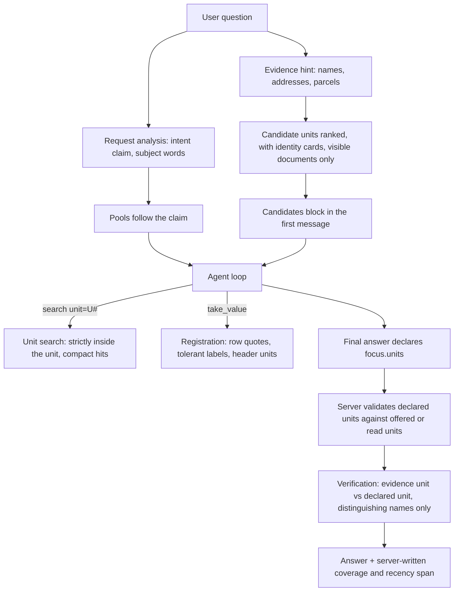
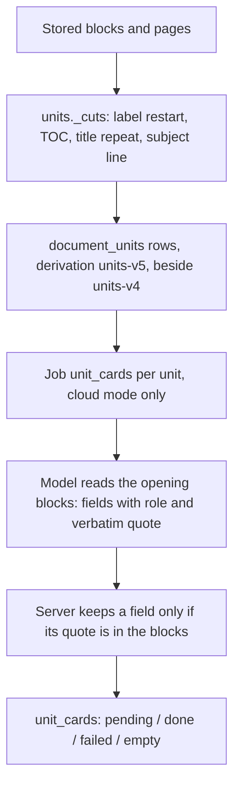

# Model-Led Understanding, Named Appraisal Units and Answers That Keep What Was Found - Plan

## Goal Capsule

- **Objective:** An appraiser who asks a question in natural words gets an answer drawn from the right appraisal, with every part they asked for answered from what the documents say. The system does not:
  - turn a professional question into a property question;
  - ask which appraisal they meant when their words already say it;
  - remove a correct value that came from the right appraisal;
  - stop early because of its own tool friction.

  The improvement is measured by meaning and attribution on a held-out set of questions about appraisals never used to shape the fixes.
- **Means:**
  - model-led understanding over identity cards the server validates (KTD1, KTD2, KTD3);
  - ingestion that names and bounds every appraisal unit from its own text, stored beside the old derivation (KTD4, KTD5, KTD6);
  - verification that compares evidence with the unit the answer declares (KTD7, KTD8);
  - a registration tool and a unit search that stop wasting steps (KTD9, KTD10).
- **Authority hierarchy:**
  1. The user's round-15 request.
  2. This plan's Product Contract: R-IDs and the session-settled Key Decisions.
  3. KTDs.
  4. Unit text.

  Project rules in `CLAUDE.md` also bind:
  - pytest on the host only, one process at a time, against `rag_test`;
  - tests on synthetic documents and office B only;
  - office A is read-only except evaluation conversations through the API;
  - no customer data in git or public docs;
  - `scripts/backup.sh` before any migration on the office database.
- **Stop conditions:**
  - A step would delete or reset documents, conversations, permissions or stored data. Derived rows are added beside old ones (KTD6); the old rows are kept and read only to resolve anchors stored before the change.
  - A settled decision proves infeasible.
  - A fix would add a judge round or a model call per chat turn.
- **Execution profile:** Opus diagnoses and decides, Sonnet implements and reviews, Haiku runs searches, tests and small doc edits. The RAG system's own models (`gpt-6-luna`) stay unchanged.
- **Who finishes:** the LFG pipeline updates PR AriGabay/rag#2. Merge and deploy stay with the user.

---

## Product Contract

### Summary

The model, not regular expressions over the question, decides what a question is about. On a first message, or when the subject changes, it sees a compact list of candidate appraisal units. Each candidate carries an identity card read from that unit's own opening. The model picks the unit, searches inside it, and declares which unit its answer is about. The server keeps what only it can enforce: permissions, the check that a cited number is in the cited source, and the comparison between the evidence's unit and the declared one.

Ingestion starts a unit at a report's own subject line or letter opening, and records each unit's identity from its text. Both are stored beside the previous derivation. Verification no longer removes a value because a sibling unit shares a generic name. The registration tool accepts what the model reads: a table row, a label with stray spaces, a header that states the unit. A unit-scoped search stays inside the unit.

### Problem Frame

A private diagnosis of round 15 ran 29 real turns on office-A appraisals: facts, professional questions, tables, comparisons, calculations, follow-ups and multi-appraisal files. Each turn was traced tool by tool and graded by meaning against reference answers written from the source blocks. Only 11 answers were full, 6 gave no answer, and 53 of 82 required points were correct.

Injecting the right source pages before the first step lifted full answers to 18 and removed both wrong answers. The same 6 turns still gave no answer. The cause was never the documents. It was the server:
- a professional question was forced into a property lookup because a file title contains the same phrase;
- a server pin to the wrong appraisal of a 412-page compendium made the model ask instead of answer;
- verification removed the correct final value twice, because the right unit had no name and a merged sibling unit had the shared one;
- a turn ended at the step limit after ten refused registrations of table cells.

Underneath, ingestion left most units of a compendium without a name, merged two appraisals into one unit, and put a report body into its neighbour's unit. Every appraisal there opens with a subject line and a letter, which ingestion did not read.

### Key Decisions

- KD1. **Understanding uses the model's reading of the question together with document evidence. The server enforces permissions and real constraints only.** Governs R1, R2, R3. (session-settled: user-directed — chosen over extending keyword/regex/vocabulary rules and question-phrasing lists: the user directed that semantic understanding not be replaced by a growing list of phrasings)
- KD2. **A clarification appears only for material ambiguity the conversation and the sources cannot resolve.** Governs R2. (session-settled: user-directed — chosen over server clarifications built from lookup ambiguity: the user ruled out clarification loops from a candidate list the system misidentified)
- KD3. **No new verification mechanism as a substitute, and no weakening.** Harmful rules may be simplified or removed. Governs R10, R11. (session-settled: user-directed — chosen over adding judge rounds or another checker: the user directed fixing understanding and retrieval instead)
- KD4. **Information not located is never reported as absent from the document.** Governs R9. (session-settled: user-directed — chosen over absence claims from bounded searches: a limited search or a cut passage is not evidence of absence)
- KD5. **A file name is not proof that every appraisal in the file concerns one property.** Governs R5, R6. (session-settled: user-directed — chosen over file-level identity: compendium files hold many properties)
- KD6. **The time selector behaviour is kept:** latest relevant first when on, relevant history shown, an explicit date respected. Governs R8. (session-settled: user-directed — chosen over changing time-preference semantics: the user asked to keep it)
- KD7. **The gold-source experiment stays internal.** Users never pick sources or approve data to get an answer, and no manual approval step is added. Governs R13. (session-settled: user-directed — chosen over user-facing source selection: the experiment is diagnostic only)
- KD8. **No deletion of documents, conversations, permissions or existing data without explicit prior approval.** Derived data is updated incrementally and versioned. Governs R7. (session-settled: user-directed — chosen over destructive rebuilds: the user forbids deleting data without approval)
- KD9. **The RAG models are unchanged, and nothing is hard-coded to test names, numbers, answers or terms.** Customer data and keys stay out of git and public docs. Governs R14. (session-settled: user-directed — chosen over tuning to the test questions: the fix must be general)
- KD10. **The diagnostic set is regression.** A separate held-out set on units never used for fixes is frozen before running and evaluated once on the final build. Governs R13. (session-settled: user-directed — chosen over evaluating only on sets used for fixes: improvement must show on new questions)
- KD11. **Efficiency is measured, and repeated searches and reads that add nothing are removed.** Raising limits alone is not a fix. Governs R8, R12, R13. (session-settled: user-directed — chosen over raising step/time/budget limits: the user ruled it out)

### Requirements

**Understanding and identification**

- R1. A question's intent (professional, property, document, mixed, comparison, or unknown when the analysis has no reading) is the request analysis's reading of the question. A phrase that also appears in a document title is a hint, never a decision. In particular, it never turns a professional question into a property lookup.
- R2. In a cloud-mode turn the server never answers in the model's place. A lookup or candidate ambiguity reaches the model as candidates, and the model asks only when the candidates and the conversation leave a material ambiguity. Exceptions:
  - A pending parameter clarification keeps working.
  - A reply to a model-made clarification binds to the units it offered.
- R3. On a first message, and on a follow-up that names a subject other than the focus, the model sees the candidate units with identity cards. These come only from documents the user may see. The answer declares the unit or units it is about, and that unit must be one the server offered or the model read in this turn.
- R4. Follow-ups keep their current behaviour: metric change, correction of the previous message, property change, an ordinal reference to the previous answer, return to an earlier topic.

**Ingestion**

- R5. Every appraisal unit of a multi-appraisal file gets an identity card read from its own opening blocks. The card holds the subject property's name, address and city, block and parcel, and property type as written, plus the dates the opening writes as labelled text, shown to tell appraisals apart.
  - Each field is a verbatim quote of the unit's blocks.
  - Only fields about the subject property are stored. Addressee, sender and person names are not kept.
- R6. A report's own subject line or letter opening starts a unit, including a subject line written inside a table block. A cover letter and the report it introduces stay one unit.
- R7. A new unit derivation and its cards are stored beside the previous rows. The old rows are kept, and are read only to resolve anchors stored before the change. Conversations stored before the change keep resolving to the same appraisal, by name or by block range, never by unit number alone.

**Retrieval and reading**

- R8. A search scoped to a unit returns only passages inside that unit, extended only across an uncertain edge to the next certain one, with every hit labelled by its own unit. Widening to the whole file or to the property's other appraisals is explicit, and it is reported. In time mode, the widening to all appraisals of the property follows the unit the call names, whichever call comes first.
- R9. Search output stays compact enough that a normal question does not exhaust the turn's reading budget. Passages are read on demand. Information not located is reported as not located.

**Answer and verification**

- R10. A grounded value is removed as "another property's" only when its evidence unit differs from the unit the answer declares, or when the claim names another subject unit by a distinguishing identity. A shared or generic name decides nothing.
- R11. The "latest in the sources checked" qualification and the coverage statement are server text. The model is not asked to write them and the judge never removes them. A model sentence that claims recency stays under the existing partial check.
- R12. `take_value` registers what the model can see in the source:
  - a table row quoted as written;
  - a row or column label that differs only in spaces, punctuation or a group column;
  - a cell whose unit its own header states.

  It refuses only a real mismatch, or a location it cannot pin down (a label found in several rows), and says which. A value whose unit the source leaves ambiguous registers with a flag that blocks calculation with it. Dates are cited, not registered.

**Measurement and constraints**

- R13. The diagnostic set (20 conversations, 29 turns) is re-run as regression on the rebuilt stack, normal path, graded by the same rubric. The frozen held-out v18 runs once on the final build. Both report per stage:
  - understanding;
  - unit identification;
  - evidence located, read and cited;
  - values present;
  - removals;
  - limits;
  - time, tokens and cost.
- R14. No property name, number, answer or test term is hard-coded. Structural vocabulary, such as the subject-line words of a report, lives in the module's structure vocabulary only. The RAG models are unchanged.

### Success Criteria

- Diagnostic set, normal path, graded by `GRADING.md`:
  - no-answer turns: at most 2 (baseline 6);
  - full answers: at least 18 (baseline 11; the gold-source track reached 18);
  - wrong answers: 0;
  - required points correct: at least 63 of 82 (baseline 53);
  - required values removed by verification although they came from the right unit: 0 (baseline 2, both the unnamed-unit context check). Removals the grader judges defensible are reported, not counted.
- `take_value` calls that registered no value: at most 20% (baseline 55%).
- Turns that hit a limit: at most 1 (baseline 4).
- Median wall time per turn and model calls per turn: no higher than baseline (about 65 s; 281 calls for 29 turns).
- Held-out v18: run once on the final build and graded by the same rubric. Its full-answer rate must exceed the diagnostic baseline's 11 of 29 (38%), and its no-answer rate must be below the baseline's 6 of 29 (21%). Either miss is reported plainly, and the system is not called ready. v18 is held out by unit: its units were never used, but two of its files are compendiums the diagnostic set also uses. The report says so.

### Scope Boundaries

- The search-only path (an office without cloud sending) keeps the deterministic server understanding. It has no model to read candidates (KTD3).
- No change to the time-preference semantics, the datum identity of rounds 13 and 14, or the components table contract.
- DOCX files keep their structured (page-less) citations and their current unit derivation. No failing DOCX compendium was observed.
- Re-processing (reindex) keeps its current behaviour for a new reading of a file. No step of this plan triggers one.

### Deferred to Follow-Up Work

- Re-deriving units for documents of other offices beyond the local office A backfill is an operator action per office, with the same script.
- A per-office token budget for ingestion model calls (none exists today).
- Splitting `Message.tsx`, `chatTypes.ts` and `datum.py` (round-14 residuals).
- Unit boundaries for DOCX compendiums (heading runs as an opening), if one is found failing.

---

## Planning Contract

### Key Technical Decisions

- KTD1. **Candidates, not pins.**
  - In cloud mode, `entities.first_message` and follow-up lookups return ranked candidate units. They are not applied through `tools.locate_unit`, and no server clarification is produced from them (`engine.py:791-812`, `resolve._take`).
  - A candidates block goes into the turn's first message after the request block. It holds at most 8 cards, each with a `U#` handle, its file and pages, ranked by the same evidence that used to pin, with the basis of each ranking shown. Ranking reads the card's subject fields as well as the unit's structural names.
  - The block is untrusted data, rendered after `POLICY`, and contains no volatile fields, so the cached prefix holds.
  - A follow-up that keeps its subject gets the focus unit's card only.
  - A model clarification lists the units it offers, in the order it writes them, in `focus.units` (KTD7). The server stores the validated list on the message as `offered_units`, as unit anchors. A reply binds to that list through the permission-checked `live_unit` resolution. A clarification that declares no unit binds nothing; the model resolves the reply from history.

  Governs R2, R3 (KD1, KD2).
- KTD2. **`ws.intent` follows the request analysis's claim.**
  - `intent.settle` keeps evidence as a recorded hint and stops the `professional`→`mixed` and `unknown`→`property` overrides (`intent.py:370-382`).
  - Pools follow the claim. An unknown claim plans both pools labelled at full weight, not appraisals as three "example" hits.
  - The first-message wait (`chat_intent_wait_seconds`) stays only for the pools of the first step.

  Governs R1 (KD1).
- KTD3. **Two understanding paths, already separate.**
  - The search-only path (`api._search_only`) keeps calling `intent.settle(None)`, `entities.first_message` and `locate_unit` unchanged, because there is no model to read candidates.
  - The engine turn is cloud-only and uses KTD1 and KTD2. KTD2 changes only the claim-bearing branches of `settle`; the `None`-claim branch both paths share is untouched.
  - Candidate ranking is a new function beside `first_message`, which keeps its current return shape for the search-only caller.

  Governs R1, R2.
- KTD4. **Subject-line boundary signal.**
  - A new signal `subject_line` in `units._cuts` fires where a page or a table block opens with the report's subject line or a letter opening: a date, an addressee line and a subject line within the opening run. The words live in the module's structure vocabulary only.
  - A subject line with a letter opening (date and addressee) in the same run counts as two signals, so the cut is `certain`. A subject line alone counts as one strong signal (`probable`), and so does a letter opening alone. A label restart or a TOC entry at the same place adds to them.
  - A second opening run within 3 pages of the previous cut (a cover letter followed by its report) does not cut again, whatever its subject line says.
  - DOCX derivation is unchanged (Scope Boundaries).
  - `UNITS_VERSION` becomes `units-v5`.

  Governs R6 (KD5).
- KTD5. **Identity cards by one model call per unit at ingestion, verified field by field.**
  - Purpose `identify`, on the existing extraction model, same as the current settings. Input: the unit's opening blocks (first 2 pages or first 40 blocks, table blocks included).
  - Only versions whose current derivation has more than one unit get cards. A single-unit file keeps its structural identity.
  - Output: fields with a role (`subject`, `addressee`, `sender`, `other`) and a verbatim quote each. The server keeps only `subject` fields whose quote is in the blocks (after `meaning._flat`), at most 12 fields of at most 200 characters each. Everything else is discarded before storing, never the card.
  - Subject fields feed candidates (KTD1), unit identity (`contexts._unit_identity`, the candidate query) and the distinguishing-name rule (KTD8). Card dates are labelled text shown in the candidates block to tell appraisals apart, and never become datum dates; `version_dates` stays the only dating source.
  - Card states: `pending`, `done`, `failed`, `empty`. A missing card falls back to the unit's structural title and identifiers.
  - A configurable ceiling on card calls per version (default 60) bounds one upload. Units beyond it stay `pending` with structural identity, and the backfill dry run reports them.
  - Cards are keyed by `(version_id, reading_id, block_first, block_last, card_version)`, so a positions backfill does not call the model again. The contexts cache and `units._MEMO` include the card version and the card states in their key, so a card that completes after the first chat read is seen on the next turn.

  Governs R5 (KD5, KD9).
- KTD6. **Additive storage.**
  - Migration `0023`:
    - adds `derivation_key` to the `document_units` primary key;
    - creates `unit_cards` with RLS (`document_access` policy) and grants copied from `0021`;
    - widens `jobs.kind` with `unit_cards`.
  - `units.replace` and `units.ensure` stop deleting rows of another derivation key; they insert beside them. `unit_cards` rows are never deleted by this plan; a new reading simply leaves them unread.
  - All readers become key-aware: `entities._unit_names`, `entities._UNIT_NAMES_SQL`, and `search.py`'s one-unit check.
  - `contexts._CACHE` and `units._MEMO` are keyed by derivation key (and card state, KTD5).
  - Stable unit ids and `unit_anchor`s of the new key carry the key's version tag (`…#n@v5`). An anchor without a tag is a `units-v4` anchor.
  - `entities.live_unit` takes the same-number shortcut only for an anchor of the current derivation. For an older anchor it reads the kept old row by (version, reading, unit number), then resolves by name, else by containment of that row's block range in one current unit; spanning several is "gone" and becomes a candidate. It never resolves by number alone.

  Governs R7 (KD8).
- KTD7. **The answer declares its unit.**
  - `FinalAnswer.focus` gains `units` (U# handles, ordered). The server validates each against the units offered in the candidates block or read in this turn, and drops anything else.
  - The validated units become the turn's located unit and `ws.unit_focus` for the next turn.
  - The asked set of `verify._wrong_context` keeps its server-held evidence first. When the question or the request components name a unit distinctively (`cx.named(question)`, `asked_subjects`), that unit is the asked set, and a declaration that excludes it is contradicted. The declared units are the asked set only when the question and components name no unit distinctively.
  - The judge's source header names the declared unit by its handle and structural title only. Card quotes appear only inside the candidates block.

  Governs R3, R10 (KD3).
- KTD8. **`_wrong_context` reads distinguishing identity only.**
  - `Contexts.named` counts a name or identifier only if no other subject context of the same file holds it.
  - A claim is removed only when its evidence unit is outside the declared units, or outside a unit it names distinctively.
  - A mention inside a comparables part is left to the judge.
  - The existing `coverage_note` server span in `compose` stays as is. The change is removing the instruction in `timeframe.PHRASE_RULE` and the time block that asks the model to write the qualified "latest" phrase, and adding a check that the judge never receives that span as a claim. `_recency_claim` still flags a model sentence that calls a value the latest.

  Governs R10, R11 (KD3).
- KTD9. **`take_value` resolves what the model quotes.**
  - A quote containing ` | ` is matched to the row of the source's table whose cells contain it; the number's cell is then taken through `_cell_of`.
  - Row and column labels match after removing spaces, punctuation and bracket marks. A row label may be in any non-numeric cell.
  - `row_number` and `row` that disagree resolve by the label when exactly one row matches.
  - A cell's unit is read from its own column header (`extraction.tables.units_for`) before the concatenated cell, label and header text.
  - An ambiguous unit reading registers the value with an `ambiguous` unit flag that `calculate` refuses, instead of refusing the registration.
  - A date gets a message that says to cite it.
  - Same-span identity (round 14 KTD1) is unchanged.

  Governs R12.
- KTD10. **Unit search stays inside the unit.**
  - `_unit_search` drops the silent widen-once to the whole file. With no hit, it reports the unit searched and the uncertain edges, and lets the model widen with an explicit `unit: null` / document call.
  - The existing reach across a `probable` edge (round 9) stays, with every hit labelled by its own unit and the extension reported. A hit outside the called unit's own blocks is evidence for its own unit, never for the declared one (KTD7).
  - Table and table-row chunks are clipped to the unit like prose.
  - Hits in a scoped search are clipped to 900 characters around the matched terms; `read(source=S#)` returns the rest.
  - The time-mode property widening keys on "the call names a unit and the turn has a time mode", not on `in_focus`, and the search memo key carries both.

  Governs R8, R9 (KD6, KD11).
- KTD11. **POLICY says less.**
  - Registration is for values the answer presents as data, or calculates with. Citing a passage needs none. Dates are cited.
  - The model declares `focus.units`.
  - The recency qualifier is not the model's to write.
  - The candidates block is data.
  - `POLICY` lines that restate server checks the model cannot act on are removed, not extended.

  Governs R3, R11, R12.

### High-Level Technical Design

A first message in cloud mode, before and after:

Before this change, `EV` decided the intent, a pin locked every search to one unit or a server clarification ended the turn, and `_wrong_context` matched names in the claim text.

Ingestion of a multi-appraisal file:

### Assumptions

- Office A is in cloud mode, so its cards can be derived by the backfill. A local-only office gets structural titles only.
- The request analysis already runs on every first message in cloud mode (`request.py`). Its intent claim is good enough to drive the pools once the overrides are gone. The diagnostic set's understanding stage measures it.
- A cap of 8 candidates covers real questions. The block reports how many matched without listing more. U8 records the asked unit's rank in each block to check this.
- The local `rag_test` database is recreated by the user (it hit Postgres's 1600-column limit). Until then, DB-backed tests are proven in GitHub CI and unit tests run locally.

### Sequencing

U1 and U2 are independent and measurable alone. U3 (storage) comes before U4 and U5. U6 and U7 ship together: removing the pin without the declared unit would weaken verification (KD3). U8 is last: it rebuilds the stack, runs the backfill and measures.

---

## Implementation Units

### U1. Registration that resolves what the model quotes

- **Goal:** `take_value` stops refusing values the model quoted correctly, and the policy stops pushing needless registrations.
- **Requirements:** R12 (KTD9, KTD11).
- **Dependencies:** none.
- **Files:**
  - `backend/app/chat/tools.py` (`_take_quote`, `_take_cell`, `_cell_of`, `_settle_meaning`, `_match_one`, `_key`)
  - `backend/app/chat/meaning.py` (`units_attested` call order)
  - `backend/app/chat/engine.py` (`POLICY` registration lines)
  - `backend/app/chat/timeframe.py` (registration wording of the time block only; the dated-datum registration rule and the recency lines stay, KTD8 changes those in U7)
  - Tests: `backend/tests/unit/test_take_value_resolve.py` (new), `backend/tests/unit/test_calc.py`, `backend/tests/unit/test_meaning.py`, `backend/tests/unit/test_datum_facet.py`
- **Approach:**
  1. In `_take_quote`, a quote holding ` | ` is matched against the source table's rendered rows, and the cell holding the number goes to `_cell_of`. No match, or several rows, keeps a refusal that names the rows found.
  2. Normalise labels for matching only: drop spaces, `(*)`-style marks and punctuation. A group column or empty first cell no longer hides the label.
  3. Read the cell's unit from `units_for(headers)[ci]` first, then fall back to the concatenated text.
  4. Register an ambiguous unit with a flag, and make `calculate` refuse inputs carrying it.
  5. Give a date its own message: cite it, do not register it.
  6. Trim the registration lines of `POLICY` and the registration wording of the time block to KTD11. A dated datum the answer presents is still registered, so the timeline keeps its rows (KD6).
- **Patterns to follow:** `_cell_of` refusals that name where the number is; round-14 `_registered_again` same-span identity.
- **Test scenarios:**
  - A quote "label | 0.9" from a two-column table registers V# with the cell's row and column.
  - A row label written "(*)" in the request and "( *)" in the table resolves to the same row.
  - A table with a group first column ("Building A | ground floor | …") resolves the row by its second cell.
  - `row_number` 4 with a label found only in row 5 resolves to row 5 when the label is unique.
  - When the label is in two rows, it is refused, and the message names both.
  - The header "value per built m²" with a cell "21,000" registers ₪ per m², not m².
  - A cell under a header with no unit and a row label holding "m²", next to a ₪ caption, registers with the `ambiguous` flag, and `calculate` with it is refused with a message naming the input.
  - A date quote returns the cite-it message and registers nothing; a year alone in a "year built" cell is not refused as "not one number".
  - Re-taking the same span still returns the first V# (round 14 regression).
- **Verification:** the registration log of a scripted turn shows each previously refused shape registered. Unit tests pass. The diagnostic re-run (U8) shows `take_value` no-registration at or below 20%.

### U2. Unit search inside the unit, compact hits, time widening by the named unit

- **Goal:** a scoped search costs a fraction of today's budget and never returns another unit's passages silently.
- **Requirements:** R8, R9 (KTD10).
- **Dependencies:** none.
- **Files:**
  - `backend/app/chat/tools.py` (`_unit_search`, `_clip_to_unit`, `tool_search`, `_property_search`, `memoized_search`, hit rendering)
  - `backend/app/platform/search.py` (only if the table-chunk clip needs block ranges)
  - Tests: `backend/tests/integration/test_chat_units.py` (scope cases at the existing 131-275 range), `backend/tests/integration/test_chat_time_mode.py`, `backend/tests/unit/test_search_cache.py`
- **Approach:**
  1. Remove the widen-once branch in `_unit_search`. A no-hit result reports the unit and its uncertain edges.
  2. Clip table and row chunks to the unit's block range.
  3. Scoped hits show up to 900 characters around the matched terms, plus a `read(source=S#)` pointer for the rest.
  4. Key the property widening and the memo on the named unit plus the time mode.
- **Patterns to follow:** `MSG_UNIT_SEARCHED` / `MSG_UNIT_EXTENDED` style reporting; `_clip_to_unit` for prose.
- **Test scenarios:**
  - A search in the second unit of a three-unit synthetic file with certain edges, whose words also match unit 1, returns only unit-2 passages.
  - The same search across a probable edge returns unit-2 passages plus the neighbour's up to the next certain edge, each labelled by its own unit, and the extension is reported.
  - A unit with a probable edge and no hit returns the no-hit report, no whole-file hits, and names the edge.
  - A table chunk starting in the unit and running past it is cut at the unit's last block.
  - A scoped hit longer than 900 characters is clipped around the matched terms, and `read(source=S#)` returns the full passage.
  - In time mode, the first `search(unit=U#)` of a first message widens to the property's linked appraisals exactly as a pinned call did, with the same coverage ledger.
  - Two calls with the same query, one in time mode and one not, do not share a memo entry.
- **Verification:** on the diagnostic re-run, `tool_chars` per turn falls, the tool-budget limit is hit in at most one turn, and no unit-scoped search issues sources outside its unit.

### U3. Additive unit storage and key-aware readers

- **Goal:** a new derivation and the cards live beside the old rows, and nothing reads the old rows by mistake.
- **Requirements:** R7 (KTD6).
- **Dependencies:** none.
- **Files:**
  - `backend/alembic/versions/0023_units_by_derivation_and_cards.py` (new)
  - `backend/app/chat/units.py` (`replace`, `ensure`, `stored`, `_MEMO`)
  - `backend/app/chat/contexts.py` (`_CACHE`, `unit_key`)
  - `backend/app/chat/entities.py` (`_unit_names`, `_UNIT_NAMES_SQL`, `live_unit`, `rematch`)
  - `backend/app/platform/search.py` (one-unit check)
  - `backend/tests/conftest.py` (`_TABLES`)
  - Tests: `backend/tests/integration/test_migration_0023.py` (new), `backend/tests/integration/test_document_units.py`, `backend/tests/unit/test_entities_units.py`
- **Approach:**
  1. Migration `0023`: re-key `document_units` with `derivation_key`; create `unit_cards` (columns per KTD5, RLS forced, grants as in `0021`); widen `jobs.kind`. The downgrade drops only what `0023` created and restores the old key over the current derivation's rows, deleting nothing else.
  2. `replace` and `ensure` insert the new key's rows and leave other keys' rows in place. Readers filter by the current key.
  3. Key the caches by derivation.
  4. The new key's stable ids carry the version tag. `live_unit` resolves by name, then by block-range containment in the anchor's old row.
- **Patterns to follow:** `version_identities` (`0021`, `identity.py` `_stored`); `0022`'s relabelling downgrade; `test_version_identities.py::test_v1_rows_stay_in_place_...`.
- **Test scenarios:**
  - After a `units-v5` derivation, the `units-v4` rows of the same version are still in the table, and every reader returns only v5 units.
  - An anchor stored on an untitled v4 unit 3 whose range now falls in v5 unit 4 resolves to unit 4. An anchor whose range spans two v5 units is reported gone and becomes a candidate (no server clarification).
  - The migration comes and goes on an empty database. RLS is forced on `unit_cards`, and a user of another group sees no card of a hidden document.
  - `contexts.of_version` after a key change in the same process returns the new derivation.
- **Verification:** migration and integration tests pass in CI, since the local `rag_test` must be recreated first. A dry count on the local office shows old rows kept.

### U4. Subject-line boundaries

- **Goal:** each report of a compendium starts its own unit.
- **Requirements:** R6 (KTD4).
- **Dependencies:** U3.
- **Files:**
  - `backend/app/chat/units.py` (`_cuts`, structure vocabulary, `UNITS_VERSION`)
  - `backend/tests/fixtures/round15/` (new synthetic compendium PDF builder in `backend/scripts/generate_fixtures.py`, invented text)
  - Tests: `backend/tests/unit/test_units_derive.py`
- **Approach:**
  1. Detect the opening run: a date line, an addressee line and a subject line within the first blocks of a page. A table block holding the subject line counts.
  2. Add the signals and the certainty rule of KTD4, plus the 3-page suppression for a cover letter followed by its report.
  3. Freeze the rule on the synthetic fixtures first. Then measure before and after on office B and, read-only, on office A with `scripts/count_units.py`, using ids-only output.
- **Patterns to follow:** existing signals with evidence by name; the "two signals certain, one probable" rule; single-appraisal files stay one unit.
- **Test scenarios:**
  - A synthetic compendium of three reports whose second report's subject line sits in a table block cuts before it.
  - The same compendium whose reports open with a letter (date, addressee) and a subject line gets `certain` cuts; a subject line alone gives `probable`.
  - A cover letter with a subject line followed two pages later by the report's own, different, subject line yields one unit.
  - A single-appraisal file whose appendix quotes another appraisal's subject line is not cut.
  - A DOCX file derives exactly as before.
  - The appendices following a report stay in that report's unit (the "unit holding only appendices" case).
- **Verification:** on the local office, the compendium file that merged two appraisals now has them in separate units. Every single-appraisal file is still one unit. The counts are recorded privately.

### U5. Identity cards at ingestion

- **Goal:** every unit carries its subject identity, read from its own words.
- **Requirements:** R5 (KTD5).
- **Dependencies:** U3, U4.
- **Files:**
  - `backend/app/chat/cards.py` (new)
  - `backend/app/providers/llm.py` (`Purpose.IDENTIFY`)
  - `backend/app/config.py` (model, effort and timeout settings for `identify`, defaulting to the extraction model's)
  - `backend/app/platform/jobs.py` (enqueue with key `cards:{version}:{card_version}`)
  - `backend/app/worker.py` (dispatch)
  - `backend/app/platform/pipeline.py` (enqueue after publish in cloud mode, multi-unit versions only)
  - `backend/app/chat/contexts.py` (`_unit_identity` reads subject fields) and `backend/app/chat/entities.py` (candidate query joins `unit_cards`)
  - `backend/scripts/derive_unit_cards.py` (new; INSERT-only backfill with `--dry-run` count and token estimate)
  - Tests: `backend/tests/unit/test_cards.py` (new), `backend/tests/integration/test_unit_cards.py` (new)
- **Approach:**
  1. Build the prompt from the opening blocks, as untrusted data, asking for fields with a role and an exact quote.
  2. Keep only verified `subject` fields, within the caps of KTD5.
  3. Store the card with its state, and add its subject fields to the unit's identity and to the candidate query.
  4. Units without a card fall back to structural identity.
  5. Log usage under `identify`, and respect the per-version ceiling.
- **Patterns to follow:** `measurements.extract` job flow, `log_usage`, `vision_reader(ctx)` consent check, `scripts/derive_time_records.py` warm-up.
- **Test scenarios:**
  - A scripted model returning a subject name, address and parcel stores all three with role `subject` and their block indexes.
  - A field whose quote is not in the blocks is dropped, and the rest are stored.
  - The addressee's address, the appraiser's office address and a person's name returned by the model are not stored.
  - A quote longer than 200 characters, or a 13th field, is not stored.
  - A model failure stores state `failed`, and the unit still appears in candidates with its structural title.
  - A single-unit file enqueues nothing.
  - A version with more units than the ceiling calls the model up to the ceiling and leaves the rest `pending`.
  - A card that completes after the first chat read of its file changes the next turn's candidates.
  - An office not in cloud mode enqueues nothing, and the backfill script reports it skipped.
  - The backfill `--dry-run` writes nothing and prints the unit count and token estimate.
  - A second run inserts nothing new.
- **Verification:** after the backfill on the local office (U8), every unit of both compendium files has a card with a subject name, or a recorded state explaining why not.

### U6. Model-led understanding with candidates

- **Goal:** the model chooses the unit from cards. The server neither pins nor asks in its place.
- **Requirements:** R1, R2, R3, R4 (KTD1, KTD2, KTD3, KTD11).
- **Dependencies:** U3, U5. Ships with U7.
- **Files:**
  - `backend/app/chat/intent.py` (`settle`)
  - `backend/app/chat/entities.py` (`first_message` returns candidates)
  - `backend/app/chat/resolve.py` (`_take`, `first_message_clarification`, `_ask_which_list`, `located_block` → candidates block)
  - `backend/app/chat/engine.py` (`_context_message`, the understanding step of the cloud turn, `asked_by_server` limited to pending-parameter binding)
  - `backend/app/chat/tools.py` (`focus_unit_for`, `find_documents` single-unit auto-focus, `locate_unit` use)
  - `backend/app/chat/api.py` (stored `offered_units` for reply binding)
  - Tests: `backend/tests/integration/test_chat_units.py`, `backend/tests/integration/test_chat_intent.py`, `backend/tests/unit/test_intent.py`, `backend/tests/unit/test_resolve.py`, `backend/tests/integration/test_round15_sequences.py` (new)
- **Approach:**
  1. Leave the search-only path as it is (KTD3). Change only the claim-bearing branches of `settle` and the cloud turn.
  2. Add the candidate-ranking function beside `first_message` and render the block per KTD1.
  3. Drop the pin and the server clarifications listed in KTD1. Store a model clarification's offered units and bind replies as KTD1 states.
  4. `ws.unit_focus` comes from the previous turn's declared units (U7), and `focus_unit_for` scopes only calls that name it.
  5. Update the pinned tests to the new behaviour, keeping their protected cases: never by passage count, only visible titles.
- **Patterns to follow:** `unit_candidate` / `anchor_with_id` for card rendering; `clarification_documents` hiding rule.
- **Test scenarios:**
  - Covers R1. A professional question whose key phrase appears in a document title gets intent `professional`, professional pools and no lookup.
  - A first message naming a property's distinctive name in a 22-unit compendium gets that unit first in the candidates block, and no server clarification.
  - A first message with a word shared by all units of a file gets a candidates block of up to 8, with ranking bases shown, and the turn reaches the model.
  - A candidate from a document the user may not see is never rendered, and the count does not reveal it.
  - A model clarification offering two units in `focus.units`, answered "the second", binds to the second offered unit on the next turn.
  - A model clarification that declares no unit binds nothing, and the reply is read as a new message.
  - A reply after the offered unit's document was hidden from the user does not resolve to it.
  - A follow-up metric change keeps the focus unit, and only its card is rendered (R4 regression).
  - A property change by name renders new candidates. A return to the earlier topic resolves through the stored focus (R4).
  - In search-only mode, the first message behaves exactly as before: pin, server clarification and deterministic intent.
- **Verification:** the diagnostic re-run shows no server-made clarification in cloud mode, the professional question answered from professional sources, and the compendium questions answered from the named unit.

### U7. Declared answer unit and verification by distinguishing identity

- **Goal:** verification keeps its protection without the pin, and stops removing values from the right unit.
- **Requirements:** R3, R10, R11 (KTD7, KTD8).
- **Dependencies:** U6. Ships together with it.
- **Files:**
  - `backend/app/chat/engine.py` (`FinalAnswer.focus.units`, validation)
  - `backend/app/chat/contexts.py` (`named` distinguishing rule)
  - `backend/app/chat/verify.py` (`_wrong_context` asked set, judge source header)
  - `backend/app/chat/timeframe.py` and `backend/app/chat/compose.py` (server-written recency and coverage span)
  - `backend/app/chat/api.py` (`_turn_unit` from declared units)
  - Tests: `backend/tests/unit/test_appraisal_context.py`, `backend/tests/unit/test_verify_units.py`, `backend/tests/unit/test_verify_recency.py`, `backend/tests/integration/test_chat_verify.py`, `backend/tests/integration/test_round15_sequences.py`
- **Approach:**
  1. Validate declared units against offered or read units.
  2. Build the asked set per KTD7: the question's or components' distinctive naming first, else the declared units. Name the declared unit in the judge's source header by handle and structural title.
  3. Make `named` ignore names held by another subject context of the file.
  4. Remove the model's instruction to write the qualified phrase (KTD8), and add the check that the judge never receives the coverage span as a claim.
- **Patterns to follow:** round 13/14 "make the check read the server's record"; `ServerSpan` registration in `compose`.
- **Test scenarios:**
  - Covers R10. In a compendium where units 9 and 10 share a project word, a value from unit 9, with the answer declaring unit 9, is kept.
  - A value from unit 10 while the answer declares unit 9 is removed as another property's, with the repair round first.
  - An answer declaring no unit, citing a value from a sibling unit, with a claim naming the asked unit by its distinctive name, is removed.
  - A question naming unit 9 distinctively, with an answer that declares and cites unit 10, has the unit-10 value removed.
  - A declared unit the server never offered and the model never read is dropped, and the turn falls back to name matching.
  - A mention of another appraisal inside the unit's comparables table is left to the judge.
  - The recency qualification appears as a server span after the answer, and the judge never sees it as a claim.
  - A model sentence calling a value "the latest" under partial coverage is still marked partial.
- **Verification:** the diagnostic re-run shows no removal of a required value from the right unit (the two baseline cases), and no removal of the coverage wording.

### U8. Rebuild, backfill and measurement

- **Goal:** the improvement is proven on the rebuilt stack and on new questions.
- **Requirements:** R13, R14 (KD10, KD11).
- **Dependencies:** U1–U7.
- **Files:**
  - `docs/evaluation/conversational-rag.md` (round 15 section, counts only)
  - `CONCEPTS.md` (identity card, candidate units, declared unit)
  - `docs/api-contract.md` (`focus.units`, `unit_cards` states)
  - `docs/operations/reprocessing.md` (cards backfill)
  - Private harness and sets under `real_documents/`, which are never committed.
- **Approach:**
  1. Run `scripts/backup.sh`, apply `0023`, rebuild through `migrate`, and check `UNITS_VERSION` in the container.
  2. Derive v5 units lazily, run the cards backfill dry run, then the real run.
  3. Re-run the diagnostic set through the private harness, normal path. Score and grade it.
  4. Iterate on failures that trace to U1–U7. Re-run the gold-source track once, to confirm the remaining gap is not retrieval.
  5. Run the frozen held-out v18 once (sha `c68af051…`), score and grade it. Report it as held out by unit, with its files named as shared with the diagnostic set.
  6. Report per stage, plus time, tokens and cost, and the rank of the asked unit in each candidates block.
- **Test expectation:** none in code. This is the measurement unit; its proof is the graded runs.
- **Verification:** the Success Criteria table is filled with measured numbers, failures are named by stage, and the held-out result is reported as measured.

---

## Verification Contract

| Gate | Command / method | Applies to |
|---|---|---|
| Unit tests | `cd backend && env -u DATABASE_URL -u OWNER_DATABASE_URL .venv/bin/pytest tests/unit` through the serialized wrapper | U1–U7 |
| DB-backed tests | GitHub CI on the pushed branch (local `rag_test` must be recreated first; with approval, the full host suite) | U2, U3, U5, U6, U7 |
| Lint | `cd backend && .venv/bin/ruff check app tests` | all |
| Frontend | `cd frontend && npx tsc --noEmit` if `chatTypes.ts` changes | U7 |
| Migration on office DB | `scripts/backup.sh` first; `docker compose build migrate frontend`, `docker compose run --rm migrate`, force-recreate backend/worker/frontend; check `UNITS_VERSION` inside the container | U3, U8 |
| Behaviour | Diagnostic set normal path via the private harness, `score_stages.py` + `GRADING.md` grading; held-out v18 once on the final build | U8 |
| Real model | `-m real_model tests/integration/test_round15_sequences.py` (opt-in, office B) | U6, U7 |

## Definition of Done

- U1–U7 merged into the branch with their tests. CI is green on the last commit.
- The office DB is migrated after a backup. v5 units and cards are derived, and the old rows are still present.
- The diagnostic set meets the Success Criteria, or each miss is explained by stage. The held-out v18 is run once and reported.
- `docs/evaluation/conversational-rag.md`, `CONCEPTS.md`, `docs/api-contract.md` and the PR body are updated, with no customer content.
- No abandoned experimental code is left in the diff. The private harness stays in `real_documents/`.

---

## Risks

| Risk | Mitigation |
|---|---|
| Without the pin, a unit-less claim citing a sibling's value reaches the user | U7 ships with U6; the declared unit is the asked set (KTD7) |
| A subject-line false cut splits one report | 3-page suppression, one signal is `probable`, appendix quotes tested (U4) |
| Card quotes name the client or appraiser as the property | roles, `subject`-only use, person names dropped (KTD5) |
| Old conversations land on another appraisal after renumbering | name or block-range resolution, old rows kept, never by number (KTD6) |
| The request analysis misreads intent more than the rules did | the understanding stage is measured; search-only keeps rules (KTD3) |
| Ingestion cost on large offices | per-unit call on two pages; dry-run estimate; cloud-mode gate |

## Sources

- Private diagnosis, two-track run and grading: `real_documents/eval/round15/`, `real_documents/tests/round15/` (gitignored).
- Prior decisions: `docs/plans/2026-10-11-1612-fix-appraisal-units-long-files-retrieval-plan.md` (round 9 units and contexts), `docs/plans/2026-10-13-1906-feat-professional-sources-intent-context-plan.md` (round 10 intent and evidence), `docs/plans/2026-10-14-1839-fix-time-ranking-reliability-plan.md` (round 12 identity), `docs/solutions/logic-errors/datum-context-is-lost-between-extraction-cache-and-display.md` (round 14 span identity).
- Code map: `backend/app/chat/engine.py:620-812` (understanding), `backend/app/chat/tools.py:1831-1930` (unit focus and search), `backend/app/chat/tools.py:5294-5720` (registration), `backend/app/chat/verify.py:3870-3910` (`_wrong_context`), `backend/app/chat/units.py:446-916` (derivation and storage).
