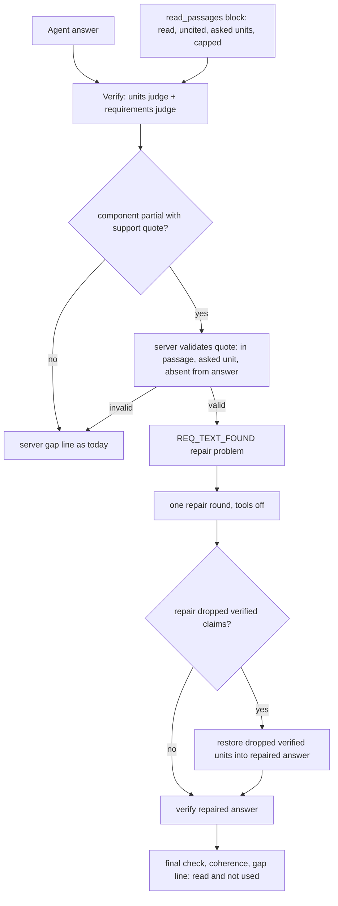

# Read evidence reaches the answer, and appraisal units keep their own boundaries - Plan

## Goal Capsule

- **Objective:** When the system has already read the part of an appraisal that answers part of a question, the answer the user sees contains that part, correctly attributed to the right appraisal and source location; and a file that holds several appraisals is never answered as if two of them were one.
- **Means:** text passages the turn read become evidence for request components through the existing requirements judge and repair round (KTD1, KTD2, KTD3); a repair that adds a missing part keeps what was already verified (KTD4); appraisal units are bounded and named from structural evidence on the page (KTD5, KTD6).
- **Authority:** the Product Contract's R-IDs win on behavior; KTDs win on mechanism within them; units override neither. The user's round-16 request and the session-settled decisions below are the source of the Product Contract.
- **Stop conditions:** stop and report if a settled decision proves infeasible (for example, if read-passage evidence cannot be given to the existing judge call without an added judge round), if any change would delete stored data, or if the held-out run would have to start before the final build.
- **Execution profile:** implementation units on Sonnet (`ce-work`), diagnosis and decisions on Opus, simple runs on Haiku. RAG product models are unchanged.
- **Who finishes:** the `lfg` pipeline: implement, simplify, review, measure, update PR AriGabay/rag#2 without merge or deploy.

---

## Product Contract

### Summary

Round 16 makes the system use what it already read. The requirements judge sees the passages the turn read and may point at the exact passage and quote that holds a part the answer left out. The server checks the quote and asks the repair round to add that part from that passage, without a new search. A repair that adds a part no longer throws away the claims already verified. Appraisal units are cut and named from page structure: running headers and footers, cover pages and page-number restarts that agree, not from exact Hebrew wording. The remaining v18 wrong-subject removals are fixed at their causes, and average answers state their basis (R11).

### Problem Frame

Round 15 fixed understanding and unit identification. On its final build the diagnostic set still had 15 of 29 turns partial. In 9 of them the system had read the source and still left a required part out of the answer. Two independent causes block completion:
- The requirements judge scores coarse components (often the whole question) without seeing the read text, so it calls them full.
- The completion path only fires for registered values, measurements or calculations; a read explanation, condition, caveat or list item never triggers it.

When a repair did add the missing part, a protection that discards any repair dropping one verified claim threw the addition away.

In the largest compendium, units are cut only by page-number restarts. One unit holds the end of one report and a whole foreign-language report, with a cover page and a running header of its own. Verification then removed correct values from it, because the unit had no identity and a short name shared across the file pointed at another unit.

In the frozen held-out run (v18), two answers averaged a table's unrounded sum where the reference expected the rounded conclusion. Both readings are defensible, so this is an interpretation question, not a wrong value. One average was removed by the judge because its sentence did not cite its calculation, and so carried no server qualifier.

### Key Decisions

- **Read text can be evidence for a component, when linked to the exact passage and quote.** (session-settled: user-directed — chosen over counting only values, measurements and calculations, or turning every sentence into a stored datum: the user asked for explanations, conditions, methods and caveats to count without converting them to quantities.) Governs R1, R2.
- **Opening a source is not support.** (session-settled: user-directed — chosen over treating a read S# as evidence: a link to the specific passage and meaning is required.) Governs R2.
- **Existing mechanisms only.** (session-settled: user-directed — chosen over a parallel layer, an added judge round or a raised tool budget: the requirements judge and the repair round already exist.) Governs R3, R6.
- **Complete from the read evidence; no new search by default, and a gap note is not the fix.** (session-settled: user-directed — chosen over re-searching or stating a gap: the evidence is already in the turn.) Governs R4.
- **Keep what was verified and allow the addition.** (session-settled: user-directed — chosen over discarding a repaired answer wholesale: "שמור מידע שכבר אומת ואפשר להוסיף אליו את החלק המבוסס שחסר".) Governs R5.
- **Unit boundaries from structural and content evidence, versioned, nothing deleted.** (session-settled: user-directed — chosen over more wording rules and destructive re-derivation: the fix must work without an exact subject line or letter opening and must never cut on a comparable's mention.) Governs R7, R8, R9.
- **The calculation basis is decided from the request and the source, and shown.** (session-settled: user-directed — chosen over forcing the rounded conclusion to match a reference.) Governs R11.
- **Measurement by repetition and a frozen held-out set.** (session-settled: user-directed — chosen over single runs and best-run reporting.) Governs R13, R14.

### Requirements

**Completion from read evidence**
- R1. A request component counts as answered only when the answer gives what the turn's read sources state for it; a part a read passage states and the answer omits makes the component partial.
- R2. Evidence for an omitted part is a verified link: a read passage (S#) and a verbatim quote inside it that states the part, in a unit of the asked appraisal. A source that was only opened, a quote not found in its passage, or a passage of another unit is no evidence.
- R3. The judging stays inside the existing requirements judge call; no judge round is added and no tool limit is raised.
- R4. A component partial with verified text evidence gets a repair problem that names the part, the passage and the quote, and asks to add it from that passage; the repair round for such problems does not search again.
- R5. A repaired answer that adds a grounded part keeps the claims the previous round verified: a verified claim the rewrite dropped is restored, not traded for the addition.
- R6. When completion still fails, the server's gap line says the part was read at its location and not used; it never says the part was not found.

**Appraisal units**
- R7. A file holding several appraisals is cut where a new report starts, also when the report has no subject line, no Hebrew letter opening and no page-number drop. Evidence includes a change of running header or footer and a cover page before it.
- R8. A cut is never made from a property named in text or a table (comparables), from a chapter's running header inside one report, or from a page-number restart on appendix pages that still name the previous report's subject.
- R9. A unit's identity includes its own running header subject and cover title when present, so a unit is never left without a name when its pages carry one.
- R10. New units are a new derivation stored beside the old rows. Cards, search scope, cited sources, verification contexts and conversation anchors use the new units. An anchor stored before resolves by name, or to the one new unit that holds its whole range; otherwise the user is offered the units, never a guessed one. Nothing is deleted.

**Correctness**
- R11. When a calculation can rest on different bases (a rounded headline conclusion or the sum of a table), the answer states which basis it used. It gives the other when the two differ, and never presents the result as a figure written in the document.
- R12. A sentence that shows the result of a conditional calculation is judged with the server's qualifier even when it does not cite the calculation itself.

**Measurement**
- R13. Text-only evidence is covered by tests: a professional explanation, a condition, a table row and a comparison between two appraisals, each with no registered value or measurement behind the missing part.
- R14. Results are reported for the final build as repeated runs (every run, not the best), separated by stage (not understood, not located, read and omitted, removed by verification), plus one run of the frozen held-out v19.

### Acceptance Examples

- AE1. **Covers R1, R2, R4.** Given a question about which rates an appraisal used for which income items, and a read passage that lists four rates, when the answer gives three, then the component is partial, the server verifies the quote of the fourth in that passage, and the repair round adds it with a citation, without a search call.
- AE2. **Covers R2, R6.** Given a component judged partial with a quote that is not in the named passage, or a passage from the neighbouring unit across a probable edge, then no completion problem is raised and the gap line keeps its existing not-located wording, which never says "not found".
- AE3. **Covers R5.** Given a repair that adds the missing part but rephrases away a verified numeric claim, then the verified claim is restored into the repaired answer and both appear in the final answer.
- AE4. **Covers R7, R8, R9.** Given a compendium where report B follows report A's appendices with a cover page and its own running header, then a unit starts at B's cover with B's running subject as its name. A's appendix pages that name A stay in A's unit, and a chapter header changing inside B cuts nothing.
- AE5. **Covers R11, R12.** Given "what is the average value per apartment" where the table sums to a different total than the rounded conclusion, then the answer names its basis. A result sentence without its C# citation still carries the server's conditional qualifier when the inputs were uncertain.

### Success Criteria

- Diagnostic set (regression), three runs on the final build, graded against the audited references. The round-15 final-build outputs are re-graded against the same corrected references first, and the targets are relative to that re-graded baseline (both figures reported): no wrong answer in any run; no-answer ≤ 2 per run; mean full turns at least 4 above the re-graded baseline; mean "read and omitted" required needs (counted per need, not per turn) at most half the re-graded baseline's.
- v18 (regression): no wrong_subject removal in its two compendium turns, and the average turn keeps its result.
- Held-out v19, run once: full ≥ 50% and no-answer < 21%, reported plainly if missed. v19 is held out by unit only; its files are shared with earlier sets and its units are small (letters, cover pages, a compendium tail).
- Cost: mean model calls and cost per turn on the diagnostic set no more than 20% above round 15's final build (244 calls, $0.197 for 29 turns), with any increase attributed (repair rounds that complete answers, a larger requirements input).

### Scope Boundaries

- No change to the RAG product models, the search-only path, or the tool budget.
- No new judge round, no new verification layer, no second completeness call.
- Text-layer defects found by the reference audit (trailing-minus negatives, duplicated DOCX table rows, a mirrored parenthesis, a misaligned multi-level table header) are recorded, not fixed here.

#### Deferred to Follow-Up Work

- Fix the text-layer defects listed in the private audit (`real_documents/tests/round16/reference_audit.md`).
- A precision sample for read-passage support quotes, if the measured false-completion rate warrants it.

---

## Planning Contract

### Key Technical Decisions

- KTD1. **Read passages go into the existing requirements call as a bounded block, and the judge may name `support` for an omitted part.** The requirements scoring input gains a `<read_passages>` block: text of S# sources the turn read in the asked units, cited or not. A cited source the judge already sees whole is skipped; for one it sees only as an excerpt (`evidence.select` above `WHOLE_SOURCE_CHARS`) the block holds the segments not shown. A long passage is clipped with `evidence.select` against the component texts, never by prefix, and the block is capped in characters. `JudgeRequirement` gains `support: [{id, quote}]` for a `partial` or `missing` requirement. The policy states that a component is full only when the answer gives what the read passages and cited sources state for it. `JUDGE_VERSION` moves to 11. Governs R1, R3. (session-settled: user-directed — chosen over a separate completeness call after merging: no judge round may be added.) Rationale: the judge already scores components and names related ids, so this adds evidence to an existing decision instead of a new mechanism. Conflict call-out: the block repeats in every batch of the requirements call, so the server must not trust a batch's `support` for a part another batch's units give (KTD2).
- KTD2. **The server validates `support` before it becomes evidence.**
  - The S# must be a read source.
  - The quote must be a verbatim substring of its text after `meaning._flat` normalisation, following `cards.verify_fields` and `tools._take_quote`.
  - The block holding the quote must lie in an asked unit (declared, located or cited), not across a probable edge into a neighbour.
  - The quoted part must be absent from the final answer: no single answer unit holds the quote's number together with at least half of its content words (the item label plus its value). This absorbs the batch-repetition effect without dropping an omitted item whose value repeats another item's.
  - Valid support is `coverage.related_evidence(...)["text"]`, a new bucket beside `data`, `failures` and `checks`.
  - An invalid support entry is dropped silently, never failing a unit.

  Governs R2.
- KTD3. **A completion problem from text support uses the existing repair round with tools off.** `verify._check_requirements` emits a `REQ_TEXT_FOUND` requirement problem naming the missing part, the S# and the quote when `data` is empty and `text` is not. When every problem of the repair round is a `REQ_TEXT_FOUND` completion, the repair step runs with `tool_choice` none. Otherwise the choice stays as today (a data completion keeps `calculate` through `compute_tool_choice`). Governs R4. (session-settled: user-directed — chosen over a re-search by default and a gap note as the fix.)
- KTD4. **`lost_supported` restores instead of discarding.** When a repaired answer drops claims the last round verified, the engine restores every claim `lost_supported` reports (number, citation and qualifier losses alike) at claim granularity: the verified claim's own sentence with its citations, never the rest of its unit. A claim whose content an answer unit already covers in other words is not restored. A claim whose value the repair changed is restored beside the new one, so both bases stay visible (R11). The merged answer is verified through the ordinary path; verdict caching keeps restored claims cheap, and the final check's coherence rules still run. The old discard remains the fallback only when the merge adds nothing grounded or the time budget does not allow verification. Governs R5. (session-settled: user-directed — chosen over discarding a repaired answer wholesale.)
- KTD5. **A running-line regime change is a strong boundary signal, gated against chapter headers.** `units.py` computes, per page, its top and bottom text lines. It finds local runs of a repeated line (normalised, digits ignored, never a bare page number or date) over consecutive pages. A new run whose line differs from the previous run's is a candidate. It is accepted only when it is long (several pages) and agrees with at least one of: the other edge's run also changes, a cover page precedes it, or a page-number restart. The boundary moves back over an immediately preceding cover page that carries neither run: few short blocks with a prominent title that names a report type or a subject, not any short divider page. Furniture detection that stores a repeated line once must be accounted for; read the stored lines per page, not the deduplicated set. Governs R7, R8. (session-settled: user-directed — chosen over more wording rules.)
- KTD6. **A lone page-number-restart cut is checked for continuity, and a unit-local running subject is identity.**
  - Every cut that carries no `subject_line` or `letter_opening` (that is, one resting only on running-line change, cover page or `label_restart`) is dropped when the cut pages' opening lines name the previous unit's running subject and no identifier differs. This keeps an appendix with its own running header and restarted numbering in its report.
  - Comparables and appendix kinds are unaffected: they are already their own units by kind.
  - `_identity` takes the unit's running subject (a segment of its running line constant across most of its pages, never a per-chapter segment) and its cover title as title or alias when present.
  - `UNITS_VERSION` becomes `units-v6`, stored beside v5 by derivation key.

  Governs R7, R8, R9, R10.
- KTD7. **A result sentence is bound to its calculation before qualifiers are written.** `verify.bind_computations` / `conditional_notes` bind a unit that shows a C#'s result to that C#, also when the number is approximate ("כ־N") or scaled ("N מיליון"), so the unit gets its `<server_qualifier>`. Governs R12.
- KTD8. **The calculation basis is a policy line plus the computation record.** The agent policy asks to state the basis the answer used and, whenever a rounded conclusion and a computed sum differ, to give the other as well (R11). The computation card already shows the inputs. No phrase list is added. Governs R11.

### High-Level Technical Design

Completion from read evidence, inside the existing turn:

Unit boundary signals after this round:

| Signal | Strength | New in round 16 |
|---|---|---|
| label_restart | strong, now continuity-checked when alone | continuity check |
| subject_line, letter_opening | strong | no |
| running-line regime change (+ cover backtrack) | strong when gated | yes |
| title_block_repeat | weak | no |
| toc_entry, identifier restart | strong | no |

### Assumptions

- The read-passages block fits within a few thousand characters per requirements batch without hurting the units judge. The cap is tuned in U1 against measured input tokens.
- Running lines are present per page in stored blocks for the affected compendium, as the private probe shows. The implementer verifies how furniture detection stores them before relying on it.
- v19's units are small and its files are shared with earlier sets, so it shows generalisation weakly. The report says so.
- The reference corrections from the private audit (7 required needs made optional, 2 value fixes, 4 accepted alternatives, H07 accepts a stated basis) are applied to the regression sets before the final runs. Held-out v19 is not touched.

### Sequencing

U1 → U2 → U3 build the completion path in order. U4 → U5 are the unit boundary path and are independent of U1–U3. U6 is independent. U7 needs U1–U3. U8 runs last, on the rebuilt final stack.

---

## Implementation Units

### U1. Read passages in the requirements judge

- **Goal:** the requirements judge sees the turn's read, uncited passages in the asked units and may return `support` quotes for an omitted part.
- **Requirements:** R1, R3; KTD1.
- **Dependencies:** none.
- **Files:** `backend/app/chat/verify.py` (`_workspace_listing` or a sibling builder, `JudgeRequirement`, `JUDGE_REQUIREMENTS_POLICY`, `_Coverage.accept`, `JUDGE_VERSION`), `backend/tests/unit/test_coverage.py`, `backend/tests/unit/test_verify_cache.py`, `backend/tests/unit/test_verify_units.py`, `backend/tests/unit/test_verify_professional.py`, `backend/tests/unit/test_verify_reread.py`.
- **Approach:**
  1. Build the passage block from `ws.sources` per KTD1: read kinds only, in an asked unit (declared, located, or a unit the answer cites), skipping what the batch already shows whole. Record input characters and tokens per requirements batch from the first test run, so cost is attributed early.
  2. Add `support` to the schema with a default, so an older reply stays valid. Add the policy sentence for full/partial and support.
  3. Keep `related` as today. `support` ids are accepted only when they are read sources.
  4. Bump `JUDGE_VERSION` to 11 and update its pins.
- **Patterns to follow:** `_unit_context` / `_preceding_note` render server context beside the unit; the `missing` field and `valid_missing` (round 8) show how a judge-named part is constrained.
- **Test scenarios:**
  - A requirements call whose turn read an uncited passage in the declared unit renders that passage in the block. A passage of another document or unit is absent.
  - A passage the answer cites, longer than the whole-source limit, whose omitted item lies outside the cited excerpt: the block shows the segment holding that item.
  - A cited passage the judge already sees whole is not repeated in the block.
  - The block respects its cap: many read passages are clipped, and the cap holds.
  - A judge reply with `support` parses. An older reply without it parses with an empty list.
  - `JUDGE_VERSION` is 11 and the verdict cache key changes with it.
  - A professional (standards pool) passage read for a mixed question is included only when the component is professional.
- **Verification:** the scripted-judge tests show the block, the schema and the cache key. Measured input tokens per requirements call are recorded for U8.

### U2. Completion problem from verified text support

- **Goal:** a component the judge marks partial with valid text support produces a repair problem that completes it from that passage, and the gap line no longer says "not found".
- **Requirements:** R2, R4, R6; KTD2, KTD3.
- **Dependencies:** U1.
- **Files:** `backend/app/chat/coverage.py` (`related_evidence` gains `text`, gap reason), `backend/app/chat/verify.py` (`_check_requirements`, `REQ_TEXT_FOUND`, support validation), `backend/app/chat/engine.py` (repair step tool choice), `backend/tests/unit/test_coverage.py`, `backend/tests/unit/test_verify_cache.py`, `backend/tests/integration/test_chat_completeness.py`.
- **Approach:**
  1. Validate support per KTD2 and keep valid entries per component across judge calls.
  2. In `_check_requirements`, branch on `data` first (as today), then on `text`. Emit `REQ_TEXT_FOUND` with the part, S# and quote.
  3. The absence check (a unit saying "not found" while support exists) uses `text` as well as `data`.
  4. Turn tools off for the repair step only when every repairable problem is `REQ_TEXT_FOUND` (KTD3).
  5. The gap reason for a component whose valid support was not used reads "read at <location>, not used".
- **Patterns to follow:** `REQ_DATA_FOUND` and its tests; `cards.verify_fields` for quote checks; the absence problem `REQ_FOUND_NOT_ABSENT`.
- **Test scenarios:**
  - Covers AE1. A partial component with a valid quote in a read passage yields one `REQ_TEXT_FOUND` problem naming S# and the quote. The repair step has tools off and adds the part.
  - Covers AE2. A quote not in its passage is dropped and no problem arises. A quote in the neighbouring unit across a probable edge is dropped.
  - A quote whose content is already in the answer (given by another batch's unit) raises nothing.
  - A unit saying the part was not found, while valid text support exists, is replaced as an absence.
  - Mixed problems (a text completion plus a not-searched component) keep tools available. A data completion that needs a calculation keeps `calculate`.
  - An omitted rate whose value equals another rate the answer gives still raises `REQ_TEXT_FOUND` (the absence test is per unit, number plus label).
  - A failed completion leaves a gap line naming where the part was read.
- **Verification:** unit and scripted integration tests pass. A scripted turn shows zero search calls in the repair step for a pure completion.

### U3. Restore verified claims when a repair drops them

- **Goal:** a repair that adds a part and drops a verified claim ends with both.
- **Requirements:** R5; KTD4.
- **Dependencies:** U2.
- **Files:** `backend/app/chat/engine.py` (the `lost_supported` branch), `backend/app/chat/verify.py` (`VerifyReport.lost_supported`, a restore helper), `backend/tests/unit/test_verify_cache.py`.
- **Approach:**
  1. On loss, compose the merged answer per KTD4: the repaired markdown plus each lost verified claim's own sentence with its citations, placed after the section holding its neighbours, or at the end.
  2. Skip a lost claim whose content an answer unit already covers in other words.
  3. Verify the merged answer normally. Fall back to the checked answer only when the merge adds nothing grounded or verification time is short.
  4. Record a round entry naming what was restored.
- **Patterns to follow:** the existing tests at `test_verify_cache.py` around `lost_supported`; the final check's coherence rules.
- **Test scenarios:**
  - Covers AE3. A repair that adds the part and rephrases away a verified number: the final answer holds both, and the round entry names the restored claim.
  - A repair that drops a verified number and adds nothing grounded: the checked answer is composed, as before.
  - A repair that changed a computed result's basis: the old verified result is restored beside the new one, and the basis line names which one the answer uses.
  - A unit holding one verified and one failing claim: only the verified claim's sentence is restored.
  - A number-free verified claim (a caveat, a condition) dropped by a repair that adds a text part: it is restored.
  - The restored text does not duplicate a claim the repaired answer kept in other words.
  - The verification time budget cannot fit the merged answer: fall back to the checked answer.
- **Verification:** the existing `lost_supported` tests are updated to the new contract and pass, and the new scenarios pass.

### U4. Running-line boundary signal and continuity check

- **Goal:** compendium units start at each report's real beginning, including foreign-language reports, and appendix restarts stay with their report.
- **Requirements:** R7, R8; KTD5, KTD6.
- **Dependencies:** none.
- **Files:** `backend/app/chat/units.py`, `backend/scripts/generate_fixtures.py` (a new synthetic compendium fixture), `backend/tests/fixtures/round16/` (generated fixture and manifest), `backend/tests/unit/test_units_derive.py`.
- **Approach:**
  1. Per page, collect the first and last text lines from stored blocks. Find local runs of a normalised repeated line.
  2. Detect run changes and gate them per KTD5. Backtrack over a cover page.
  3. Add the signal name to the evidence.
  4. Apply the continuity check to lone `label_restart` cuts per KTD6.
  5. Bump `UNITS_VERSION` to `units-v6` and update its pins.
  6. Keep the derivation linear in pages.
- **Execution note:** start from a failing synthetic fixture that reproduces the merge (report A, A's appendices with restarting page numbers and A's name, report B with a cover and its own running header, then B's chapters with chapter running headers).
- **Patterns to follow:** the round-15 signals `subject_line` / `letter_opening` and their `Doc` builder tests; `MULTI` registration for a multi-unit fixture.
- **Test scenarios:**
  - Covers AE4. The synthetic compendium derives one unit per report, B's starting at its cover, with signals recorded.
  - Appendix pages that restart numbering and name A stay in A's unit.
  - A's appendices with their own running header, restarted numbering and a divider page, still naming A, cut nothing (the continuity check covers every cut without a subject line or letter opening).
  - Chapter running headers changing inside B cut nothing.
  - A comparables table naming another property cuts nothing.
  - A file where every report shares one footer (same appraiser) still cuts at subject lines as before. Existing round-15 fixtures keep their units.
  - A run line that is only a page number or a date is ignored.
  - A DOCX (no pages) derives as before.
  - The thousand-page performance test stays within its bound.
- **Verification:** derivation tests pass. Before rollout, a read-only derivation of `units-v6` over every multi-page stored document is compared with `units-v5`, and each new or removed cut is listed and reviewed privately on page images; any new cut that is not a report start blocks U5's rollout. The counts go into the U8 evaluation section, never document text.

### U5. Unit identity from running subject and cover, and propagation

- **Goal:** every unit with a running subject or cover title has a name, and the new units reach cards, search, sources, verification and anchors.
- **Requirements:** R9, R10; KTD6.
- **Dependencies:** U4.
- **Files:** `backend/app/chat/units.py` (`_identity`), `backend/app/chat/entities.py` (`ensure_current_units`, `live_unit` for a unit split in two), `backend/app/platform/search.py` (`document_term_holders` ensure), `backend/scripts/derive_unit_cards.py`, `backend/tests/unit/test_units_derive.py`, `backend/tests/unit/test_entities_units.py`, `backend/tests/integration/test_document_units.py`, `backend/tests/unit/test_appraisal_context.py`, `docs/operations/reprocessing.md`.
- **Approach:**
  1. The running subject is the segment of the unit's running line that is constant across most of its pages (at least two thirds) and differs from other units' running lines in the file; a per-chapter segment is ignored. It becomes the title when no title block exists, else an alias. A cover title is used the same way when present.
  2. Old anchors keep `entities.resolve_older` as it is: a name match, else the one new unit holding the whole old range, else "gone" with the units offered (R10).
  3. `document_term_holders` ensures the current derivation like the other readers.
  4. The cards backfill for v6 units is part of the rollout, after `scripts/backup.sh`.
- **Patterns to follow:** round-15 propagation (`ensure_current_units`, `current_key_sql`, tag on handles, listed units).
- **Test scenarios:**
  - A unit with a running header "<report type> – <subject>" gets <subject> as title or alias. A unit whose running line is shared by all units gets none from it.
  - A unit whose chapter headers vary while a "<report type> – <subject>" footer is constant takes only the footer's subject.
  - A unit with a cover title and no running line takes the cover title.
  - Covers AE4. Verification of a claim naming "<brand> <city>" against a value in the unit whose running subject is that phrase is not "another property's", while another unit's card holds only "<brand>".
  - An anchor stored on a v5 unit that split into two v6 units resolves by name when a name matches, and otherwise is "gone" with both units offered.
  - A version holding only v5 rows gets v6 rows before candidates are ranked and before term holders are counted. Nothing is deleted.
- **Verification:** unit and integration tests pass. A read-only probe shows the compendium's units named.

### U6. Conditional result binding and calculation basis

- **Goal:** a result sentence keeps the server's qualifier without citing its C#, and answers state their calculation basis.
- **Requirements:** R11, R12; KTD7, KTD8.
- **Dependencies:** none.
- **Files:** `backend/app/chat/verify.py` (`bind_computations`, `conditional_notes`), `backend/app/chat/engine.py` (`POLICY` line), `backend/tests/unit/test_verify_computed.py`, `backend/tests/unit/test_engine_policy.py` (or the existing policy test file).
- **Approach:**
  1. Trace why the held-out sentence ("כ־N", the comparables table cited instead of C#) was not bound. Extend binding to approximate and scaled forms.
  2. Add one policy sentence on stating the basis when a rounded conclusion and a computed sum differ.
- **Test scenarios:**
  - Covers AE5. A unit showing a conditional C#'s result as "כ־N" or "N מיליון" without citing it gets the server qualifier and is not removed as uncertain_reading.
  - A unit showing a number equal by chance to a C# result, but about another item, is not bound.
  - The policy text names basis disclosure. No phrase list exists in code.
- **Verification:** tests pass. On the rebuilt stack the held-out average turn keeps its result, measured as regression.

### U7. Text-only evidence scenarios and real-model test

- **Goal:** end-to-end proof that a missing part supported only by text is completed, in the four required shapes.
- **Requirements:** R13; covers R1–R6 end to end.
- **Dependencies:** U1, U2, U3.
- **Files:** `backend/tests/integration/test_round16_sequences.py` (new, scripted model, office B, synthetic fixtures), `backend/tests/integration/test_round16_real_model.py` (new, `-m real_model`, opt-in).
- **Approach:** scripted sequences in which the agent reads a passage and answers without one part. The scripted judge returns `support`. Assert the repair problem, the tools-off repair step and the final answer. The real-model file replays the four shapes on office B synthetic documents, three repetitions each, opt-in.
- **Test scenarios:**
  - A professional explanation: a standards passage gives the reason, and the answer omits it, then is completed.
  - A condition or caveat: a rate's stated condition is omitted, then completed.
  - A table: one row of a read table is omitted, then completed from the table passage.
  - A comparison between two appraisals: the second appraisal's item was read but omitted, then completed with its own attribution.
  - Each completed part cites the passage it came from, and no search call runs in the repair step.
- **Verification:** scripted tests pass under the pytest wrapper. The real-model tests are run opt-in and reported with every repetition.

### U8. Measurement on the final build

- **Goal:** report the final build honestly by stage, with repetitions and one held-out run.
- **Requirements:** R14; Success Criteria.
- **Dependencies:** U1–U7, rebuilt stack.
- **Files:** `docs/evaluation/conversational-rag.md` (round 16 section, counts only). Private: `real_documents/eval/round15/diag_set.yaml` corrections from the audit, run folders under `real_documents/tests/round15/runs/`.
- **Approach:**
  1. Apply the audited reference corrections to the regression sets (diagnostic, v18) before any run, and record them privately. Re-grade the stored round-15 final-build outputs against the corrected references to set the baseline.
  2. Rebuild the stack, verify constants, take a backup, and run the cards backfill.
  3. Run the diagnostic set three times and v18 once, then grade by meaning. Report all runs with stage separation (not understood, not located, read and omitted, removed).
  4. Run v19 once after its sha check, and grade it.
  5. Record cost and time.
- **Test expectation:** none -- measurement, not product behavior.
- **Verification:** the evaluation section states each run's full, partial, wrong and no-answer counts and the remaining failure causes. The held-out caveats are stated.

---

## Verification Contract

| Gate | Command or method | Applies to |
|---|---|---|
| Unit and integration tests | `scratchpad/pt15.sh <paths> -q` (host, separate test DB `rag-testdb-r15`, never two at once, never in Docker) | U1–U7 |
| Full suite before push | `scratchpad/pt15.sh -q` | final build |
| Lint | `cd backend && .venv/bin/ruff check app tests` | U1–U7 |
| Real-model scenarios | `-m real_model tests/integration/test_round16_real_model.py`, opt-in, office B | U7 |
| Stack rebuild | `docker compose build migrate frontend`, force-recreate backend, worker, frontend; verify `UNITS_VERSION == "units-v6"` and `JUDGE_VERSION == 11` inside the containers | U8 |
| Office DB changes | `scripts/backup.sh` before any migration or cards backfill | U5, U8 |
| Measurement | private harness `real_documents/tests/round15/harness` (`run_set.py`, `score_stages.py`, `GRADING.md`) | U8 |

---

## Definition of Done

- R1–R14 are met or each miss is reported by stage in the evaluation section.
- All unit tests touched or added pass under the wrapper, and the full suite passes on the final build.
- `JUDGE_VERSION` 11 and `UNITS_VERSION` `units-v6` are pinned in tests and verified in the rebuilt containers.
- No stored data was deleted, and v5 unit rows remain beside v6.
- No customer text, names or values are in git. Private measurement stays in `real_documents/`.
- The PR body carries the round-16 section and any unapplied review findings, and there is no merge and no deploy.
- Code from abandoned attempts is removed from the diff.

---

## Appendix

### Sources

- Private diagnosis: `real_documents/tests/round15/diag/r16_diagnosis.md`, `r16_readnotanswered.md`, stored-block probes `diag/blocks_518_532.txt`, `diag/tops_330_714.txt`.
- Private reference audit with page images: `real_documents/tests/round16/reference_audit.md`, `reference_corrections.yaml`.
- Held-out v19: `real_documents/eval/round16/real_v19_heldout.yaml` (sha256 `ec43d37f…`), frozen before any round-16 code change.
- Learnings: `docs/solutions/logic-errors/server-rules-overriding-the-model-and-layout-only-unit-identity-break-multi-appraisal-answers.md` (round 15: additive derivations, tagged handles, ensure before ranking), `docs/solutions/logic-errors/datum-identity-needs-a-source-grounded-component-decided-pairwise.md` (edit semantics and coherence after cuts), `docs/solutions/logic-errors/datum-context-is-lost-between-extraction-cache-and-display.md` (not read is not "not stated"; caches store results, not verdicts), `docs/solutions/logic-errors/pdf-text-layer-passes-but-content-is-missing.md` (repeated content stored once as furniture).
- Code anchors: `backend/app/chat/verify.py` (`_workspace_listing`, `_Coverage.accept`, `_check_requirements`, `lost_supported`, `conditional_notes`, `bind_computations`), `backend/app/chat/coverage.py` (`related_evidence`), `backend/app/chat/engine.py` (repair loop), `backend/app/chat/units.py` (`_cuts`, `_identity`, `UNITS_VERSION`), `backend/app/chat/entities.py` (`ensure_current_units`, `live_unit`), `backend/app/platform/search.py` (`document_term_holders`).

### Alternatives Considered

- **A separate completeness call after merging the judge batches.** It would avoid the batch-repetition effect. It was rejected because it adds a judge call per turn, which the user excluded. Server-side checks in KTD2 handle the repetition instead.
- **Splitting coarse components at request analysis.** It would make components finer before answering, but the items of a list are unknown until the source is read. Judging components against read evidence covers this without a second understanding step.
- **Agent-declared coverage (the agent lists which read parts it used).** This relies on the agent noticing its own omission, which is the failure being fixed.
