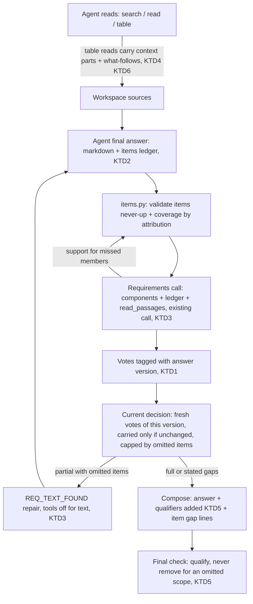
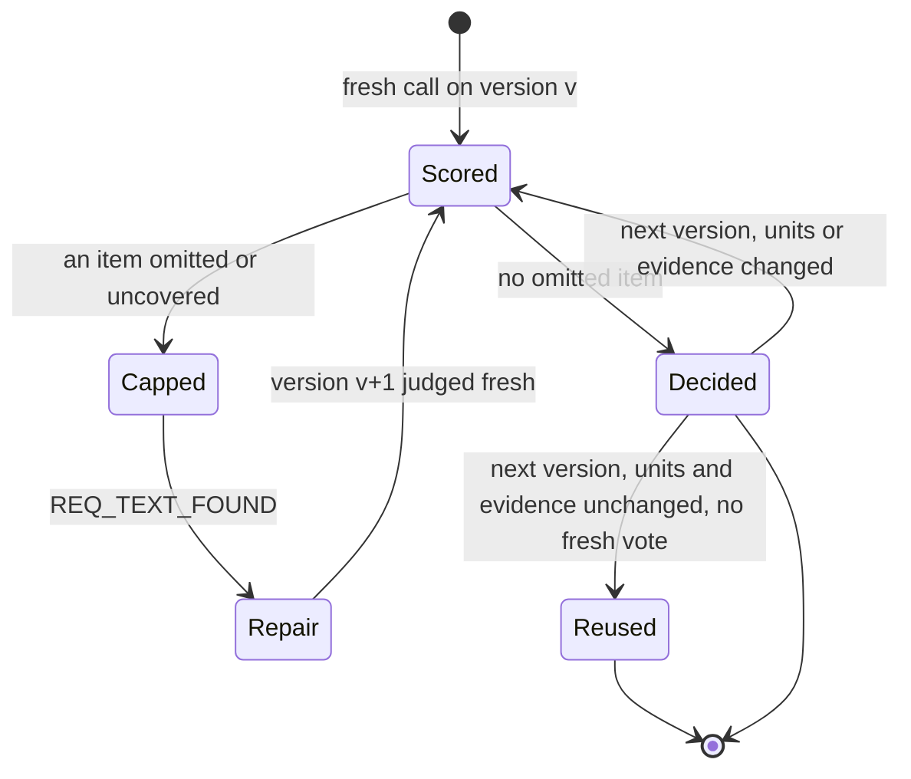

# Answers built from the items the sources list, judged on the current answer, with scope qualifiers kept - Plan

## Goal Capsule

- **Objective:** When an appraiser asks for something a source lists (all the adjustments, every rate, each condition, both appraisals' figures), the answer gives every listed item with its source, value, condition and attribution, or says exactly which item could not be verified and why. A figure is never shown with a wider meaning than its source gives it.
- **Means:**
  - The answer is built and checked against an item ledger per request component, inside the existing answer and requirements path (KTD2, KTD3).
  - Completeness is decided on the current answer version (KTD1).
  - Table-adjacent context is bound to the values it scopes (KTD4, KTD5).
  - The tool budget stops leaking on the mechanisms the traces show (KTD6).
- **Authority:** the Product Contract's R-IDs win on behavior, and KTDs win on mechanism within them. Units override neither. The user's round-17 request and the session-settled decisions below are the source of the Product Contract.
- **Stop conditions:** stop and report in any of these cases:
  - A settled decision proves infeasible, for example the item ledger cannot be checked without an added judge round.
  - A change would delete stored data or need a re-extraction of office A.
  - The final measurement would have to start before the final build.
- **Execution profile:**
  - **Opus:** diagnosis and decisions.
  - **Sonnet:** implementation units (`ce-work`) and reviews.
  - **Haiku:** simple runs.
  - RAG product models (`gpt-6-luna`) are unchanged.
- **Who finishes:** the `lfg` pipeline implements, simplifies, reviews and measures, then updates PR AriGabay/rag#2 without merge or deploy.

---

## Product Contract

### Summary

Round 17 changes how an answer is assembled and judged. After reading, the answering agent lists, under each frozen request component, the items the read sources give for it. Each item carries its source, quote, value, condition and an explicit state.

The server validates every item against what was read, and checks by attribution that each included item is in the answer. The existing requirements call checks the list against the read passages and names members the list missed.

A component is full only when its required items are covered. Its status is decided on the answer version being shown, not on a vote from an earlier version.

A table is read together with the heading path and the short blocks attached to it. A scope note under a table travels with the table's values, and verification adds a missing material qualifier instead of cutting it or removing the figure.

The traced budget leaks are closed: re-sent text, oversized search envelopes, tables read without their neighbours, unlisted continuation units and refused `take_value` calls. A reproduced nondeterminism in passage retrieval is fixed at its source.

### Problem Frame

Round 16 gave the requirements judge the read passages, but the final build did not improve the core metrics. The comparison is against the round-15 final build, re-graded on the corrected references:

| | Round 15 (re-graded) | Round 16, 3 runs |
|---|---|---|
| Full | 18 | mean 17.3 |
| Read-and-omitted required items per run | 7 | 9–10 |
| D07-t2 | not wrong | wrong in all three runs |
| Cost | $0.197 | $0.235–0.261 |

The private diagnosis (`real_documents/tests/round15/diag/`, round-16 runs) found five distinct paths:

1. **A stale `full` vote wins.** A requirement vote carried from an unchanged unit of an earlier answer version outranks a fresh `partial` vote on the repaired answer, even when the fresh vote carries a server-validated quote of the omitted part. Votes are merged by "best status".
2. **Enumerations are coarse.** A frozen component usually spans the whole question, and nothing records which members the source lists and which the answer gives. Most omissions are partial enumerations: 3 of 4 rates, 8 of 10 units, a missing row, a missing second basis.
3. **The scope note never reaches the reader.** D07-t2's scope qualifier ("the table above refers to one valuation approach only") is a separate paragraph block right after a table. A table read never includes it, so across the runs:
   - the agent did not see it;
   - the judge cut the qualifier the agent did write as unsupported;
   - the final check removed the sentence instead of qualifying it.
4. **Unlocated items sit next to what was read.** 14 of 20 not-located required items were 1–5 blocks from a table the turn had already returned. Table reads return only the table and report `complete`. Read text is re-sent; search envelopes are about 45% of search output. Continuation units without the property name are never listed. `take_value` refusals consume steps.
5. **The CI failure comes from a random tiebreak.** `test_long_document_outside_retrieved_passages_is_partial_scan` fails about 0.5% of runs (2 of 400 reproduced). The trigram stage breaks ties by a random chunk UUID and the lexical stage has no final tiebreak.

### Key Decisions

- **Completeness is decided per answer version.** An earlier decision is reused only while its content and dependencies are unchanged, and validated evidence of a missing item lowers the decision. Decision history is kept for diagnostics, separate from the current state. Governs R1, R2, R3. (session-settled: user-directed — chosen over keeping the best status across all votes: an old `full` must not hide a gap found by a newer check)
- **Answers are built and checked against an item ledger under the frozen request.** Each item gets an explicit outcome, and full means the required items are covered by attribution, not by word or number presence. No requirement the user did not ask for is added. Governs R4, R5, R6, R7, R8. (session-settled: user-directed — chosen over one more general prompt sentence, an automatic extra judge round, or treating every document detail as required: the user asked for the ledger to live in the existing build and check path)
- **The ledger lives inside the existing answer-building and completeness-check path.** It adds no parallel layer and no added judge round. Governs R4, R6, R9. (session-settled: user-directed — chosen over a new verification layer or round: integrate into the existing path)
- **Material qualifiers are bound to the values in their scope, with exact references, and never dropped while the number stays.** Unverified essential context is stated as a precise limitation, and a qualifier of another component is never applied. Governs R10, R11, R12, R13. (session-settled: user-directed — chosen over cutting the qualifier or removing the sentence: a number must not gain a wider meaning)
- **Completion uses the ledger and sources already read.** Locating is fixed from traces, with no blanket increase of the tool budget or waiting time. Governs R9, R14, R15. (session-settled: user-directed — chosen over raising budgets)
- **Measurement order and reporting.** The three failures get focused tests first. Then the diagnostic set runs on one final build in several repetitions, with the same corrected references and scoring, and every run is reported. v19 is not evidence for multi-component questions, and a new multi-component held-out set states its separation limits. Governs R16, R17, R18, R19. (session-settled: user-directed — chosen over presenting regression or thin held-out success as generalization, or picking the best run)
- **The CI failure is reproduced before the test changes, and is never marked flaky.** Governs R20. (session-settled: user-directed — chosen over marking it flaky or relying on a passing rerun)
- **Operating constraints.** RAG product models are unchanged. Tests use the separate test DB, and the old `rag_test` is untouched. There is no mandatory manual approval and no deletion of stored data. Private data stays out of git. The PR is updated without merge or deploy. Governs R21. (session-settled: user-directed — chosen over n/a: standing project constraints restated by the user)

### Requirements

**Completeness on the current answer**

- R1. A component's status reflects the answer version the user will see. A vote cast on an earlier version counts only when every unit it rests on is unchanged and the evidence the turn holds for that component is unchanged.
- R2. Server-validated evidence that an item is missing from the current answer lowers the component to at most `partial`, whatever any vote says.
- R3. Every decision records the answer version, the component, and the votes and evidence it rests on. Earlier versions' votes and decisions stay available in diagnostics and never feed the current state.

**Item ledger**

- R4. For each frozen component, the answer carries the relevant items found in the read sources. Each item has its source, a verbatim quote, its value when there is one, its condition when the source attaches one, and a state the agent declares: `included` (in the answer with evidence), `not_verifiable` (with the reason), or `not_applicable` (with the request condition that excludes it). The server assigns a fourth state, `omitted`, to a member the requirements call adds after validation and to an included item no surviving unit covers.
- R5. An item counts as covered only when a surviving answer unit states it with attribution to the item's source, its property (appraisal unit and document), its date where the item has one, and its condition. Words or numbers appearing elsewhere in the answer do not count.
- R6. A component is `full` only when every item in its ledger is covered or carries an explicit `not_verifiable` or `not_applicable` state with a reason. The existing requirements call may add members of the asked kind that the read passages state and the ledger missed. Those enter the ledger as omitted items after server validation.
- R7. The ledger never adds a requirement the user did not ask for. Items are limited to members of the asked kind for the asked property, and a document detail outside the request is not an item.
- R8. Items with state `not_verifiable` or `not_applicable` and items left omitted after the repair are stated to the user in a gap line that names the item, its place in the source, and the reason. The line never says "not found" for an item that was read.

**Qualifiers that change meaning**

- R9. Read context reaching the agent and the verifier includes the parts that belong to a table, each with its exact block reference:
  - the heading path;
  - the caption and header rows;
  - the notes;
  - the short blocks immediately before and after the table, up to the next structural boundary or appraisal-unit edge and within a named size cap, with a pointer naming any block beyond the cap.
- R10. A material qualifier the source states for a value (in its table's caption, headers, notes or context parts, its heading, or its own passage) is never cut from a sentence that keeps the value, and a sentence is never removed solely because it lacks that qualifier. Verification adds the qualifier from the source next to the value, with its citation.
- R11. When the essential context of a value cannot be verified, the answer states that limitation precisely next to the value instead of presenting it unqualified.
- R12. A qualifier binds only to values within its scope. A table's trailing note binds to that table's values, and a heading binds to the blocks under it. A qualifier of another component, table or section is never applied.
- R13. The qualifier binding works from structure and position, not from fixed wording. A heading, a table note and a preceding sentence are all valid places, and the same rules hold for Hebrew and foreign-language documents.

**Completion and locating**

- R14. An item whose evidence the turn already read is completed from that source without a new general search. A new search runs only for items not yet located.
- R15. The turn spends less of its budget on text it already received, and table reads point to what follows them. Continuation units of an asked appraisal are discoverable. Each mechanism is changed only where the round-16 traces show it, with no blanket increase of the tool budget or waiting time.

**Measurement and reporting**

- R16. Focused tests reproduce and then pin the three failures:
  - an old decision hiding a gap;
  - a list answered in part;
  - a material qualifier that disappears.
- R17. The diagnostic set runs on one final build in at least three repetitions, with the same corrected references and the same rubric, and every run is reported. The report covers:
  - full-and-correct answers;
  - read-and-omitted items;
  - errors;
  - not-located items;
  - time;
  - tokens;
  - cost;
  - cost per full-and-correct answer.
- R18. A new held-out set with multi-component questions (v20) is frozen before any round-17 code change and runs once on the final build. Its separation from development material is stated plainly. v19 is not presented as evidence for multi-component questions.
- R19. The final report states what changed in the answer-building path, how omissions are prevented, and what the final build proved. If the core metrics did not improve, it says the goal was not reached.
- R20. The CI failure is fixed at its reproduced cause: a nondeterministic tiebreak in passage retrieval and a test whose premise rested on chance. The test is not marked flaky.
- R21. RAG product models are unchanged, and tests run on the separate test DB. No stored data is deleted and no manual approval is added. Private data stays out of git, and the PR is updated without merge or deploy.

### Acceptance Examples

- AE1. **Covers R1, R2.**
  - **Given:** the first answer gives a component and its vote is `full`. A repair round edits another sentence, and the fresh requirements call scores the component `partial`, with a validated quote of a rate the answer omits.
  - **When:** the status is decided.
  - **Then:** the component is `partial`, and the old `full` vote appears only in the history.
- AE2. **Covers R1, R3.**
  - **Given:** a repair round changed nothing in the units that gave a component, and no new passage bearing on it was read.
  - **When:** the status is decided.
  - **Then:** the earlier `full` decision is reused without a fresh vote, and the trace marks it as reused with the version it came from.
- AE3. **Covers R4, R5, R6.**
  - **Given:** the user asks which adjustments the appraisal applied, and the source table lists three. The answer gives two, citing the table, and the ledger lists three with the third `included`.
  - **When:** the answer is checked.
  - **Then:** the third item is not covered, the component is `partial`, and the repair is asked to add it from the same table without searching.
- AE4. **Covers R5.**
  - **Given:** the answer states the third adjustment's number, but in a sentence about another appraisal that cites another document.
  - **When:** coverage is checked.
  - **Then:** the item is not covered.
- AE5. **Covers R9, R10, R12.**
  - **Given:** a value comes from a sensitivity table whose next block says the table refers to one valuation approach only.
  - **When:** the table is read.
  - **Then:** the note is part of the table's read context. An answer giving the value as the property's total without the scope gets the scope added from the note, with its citation. The sentence is not removed and the scope words are never cut. A value from another table in the same section does not get that note.
- AE6. **Covers R11.**
  - **Given:** a value whose cited source states a scope the server cannot place, for example because its block is outside the reading the turn holds.
  - **When:** the answer is finalized.
  - **Then:** the value stays, with a precise note that its scope in the source was not verified.

### Success Criteria

All comparisons use the round-16 final build (`844cb70`) and the round-15 baseline, both graded on the corrected references with the same rubric.

- Read-and-omitted required items: a mean of at most 5 per run, about half of round 16's 9.7.
- Full-and-correct answers: a mean of at least 20 of 29, and no run below the round-15 baseline of 18.
- D07-t2 is not graded wrong in any run, and no run has more than one wrong answer.
- Not-located required items: a mean of at most 4 per run.
- Cost: the mean cost per diagnostic run is at most $0.235, and the cost per full-and-correct answer is below round 16's $0.0144.
- v20 (multi-component held-out) is reported once with its separation statement. Full answers of at least 50% is the target, and the report gives the result whether or not it is met.
- The failing CI test passes 400 of 400 repetitions locally, and the round-17 changes leave the full suite and CI green.

### Scope Boundaries

- Out of scope:
  - changing the RAG product models;
  - re-extracting or migrating stored tables or blocks;
  - adding a judge round;
  - raising `chat_tool_output_chars`, `chat_max_steps`, `chat_read_chars` or time limits.
- The ledger is not a public API field this round. It reaches the user through the answer text and the gap lines (R8), and reaches reviewers through diagnostics.

#### Deferred to Follow-Up Work

- **Table notes captured at extraction time:** storing free-text notes under tables in `extracted_tables.structure` needs re-processing and a backup of office A. This round binds them at read time instead (KTD4).
- **Trigram tiebreak inside the SQL function:** a deterministic tiebreak inside `trigram_candidates` needs an alembic migration. This round fixes the order on the Python side, which decides small scopes (KTD8).
- **Frontend display of the item ledger:** an item table in the components view.
- **File splits:** `verify.py` and `units.py`, flagged in round 16.

---

## Planning Contract

### Key Technical Decisions

- KTD1. **Votes carry the answer version they judged, and a carried vote is admitted only while its units and its component's evidence are unchanged.**
  - Each `JudgeRequirement` records the version digest of the answer it scored. The digest covers the ordered unit keys of the whole answer plus the workspace signature of the read evidence.
  - Every batch scores every component over its own units only, so batch votes stay relative. The current decision merges, by best status, the fresh batch votes of the current version with the admitted carried votes.
  - A carried vote is admitted when its giving units are unchanged and the component's evidence signature is unchanged. The evidence signature covers the passage ids, support and related ids the component's call saw.
  - A carried vote that fails the evidence test is not admitted, and its giving units join the units judged fresh in that same round, extending the "gave with a changed unit, re-judge together" loop in `VerdictCache.reuse`. So the component is always scored over its own units, and no judge round is added.
  - Validated missing-item evidence (R2), and the omitted ledger items of KTD3, then cap the merged decision at `partial`.
  - Votes stay in `requirement_votes` as history, tagged with their version. A new `requirement_decisions` map holds the current state, and `requirements_trace` shows both.
  - The three carry paths all go through this rule:
    - `VerdictCache.reuse` in `backend/app/chat/verify.py`;
    - the whole-answer carry guarded by `signature`;
    - `final_check.rescore` in `backend/app/chat/final_check.py`.
  - (session-settled: user-directed — chosen over best status across all votes: an old `full` must not hide a gap found by a newer check; governs R1, R2, R3)
- KTD2. **The answering agent declares the item ledger in its existing final structured answer. The server validates it.**
  - `FinalAnswer` gains a required `items` list, with no default, per strict-schema rules. Each item names its frozen component id, label, source handle (S#/V#/T#), a short verbatim quote, value, condition, state and reason.
  - `items` is declared before `answer_markdown` in `FinalAnswer`, so the strict schema makes the agent write the ledger from the read sources first and then write the answer from the ledger's included items. A ledger written after the prose would only mirror it.
  - The agent already holds the read text when it writes the final answer, so listing what it found costs output tokens, not a call.
  - The server keeps a turn-level ledger keyed by (component, source, verbatim quote). Each new answer version's items merge into it, and items added from the judge's support carry forward. An item leaves the open set only when a surviving unit covers it, or a later version states it `not_verifiable` or `not_applicable` with a valid reason.
  - An agent item that fails validation (unreturned source, non-verbatim quote, outside the asked units, a `not_verifiable` or `not_applicable` without a reason) is excluded from the ledger and recorded in diagnostics with its reason. Missed members reach the ledger only through validated judge support.
  - A new module, `backend/app/chat/items.py`, validates items "never up", reusing the support checks of round 16:
    - the source was returned to the agent;
    - the quote is verbatim;
    - the source is inside an asked unit;
    - the document is one the answer is about.
  - It also checks coverage by attribution (R5). The covering unit cites the item's source or a value registered from it, and states the item's value (or, for an item without a value, the label's content words). It states the item's date when the item has one. Condition words are required only to tell apart items of one component that share a value or label, so a paraphrased condition still covers.
  - It replaces the presence test `_in_answer` for ledger items.
  - Rejected alternative: the judge producing the ledger, which would need a second judge pass or a much larger judge output.
  - (session-settled: user-directed — chosen over a general prompt sentence or an extra judge round; governs R4, R5, R6, R7)
- KTD3. **The ledger enters the existing requirements call and repair path.**
  - The requirements call renders each component's validated items, with their states, beside `<read_passages>`. Its policy says a component with a ledger is full only when the read passages state no further member of the asked kind for the asked property. Missed members come back through the existing `support` schema, and the server validates them into omitted items.
  - `requirement_outcomes` caps a component at `partial` when a required item is omitted, uncovered or unvalidated.
  - `_check_requirements` emits one `REQ_TEXT_FOUND` problem per component, listing its omitted items with their sources and quotes. The repair round therefore runs tools-off for text completions (R14), and keeps tools for calculation components as today.
  - Gap lines for `not_verifiable`, `not_applicable` and still-omitted items are server text (a new `compose.ServerSpan` kind), so the saved Markdown remains a pure function of the final state.
  - The ledger and its outcomes go into `requirements_trace`/`resolution`, and their documents join the message's permission set in `backend/app/chat/api.py`.
  - (session-settled: user-directed — chosen over a new layer or round; governs R6, R8, R14)
- KTD4. **Table-adjacent context is bound at read time from block structure, with no re-extraction.**
  - When a table is read, whether by `read(table=)`, a table hit read through `read(source=)`, or the table path of a search hit, its source text gains context parts, each tagged with its kind and block reference:
    - the section heading path;
    - the paragraph immediately before the table when it is not already the caption;
    - the consecutive paragraph blocks immediately after the table, up to the next heading, table or image block, or a small character cap.
  - The parts come from `document_blocks` around `table.block_index`, through the existing reader helpers.
  - The binding is structural: no phrase list decides what a note is.
  - Parts stop at the table's appraisal-unit edge (the same unit test `_support_in_asked_units` makes). A paragraph that lies between two tables is tagged as between tables in both tables' parts.
  - The verifier reads `Source.text`, so the judge sees the parts too. `evidence.py` keeps them when clipping a table source, as it already keeps caption and notes.
  - (session-settled: user-directed — chosen over cutting or removing qualifiers; governs R9, R12, R13)
- KTD5. **A missing material qualifier is added, never cut and never a reason to remove.**
  - The existing unit verdict schema gains a `scope` value in its `defect` enum, mapped in the failure-kind table to a non-removing action, plus an optional field: the verbatim scope phrase from the cited source's context that the sentence omits. The server validates that it is verbatim in a context part (KTD4) bound to the cited value's table or section (R12).
  - The validated phrase is attached next to the value as server text, with the citation, through the existing `missing_qualifier`/`qualified` action path.
  - `final_check.decide` treats a final-text failure whose only defect is an omitted scope with a validated phrase the same way: it qualifies, it does not remove.
  - A phrase from a part tagged as between tables is never attached as asserted scope. It yields the R11 limitation note instead.
  - `plan_qualifier_edits` never deletes qualifier words that the cited source states anywhere in its context: caption, headers, notes, context parts, heading or passage.
  - When no phrase validates but the judge reports defect `scope`, `decide` and `attribute_only` keep the value with a precise limitation note (R11).
  - (session-settled: user-directed — chosen over cutting the qualifier or removing the sentence; governs R10, R11)
- KTD6. **Locating fixes are taken only from the round-16 traces, in order of the items they would have saved.**
  1. Table reads return their context parts and a short "what follows" pointer: the next blocks' kinds, with handles to read on. The read status speaks of the table, not the section (class A: 14 of 20 items).
  2. Blocks shown whole register in `ws.sent`, so a later read sends only new blocks (about 13% of returned text was re-sent). A search hit registers only paragraph blocks whose full text it displayed, never a table or table-row block, and never a block cut by the scoped-passage window or the unit clip. A table read registers its table block only when its status is complete, and a context part only when its full text was sent.
  3. The search envelope prints document-level attributes once per document group (about 45% of search output was envelope). The verifier's `Source.text` is unchanged.
  4. A section read lists its unread sibling sub-sections with handles (class B).
  5. `find_documents` lists the continuation units that immediately follow a matched unit and have no identity of their own, labelled as continuations of it, never as subjects (class E).
  6. `take_value` accepts a locator that carries both cell fields and a quote, prefers the cell, and checks the quote. Refusals name the exact corrected locator (27% of calls were refused and re-issued).
  7. The POLICY line that "one focused search is usually enough" is replaced by the ledger rule: answer once every asked component's items are located, and search only for those not yet located. This POLICY change lands with the ledger (U2).
  - (session-settled: user-directed — chosen over raising budgets; governs R15)
- KTD7. **The answer path holds its cost.**
  - The ledger adds agent output tokens and judge input. KTD6's dedup and envelope compaction remove input tokens.
  - `<read_passages>` keeps its round-16 caps (READ_PASSAGES_CHARS 6000), and the item list per component is capped, with a constant named in `verify.py`.
  - Cost is measured per run and per full-and-correct answer (R17).
- KTD8. **Retrieval ties break deterministically on chunk order, decided on the Python side.**
  - The lexical statement in `backend/app/platform/search.py` adds a final `chunk_index` (then id) ordering.
  - The outer trigram statement orders ties by `chunk_index` instead of the random `chunks.id`.
  - Small scopes (`SMALL_SCOPE_CANDIDATES` 200) never hit the inner SQL function's limit on ties, so that function's internal order stays as is (deferred). The semantic statement (an HNSW nearest-neighbour scan) is unchanged: the reproduced cause does not involve it, and an extra ordering could defeat the index scan.
  - The failing test is rewritten so the datum ranks last on every signal by design. Its fillers carry the attribute's words; the datum does not. It still proves "outside the retrieved passages".
  - `tests/integration/test_search.py`'s legacy-order pin must still hold.
  - (session-settled: user-directed — chosen over marking the test flaky; governs R20)

### High-Level Technical Design

The answer path after round 17. The new and changed steps are marked with their KTD.



How a component's state moves across answer versions (KTD1):



The ledger item, as a directional sketch (not a schema):

```text
item := { component: N#, label, source: S#|V#|T#, quote (verbatim, <= SUPPORT_QUOTE_MAX),
          value (as written or ""), condition (as written or ""),
          state: included | not_verifiable | not_applicable, reason }
server adds: id I#, valid (or why not), covered_by unit index (or why not), origin: agent | judge_support
```

### Assumptions

- The agent sees the frozen component ids. If they are not already in the existing request block, U2 adds them there, which adds no call.
- Strict-schema output can carry the item list within the current final-answer token limits. Typical lists have under 15 items. The ledger is capped, and items beyond the cap fall back to the existing judge `support` path.
- Paragraph blocks immediately after a table and before the next heading are its notes in the corpus. A cap keeps a long following section from being pulled in.
- v20 can be built from units outside the rounds 15–17 development sets. If the corpus cannot supply enough multi-component units, v20 is smaller and says so (R18).

### Sequencing

1. **Step 0 (done):** v20 was built and frozen before any round-17 code change. Its sha256 is `83d6eb5b…`, recorded with its separation statement in private notes.
2. **U10:** the three synthetic reproductions are written first and recorded failing on the round-16 build.
3. **U7:** the CI fix is independent and can land at any point after step 0.
4. **The answer-path units:**
   - U2 depends on nothing.
   - U4 depends on nothing.
   - U3 depends on U2.
   - U1 depends on U3, which owns the omitted-item cap.
   - U5 depends on U4.
5. **U6** depends on U4 for KTD6 items 1–2. Its POLICY change lives in U2.
6. **U8** depends on U1–U6 and holds the opt-in real-model proofs.
7. **U9** runs on the final build only.

### Risks

| Risk | Mitigation |
|---|---|
| The agent that omitted rows in prose may omit them in the ledger too. | Writing the ledger first, then the answer from it (KTD2), plus the judge's validated support for missed members (KTD3). U10, U8 and U9 measure whether the omissions drop. If they do not, the report says so. |
| The ledger and the context parts add tokens, and cost already rose in round 16. | KTD7: the KTD6 dedup and envelope compaction, a capped ledger, and unchanged read-passage caps. Cost per full-and-correct answer is a success criterion. |
| Binding by position could attach another table's or unit's note. | Parts stop at the appraisal-unit edge, between-tables parts yield only a limitation note, and there are negative tests in U4 and U5 (R12). |
| The inner trigram tie order stays random for scopes above 200 candidates. | Deferred to follow-up work, which needs a migration. The reproduced failure is on the small-scope path. |

---

## Implementation Units

### U1. Completeness decisions bound to the answer version

- **Goal:** a component's status reflects the answer the user will see. Earlier votes are reused only while still valid, and history is kept apart.
- **Requirements:** R1, R2, R3 (KTD1).
- **Dependencies:** U3, for the omitted-item cap. The version binding itself can be built first.
- **Files:**
  - `backend/app/chat/verify.py`: `JudgeRequirement`, `VerdictCache`/`_Round`, `_carried`, `verify_answer`, `VerifyReport.requirement_outcomes`, `requirements_trace`.
  - `backend/app/chat/final_check.py`: `rescore`, `with_votes`.
  - `backend/app/chat/engine.py`: trace round numbering.
  - Tests:
    - `backend/tests/unit/test_coverage.py`;
    - `backend/tests/unit/test_verify_cache.py`;
    - `backend/tests/unit/test_final_check.py`.
- **Approach:**
  1. Compute an answer-version digest in `verify_answer` from the ordered unit keys plus the workspace signature, and stamp every fresh vote with it and with its call's unit indexes.
  2. Admit a carried vote, from `VerdictCache.reuse`, the whole-answer carry or `final_check.rescore`, only per KTD1, and record it as reused with its source version. When a vote fails KTD1's evidence test, return its giving units to the fresh units of the same round.
  3. In `requirement_outcomes`, merge the current version's fresh batch votes and admitted carried votes by best status, then cap by R2 evidence. Validated support, and from U3 omitted items, cap at `partial` and fill `missing_part`.
  4. Store decisions in a new `requirement_decisions` structure. `requirements_trace` emits both the per-version vote history and the current decision.
- **Patterns to follow:** "never up" validation (`coverage.validate_requested`, `validated_support`). `_carried` copies traces rather than mutating them. The trace size constants are `TRACE_*`.
- **Test scenarios:**
  - Covers AE1. A first round's carried `full` vote for N1, plus a fresh `partial` vote on the edited version with validated support: N1 is `partial`, and the trace shows the carried vote as history.
  - A component `partial` in round 1 whose repair adds the omitted rate, judged fresh `full` on round 2: N1 is `full`.
  - Covers AE2. Round 2 changes a unit that does not give N1, and no new passage bears on N1: the round-1 `full` vote is reused and marked reused with the round-1 version.
  - A unit giving N1 is unchanged, but a passage stating a new member of N1's kind was read after round 1. The evidence signature changed, so the carried vote is not admitted, the giving unit is judged fresh in the same round, and N1 is decided from that fresh vote.
  - A material condition in the unit that gives N1 changes (a date or a VAT basis edited by the repair): the unit key changes, the vote is not carried, and N1 is re-scored.
  - Two fresh batches of one version score N1 `full` (batch with the giving unit) and `missing` (batch without it): N1 is `full`, so batch-relative merging is preserved.
  - A repair round changes one sentence. A fresh batch without N1's unchanged giving unit scores N1 `missing`, and the carried `full` vote passes KTD1's test: N1 stays `full`.
  - The final check re-scores one unit and leaves another's vote untouched: the untouched vote is admitted only under KTD1's conditions.
  - Trace bounds hold with history: `TRACE_VOTES_PER_COMPONENT` is respected, and the decision always appears.
- **Verification:** the scenarios pass, and the existing carried-vote tests in `test_verify_cache.py` and `test_coverage.py` pass or are updated only where they pinned the old best-of-all rule.

### U2. Item ledger: schema, prompt and server validation

- **Goal:** the agent lists the items it found under each frozen component, and the server keeps only valid items, with coverage decided by attribution.
- **Requirements:** R4, R5, R7 (KTD2).
- **Dependencies:** none.
- **Files:**
  - `backend/app/chat/engine.py`: `FinalAnswer.items`, the item model, POLICY item rules and request-block component ids if needed.
  - `backend/app/chat/items.py`: new; validation and coverage.
  - `backend/app/chat/verify.py`: reuse of the support validators via a shared helper.
  - `backend/tests/support/scripted_agent.py` (`final()`) and every `FinalAnswer(...)` constructor in the tests: add `items=[]`.
  - New tests: `backend/tests/unit/test_items.py`.
- **Approach:**
  1. Add the strict item model and a required `items` list, which may be empty. Declare it before `answer_markdown`.
  2. POLICY describes the ledger as part of the final answer's structure (not a new general sentence):
     - one item per member of the asked kind that the read sources state for the asked property;
     - each with its source handle and a short verbatim quote;
     - an explicit state, with a reason for `not_verifiable` and `not_applicable`;
     - no items outside the request;
     - the ledger is written first, from the read sources, and the answer from its included items;
     - the reading rule of KTD6 item 7 replaces the "one focused search" line.
  3. `items.validate`:
     - drops items that fail the round-16 support checks (returned source, verbatim after normalisation, quote length, asked unit, answer's document);
     - maps a component given as text to its frozen id, or marks the item unassigned in diagnostics;
     - assigns I# ids.
  4. `items.covered(item, units, ws)` applies KTD2's attribution rule. The covering unit's cited document and unit must equal the item's.
  5. `items.merge` keeps the turn-level ledger across answer versions per KTD2.
- **Patterns to follow:**
  - `_declare_units`, which validates a declared list against turn state;
  - `valid_support`/`validated_support` and `_flat_quote`;
  - `coverage.validate_requested`.
- **Test scenarios:**
  - A valid item quoted from a read table row is kept with an I# id.
  - An item whose source was never returned is dropped and reported in diagnostics.
  - An item whose quote is not verbatim is dropped.
  - An item from a document the answer is not about is dropped.
  - An item from another appraisal unit of the same file is dropped.
  - Covers AE4. The item's number appears in a unit citing another document, so the item is not covered.
  - The item's number appears in a unit citing its own source, but the item's condition words are missing, so it is not covered.
  - The value is given as a V# taken from the item's source, so the item is covered.
  - A label-only item (a stated reason) is covered by a unit citing its source with at least half the label's content words.
  - A `not_applicable` item with an empty reason is invalid, excluded from the ledger and recorded in diagnostics.
  - A paraphrased condition, with the right source, value and date, still covers the item.
  - The item's value is stated with another date than the item's, so it is not covered.
  - The generated JSON schema lists `items` before `answer_markdown`.
  - A judge-support item, omitted in version 1 and not re-listed by the agent in version 2, stays open in the merged ledger.
  - An empty ledger for a single-fact component changes nothing.
- **Verification:** `test_items.py` passes, and every existing test constructing `FinalAnswer` passes with `items=[]`.

### U3. The ledger in the completeness check and the repair

- **Goal:** the existing requirements call checks the ledger, the decision is capped by omitted items, the repair completes them from the read sources, and the user sees precise gap lines.
- **Requirements:** R2, R6, R8, R14 (KTD3).
- **Dependencies:** U2.
- **Files:**
  - `backend/app/chat/verify.py`: `_Coverage.render`/`accept`, `JUDGE_REQUIREMENTS_POLICY`, `requirement_outcomes` cap, `_check_requirements`, `text_completion_only`.
  - `backend/app/chat/final_check.py`: the `_Coverage` construction site.
  - `backend/app/chat/coverage.py`: gap lines and the `related_evidence` text bucket.
  - `backend/app/chat/compose.py`: the new `ServerSpan` kind.
  - `backend/app/chat/api.py`: the permission set and the diagnostics.
  - Tests:
    - `backend/tests/unit/test_coverage.py`;
    - `backend/tests/unit/test_final_check.py`;
    - `backend/tests/integration/test_round17_sequences.py` (new).
- **Approach:**
  1. Render each component's validated items, with state and I#, inside the requirements call. Both `_Coverage` construction sites receive them.
  2. Add one policy rule: with a ledger, return `support` for members of the asked kind that the read passages state and the ledger lacks. Validated support becomes items with origin `judge_support` and state `omitted`.
  3. The cap: a required item that is omitted or uncovered limits the component to `partial`.
  4. `_check_requirements`: one `REQ_TEXT_FOUND` per component, listing its omitted items. The tools-off rule is unchanged.
  5. Compose writes the gap lines (R8) as server spans.
  6. The ledger, with its validation and coverage outcomes, enters `requirements_trace`, and its documents join the permission set.
- **Patterns to follow:**
  - the round-16 `REQ_TEXT_FOUND` and gap variant `read_not_used`;
  - `compose.ServerSpan` and `assert_fixed_point`;
  - `api.py` adding support documents to `checked`.
- **Test scenarios:**
  - Covers AE3. The ledger has 3 items and the answer covers 2, so N1 is `partial`, one `REQ_TEXT_FOUND` names the third item's source and quote, and the repair runs tools-off.
  - After the repair adds the third item, N1 is `full` on the new version (with U1).
  - The judge's support names a fourth member the ledger missed: it is validated into an omitted item, N1 is `partial`, and the repair is asked for it.
  - The judge names support from an unread source: it is rejected, and N1's state is unchanged by it.
  - A `not_verifiable` item with a reason does not block `full`, and its gap line names the item, its place and its reason.
  - An item still omitted after the repair gets a gap line saying it was read at its place and not used; never "not found".
  - A calculation component with an omitted input item keeps the repair round's tools.
  - The saved Markdown with item gap lines passes `assert_fixed_point`.
  - Integration: U10's partial-list sequence passes.
- **Verification:** the scenarios pass, and `test_round16_sequences.py` still passes.

### U4. Table reads carry their context and register what was sent

- **Goal:** a table read gives the agent and the verifier the heading path, the caption, headers and notes, and the short blocks before and after the table, each with its block reference, plus a pointer to what follows. Nothing already returned is sent twice.
- **Requirements:** R9, R12, R13, R15 (KTD4, KTD6 items 1–2).
- **Dependencies:** none.
- **Files:**
  - `backend/app/chat/tools.py`: `_read_table_once`, `_table_text`, `_read_source` table branch, `tool_search` hit registration, `ws.sent`.
  - `backend/app/chat/evidence.py`: keep the context parts when clipping.
  - `backend/app/chat/rereader.py`: the `_expand_table_headers` parity.
  - Tests:
    - `backend/tests/integration/test_chat_reading_tools.py`;
    - `backend/tests/unit/test_tables.py`.
- **Approach:**
  1. From `document_blocks` around the table's block index, through the reader helpers, collect:
     - the heading path;
     - the preceding paragraph when it is not the caption;
     - the following paragraphs until a heading, table, image or the cap, which is a named constant.
  2. Render each part with its kind and block reference in the table source's `text` and `body`.
  3. Add a "what follows" line naming the next blocks' kinds, with a read handle.
  4. Register shown blocks in `ws.sent` per KTD6 item 2. Stop parts at the appraisal-unit edge, and tag a between-tables paragraph (KTD4).
  5. In `evidence.fit`, keep the context parts like the caption and notes.
- **Patterns to follow:**
  - `_neighbors` and `blocks_between`;
  - `_emit`'s `ws.sent` registration;
  - `_table_head` in `rereader.py`;
  - the reading-tools fixture `add_document`, which inserts blocks and the table structure by hand.
- **Test scenarios:**
  - Covers AE5. A table followed by a one-sentence paragraph and then a heading: the read source's text contains the paragraph, tagged as after the table with its block index, and stops before the heading.
  - A table followed by three long paragraphs: only the paragraphs within the cap are included, and the pointer names the rest.
  - A table followed directly by another table: no trailing part is taken from the second table, and the pointer names it.
  - The paragraph before a table that is already its caption is not duplicated.
  - DOCX-shaped and PDF-shaped table structures with empty `notes`/`title` still get trailing parts.
  - A paragraph search hit shown whole, read afterwards with `read(source=)`, is not re-sent, and the output says it was already returned.
  - A clipped scoped hit's blocks are still sent in full by a later `read(source=)`.
  - A `table_row` hit followed by `read(source=)` still returns the table and its handle.
  - A table at the end of one appraisal unit, followed by an untitled paragraph of the next unit, takes no trailing part.
  - Table A, one paragraph, then table B: the paragraph appears in both tables' parts, tagged as between tables.
  - A Hebrew table with a trailing Hebrew note: the note reaches the table's read context with its block reference.
  - A table read twice returns the memoized `same_as` copy, and the context parts are unchanged.
  - The verifier's view of a clipped long table keeps the trailing part.
- **Verification:** the scenarios pass, and the existing reading-tools tests pass, updated only where the table output gained the new lines.

### U5. Scope qualifiers are added, never cut, never a reason to remove

- **Goal:** a value shown without the scope its source states gets that scope added from the source, with its citation. If the scope cannot be verified, the value gets a precise limitation. Qualifier words the source states are never cut.
- **Requirements:** R10, R11, R12 (KTD5).
- **Dependencies:** U4.
- **Files:**
  - `backend/app/chat/verify.py`: the unit verdict schema field, JUDGE_POLICY rule, server validation, `plan_qualifier_edits`/`_silent_*`, the `missing_qualifier` problem.
  - `backend/app/chat/final_check.py`: `decide`, `attribute_only`.
  - `backend/app/chat/compose.py`: the server span for an added scope.
  - Tests:
    - `backend/tests/unit/test_verify_edit_ladder.py`;
    - `backend/tests/unit/test_final_check.py`;
    - `backend/tests/integration/test_round17_sequences.py` (owned by U10; U5 makes its qualifier sequence pass).
- **Approach:**
  1. Add the `scope` defect value with its non-removing mapping, and the optional field for the omitted scope phrase (KTD5).
  2. The server validates the phrase against the context parts bound to the cited value's table or section (R12), and attaches it as a `missing_qualifier` with an annotation, through the existing `qualified` action.
  3. `final_check.decide` maps an "unsupported because the scope is omitted" failure with a validated phrase to qualification. Without a validated phrase it adds the limitation note (R11) and keeps the value.
  4. The `_silent_*` checks treat context-part text as stated.
  5. JUDGE_POLICY: a qualifier the answer writes is supported when a context part of its cited source states it.
- **Patterns to follow:**
  - the round-13 rule that "a grounded number is never removed because of an attribute" (`attribute_only`);
  - `MSG_QUALIFIER_FOUND`;
  - the `QualifierEdit` kinds.
- **Test scenarios:**
  - Covers AE5. The answer states the table's value as a total, without the scope, and the judge returns the omitted phrase from the trailing part. The server adds the phrase with the citation, the sentence stays and the value is unchanged.
  - The answer already writes the scope, and the judge, seeing the trailing part, does not cut it. In a regression of D07 run 1, the qualifier survives.
  - In a final-check regression of D07 run 2, the final text lacks the scope and the verdict is unsupported for that reason. The sentence is qualified, not removed.
  - Covers AE6. The judge reports a scope defect, but no phrase validates (the phrase is not in any context part): the value stays with the limitation note.
  - A scope in the section heading binds to a value from a table under it, and a scope in a preceding sentence binds to the table it precedes.
  - Another component: the trailing note of table A is not applied to a value cited from table B in the same section, and the server rejects the phrase when it is offered for B.
  - A qualifier the source does not state at all is still cut as before (the round-13 behavior is preserved).
  - A qualifier stated in the table's caption or notes is never cut.
  - A phrase from a between-tables paragraph is offered for table A's value: no asserted scope is attached, and the limitation note is added.
  - A Hebrew scope note qualifies its own table's value and never another table's.
- **Verification:** the scenarios pass, and the edit-ladder and final-check suites pass.

### U6. Locating fixes from the traces

- **Goal:** less of the budget goes to the envelope, re-sent text and refused calls. The agent can reach sibling sub-sections and continuation units, and stops when the ledger's items are located rather than after one search.
- **Requirements:** R14, R15 (KTD6 items 3–7, KTD7).
- **Dependencies:** U4, which owns KTD6 items 1–2. The POLICY reading rule lives in U2.
- **Files:**
  - `backend/app/chat/tools.py`: `_render_source` grouping, section-read sibling list, `tool_find_documents`/`_unit_detail`, `take_value` locator handling and messages.
  - `backend/app/platform/search.py`: `units_matching`, continuation units.
  - Tests:
    - `backend/tests/integration/test_chat_reading_tools.py`;
    - `backend/tests/integration/test_chat_units.py`;
    - `backend/tests/unit/test_take_value_resolve.py`.
- **Approach:**
  1. Search output groups hits by document and prints document attributes once.
  2. A section read appends the unread sibling sub-sections of its parent, with handles.
  3. `units_matching` returns, after a listed subject unit, the immediately following units with no identity of their own. `find_documents` labels them as continuations of that unit (`ws.listed_units` gains their handles).
  4. `take_value` accepts cell fields and a quote together, preferring the cell and checking the quote, and its refusal messages name the corrected locator.
- **Patterns to follow:**
  - `MSG_UNITS_LISTED` and `unit_handle_of`;
  - `NON_SUBJECT_KINDS`;
  - the `_note_refusal` keys;
  - the `unit_file` fixture helper for multi-unit files.
- **Test scenarios:**
  - Three hits from one document print the document title and id once, and each hit keeps its id, location and kind.
  - The verifier's sources for those hits are unchanged.
  - Reading sub-section 6.1 lists 6.2 and 6.3 as unread siblings with handles. After 6.2 is read, it is no longer listed.
  - A file with a named unit followed by two untitled appendix units: `find_documents` for the named property lists the named unit and the two continuations labelled as its continuations. A continuation is never listed as a subject.
  - A continuation unit that has its own identity (a new report) is not listed as a continuation.
  - `take_value` with cell fields and a matching quote registers the value. With a mismatching quote it refuses, naming the cell found.
  - The refusal message for a missing column names the table's columns.
- **Verification:** the scenarios pass. The search, units and take_value suites pass, updated only where output shape changed.

### U7. Deterministic retrieval tiebreak and the CI test

- **Goal:** passage retrieval returns the same order for tied chunks on every run, and the extraction test proves its premise by design.
- **Requirements:** R20 (KTD8).
- **Dependencies:** none.
- **Files:**
  - `backend/app/platform/search.py`: the `_lexical`, `_semantic` and `_trigram_statement` orderings.
  - `backend/tests/integration/test_fact_extraction.py`.
  - `backend/tests/integration/test_search.py`.
- **Approach:**
  1. Add a final `chunk_index`, then id, ordering to the lexical statement and to the outer trigram ordering. The semantic statement is unchanged (KTD8).
  2. Rewrite the test's fillers to carry the attribute's words, so that the datum is last on lexical, trigram and semantic signals.
  3. Keep the datum text and the rest of the test.
- **Execution note:** keep the 400-repetition reproduction harness, outside the repo, to show 0 failures after the fix. Evidence of the cause is already in hand: 2 of 400 failures, with the datum at trigram rank 1–2.
- **Test scenarios:**
  - 41 chunks tied on trigram similarity: two runs with fresh chunk ids return the same top 12.
  - The rewritten partial-scan test passes, and the datum is excluded on every signal.
  - The legacy-order pin in `test_search.py` still holds.
- **Verification:** the test passes 400 of 400 local repetitions, and the search suite passes.

### U8. Real-model proofs of the three failures

- **Goal:** each of the three failures, already pinned synthetically by U10, is shown on the real model (opt-in), and every run is reported.
- **Requirements:** R16.
- **Dependencies:** U1–U6, U10.
- **Files:**
  - `backend/tests/integration/test_round17_real_model.py` (new, `-m real_model`).
  - `backend/scripts/generate_fixtures.py`: the round-17 renderer, shared with U10.
  - `backend/tests/fixtures/round17/`: the U10 fixtures.
- **Approach:** the real-model sequences mirror the round-16 file. Each runs 3 times, in new conversations on office B, and records the stage of each part. The sequences are:
  - a partial list;
  - a scope qualifier after a table;
  - a scope qualifier in a heading, next to another component's qualifier.
- **Patterns to follow:** `test_round16_real_model.py` (its record and summary files under `real_documents/eval/round17/real-model/`).
- **Test scenarios:**
  - List complete in 3 of 3.
  - Qualifier present with its citation in 3 of 3.
  - The other component's qualifier never applied.
  - Every run is reported.
- **Verification:** the results are recorded and reported, whatever their counts.

### U10. Failing reproductions of the three failures on the round-16 build

- **Goal:** the three failures are reproduced synthetically and recorded failing before any fix, then pinned.
- **Requirements:** R16.
- **Dependencies:** none. U10 runs before U1–U6.
- **Files:**
  - `backend/tests/integration/test_round17_sequences.py` (new).
  - `backend/scripts/generate_fixtures.py`: a round-17 renderer.
  - `backend/tests/fixtures/round17/`: synthetic PDFs, including a table with a trailing scope note, and a list of three adjustments.
- **Approach:**
  1. Write three ScriptedAgent sequences:
     - **an old `full` hiding a gap:** a repair round edits an unrelated sentence while a fresh vote carries validated support;
     - **a three-item list answered with two;**
     - **a scope note after a table:** the agent drops it, the judge cuts it, and the final check removes the sentence.
  2. Run them on the current build and record their failures in the unit's commit message. Mark them as expected to fail until the owning unit lands (U1/U3, U3, U5). The owning unit removes the marker.
- **Patterns to follow:** `test_round16_sequences.py` and the `Round16PdfRenderer`.
- **Test scenarios:**
  - **Old decision:** the gap with validated support ends `partial` and is repaired.
  - **Partial list:** the third item is added from the read table, with no search after the first read.
  - **Qualifier:** in each of the three D07 paths, the final answer carries the scope with its citation, and the value is never shown as the property's total.
- **Verification:** the three sequences fail on the round-16 code for the stated reason, then pass once their owning units land.

### U9. Final measurement, evaluation record and learning

- **Goal:** the core metrics are measured on one final build, every run is reported, and the result is recorded without overstating it.
- **Requirements:** R17, R18, R19, R21.
- **Dependencies:** U1–U8, U10. v20 was frozen at Step 0, before any round-17 code change (sha256 `83d6eb5b…`).
- **Files:**
  - `docs/evaluation/conversational-rag.md`: round 17, counts only.
  - `docs/solutions/`: one learning, when the round produced durable reasoning.
  - Private, under `real_documents/`: runs, grades and the v20 set.
- **Approach:**
  1. Run the diagnostic set 3 times, v18 once and v20 once, all on the final build, with Sonnet graders that use the same rubric and see no other run's grades.
  2. Report every run:
     - full-and-correct, partial, wrong and no-answer answers;
     - read-and-omitted and not-located items;
     - removed-correct items;
     - time, tokens and cost;
     - cost per full-and-correct answer.
  3. State v19's and v20's separation limits, and that regression success is not generalization.
- **Test expectation:** none. This is a measurement unit, and its outputs are the runs and the record.
- **Verification:** the record exists with all runs. Success Criteria are checked one by one, and an unmet criterion is reported as unmet.

---

## Verification Contract

| Gate | Command or method | Applies to |
|---|---|---|
| Unit and integration tests | `cd backend && env -u DATABASE_URL -u OWNER_DATABASE_URL .venv/bin/pytest <paths>` on the host, with `DATABASE_URL`/`OWNER_DATABASE_URL` pointed at the separate test database (database name `rag_test` on port 5434, container `rag-testdb-r15`, which the conftest guard accepts). In this session the wrapper `scratchpad/pt15.sh` does exactly that and serializes runs. Never two pytest processes, never in Docker. | U1–U8, U10 |
| Full suite | `scratchpad/pt15.sh` with no paths, once on the final build | final |
| Lint | `backend/.venv/bin/ruff check` on changed files | U1–U8, U10 |
| Repetition harness | the CI test 400× in one process (outside the repo) | U7 |
| Real-model proofs | `pt15.sh tests/integration/test_round17_real_model.py -m real_model` | U8 |
| Rebuild before measuring | `docker compose build migrate frontend`, then force-recreate backend, worker and frontend, then check a changed constant inside the container | U9 |
| Measurement | the harness `run_set.py` (diagnostic set ×3, v18 ×1, v20 ×1), `score_stages.py`, and Sonnet grading with `GRADING_r16.md` | U9 |
| CI | GitHub Actions on the PR, read through the app's PR status, never polled | final |

---

## Definition of Done

- U1–U8 and U10 are merged on the branch. Every scenario in their units has a test, and all pass on the host suite and in CI.
- The CI test passes 400 of 400 local repetitions.
- U9's record reports every run on the final build against each Success Criterion, naming any that were not met. If the core metrics did not improve, the record and the final report say the goal was not reached.
- No stored data was deleted, and no migration or re-extraction ran on office A. RAG models are unchanged, and private data is not in git.
- PR AriGabay/rag#2 is updated with the round-17 section and the unapplied review findings, without merge or deploy.
- Cleanup: no abandoned-attempt code, debug prints or unused helpers remain in the diff.

---

## Sources & Research

- **Private diagnosis:**
  - `real_documents/tests/round15/diag/r17_locating.md`: per-call traces of the 20 not-located items, class counts and budget shares.
  - Round-16 runs `r16h-diag-1..3`, `r16h-v18`, `r16h-v19`, each with `grades.json` and `requirements_trace`.
- **Prior learnings:**
  - `docs/solutions/logic-errors/read-evidence-never-reached-the-answer-and-units-need-agreeing-page-structure.md`: support validation; never discard a grounded addition.
  - `docs/solutions/logic-errors/datum-context-is-lost-between-extraction-cache-and-display.md`: a cache stores a result, not a verdict; context window bounds.
  - `docs/solutions/logic-errors/server-rules-overriding-the-model-and-layout-only-unit-identity-break-multi-appraisal-answers.md`: no phrase lists; additive derivations.
- **Code anchors:**
  - `backend/app/chat/verify.py`: `requirement_outcomes`, `VerdictCache.reuse`, `_carried`, `validated_support`, `_check_requirements`, `plan_qualifier_edits`.
  - `backend/app/chat/final_check.py`: `decide`, `rescore`.
  - `backend/app/chat/tools.py`: `_read_table_once`, `_read_source`, `_render_source`, `tool_find_documents`, `take_value`.
  - `backend/app/platform/search.py`: `search_evidence`, `_lexical`, `_semantic`, `_trigram_statement`, `units_matching`.
  - `backend/alembic/versions/0017_trigram_candidates.py`.
