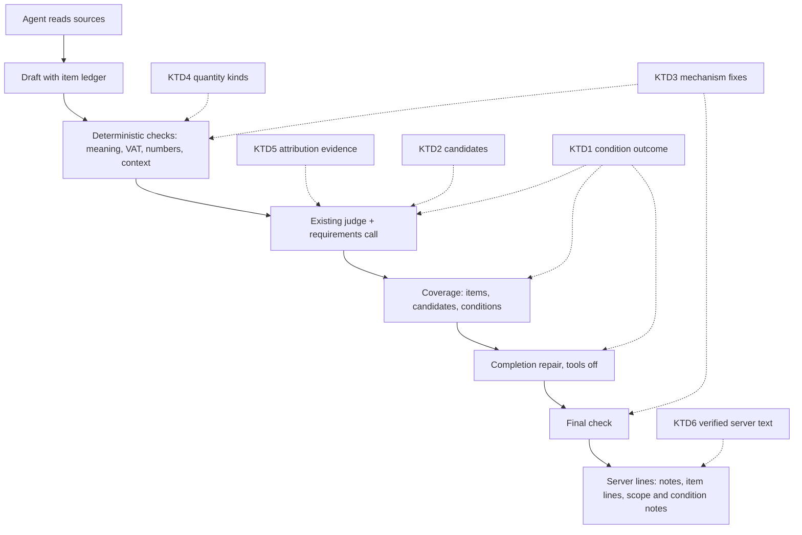
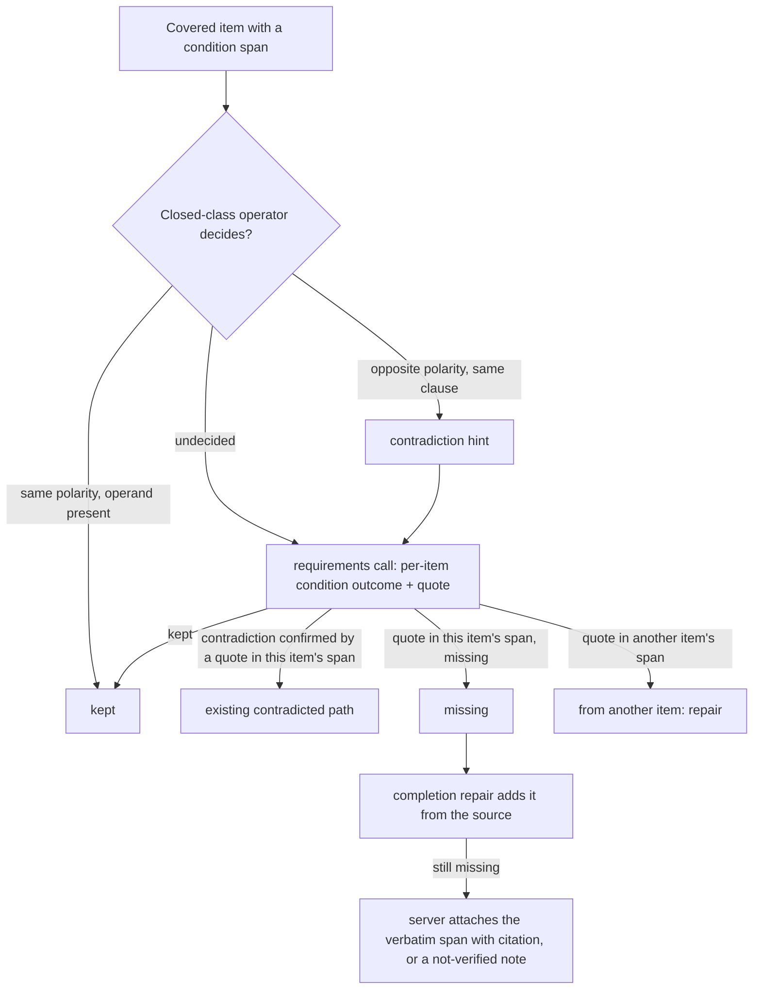

# Answers that keep the source's meaning - conditions bound to their data, verification that removes only what is wrong, server lines that are true - Plan

## Goal Capsule

- **Objective:** an appraiser who asks about data the sources give gets every requested item with the conditions and qualifiers that make up its meaning. A correct, supported statement is never removed or bent by the server, and every line the server adds to the answer is true.
- **Means:**
  - Verification is repaired at the mechanisms that removed correct statements, keeping its protections against wrong attribution (KTD3, KTD4).
  - A condition is checked as part of its item's meaning, separately from telling similar items apart (KTD1).
  - The item list is completed from the structure of the sources read, not only from the agent's ledger (KTD2).
  - Qualifiers are attributed by structure, wording and heading scope (KTD5), and server-written text is built from verified material (KTD6).
  - Product models stay as they are, and no model call is added (KTD8).
- **Authority:** the Product Contract's R-IDs win on behavior, and KTDs win on mechanism within them. Units override neither. The user's round-18 request and the session-settled decisions below are the source of the Product Contract.
- **Stop conditions:** stop and report when any of these holds:
  - A fix would need re-extraction or reprocessing of stored office-A documents.
  - A fix would delete stored data.
  - A settled decision proves infeasible, for example condition completeness cannot be judged without an added model call.
  - The final measurement would have to start before the final build.
- **Execution profile:**
  - **Opus:** diagnosis, decisions and acceptance of returned work.
  - **Sonnet:** implementation units and reviews.
  - **Haiku:** runs and simple searches.
  - RAG product models (`gpt-6-luna`) are unchanged.
- **Who finishes:** the `lfg` pipeline implements, simplifies, reviews and measures, then updates PR AriGabay/rag#2 without merge or deploy.

---

## Product Contract

### Summary

Round 18 fixes where the answer loses the source's meaning. A controlled experiment on fixed sources located the loss: the draft holds about 80% of the required items in every model setting, and verification then removes 7–10 correct items per run and drops most of the lost conditions. A stronger model did not change either number.

So the fixes go to verification, to the server's own text and to the item list, not to the model. Each removal mechanism the traces show is repaired at its cause, with tests that keep the protections against wrong attribution. A condition becomes part of what "covering an item" means, checked by meaning even when the item is alone. The server proposes candidate items from table rows, list members and notes of the sources already read, and the existing requirements call decides which ones the request asks for.

### Problem Frame

Round 17 closed most of the ledger and versioning gaps, but its held-out set showed conditions as the weakest shape (22 of 40) and verification removals as the largest cause of loss. Round 18 ran a controlled experiment on 9 conversations (14 turns) with the sources fixed, drafts captured before verification, and blinded grading of where each required item was lost. Its three arms were the current model, a stronger model building the answer, and a stronger model judging.

| Arm | Correct in draft | Correct in final | Written then removed | Read but never written | Conditions dropped (draft → final) | Wrong server additions | Cost |
|---|---|---|---|---|---|---|---|
| Current model | 28 / 41 of 51 | 28 / 31 | 0 / 10 | 9 / 10 | 1→4 / 4→13 | 7 / 17 | $0.10 / $0.14 |
| Strong agent | 41 / 38 of 51 | 34 / 34 | 7 / 3 | 10 / 9 | 1→3 / 6→13 | 14 / 33 | $2.01 / $1.97 |
| Strong judge | 43 / 43 of 53 | 33 / 36 | 9 / 7 | 10 / 9 | 1→8 / 1→6 | 14 / 19 | $0.72 / $0.70 |

The first current-model run had 3 turns time out, which is why its draft count is low.

What the evidence shows:

- **The sources are not the gap.** 50–51 of 51 required items were in what the agent read.
- **The model is not the bottleneck.**
  - The strong agent did not raise the draft, at about 20× the cost.
  - The strong judge did not prevent removals, at 5–7× the cost.
- **Verification is the largest loss.** Of 13 required items removed in round 17's runs, 12 removals were wrong and 1 was mixed. In the experiment, 28 conditions were kept in the draft and dropped by the final. The mechanisms:
  - period words split by the PDF text layer, or written as an unprefixed plural adjective;
  - a year read as an amount because of a trailing comma, and a comma-joined list of years read as one number;
  - one column header chosen for a whole source that holds several tables, and a header row misaligned with its data rows;
  - a month name or a negated period ("not shown as a monthly sum") read as a period;
  - a value the source writes with a scale abbreviation, which the answer writes in full digits;
  - VAT compared across number forms ("millions" against full digits);
  - an appraisal context cut at an intermediate heading line;
  - a file title standing for a second report in the same file;
  - date digits counted as unstated numbers;
  - a cascade from a wrong removal;
  - a bold label classified as unclassifiable;
  - repairs that rewrote an item without its condition.
- **The server's own text is often false.**
  - Item gap lines ("read and not used") were wrong in 59 of 81 cases across four graded runs, mostly because coverage compares number forms as strings and demands the date in the same sentence.
  - Removal notes said "no support found" for removals that had other causes (19 of 23 wrong).
  - A period word was added next to a count of months.
  - Model-written labels and reasons reach the answer inside server lines that skip final verification.
- **The item list misses what the agent missed.** The agent declared items in only 4–13 of 21–29 turns. An item it dropped from both the ledger and the answer cannot be caught by comparing the two, and 9–10 required items per run were read and never written in every arm.
- **Position alone fails both ways for scope qualifiers.**
  - A paragraph that follows the table it scopes, says "the table above", and sits on the same page was refused because another table came later.
  - A numbered section heading that names the valuation method was not carried to the values below it in 5 of 6 real-model runs.

### Key Decisions

- **Condition completeness is a check of its own, by meaning, for every item with a material condition.** It is separate from disambiguating similar items. Governs R1, R2, R3, R4. (session-settled: user-directed — chosen over keeping the condition check only when another item shares the value's signature, or requiring the condition's words copied: a single item's dropped condition went unnoticed, and copied words do not prove meaning)
- **The model stays, and no model call is added.** Governs R17. (session-settled: user-directed — chosen over a stronger answering or judging model: the user directed a data-path fix if a stronger model does not close the gap, and the controlled experiment showed no draft gain at about 20× cost and no fewer removals at 5–7× cost)
- **Candidate items come from the read sources' structure; the request decides which count.** Governs R5, R6, R7. (session-settled: user-directed — chosen over a larger agent ledger or another prompt instruction: an item the agent dropped from both ledger and answer cannot be found by comparing them)
- **Wrong removals are fixed at their mechanisms; protections against wrong attribution stay.** Governs R8. (session-settled: user-directed — chosen over loosening verification: each removal had a specific cause, and the protections still catch real misattribution)
- **Scope qualifiers are attributed by structure, wording and heading scope.** Governs R9. (session-settled: user-directed — chosen over position alone: position both refused a correct attribution and missed a heading's scope)
- **Duration, count and periodic rate are distinct kinds for source data and for server text.** Governs R10. (session-settled: user-directed — chosen over period words matched wherever they appear: a count of months received a "per month" note)
- **Model-originated text in server lines is verified or replaced.** Governs R11. (session-settled: user-directed — chosen over trusting text because the server shows it: those lines skip final verification)

### Requirements

**Conditions are part of an item's meaning**

- R1. When a source gives an item with a material condition, the answer sentence that gives the item also carries that condition, even when the item is the only one of its kind. Material conditions are: a negation, "only", "except", "subject to", applicability, approved or proposed status, a valuation method, and a limit in time or to a component.
- R2. The condition check is by meaning. A correct rephrasing passes. A lost negation or exclusivity fails, and so does a condition taken from a neighbouring item.
- R3. A condition is bound to the item and to the source span that establishes it: the item's quote, its table row, the row's note, a paragraph attributed to its table, or its section heading. Disambiguating similar items stays a separate check.
- R4. A missing condition is completed from the source with its citation, or the answer states precisely that the condition was not verified. A missing condition is never a reason to remove the value.

**The item list comes from the sources**

- R5. Candidate items are found in the structure of the sources the turn read, around the data the answer draws on: table rows, enumerated list members, headings, notes and exceptions.
- R6. A candidate counts only after its relevance to a frozen request component and its attribution to the asked appraisal and component are verified. No requirement the user did not ask for is added.
- R7. A verified candidate missing from the answer is completed from the source already read, through the existing completion repair.

**Verification and the server's text**

- R8. A supported statement is not removed or altered by any of the mechanisms the diagnosis found, and the protections against wrong subject, wrong unit and invented numbers still remove what they removed before.
- R9. A qualifier in a paragraph next to a table, or in a section heading, is attributed to a table's values only on evidence of structure, wording and the heading's scope. Without that evidence it is not applied, and the answer says precisely why the scope could not be verified.
- R10. Durations, counts and periodic rates are told apart in the source and in the answer. A server note never gives a period to a duration or a count.
- R11. Every line the server adds is true:
  - an item is "read and not used" only when no answer sentence gives it;
  - text that came from the model is shown only after it is verified, or is replaced by text built from the source.
- R12. A removal or limitation note names its actual cause, and server notes never show internal identifiers (V#, C#).
- R13. When the final check fails, its cause is kept in the turn's diagnostics.

**Measurement and completion**

- R14. The focused cases run first on the controlled harness with drafts captured, beside control runs of the round-17 build. Then, on one final build, the diagnostic set (a set of its own) runs 3 times, v18 and v20 run as regression, and v21 runs as the new held-out set. Every run is reported.
- R15. Each run reports:
  - condition completeness;
  - omissions;
  - wrong removals;
  - wrong server additions;
  - full-and-correct answers;
  - cost per full-and-correct answer;
  - for the focused cases, the stage where each lost item was lost.
- R16. The final report states what was proven about the model, the answer building and the verification, which solution was implemented, and what remains limited. An unmet criterion is reported as unmet.
- R17. Operating constraints:
  - RAG product models are unchanged.
  - No new kind of model call is added, and no round beyond the existing repair budget: a condition or candidate completion uses the existing completion repair.
  - No mandatory manual approval is added.
  - No stored data is deleted.
  - Private data stays out of git.
  - The PR is updated without merge or deploy.

### Acceptance Examples

- AE1. **Covers R1, R4.**
  - **Given:** a single item whose source row says the value applies only to an approved plan.
  - **When:** the answer gives the value without that limit.
  - **Then:** the item is not covered; the repair adds the limit from the row with its citation, or the server attaches it, and the value stays.
- AE2. **Covers R2.**
  - **Given:** a source condition "excluding the parking floors".
  - **When:** the answer says "without the parking levels".
  - **Then:** the item is covered.
- AE3. **Covers R2.**
  - **Given:** a source condition with a negation ("not including").
  - **When:** the answer states the value as including.
  - **Then:** the condition check fails as contradicted, not as missing.
- AE4. **Covers R2, R3.**
  - **Given:** two adjacent rows, one with a time limit.
  - **When:** the answer gives the other row's value with that time limit.
  - **Then:** the check fails as a condition from another item.
- AE5. **Covers R5, R6, R7.**
  - **Given:** the answer cites one row of a per-use rate table for a question asking for the rates per use.
  - **When:** the agent's ledger lists only that row.
  - **Then:** the other rows become candidates; the requirements call marks them as asked; the completion repair adds them from the table already read, with no new search.
- AE6. **Covers R6.**
  - **Given:** a table that also holds rows the question did not ask about.
  - **When:** candidates are proposed.
  - **Then:** those rows are marked not asked and never become requirements.
- AE7. **Covers R9.**
  - **Given:** a paragraph that directly follows a table on the same page and says "the table above refers only to the income approach", with another table on a later page after three unrelated blocks.
  - **Then:** the qualifier is attributed to the first table. The same paragraph without the deictic word, or with an intervening block, is not attributed.
- AE8. **Covers R9.**
  - **Given:** a numbered section heading naming a valuation method, then one sentence, then a table.
  - **When:** the answer gives a value from the table.
  - **Then:** the method is a condition of that value; a later section's note is never applied to it.
- AE9. **Covers R10.**
  - **Given:** a source "a lease of 36 months" and "rent of 50 per square metre per month", with the period word split by the text layer.
  - **Then:** the 36 is a duration with no period note; the 50 keeps its monthly period; neither statement is removed.
- AE10. **Covers R11.**
  - **Given:** an answer that gives a ledger item as "16.07 million" when the item's value is written in full digits, in a table row under a lead sentence that carries the date.
  - **Then:** the item is covered, and no "read and not used" line is written for it.

### Success Criteria

- On the focused cases, verification no longer takes away what the draft had right: correct items in the final are close to correct items in the draft, and conditions kept in the draft stay in the final.
- Wrong server additions drop to a few per run, and no "read and not used" line names an item the answer gives.
- On the diagnostic set, full-and-correct answers and condition completeness rise over round 17 on the same references and scoring, without a rise in wrong answers, and cost per full-and-correct answer does not rise materially.
- The goal is met only if the meaning-preservation metrics improve. Fewer warnings alone is not success.

### Scope Boundaries

- Not in scope:
  - changing the RAG product models or adding a model call;
  - re-extracting or reprocessing stored documents (a two-row or spanned table header is handled at read time);
  - the agent's search and locating behaviour, which round 17 changed and this experiment did not implicate.
- Image-only evidence (values that appear only in a page image the text layer lacks) is outside the source-derived candidates. It is reported as a limitation.

#### Deferred to Follow-Up Work

- Fixing two-row and spanned headers in the extractors, which needs reprocessing approval.
- Recording page and box geometry on every source for attribution beyond tables.

---

## Planning Contract

### Key Technical Decisions

- KTD1. **A condition outcome per covered item, decided deterministically where the source structure decides it and by the existing requirements call otherwise.** Governs R1–R4.
  - **Condition span:** an item's condition is anchored in its own source context: quote, row, row note, attributed paragraph or heading. `items.validate` checks an agent-written condition against that context; a condition found only in another item's context is recorded as misattributed.
  - **Items without a ledger:** when an answer sentence cites a source span that carries a material condition (by the closed-class reader, a row note, an attributed paragraph or the heading) and no ledger item covers that span, the server builds an origin-`source` item from the cited span, so the condition is checked on turns where the agent declared nothing. A cited span with no material condition creates no item. Such an item counts as covered by the sentence that cites it, so it never gets a "read and not used" line.
  - **Deterministic outcome:** closed-class operators (negation, exclusivity, exception, subjection, thresholds) are read with a tokenizer that keeps them. Today's stopword list drops them.
    - Matching operator and polarity plus most of the operand → `kept`.
    - The opposite polarity on the same operand within the same clause → a contradiction hint. It goes to the requirements call like an undecided case, and counts as `contradicted` only when the judge confirms it with a quote in the item's own span. A sentence carrying both polarities, or an operand match below most of the operand, is undecided with no hint.
    - Everything else → undecided.
  - **Undecided cases:** they go into the existing `<item_ledger>` block of the requirements call. Each carries the condition and its source span, and the judge returns a per-item condition outcome with a quote. The server accepts it only when the quote stands in the right span: this item's span for missing or contradicted, another item's span for "from another item". This is a judge-contract change in the same call, so `JUDGE_VERSION` goes to 14.
  - **Actions:**
    - Missing goes to the completion repair with the source quote.
    - If still missing, the server attaches the verbatim condition span with its citation, or a precise "condition not verified" note when no compact span exists.
    - A confirmed contradiction follows the existing contradicted-claim path, which may remove the wrong statement. An unconfirmed hint is treated as undecided, and the value stays.
    - From another item goes to repair.
    - Only a confirmed contradiction can remove a statement. A missing or misattributed condition never removes the value.
  - **Repair guard:** `lost_supported` learns condition, threshold, period and VAT words, so a repair that drops a verified condition restores the earlier sentence.
  - (session-settled: user-directed — chosen over checking conditions only when a sibling shares the signature, or copying condition words: both missed single-item and rephrased cases)
- KTD2. **Server-built candidates, scoped by anchors, decided in the existing requirements call.** Governs R5–R7.
  - **Anchors:** an anchor is a ledger item, or a read table or list source the answer cites (the call's `answer_ids` that are readable). A cited source needs no component before the call.
  - **Candidates are the anchor's structural siblings in sources the turn read:**
    - the other data rows of its table;
    - the other members of its enumerated list;
    - the other value-bearing sentences of a cited passage, within its section's paragraph run (two thirds of the read-never-written items in the experiment sat inside a span the answer already cited);
    - its table's notes that stand as items of their own;
    - paragraphs attributed by KTD5 that state items of their own.
  - **Limits are conditions, not candidates:** a note, paragraph or heading that limits a value is that value's condition span under KTD1 and never a separate candidate.
  - **Bound:** at most 20 candidates per anchor source, rendered compactly (id, row label or first words, value, source).
  - **Decision:** in the same call, the judge assigns each candidate to a frozen component id or to "not asked", with the request words it answers. The server keeps an "asked" mark only when those words appear in the component or request text and also in the candidate's own row text, column header, caption or heading.
  - **Server-built fields:** kept candidates become ledger items with origin `source`. Their label, value and condition are built by the server from the source, so they need no verbatim check. All five origin-sensitive sites handle the new origin.
  - (session-settled: user-directed — chosen over a larger agent ledger or another prompt instruction: the agent omitted the same items from both)
- KTD3. **Each wrong-removal mechanism gets its own fix and a test that the protection it served still holds.** Governs R8.
  - **Period reading** (KTD4).
  - **Number forms:**
    - a comma is a thousands separator only in the `d{1,3}(,ddd)+` shape, so a comma-joined list of years reads as separate years;
    - one value comparison with scale words and separators, used by VAT backing, the unstated-number check and item coverage;
    - a number the source writes with a scale word or abbreviation also enters the pool at its full value;
    - VAT never attaches to an identifier or a property name, and a VAT phrase inside parentheses belongs to the amount in those parentheses.
  - **Calculation units:** a date the unit's cited passage states, in any date form, is not an unstated number.
  - **Appraisal context:** a context cut only at a heading line, with no address or parcel of its own, continues the preceding context in `_wrong_context`.
  - **Source heads in a multi-report file:** they name the appraisal unit's own subject, not the file title alone.
  - **Dependency cascade:** a dependent claim directly supported by its own cited source is not removed because its predecessor was.
  - **Final check:** a bold label followed by a supported statement is classified by the statement.
  - **Re-read expansion:** an expansion is not adopted because a small number matches only a row ordinal in another table, and the repair message names the number and asks to add a citation, not to replace one.
  - **Final-check failure detail:** see KTD7.
  - (session-settled: user-directed — chosen over loosening verification)
- KTD4. **Quantity kinds read once in `meaning`: duration, count and periodic rate.**
  - **Split words:** text-layer splits are joined only when the joined token is a period or time-unit word, before any scan.
  - **One period vocabulary:** the unprefixed plural adjectives (monthly, yearly) are periods after a plural noun, as the measurement extractor already reads them; `meaning` and the extractor share one word list.
  - **Not a period:** "in/for the month of" followed by a month name, and a period inside a negated clause.
  - **Duration:** a number followed by a time-unit noun (plural, dual or construct) is a duration and never takes or claims a period.
  - **Column headers:**
    - A header period reaches only cells whose kind can be a rate, with the same gate that captions already have.
    - Each table in a source gets its own header; a source holding several tables no longer shares the first table's header.
    - Leading digit-free rows form the header, aligned to the data rows by their non-empty cells.
    - An empty header cell continues the cell before it, so a spanned header reaches the columns it covers.
  - **Area basis:** a basis word that stands in a sentence with no number gives no basis to other numbers; a general basis comes only from a table's header, caption or note, and a basis adjective needs its area word next to it.
    - All of this is read-time only; no reprocessing.
  - **Trailing punctuation:** a number token's trailing comma is stripped before the year and identifier tests.
  - **Server notes:** a period note is placed after the number's unit phrase at the occurrence the problem names, never on a duration or count. Governs R10.
  - (session-settled: user-directed — chosen over period words matched wherever they appear)
- KTD5. **Attribution evidence travels as structured fields on the table read, not only as text tags.**
  - **Fields:** `TablePart` gains page, block distance, a deictic direction (back or forward, from a small closed set of reference words), and a heading-like flag for short section labels the extractor stored as paragraphs. `Source` carries the parts as data, which spares verification a database read.
  - **Paragraph after a table:** attributed when it is adjacent (no blocks between except the table's own notes or images), on the same page or at the top of the next, and its wording points back to the table.
  - **Paragraph before a table:** attributed symmetrically, with forward wording.
  - **Heading scope:** a heading's material qualifier (method, status, component or time) becomes a condition of the table's values through KTD1.
  - **Otherwise:** the qualifier is not applied, and the note's reason names the missing evidence. `_clean_scope` returns only balanced phrases.
  - Governs R9. (session-settled: user-directed — chosen over position alone)
- KTD6. **Server lines are built from verified material.** Governs R11, R12.
  - **Item lines:**
    - The name comes from the source (row label or quote).
    - The agent's reason is shown only when its content words stand in the item's source context or the request. Otherwise the state's server wording is used.
    - "Read and not used" requires that no sentence gives the item. A value stated with attribution but without its date or condition is handled by KTD1 or a date note, never by "not used".
  - **Dates:** coverage accepts the date stated in the sentence's own lead-in or list heading.
  - **Component gap lines:** a partial component's "read and not used" line names the missing part the judge named, never the whole component. A value whose cited sentence survives is never called uncertain because its quote lacked a kind word.
  - **Removal notes:** they reuse the per-cause sentences the diagnostics already have.
  - **Conditional-result notes:** they name the values in words, never by V# or C#.
  - (session-settled: user-directed — chosen over trusting text because the server shows it)
- KTD7. **The final-check failure keeps its cause.** The exception text and the final check's stats go into the failure detail, the turn's diagnostics and the trace. The user still sees the same failure message. Governs R13.
- KTD8. **No product model change, and no added call.** Every new judgment rides in the existing requirements call, and its token growth is measured in cost per full-and-correct answer. Governs R17. (session-settled: user-directed — chosen over a stronger model in either role: no draft gain at about 20× cost, and no fewer removals at 5–7× cost)
- KTD9. **Measurement first on the experiment's own harness, then on the sets.**
  - **Focused cases:** `r18_cases` runs twice on the final build and twice on the round-17 build as a same-session control, with the current model, oracle sources and drafts captured. All four runs are graded blind together with the experiment's stage rubric. Thresholds are read against the control's range, with arm A as context.
  - **Sets:** after the final build, the diagnostic set (its own set) runs ×3, and v18, v20 and v21 run ×1 each, graded with `GRADING_r16.md`.
  - Governs R14–R16. (session-settled: user-directed — chosen over a single run: the user asked for repetitions and every run reported)

### High-Level Technical Design

Where each fix sits in the turn:

The condition outcome per covered item:

### Assumptions

These are unconfirmed bets. The user stated the metrics but no thresholds:

- **Focused cases:**
  - at most 1 correct item written then removed per run;
  - at most 1 condition dropped between draft and final per run;
  - at most 3 wrong server additions per run.
- **Diagnostic set:**
  - full-and-correct answers average at least 20 (round 17: 18.3);
  - read-and-omitted averages at most 5 (round 17: 7.3);
  - cost per full-and-correct answer stays within +20% of round 17's $0.0134.
- **Requirements call size:** the condition and candidate fields add less than 25% to its input tokens.
- **Header heuristic:** the read-time header handling holds for the real two-row headers seen. Spanned headers in DOCX stay uncertain until the fixture is tested.

### Sequencing

1. U8 first: synthetic reproductions of the failure shapes, failing on the round-17 build.
2. The verification fixes, U1, U2 and U3. They touch different functions, but `verify.py` is shared, so they land one at a time.
3. U4, the attribution evidence, which U5 consumes.
4. U5 (conditions), then U6 (candidates). Both change the requirements call, so `JUDGE_VERSION` is bumped once, in U5.
5. U7 (server text), which builds on U2's number forms and U5's outcomes.
6. U9, real-model proofs.
7. U10, measurement on one final build.

### Risks

| Risk | Mitigation |
|---|---|
| Candidates inflate answers with rows the user did not ask for | Candidates only around anchors, the asked mark kept only when the request words stand in the candidate's own row, header, caption or heading, a cap, AE6 as a test, and a real-model sequence in U9 |
| The judge marks conditions missing too often | A missing condition only adds text from the source and never removes. Cost and false additions are measured. |
| A deterministic polarity reading removes a correct sentence | The deterministic reading only gives a hint, within one clause and on most of the operand; only a judge-confirmed contradiction can remove, with protection tests |
| Candidates cannot reach the items lost | U6 first measures, on the existing stage grades, how many read-and-never-written items are siblings of a cited span, and reports the share |
| Fixes for wrong removals weaken real protections | Every mechanism fix ships with a test that the case it protected still removes |
| Deictic word lists turn into phrase lists | The set is closed and grammatical (reference words), used only together with adjacency evidence and never alone |
| The requirements call grows | The size bound in Assumptions, measured in U10 |
| Run-to-run variance hides the effect | Two focused runs and three diagnostic runs, all reported, with stage location from captured drafts |

---

## Implementation Units

| U-ID | Title | Main files | Depends on |
|---|---|---|---|
| U8 | Failing reproductions of the round-18 shapes | `backend/tests/integration/test_round18_sequences.py`, `backend/scripts/generate_fixtures.py` | none |
| U1 | Quantity kinds and period reading | `backend/app/chat/meaning.py`, `backend/app/chat/verify.py` | U8 |
| U2 | Number forms, VAT attachment and calculation dates | `backend/app/answering/verify.py`, `backend/app/chat/verify.py` | U8 |
| U3 | Removals by context, subject, dependency and classification | `backend/app/chat/verify.py`, `backend/app/chat/final_check.py`, `backend/app/chat/engine.py` | U8 |
| U4 | Attribution evidence for table qualifiers | `backend/app/chat/tools.py`, `backend/app/chat/verify.py` | U1 |
| U5 | Condition completeness by meaning | `backend/app/chat/items.py`, `backend/app/chat/verify.py`, `backend/app/chat/engine.py` | U4 |
| U6 | Source-derived candidate items | `backend/app/chat/items.py`, `backend/app/chat/verify.py`, `backend/app/chat/coverage.py` | U5 |
| U7 | Server lines built from verified material | `backend/app/chat/coverage.py`, `backend/app/chat/items.py`, `backend/app/chat/verify.py` | U2, U5 |
| U9 | Real-model proofs | `backend/tests/integration/test_round18_real_model.py` | U4–U7 |
| U10 | Measurement, record and learning | `docs/evaluation/conversational-rag.md` | all |

### U8. Failing reproductions of the round-18 shapes

- **Goal:** the failure shapes the diagnosis found are reproduced on synthetic office-B documents and recorded failing on the round-17 build, before any fix.
- **Requirements:** R1–R4, R8–R11.
- **Dependencies:** none.
- **Files:**
  - `backend/scripts/generate_fixtures.py`: a `Round18PdfRenderer` after the `Round17PdfRenderer` pattern, `write_round18`, and `--only round18`.
  - `backend/tests/fixtures/round18/`: synthetic PDFs and `manifest.json`.
  - `backend/tests/integration/test_round18_sequences.py` (new).
- **Approach:**
  1. Render layouts that carry each shape, all invented, with the synthetic marker:
     - a table with a two-row header whose upper row carries the period, on a page that holds a second table with a different header;
     - a valuation paragraph that lists averaging years joined by commas, and a per-unit amount written with a scale abbreviation;
     - a paragraph after a table with a back-reference, then another table on the next page;
     - a numbered method heading, one sentence, then a table;
     - a lease paragraph with a duration in months and a monthly rent, with a split period word;
     - a row with an "only approved plan" note;
     - a valuation paragraph with full-digit amounts and VAT;
     - an appraisal whose calculation pages start with a heading line ending in a colon;
     - a file holding two reports.
  2. Write ScriptedAgent sequences that answer correctly, and record what the current build does to each answer.
  3. Mark them expected to fail until their owning unit lands. The owning unit removes the marker.
- **Patterns to follow:** `test_round17_sequences.py`, `Round17PdfRenderer`, and the fixture rules in `backend/scripts/generate_fixtures.py`.
- **Test scenarios:**
  - **Duration and rate:** the duration keeps no period note, the monthly rent is not removed, and the split word reads as a period.
  - **Two-row header:** the annual column values keep their period.
  - **VAT:** a value written in millions with "including VAT", against a full-digit source with the same status, is not edited.
  - **Same property:** values on the calculation pages are not removed as "another property".
  - **Two reports in one file:** passages of the second report are not judged as the first report's subject.
  - **Condition kept:** a single item's "only approved plan" condition is kept in the final, or attached by the server.
  - **Deictic note:** the paragraph after the table scopes its values. Covers AE7.
  - **Method heading:** the heading's method reaches a value from its table. Covers AE8.
- **Verification:** each sequence fails on the round-17 code for the stated reason and passes once its owning unit lands.

### U1. Quantity kinds and period reading

- **Goal:** periods, durations and counts are read correctly in source and answer text, and the server never adds a period to a duration.
- **Requirements:** R8, R10. KTD4.
- **Dependencies:** U8.
- **Files:**
  - `backend/app/chat/meaning.py`: `_PERIOD`, number-token reading in `check`, `parse_source` header handling, and a quantity-kind reader built from `KIND_WORDS`, `units_attested` and `nonmonetary`.
  - `backend/app/chat/verify.py`: the annotation position in `VerifyReport.edit` / `_after_number`, and `_silent_qualifier_spans`.
  - `backend/tests/unit/test_meaning.py`, `backend/tests/unit/test_verify_edit_ladder.py`.
- **Approach:**
  1. Join split words before matching, only when the result is a period or time-unit word.
  2. Share one period vocabulary with `backend/app/measurements/extract.py`, including the unprefixed plural adjectives, and exclude a month name after "the month of" and a period inside a negated clause.
  3. Classify each number's kind once, and gate both header periods and claimed periods on it. A duration or count is never a period owner.
  4. Give each table of a source its own header, built from its leading digit-free rows aligned by non-empty cells, and continue an empty header cell from the cell before it.
  5. Take a general area basis only from a table's header, caption or note, and require an area word next to a basis adjective.
  6. Strip a trailing comma from the token before the year and identifier tests, everywhere `written` is read.
  7. Annotate after the unit phrase, at the problem's own occurrence.
- **Execution note:** start from the failing U8 sequences and from parametrised unit cases of each real token shape: split, dual, plural and construct forms.
- **Patterns to follow:** `test_a_duration_or_a_date_is_not_a_period`, `test_a_headed_income_table_keeps_the_period_of_its_caption`.
- **Test scenarios:**
  - A split monthly period word on a rent amount attests the period, and the claim is not removed. Covers AE9.
  - The number before a plural or construct months noun is a duration: no period is attested or claimed, and no note is added. Covers AE9.
  - A dual months word after a rent noun reads as a monthly rate, and after a number reads as a duration.
  - "for one year" in a lease sentence is a duration, not a yearly period.
  - A two-row header with the period in the upper row gives the period to that column's amounts, and not to a percent or a count column.
  - A source holding two tables gives each table's cells their own header's period.
  - A header row with one cell fewer than its data rows still aligns by non-empty cells.
  - An unprefixed plural monthly adjective after a plural rent noun attests a monthly period for its amount.
  - "for the month of" followed by a month name, and a negated "not shown as a monthly sum", attest no period.
  - A basis adjective in a sentence with no number gives no basis to the source's numbers.
  - A spanned header cell reaches the empty header cells after it.
  - A year written with a trailing comma is a year, not an amount, so no period is attached to it.
  - A period note on a number written twice lands at the occurrence the problem names, after its unit word.
  - **Protection:** a period the source contradicts still removes. `test_a_source_that_states_another_period_keeps_the_removal_path` stays green.
- **Verification:** the U8 duration, header and comma sequences pass, and all existing meaning and edit-ladder tests pass, or are changed only where they pinned the wrong behaviour, with the reason in the commit.

### U2. Number forms, VAT attachment and calculation dates

- **Goal:** numbers are compared by value across forms in every check, VAT attaches only to amounts, and a stated date is never an unstated number.
- **Requirements:** R8. KTD3.
- **Dependencies:** U8.
- **Files:**
  - `backend/app/answering/verify.py`: `_NUMBER` (thousands separator only in groups of three), and a value-form helper beside `numbers_in`, with scale words and separators.
  - `backend/app/chat/verify.py`: `vat_attachments`, `_vat_backing`, `_wrong_vat`, `_vat_bearing`, `_unstated`, `_restated`, `_date_backed`, `_expand_unstated` / `_expand_numbers`, and the unstated-number repair message.
  - `backend/tests/unit/test_verify_units.py`, `backend/tests/unit/test_numbers_in.py`, `backend/tests/unit/test_verify_computed.py`.
- **Approach:**
  1. Compare VAT backing by value: "122.7 million" and "122,700,000" are the same amount at the shown precision, reusing `calc.display_matches`.
  2. Treat a number that names a property, plot or identifier as not VAT-bearing. Such a number sits inside a name the source gives, or follows an identifier word. A VAT phrase inside parentheses belongs to the amount in those parentheses.
  3. Let a date stated by the unit's cited source, in any date form or its date line, back the date's digits in calculation units.
  4. Read a comma as a thousands separator only in groups of three, so a comma-joined list of years yields each year.
  5. Add to the pool the full value of a number the source writes with a scale word or abbreviation.
  6. Do not adopt a re-read expansion because a small number matches only a row ordinal of another table, and make the repair message name the number and ask to add a citation, never to replace a valid one.
- **Execution note:** the mechanisms and their private cases are in `real_documents/tests/round15/diag/r18_numbers_notes.md`. `_NUMBER` is shared by every number reader, so run the full unit suite after step 4.
- **Patterns to follow:** `_restated`, `_shows`, and the VAT tests at `test_verify_units.py` 345–414.
- **Test scenarios:**
  - A value in millions including VAT, cited to a full-digit source including VAT, keeps its VAT wording, and no removal note is written.
  - A value in millions including VAT, cited to a full-digit source excluding VAT, is still edited or removed. This is the protection.
  - A VAT phrase after a property's name that holds a number is not attached to that number.
  - "excluding VAT" inside the parentheses of an amount stays with that amount and is not cut from it.
  - A sentence citing a source that lists averaging years joined by commas with no spaces keeps those years and is not removed.
  - `1,250,000` and `12,500` read as before, and a list `2018,2019` reads as two years.
  - A full-digit amount whose cited source writes it with a thousands abbreviation is not an unstated number.
  - A unit whose only unmatched number is a row ordinal of another table does not adopt that table, and the repair message names the number.
  - The digits of a valuation date, written with slashes in the source's date line and with dots in the unit, are not unstated numbers in a calculation unit.
  - **Protection:** an invented number in a calculation unit is still removed as a computation mismatch.
- **Verification:** the U8 VAT sequence passes, and existing VAT, unstated-number and computed tests pass.

### U3. Removals by context, subject, dependency and classification

- **Goal:** correct statements are not removed by a wrong appraisal-context cut, a file title, a cascade or a classification, and a final-check failure keeps its cause.
- **Requirements:** R8, R13. KTD3, KTD7.
- **Dependencies:** U8.
- **Files:**
  - `backend/app/chat/verify.py`: `_wrong_context`, `_source_parts` heads, `_remove_dependents`, `_non_claim_accepted` / `structural_kind`.
  - `backend/app/chat/units.py`: the continuity rule that U3 reuses.
  - `backend/app/chat/final_check.py` and `backend/app/chat/engine.py`: the failure detail.
  - `backend/tests/unit/test_appraisal_context.py`, `backend/tests/unit/test_verify_units.py`, `backend/tests/unit/test_final_check.py`.
- **Approach:**
  1. In `_wrong_context`, a subject context whose cut rests only on a heading line, and which states no address or parcel of its own, continues the preceding subject context. This reuses the continuity rule of `backend/app/chat/units.py` (a new unit that names the previous one and states no new address or parcel), not the property graph. A context that states a different address or parcel stays another property.
  2. In a multi-report file, a source head names the appraisal unit's own subject first, and the file title only as the file.
  3. A dependent unit whose own cited source directly supports it survives its predecessor's removal.
  4. A unit made of a bold label followed by a statement is classified by the statement.
  5. The `FinalCheckError` text and the final check's stats go into `ProviderFailure.detail`, diagnostics and the trace, with no change to the user-facing message.
- **Patterns to follow:** the `_wrong_context` tests in `test_appraisal_context.py`, and `_dependency_problem`.
- **Test scenarios:**
  - An appraisal whose calculation pages were cut into a separate context still accepts its values for the asked property.
  - **Protection:** a value of a genuinely different property in the same file is still removed as wrong subject.
  - A judge batch over a two-report file sees the second report's subject in the source head. This uses a scripted judge that checks the rendered head.
  - A dependent claim cited to its own supporting source survives when its base claim is removed. A dependent with no own support still goes.
  - "**Location:** section X, paragraph N [S4]" is judged as a statement, and is not removed as unclassified.
  - A forced `FinalCheckError` leaves its message in the turn's diagnostics.
- **Verification:** the U8 context and two-report sequences pass, and the existing context and final-check tests pass.

### U4. Attribution evidence for table qualifiers

- **Goal:** a qualifier next to a table, or in its section heading, is attributed by structure, wording and heading scope, and the evidence reaches verification without database reads.
- **Requirements:** R9. KTD5.
- **Dependencies:** U1.
- **Files:**
  - `backend/app/chat/tools.py`: `TablePart`, `_table_context`, `Source` (a parts field), and the register site.
  - `backend/app/chat/verify.py`: `_scope_standing`, `scope_outcome`, `_clean_scope`, `context_qualifiers`, and the limitation messages.
  - `backend/tests/unit/test_verify_edit_ladder.py`, `backend/tests/unit/test_chat_reading_tools.py`.
- **Approach:**
  1. Record page, block distance, deictic direction and a heading-like flag on each part when the table is read.
  2. Attribute an after-paragraph or before-paragraph only on adjacency plus wording, per KTD5. Attribute a heading by the table's heading path, including heading-like paragraphs of the same section.
  3. Make `_scope_standing` read the structured evidence. `between` alone no longer decides.
  4. Name the missing evidence in the limitation note.
  5. Make `_clean_scope` return balanced text, or reject the phrase.
- **Patterns to follow:** `test_ae5_a_table_value_written_as_the_total_gets_the_scope_its_following_paragraph_states_with_its_citation`, `test_a_scope_phrase_from_another_tables_note_is_rejected...`.
- **Test scenarios:**
  - **Covers AE7.** An adjacent after-paragraph with a back-reference on the same page scopes the table before it, even when another table follows later.
  - The same paragraph with an unrelated block between it and the table is not attributed, and the note says why.
  - A paragraph with a forward reference before a table scopes that table and not the one above.
  - A paragraph between two tables with no reference word is not attributed. `test_a_phrase_that_stands_only_in_a_paragraph_between_two_tables_is_never_asserted_as_the_values_scope` keeps its outcome.
  - **Covers AE8.** A numbered heading-like paragraph naming a method is part of the table's heading scope, and a later section's note is not.
  - A judge phrase cut inside a parenthesis is returned balanced or rejected.
- **Verification:** the U8 deictic and heading sequences reach the server's scope path, and the existing scope tests pass.

### U5. Condition completeness by meaning

- **Goal:** every covered item with a material condition gets a condition outcome. A missing condition is completed or noted, never a reason to remove the value.
- **Requirements:** R1–R4. KTD1, KTD8.
- **Dependencies:** U4.
- **Files:**
  - `backend/app/chat/items.py`: the condition span, validation against it, items built from cited spans that carry a material condition, a condition outcome separate from the `shared` disambiguation, and an operator-keeping tokenizer.
  - `backend/app/chat/verify.py`:
    - `_item_ledger_block`;
    - `JudgeRequirement` (a per-item condition outcome with quote);
    - `JUDGE_REQUIREMENTS_POLICY`;
    - validation of condition quotes;
    - the condition note span;
    - `QUALIFIER_LEXICON` for `lost_supported`;
    - `JUDGE_VERSION = 14`.
  - `backend/app/chat/engine.py`: the condition reaches the completion repair's request.
  - `backend/tests/unit/test_items.py`, `backend/tests/unit/test_coverage.py`, `backend/tests/unit/test_verify_cache.py` (and the other three `JUDGE_VERSION` pins).
- **Approach:**
  1. Build each item's condition span from its own context: quote, row, row note, attributed paragraph or heading.
  2. Decide the closed-class operators deterministically, and send the rest to the existing requirements call.
  3. Act on each outcome per KTD1.
  4. Rewrite the two tests that pinned the opposite behaviour (`test_items.py` 288 and 294) to the new contract, with the reason in the commit.
- **Execution note:** implement test-first from the four user-named cases before touching the judge contract.
- **Patterns to follow:** `scope_outcome`'s add-never-cut path, `validated_support`, and `REQ_TEXT_FOUND`.
- **Test scenarios:**
  - **Covers AE1.** A single item whose "approved plan only" condition the answer omits is not covered. The repair request quotes the condition. If still missing, the server attaches the verbatim span with its citation, and the value stays.
  - **Covers AE2.** A correctly rephrased exception is kept, through a scripted judge outcome with a valid quote.
  - **Covers AE3.** A lost negation gives a contradiction hint. When the judge confirms it with a quote in the item's span, it follows the contradicted-claim path, not a missing-condition note.
  - An unconfirmed contradiction hint leaves the value and goes to repair or a "condition not verified" note.
  - **Covers AE4.** A time limit taken from the neighbouring row fails as from another item, and the judge quote must stand in that row's span.
  - A judge "missing" outcome whose quote is not in the item's condition span is rejected.
  - An agent condition that stands only in another item's context is recorded as misattributed, and the item is checked against its own context.
  - A repair that drops a verified threshold word restores the earlier sentence.
  - An item with no material condition gets no condition outcome, and the requirements call input does not grow for it.
  - A turn with an empty agent ledger whose answer cites one row with an "approved plan only" note gets an origin-`source` item for that row, and its condition is checked. Covers AE1.
  - **Protection:** a sentence with opposite polarities on different operands is kept, and a partial operand overlap is not contradicted; both go to the judge path.
  - Two items sharing a value still need the words that tell them apart. The disambiguation test stays green, separately.
- **Verification:** the U8 condition sequence passes, the `JUDGE_VERSION` pins are updated, and the requirements-call render size for the ledger block is recorded in a test.

### U6. Source-derived candidate items

- **Goal:** items the agent dropped from both the ledger and the answer are found in the structure of the sources read, decided against the request, and completed from the source.
- **Requirements:** R5–R7. KTD2.
- **Dependencies:** U5.
- **Files:**
  - `backend/app/chat/items.py`: candidate building from anchors, and origin `source`.
  - `backend/app/chat/verify.py`: candidates in `_item_ledger_block` / `_Coverage.render`, the asked or not-asked output, validation, `requirement_outcomes`, and `item_states`.
  - `backend/app/chat/coverage.py`: `item_gap_lines` for the new origin.
  - `backend/app/chat/tools.py`: access to the read table's rows and the list members of a read section.
  - `backend/tests/unit/test_items.py`, `backend/tests/unit/test_coverage.py`.
- **Approach:**
  1. Find the anchor sources: ledger items, and read table or list sources the answer cites.
  2. Collect siblings from each anchor's table, list or section, using the KTD5 attribution for notes.
  3. Cap and render the candidates compactly.
  4. Validate the judge's component assignment against the request words and the candidate's own text.
  5. Add the kept candidates as server-built ledger items.
  6. Route omitted ones to the existing completion repair. They never trigger a new search.
- **Execution note:** before implementing, classify the read-but-never-written items in the private stage grades (`real_documents/tests/round18/blind/`) as same table, same list, same section or unrelated to any cited span, and record the reachable share in the commit message. A share below the omission target is reported as a limit of KTD2.
- **Patterns to follow:** `support_item`, `add_support_items`, `valid_missing`, `_read_passages`.
- **Test scenarios:**
  - **Covers AE5.** An answer citing one row of a per-use rate table yields the other rows as candidates. Those the judge marks asked become items, and the completion repair adds them with no search call.
  - **Covers AE6.** Rows the judge marks not asked never become items. An asked mark whose request words are not in the request, or not in the candidate's own row, header, caption or heading, is rejected.
  - A list of four reasons where the answer gives three yields the fourth as a candidate.
  - A note row of the anchor's table that limits a value becomes that value's condition span (KTD1), not a candidate.
  - Candidates are capped per anchor source, and the render records the count left out.
  - In a turn with no agent ledger, a cited rate table still yields candidates, and the judge's component assignment decides which count.
  - A candidate from another appraisal unit of the same file is not offered.
  - All five origin-sensitive sites treat origin `source` explicitly, with a test each where behaviour differs.
- **Verification:** AE5 and AE6 tests pass. A sequence over the U8 rate-table fixture completes the list from the read table.

### U7. Server lines built from verified material

- **Goal:** every server-added line is true, and model text in server lines is verified or replaced.
- **Requirements:** R11, R12. KTD6.
- **Dependencies:** U2, U5.
- **Files:**
  - `backend/app/chat/items.py`: `_states_value` by value form, `_states_date` with lead-in and list-heading dates.
  - `backend/app/chat/coverage.py`: `item_line`, `_plain`, the reason check, `reason_of` / `_read_not_used` / `gap_sentence`, and `_uncertain_value`.
  - `backend/app/chat/verify.py`: `VerifyReport.edit` removal notes with per-cause sentences, and the conditional-result note wording.
  - `backend/tests/unit/test_coverage.py`, `backend/tests/unit/test_items.py`, `backend/tests/unit/test_final_check.py`, `backend/tests/unit/test_chat_compose.py`, `backend/tests/unit/test_verify_units.py`.
- **Approach:**
  1. Run coverage on U2's value forms.
  2. Let a date come from the sentence's lead-in or list heading.
  3. Remove "value given without its date or condition" from the "not used" path.
  4. Name items from the source.
  5. Show a reason only when its content words stand in the source context or the request.
  6. Write removal notes from `REMOVAL_SENTENCES` by cause.
  7. Write conditional notes without internal ids.
- **Patterns to follow:** `gap_label` / `valid_missing`, `REMOVAL_SENTENCES`, `removal_summary`.
- **Test scenarios:**
  - **Covers AE10.** An item given as "16.07 million" against a full-digit value gets no gap line, and nor does a table row under a dated lead sentence.
  - An item the answer does not give still gets its "read and not used" line, naming the source's row label.
  - An agent reason with words in neither the source nor the request is replaced by the state's server wording.
  - A wrong-subject removal note says the passage belongs to another subject, not "no support found". The exact-string tests change with their reason.
  - A conditional-result note names the values in words, with no V# or C#.
  - A partial component's gap line names the missing part the judge named, not the whole component.
  - A value whose cited sentence survives is not called uncertain, even when its quote lacks a kind word.
  - Item gap lines remain a fixed point with no judge call. `test_item_gap_lines_are_server_text_that_is_a_fixed_point_and_cost_no_judge_call` stays green.
- **Verification:** the gap-line and note tests pass, and the U8 sequences show no false gap line.

### U9. Real-model proofs

- **Goal:** the condition, deictic-scope and heading-scope shapes are shown on the real model, opt-in, and every run is reported.
- **Requirements:** R14, R16.
- **Dependencies:** U4–U7.
- **Files:** `backend/tests/integration/test_round18_real_model.py` (new, `-m real_model`), and the U8 fixtures.
- **Approach:** three sequences, each run 3 times in new office-B conversations:
  - a single item with an "approved plan only" condition;
  - a paragraph after the table with a back-reference;
  - a numbered method heading with another section's note nearby;
  - a table with asked and unasked rows, reporting any row added that was not asked.
- **Patterns to follow:** `test_round17_real_model.py` and its summary files under `real_documents/eval/round18/real-model/`.
- **Test scenarios:**
  - The condition is present with its citation.
  - The deictic scope is attached.
  - The heading's method reaches the value, and the other note is not applied.
  - No unasked row is added.
  - Each run reports the stage where anything was lost.
- **Verification:** the results are recorded and reported, whatever the counts.

### U10. Measurement, record and learning

- **Goal:** the effect is measured on the experiment's harness and on the sets, every run is reported, and the result is recorded without overstating it.
- **Requirements:** R14–R16. KTD9.
- **Dependencies:** all other units, and the frozen v21 (`real_documents/eval/round18/real_v21_heldout.yaml`, sha256 `e6e47b75…`, frozen before any round-18 code change). v21 has 9 conversations, 18 turns and 100 required needs, 87 of them carrying a condition. It uses only units that earlier sets touched for other questions; its header states the remaining overlaps.
- **Files:**
  - `docs/evaluation/conversational-rag.md`: round 18, counts only.
  - `docs/solutions/`: one learning, when the round produced durable reasoning.
  - Private, under `real_documents/`: runs, blinded bundles and grades.
- **Approach:**
  1. Run `r18_cases` twice on the final build and twice on the round-17 build (`d331db0`) as a same-session control, with the current model, oracle sources and drafts captured. Grade all four blind together with `GRADING_r18_stages.md`. Compare against the control, with arm A as context.
  2. Run the diagnostic set (its own set) 3 times, and v18, v20 and v21 once each. Grade with `GRADING_r16.md` by Sonnet graders that see no other run's grades.
  3. For every run, report the R15 metrics plus time, tokens, cost and the requirements-call input size.
  4. State v20's status as regression and v21's separation limits.
- **Test expectation:** none. This is a measurement unit; its outputs are the runs and the record.
- **Verification:** the record exists with all runs. Each Success Criterion and Assumption threshold is checked and reported as met or unmet.

---

## Verification Contract

| Gate | Command or method | Applies to |
|---|---|---|
| Unit and integration tests | On the host, `cd backend && env -u DATABASE_URL -u OWNER_DATABASE_URL .venv/bin/pytest <paths>` against the separate test database (`rag_test` on port 5434). In this session the wrapper `scratchpad/pt15.sh` runs exactly that and serializes runs. Never two pytest processes, never in Docker. | U1–U8 |
| Full suite | `scratchpad/pt15.sh` with no paths, once on the final build | final |
| Lint | `backend/.venv/bin/ruff check` on changed files | U1–U9 |
| Fixtures | `generate_fixtures.py --only round18`, run in the backend image as the fixtures README says | U8 |
| Real-model proofs | `pt15.sh tests/integration/test_round18_real_model.py -m real_model` (key from `.env`, never printed) | U9 |
| Rebuild before measuring | `docker compose build migrate frontend`, then force-recreate backend, worker and frontend, then check `JUDGE_VERSION` inside the container | U10 |
| Measurement | harness `run_set.py` (with `--oracle` and draft capture for `r18_cases`), blinded bundles, Sonnet stage grading, and `score_stages.py` for the sets | U10 |
| CI | GitHub Actions on the PR, read through the app's PR status, never polled | final |

---

## Definition of Done

- U1–U9 are on the branch. Every U1–U8 scenario has a test, and all pass on the host suite and in CI. U9's real-model scenarios run opt-in and are reported with their counts.
- The U8 sequences pass, with no expected-failure markers left.
- U10's record reports every run on the final build against each Success Criterion and Assumption threshold, naming any unmet. If the meaning-preservation metrics did not improve, the record and the final report say the goal was not reached.
- No stored data was deleted, no reprocessing or migration ran on office A, RAG models are unchanged, no model call was added, and private data is not in git.
- PR AriGabay/rag#2 is updated with the round-18 section and any unapplied review findings, without merge or deploy.
- Cleanup: no abandoned-attempt code, debug prints or unused helpers remain in the diff.

---

## Sources & Research

- **Private diagnosis (gitignored):**
  - `real_documents/tests/round15/diag/r18_removals_additions.md`: classification of round 17's removals and server additions, with mechanisms M1–M8.
  - `real_documents/tests/round15/diag/r18_numbers_notes.md`: the trace of number removals, period removals, wrong notes and the 28 conditions dropped between draft and final (U1, U2, U7).
  - `real_documents/tests/round18/blind/R1..R6/grades_stages.json` and `real_documents/tests/round18/blind_key.json`: the blinded stage grades of the controlled experiment.
  - `real_documents/tests/round18/GRADING_r18_stages.md` and `real_documents/eval/round18/r18_cases.yaml`: the stage rubric and the focused cases.
- **Prior learnings:**
  - `docs/solutions/logic-errors/completeness-belongs-to-the-answer-version-and-omissions-need-an-item-ledger.md`: the ledger is filled by the agent that omits, and position alone cannot decide a between-tables note.
  - `docs/solutions/logic-errors/read-evidence-never-reached-the-answer-and-units-need-agreeing-page-structure.md`: validated support, and never discarding a grounded addition.
  - `docs/solutions/logic-errors/server-rules-overriding-the-model-and-layout-only-unit-identity-break-multi-appraisal-answers.md`: no open phrase lists. This is why the closed operator and reference sets stay small and are never used alone.
- **Code anchors:**
  - `backend/app/chat/items.py`: `validate`, `_unit_covers`, `_states_value`, `_states_date`, `_signature`, `Ledger.outcomes`.
  - `backend/app/chat/coverage.py`: `item_line`, `_plain`, `item_gap_lines`, `gap_label`.
  - `backend/app/chat/meaning.py`: `_PERIOD`, `_NUM_AT`, `check`, `parse_source`, `KIND_WORDS`, `units_attested`.
  - `backend/app/chat/verify.py`:
    - meaning edits: `VerifyReport.edit`, `_after_number`, `_silent_qualifier_spans`;
    - VAT: `vat_attachments`, `_vat_backing`, `_wrong_vat`;
    - numbers: `_unstated`;
    - removals: `_wrong_context`, `_source_parts`, `_remove_dependents`;
    - scope: `scope_outcome`, `_scope_standing`, `_clean_scope`;
    - requirements call: `_item_ledger_block`, `JudgeRequirement`, `lost_supported`, `QUALIFIER_LEXICON`, `JUDGE_VERSION`.
  - `backend/app/chat/tools.py`: `TablePart`, `_table_context`, `Source`, `read_scope`.
  - `backend/app/chat/final_check.py`: `split`, `FinalCheckError` raise sites. `backend/app/chat/engine.py`: `finish`.
