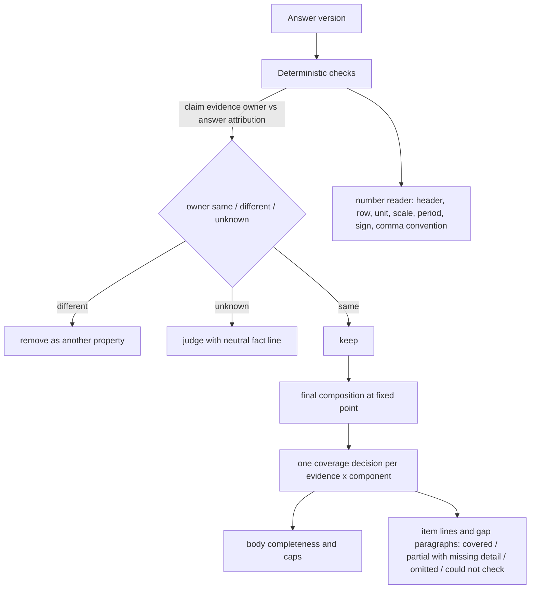

# Consistent attribution between the request, the claim and the source - Plan

## Goal Capsule

- **Objective:** an appraiser gets the full answer the sources support. A correct statement is removed only when evidence shows it is wrong, and every "read and not used" message names a detail the answer really lacks.
- **Means:**
  - A claim is attributed to its property on evidence of the datum's owner (KTD2).
  - A number is read with everything that gives it its meaning (KTD3).
  - One piece of evidence can serve several request components (KTD1).
  - The answer body and every gap message rest on one coverage decision over the answer that is sent (KTD4).
  - RAG models and OCR are unchanged (KTD6).
- **Authority:** the Product Contract's R-IDs win on behavior, and KTDs win on mechanism within them. Units override neither. The user's round-19 request and the session-settled decisions below are the source.
- **Stop conditions:** stop and report in any of these cases:
  - A fix would need a model or OCR change, re-ingestion of stored documents, or deletion of data.
  - A permission check would have to be weakened.
  - The final measurement would have to start before the final build.
- **Execution profile:**
  - **Opus:** diagnosis and decisions.
  - **Sonnet:** implementation and reviews.
  - **Haiku:** simple runs.
- **Who finishes:** the `lfg` pipeline implements, simplifies, reviews and measures, then updates PR AriGabay/rag#2 without merge or deploy.

---

## Product Contract

### Summary
Round 19 fixes the attribution that verification and the server's own text get wrong.
- **Another property:** a claim counts as "another property" only when evidence of whom the datum belongs to conflicts with the property the answer attributes it to. A comparison checks each claim against its own side.
- **Numbers:** a number is read together with its header, row, unit, scale, period and sign, and a comma is read by the document's own convention.
- **Evidence and components:** a piece of evidence is identified apart from the request components it fills.
- **Coverage:** coverage is decided once, over the final answer. That one decision drives both the body's completeness and every gap message.

### Problem Frame
On the round-18 final build, the new held-out set v21 gave a full answer in only 7 of 18 turns. Tracing the round-18 runs showed four attribution failures:
- **"Another property" removals:** the deterministic check removes a claim when the context numbers its evidence cites do not intersect one "asked" set.
  - It ignores the cited text, which names the same property.
  - Any unit heading, even a sentence ending with a colon or OCR digit noise, counts as an identity of its own.
  - In a comparison, the side whose name did not resolve loses every row.
  - This removed 8 required items of one appraisal (v20), all rows of a comparison (v21), and a cash-flow lookup (v18).
- **Gap messages:** 33 of 46 "read and not used" item lines and 16 of 23 gap paragraphs were false.
  - Coverage demands every number of an item's value inside one sentence.
  - It picks identifiers and ordinals as values.
  - It never checks items the agent declared not verifiable or not applicable.
  - Ledger twins from earlier answer versions inflate the condition-word demand.
  - No line names the exact missing detail. None came from a technical failure.
- **Number and unit meaning:**
  - A round-18 split-word repair joins the last letter of an abbreviation to the next period word (for example "total per year" becomes a non-word). This destroys an annual or monthly column header.
  - A decimal comma is read as a thousands separator.
  - A negative number loses its sign.
  - An identifier inherits its row's area basis, and a VAT phrase attaches to a house number.
- **Ledger merge:**
  - An agent item deletes a server item of another component when their quotes overlap.
  - A repair round re-listing an item overwrites a closed decision.
- **Timeouts:** three agent-call timeouts in the round-18 diagnostic runs traced to provider slowness, not to round-18 input growth. The traces show identical first-step input, equal tool output, and an equally slow same-session control.

### Key Decisions
- **Evidence identity is separate from the requirements it fills.** One source can support several components, with coverage per component. Governs R1-R3. (session-settled: user-directed — chosen over an agent item deleting another component's server item on overlapping quotes: one table or paragraph often answers two sub-questions)
- **"Another property" needs positive evidence of the owner and a conflict with the answer's attribution.** Continuity is three-state: established, different, or uncertain. A comparison checks each claim against its own side. Permission stays a separate, complete check. Governs R4-R8. (session-settled: user-directed — chosen over treating absence of identity as continuity or as another property, a blanket verification exemption, or merging all units of a file: each would either remove correct claims or hide wrong ones)
- **A number is read with its header, row, unit, scale, period and sign.** Comparison keeps sign, precision and scale, and a comma is read by context and the document's convention. Governs R9-R12. (session-settled: user-directed — chosen over converting every comma to a point or dropping all commas: both break one of the two conventions)
- **One coverage decision over the final answer drives the body and every gap message.** A message names the exact missing detail. A check that could not complete says so. Governs R13-R17. (session-settled: user-directed — chosen over hiding the messages or computing coverage on an earlier version: the messages must stay true and true omissions must still be named)
- **No model, OCR, data or approval change.** Governs R18. (session-settled: user-directed — chosen over a model or OCR change this round)
- **Measure the traced failures first, then the sets on one final build in repetitions.** Failed turns count. Governs R19-R21. (session-settled: user-directed — chosen over a new held-out set per point fix, or excluding failed turns)

### Requirements

**One source, several requirements**
- R1. A piece of evidence (a source span) is identified independently of the request component it fills. The same evidence can fill several components, each with its own declared state and coverage.
- R2. An item the agent declares never removes a server item of another component. An agent item replaces a server item only for the same evidence and the same component.
- R3. A closed decision (not verifiable, or not applicable, with a reason) persists across repair rounds and claim removals. It reopens only when a surviving sentence gives the evidence, or when the agent declares another state with a new reason.

**Attribution to a property**
- R4. A claim is removed as "another property" only when positive evidence of whom the datum belongs to conflicts with the property the answer attributes it to. The asked side must be resolved.
- R5. Positive ownership evidence, in order:
  1. a name, parcel or address in the cited span or its table heading;
  2. the unit's identity taken from its identification parts;
  3. a link to the same property without conflict.

  A heading that is a sentence ending with a colon, or digit noise, is no identity.
- R6. Continuity is three-state: established, different, or uncertain. Absence of identity proves neither continuity nor another property. An uncertain attribution is never removed deterministically.
- R7. In a comparison, each claim is checked against the side it is attributed to. A compound subject that resolves only in part is uncertain, never another property.
- R8. Permission checks stay complete and separate from attribution.

**Number and unit meaning**
- R9. A number keeps the period, basis and VAT status its column header, row label, caption or note give it, including headers written with abbreviations.
- R10. Duration, count and periodic rate stay apart.
- R11. Numeric comparison keeps sign, precision and scale. A negative claim needs a negative source.
- R12. A comma is read by context and the document's convention: a thousands separator, a decimal comma, or a list separator. Commas are never all converted or all dropped. A residual ambiguity is stated.

**Gap messages and coverage**
- R13. Coverage is decided once, over the final answer, after every addition, repair, cut and removal. The body's completeness, every item line and every gap paragraph use that decision.
- R14. An item counts as given when an attributed block of the answer states its headline values: a sentence, a list item with its lead-in, a paragraph, or a table row under its heading. Identifiers, ordinals and footnote marks are not headline values.
- R15. A partly given item is stated as partial, with its exact missing detail. "Read and not used" means none of it is given.
- R16. Declared not-verifiable or not-applicable items pass the same coverage check. A line is written only when the answer does not state them.
- R17. A coverage check that fails technically yields the state "the check could not be completed" in place of any gap message. When the check completes, true omissions are still named.

**Constraints and measurement**
- R18. RAG product models and OCR are unchanged. There is no mandatory manual approval and no deletion of existing data. The separate test DB is used, private data stays out of git, and the PR is updated without merge or deploy.
- R19. The traced failures are reproduced and checked first, from traces and synthetic tests. After that, the diagnostic set and the regressions (v18, v20, v21) run on one final build in repetitions, and every run is reported.
- R20. Each run reports, separately:
  - full-and-correct answers;
  - required items;
  - conditions kept, out of all required conditions (and out of those present, with the denominator stated);
  - wrong removals;
  - wrong gap messages;
  - failed turns, counted in the service metric with input size, steps and call times;
  - wrong-property claims let through on an unknown attribution;
  - cost per full-and-correct answer and provider latency (median and p95 call time), so a score change can be read against latency.
- R21. An independent evaluation (v22, frozen before the code changes) runs once on the final build, with its overlaps with development documents disclosed. v21 is regression from now on.

### Acceptance Examples
- AE1. **Covers R1, R2.**
  - **Given:** one table row answers two request components.
  - **When:** the agent declares it under one component.
  - **Then:** the server's item for the other component stays, and each component has its own state.
- AE2. **Covers R3.**
  - **Given:** a version that declares an item not applicable with a reason.
  - **When:** a repair round lists the item again as included with no reason.
  - **Then:** the decision stays closed. A surviving sentence that states the item covers it.
- AE3. **Covers R4-R6.**
  - **Given:** an appraisal's calculation pages, cut into a context whose heading is a sentence ending with a colon.
  - **When:** the cited text names the asked property.
  - **Then:** the claim is kept.
  - **And:** a value of a property with a different parcel in the same file is still removed.
- AE4. **Covers R7.**
  - **Given:** a comparison table whose cells cite their own appraisal.
  - **Then:** each cell is checked against its side.
  - **And:** a cell citing side B under side A's column is removed.
- AE5. **Covers R9.**
  - **Given:** a column headed with an abbreviation for "total per year".
  - **Then:** its values keep the yearly period.
  - **And:** a monthly-rent header with an abbreviated plural noun keeps the monthly period.
- AE6. **Covers R11, R12.**
  - **Given:** a source that writes 13,2 in a cell and 3,596,696 elsewhere.
  - **Then:** a claim of 13.2 is supported, and claims of 13 or 132 are not.
  - **And:** a list 6,7,8 is no 6.7, and −3.5% is not +3.5%.
- AE7. **Covers R13-R15.**
  - **Given:** a list item that states an item's value over two sentences.
  - **When:** the item's value field also holds a plan identifier.
  - **Then:** the item is covered.
  - **And:** an item with one of two figures stated gets a partial line naming the missing figure.

### Success Criteria
- On the traced failures (v20 one appraisal, v21 comparison, v18 cash flow, the annual-header and decimal-comma cases, the 33 wrong item lines), the reproduced wrong removals and wrong gap messages stop, and the true omissions are still named.
- On the sets, wrong removals and wrong gap messages drop clearly, and full-and-correct answers rise over round 18. Wrong answers do not rise.
- Fewer messages alone is not success: true omissions must still be named.
- Gains on the traced sets are in-sample. Generalization is judged on v22: its wrong removals and wrong gap messages meet the set-run thresholds, its wrong answers stay at or below the round-19 v21 rate, and its full-and-correct answers are reported as an absolute figure with no claimed rise.

### Scope Boundaries
- Not in scope:
  - OCR and extraction;
  - re-ingestion;
  - model changes;
  - the agent's search and reading;
  - provider timeouts, which are reported but not tuned.
- An evidence/fill model that reaches beyond the item ledger (for example the judge's own verdict cache) is not changed.

---

## Planning Contract

### Key Technical Decisions
- KTD1. **Evidence and fills.** Governs R1-R3. (session-settled: user-directed — chosen over overlap deletion across components)
  - **Evidence identity:** a ledger item's identity becomes (document, appraisal unit, flat quote), not the S# handle. The unit is empty for files with no unit marks, so the same text in two units of one file stays two pieces of evidence.
  - **Fills:** each component's fill is its own record, with declared state, reason, origin and version.
  - **Merge rules:**
    - An agent fill replaces a server fill only for the same component: the same evidence, or a server quote that contains or is contained in the agent's quote within the same document and unit (the round-18 span rule). Cross-component replacement is the only removal dropped.
    - `_holds` and candidate assignment are per component.
    - A candidate the judge assigns to two components gets two fills.
    - The condition check runs once per evidence; items with different flat quotes are different evidence, each with its own check.
  - **Disambiguation:** the `shared` rule counts only items alive in the latest version.
  - **Repeated declaration:** an included declaration does not reopen a closed state (R3).
- KTD2. **Three-state ownership.** Governs R4-R8. (session-settled: user-directed — chosen over identity-less continuity or a verification exemption)
  - **The comparison:** `Contexts.owner` is replaced by a comparison that answers same, different or unknown for a claim's evidence against the answer's attribution.
  - **Ownership evidence:** from the cited span (names, parcels, addresses), the unit's identification parts, and a non-conflicting link.
  - **Noise headings are no identity:** digit-only headings and colon-ended sentences.
  - **Decision:** `_wrong_context` removes only on different. On unknown, the claim is never removed deterministically; a neutral fact line rides in the existing verification call that already judges the unit, so no call is added.
  - **Every caller of the old rule moves:** `tools.subject_from` uses the same comparison; it labels a value's subject contradicted only on different, and asserted on unknown.
  - **Asked subjects:** decomposed into their sides.
  - **Comparison claims:** checked against the side named by their column heading, their own words, or their single cited source.
  - **Permissions:** the permission and visible-document checks are untouched.
  - **Judge contract:** if the judge's input changes, `JUDGE_VERSION` is bumped.
- KTD3. **Number reading.** Governs R9-R12. (session-settled: user-directed — chosen over a blanket comma rule)
  - **Abbreviations:** the split-word join never takes a letter after a quote mark, which undoes the round-18 regression. The abbreviated construct plural counts as a plural noun before a plural period adjective.
  - **Commas:** one shared, length-preserving comma reader used by the answering number reader, the stored-amount parser and the meaning reader:
    - two or more ",ddd" groups are thousands;
    - when both separators appear, the later one is decimal;
    - a single comma with 1-2 digits (or "0,") is decimal when the token is a whole cell, sits next to a percent, currency or unit, or the same source shows a certain decimal comma;
    - "d,d" pairs and chains are lists, and the source side keeps both readings;
    - a single ",ddd" stays thousands, and that ambiguity is stated.
  - **Signs:** signed forms for negative source numbers (a minus sign not after a letter or digit, accounting brackets, a trailing minus). Unsigned claims still pass.
  - **Identifiers:** identifier occurrences in sources carry no row or header qualifiers.
  - **VAT:** a bare whole number of up to three digits, with no currency, scale, percent, separator or unit near it, is not VAT-bearing.
- KTD4. **One coverage decision over the final composition.** Governs R13-R17. (session-settled: user-directed — chosen over hiding messages or per-unit coverage)
  - **One pure function:** coverage is one pure function over model-written units as edited (server spans excluded, so a gap line never covers its own item), grouped in blocks (line, list item with its lead-in, paragraph, table row under its heading). Consumers during the repair loop call it on the version they hold. It is recomputed on every compose pass, and its evaluation on the fixed-point composition is the one decision that drives what is sent; nothing after the fixed point recomputes it differently. It serves:
    - the item states;
    - the requirement caps;
    - the judge-support presence test;
    - the gap paragraph's reason;
    - the item lines.
  - **Headline values:** a value field's numbers intersected with the quote, minus identifiers, ordinals and footnote marks. Number-less items use a word check within the block.
  - **Outcome:** the function yields one outcome per evidence x component: covered, partial (with the exact missing detail), omitted, or could not be checked.
  - **Declared items:** they pass the same check.
  - **Gap paragraph reasons:** "found but not presented" only when a data id is uncited in the final text. "Conflicting sources" only without full coverage.
  - **Failures:** an exception or a missing input in the coverage check yields a "could not be completed" state with its own wording.
- KTD5. **Reproduce first.** Synthetic office-B sequences reproduce each traced shape and fail on the round-18 build before any fix. Pure-function checks replay the traced mechanisms.
- KTD6. **No product model or OCR change, and no added call.** Governs R18. (session-settled: user-directed — chosen over model or OCR changes)
- KTD7. **Measurement plan.** Governs R19-R21. (session-settled: user-directed — chosen over a set per fix or excluding failed turns)
  - First, the traced turns run alone on the final build (`--only`).
  - Then the diagnostic set ×3, v20 ×2, v21 ×2, v18 ×1 and v22 ×1, all on one final build.
  - Grading uses `GRADING_r16.md` plus the round-18 and round-19 additions and a wrong-gap-message count.
  - Each failed turn is reported with its input size, steps and call times.

### High-Level Technical Design

### Assumptions
These are unconfirmed bets:
- **Wrong gap messages:** at most 1 per run on the diagnostic set; at most 3 on v20 and on v21.
- **Wrong removals:** at most 2 per set run.
- **Full-and-correct answers:**
  - v21 rises from 7 to at least 10 of 18;
  - the diagnostic set averages at least 20.
- **Cost per full-and-correct answer:** within +10% of round 18.
- **The comma reader's residual ambiguity** (a single ",ddd"): no case in the traced sets depends on it.

### Sequencing
0. Freeze v22 (questions and references, private) with its sha256 and its overlap record before any code change; no code change starts until it is frozen, and U6 checks the hash before running it.
1. U8: reproductions, failing on the round-18 build.
2. U1: number reading. It is independent of the rest.
3. U2: ownership.
4. U3: evidence and fills.
5. U4: one coverage decision. It builds on U3.
6. U5: real-model proofs.
7. U6: measurement on one final build.

### Risks
| Risk | Mitigation |
|---|---|
| Unknown ownership lets a real wrong-property claim through | The judge still sees a neutral fact line. The protection test for a different parcel or name stays. |
| The comma reader changes thousands readings | Thousands keep priority for ",ddd". The full suite and guard tests cover 1,250, 3,596,696 and lists. |
| Block coverage over-covers, hiding true omissions | The 13 correct item lines and 7 correct gap paragraphs from the traces become guard tests. |
| An evidence-identity change breaks stored diagnostics consumers | The diagnostics shape keeps its fields, and evidence id and fill id are added. |

---

## Implementation Units

### U8. Failing reproductions of the round-19 shapes
- **Goal:** each traced shape is reproduced synthetically in office B and recorded failing on the round-18 build before any fix.
- **Requirements:** R19. KTD5.
- **Dependencies:** none.
- **Files:**
  - `backend/scripts/generate_fixtures.py`: a `Round19PdfRenderer` and `--only round19`.
  - `backend/tests/fixtures/round19/`
  - `backend/tests/integration/test_round19_sequences.py` (new).
- **Approach:** synthetic layouts with the synthetic marker, one sequence each, strict xfail naming the owning unit:
  - calculation pages under a colon-ended heading-sentence;
  - a digit-noise heading;
  - a two-appraisal comparison whose second name differs in its page range;
  - a table row answering two components;
  - an abbreviation-headed annual column, and a monthly header with an abbreviated plural noun;
  - a decimal-comma table with thousands elsewhere, and a negative percent;
  - a list item stating an item over two sentences, with an identifier in its value;
  - an agent-declared not-applicable item the answer states.
- **Patterns to follow:** `test_round18_sequences.py`, `Round18PdfRenderer`.
- **Test scenarios:**
  - Each sequence fails on the round-18 code for the stated reason.
  - Each sequence passes once its owning unit lands.
  - **Protection:** a different-parcel value in the same file is still removed.
  - **Protection:** a true omission still gets its line.
- **Verification:** the failures are recorded per sequence, with the assertion that fails.

### U1. Number reading
- **Goal:** a number keeps its header, row, unit, scale, period and sign, and commas are read by convention.
- **Requirements:** R9-R12. KTD3.
- **Dependencies:** U8.
- **Files:**
  - `backend/app/chat/meaning.py`: `_SPLIT_HEAD` look-behind, `_after_plural_noun`, identifier occurrences in `parse_source`.
  - `backend/app/answering/verify.py`: the comma pre-pass, signed forms in `numbers_in`.
  - `backend/app/measurements/values.py`: `parse_amount`.
  - `backend/app/chat/verify.py`: `_vat_bearing`.
  - Tests: `backend/tests/unit/test_meaning.py`, `test_numbers_in.py`, `test_verify_units.py`, `backend/tests/unit/test_measurements*.py`.
- **Approach:**
  1. Apply the KTD3 abbreviations rule: the split-word join never takes a letter after a quote mark, and the abbreviated construct plural counts as a plural noun before a plural period adjective.
  2. Add the shared comma reader to the three KTD3 consumers (the answering number reader, the stored-amount parser, the meaning reader). Other sites change only where they read document numbers without going through those three.
  3. Add signed forms.
  4. Apply the identifier and small-number VAT rules.
- **Execution note:** red first with invented strings for every case in KTD3.
- **Test scenarios:**
  - Abbreviation-headed annual, monthly and VAT headers give their qualifier.
  - The abbreviated plural noun before a monthly adjective gives a monthly period.
  - "a period of two months" is no period.
  - A two-column table with different periods keeps each column's period.
  - A duration column next to an annual column has no period.
  - Covers AE6.
  - 1,250 and 3,596,696 are unchanged.
  - 1.234,56 and 1,234.56 both read 1234.56.
  - 0,125 reads 0.125.
  - parse_amount handles 13,2, (3.5)% and € 13,2.
  - A negative claim needs a negative source; an unsigned claim passes.
  - A plot or unit identifier has no area basis.
  - A house number is not VAT-bearing.
- **Verification:** the U8 number sequences pass, and the full unit suite is green.

### U2. Three-state ownership
- **Goal:** "another property" is decided on evidence of the owner, and comparisons check each side.
- **Requirements:** R4-R8. KTD2.
- **Dependencies:** U8.
- **Files:**
  - `backend/app/chat/contexts.py`: identity without noise headings, a three-state owner comparison.
  - `backend/app/chat/verify.py`: `_wrong_context`, `_evidence_contexts`, the judge fact line.
  - `backend/app/chat/tools.py`: decomposition in `asked_subjects`, and `subject_from` on the same comparison.
  - Tests: `backend/tests/unit/test_appraisal_context.py`, `test_verify_units.py`.
- **Approach:**
  1. Ownership evidence comes from the cited span and the unit identity.
  2. The comparison returns same, different or unknown.
  3. Remove only on different with a resolved asked side.
  4. On unknown, pass the neutral fact line to the judge.
  5. Comparisons: map each claim to its side.
- **Execution note:** red first.
- **Test scenarios:**
  - Covers AE3.
  - Covers AE4.
  - A digit-noise heading is no name.
  - A partly resolved compound subject is unknown and nothing is removed.
  - **Protection:** a different parcel or name is still removed.
  - **Protection:** permissions are unchanged; a source from an unauthorized document is never offered.
  - Unknown passes the fact line to the judge and nothing is removed deterministically.
  - A value whose subject resolves only as unknown is not removed through the `subject_from` contradicted path.
- **Verification:** the U8 ownership sequences pass, and the v20, v21 and v18 traced mechanisms replay correctly in pure-function checks.

### U3. Evidence and fills in the ledger
- **Goal:** one evidence can fill several components, and decisions persist across versions.
- **Requirements:** R1-R3. KTD1.
- **Dependencies:** U8.
- **Files:**
  - `backend/app/chat/items.py`: identity, fills, `merge`, `_holds`, `candidate_id`, `outcomes`, `shared`.
  - `backend/app/chat/verify.py`: candidate assignment to several components, `item_states`, diagnostics.
  - `backend/app/chat/coverage.py`
  - Tests: `backend/tests/unit/test_items.py`, `test_coverage.py`.
- **Approach:**
  1. Introduce the evidence/fill identity.
  2. Rewrite `merge` to the KTD1 rules.
  3. Keep fill history by version.
  4. Keep the diagnostics fields, adding the evidence id and fill id.
- **Test scenarios:**
  - Covers AE1, in both merge orders.
  - Two overlapping items with different conditions keep separate condition checks.
  - A genuine re-registration with another spelling of the same quote stays one item.
  - Covers AE2.
  - The decision is kept after a repair and after a claim removal.
  - A candidate assigned to two components gets two fills.
  - An agent row quote and a server cell quote for one component yield one fill and one condition check.
  - The same quote in two appraisal units of one file gives two pieces of evidence.
- **Verification:** the U8 two-component sequence passes, and the ledger tests are green.

### U4. One coverage decision over the final answer
- **Goal:** the body and every gap message rest on one coverage decision over the final composition, and lines name the exact missing detail.
- **Requirements:** R13-R17. KTD4.
- **Dependencies:** U3.
- **Files:**
  - `backend/app/chat/items.py`: block coverage, headline values, `_first_value`.
  - `backend/app/chat/coverage.py`: `item_gap_lines`, `item_line`, `reason_of`, `component_outcomes`.
  - `backend/app/chat/verify.py`: `_in_answer`, `validated_support`, requirement caps.
  - `backend/app/chat/final_check.py`: the composition handed to coverage.
  - Tests: `backend/tests/unit/test_coverage.py`, `test_items.py`, `test_final_check.py`.
- **Approach:**
  1. Compute coverage once on the fixed-point composition.
  2. Every consumer reads that decision.
  3. Partial items name the missing detail.
  4. A check failure becomes its own state and wording.
- **Execution note:** turn the 13 correct item lines and 7 correct gap paragraphs from the traces into guard tests (invented strings with the same shapes) before changing coverage.
- **Test scenarios:**
  - Covers AE7.
  - A table row under its heading covers the item.
  - A calculation result covers an item whose value it shows.
  - A shared lead-in gives the date.
  - A declared not-applicable item the answer states gets no line.
  - A partial item gets a line naming its missing figure.
  - A coverage exception yields "could not be completed".
  - **Guards:** true omissions still get their lines.
  - "found but not presented" is written only when a data id is uncited.
  - The gap paragraph and the item lines agree with the body.
  - An item stated only in a server gap or item line is not covered.
  - The final item lines equal the function's output on the sent text.
- **Verification:** the U8 gap sequences pass, the guard tests pass, and the fixed point holds with no judge call for server lines.

### U5. Real-model proofs
- **Goal:** the comparison, the calculation pages, the two-component source and the gap lines are shown on the real model, opt-in, 3 runs each.
- **Requirements:** R19.
- **Dependencies:** U1-U4.
- **Files:** `backend/tests/integration/test_round19_real_model.py`.
- **Approach:** follow the pattern of `test_round18_real_model.py`. Records go under `real_documents/eval/round19/real-model/`.
- **Test scenarios:**
  - Comparison cells are kept on their sides.
  - Calculation-page values are kept.
  - Both components are covered.
  - No false gap line appears, and a true omission gets its line.
  - A wrong-property claim with identity-less evidence: report whether the judge removes or flags it.
- **Verification:** results are recorded and reported, whatever the counts.

### U6. Measurement, record and learning
- **Goal:** the effect is measured on one final build and reported without overstating it.
- **Requirements:** R19-R21. KTD7.
- **Dependencies:** all other units, and v22 frozen before the code changes (`real_documents/eval/round19/real_v22_heldout.yaml`).
- **Files:**
  - `docs/evaluation/conversational-rag.md`: round 19, counts only.
  - `docs/solutions/`: one learning, if one qualifies.
  - Private files under `real_documents/`.
- **Approach:**
  1. Run the traced turns alone (`--only`) on the final build.
  2. Then run the diagnostic set ×3, v20 ×2, v21 ×2, v18 ×1 and v22 ×1, with Sonnet graders that see no other run's grades.
  3. Report the R20 metrics and per-failed-turn input size, steps and call times.
  4. State v21's regression status and v22's overlaps.
- **Test expectation:** none. This is a measurement unit.
- **Verification:** the record exists for every run, and each Success Criterion and Assumption is checked as met or unmet.

---

## Verification Contract

| Gate | Command or method | Applies to |
|---|---|---|
| Unit and integration tests | On the host, against the separate test DB (`rag-testdb-r18`, port 5435, db `rag_test`) through the serialized wrapper `scratchpad/pt18.sh`. Never two pytest processes, never in Docker. | U1-U5, U8 |
| Full suite | `pt18.sh` with no paths, once on the final build | final |
| Lint | `backend/.venv/bin/ruff check app tests` | all |
| Fixtures | `generate_fixtures.py --only round19`, in the backend image | U8 |
| Real-model proofs | `pt18.sh tests/integration/test_round19_real_model.py -m real_model` | U5 |
| Rebuild before measuring | `docker compose build migrate frontend`, recreate backend, worker and frontend, check `JUDGE_VERSION` in the containers, restart the harness | U6 |
| Measurement | harness `run_set.py`, `score_stages.py`, Sonnet grading with `GRADING_r16.md` plus the round-18/19 additions | U6 |
| CI | GitHub Actions on the PR, read through the app's PR status, never polled | final |

---

## Definition of Done
- U1-U5 and U8 are on the branch. Every U1-U4 and U8 scenario has a test, and all pass on the host suite and in CI. U5's opt-in real-model tests run on the host with `-m real_model` and are reported with their counts.
- U6's record reports every run against each Success Criterion and Assumption. If full answers did not rise, the report says so.
- No model, OCR, data-deletion or approval change. Permissions are unchanged, and private data is not in git.
- PR AriGabay/rag#2 is updated with the round-19 section and any unapplied review findings, without merge or deploy.
- Cleanup: no abandoned-attempt code or debug prints remain.

---

## Sources & Research
- **Private diagnosis:**
  - `real_documents/tests/round15/diag/r19_other_property.md`
  - `real_documents/tests/round15/diag/r19_gap_lines.md`
  - `real_documents/tests/round15/diag/r19_numbers_periods.md`
  - `real_documents/tests/round15/diag/r19_ledger_timeouts.md`
- **Prior learnings:**
  - `docs/solutions/logic-errors/meaning-was-lost-in-verification-not-the-model-and-conditions-need-their-own-check.md`: locate the stage on fixed sources, and a check that cannot decide only hints.
  - `docs/solutions/logic-errors/server-rules-overriding-the-model-and-layout-only-unit-identity-break-multi-appraisal-answers.md`: an empty identity means unknown, not different.
  - `docs/solutions/logic-errors/completeness-belongs-to-the-answer-version-and-omissions-need-an-item-ledger.md`
- **Code anchors:**
  - `backend/app/chat/verify.py`: `_wrong_context`, `_evidence_contexts`, `_in_answer`, `validated_support`, `_as_edited`, `_vat_bearing`.
  - `backend/app/chat/contexts.py`: `Contexts.owner`, `identity`.
  - `backend/app/chat/tools.py`: `asked_subjects`.
  - `backend/app/chat/items.py`: `Item.key`, `Ledger.merge`, `_holds`, `_states_value`, `_first_value`, `_coverage_all`, `outcomes`.
  - `backend/app/chat/coverage.py`: `item_gap_lines`, `item_line`, `reason_of`.
  - `backend/app/chat/meaning.py`: `_SPLIT_HEAD`, `_after_plural_noun`, `parse_source`.
  - `backend/app/answering/verify.py`: `_NUMBER`, `numbers_in`.
  - `backend/app/measurements/values.py`: `parse_amount`.
