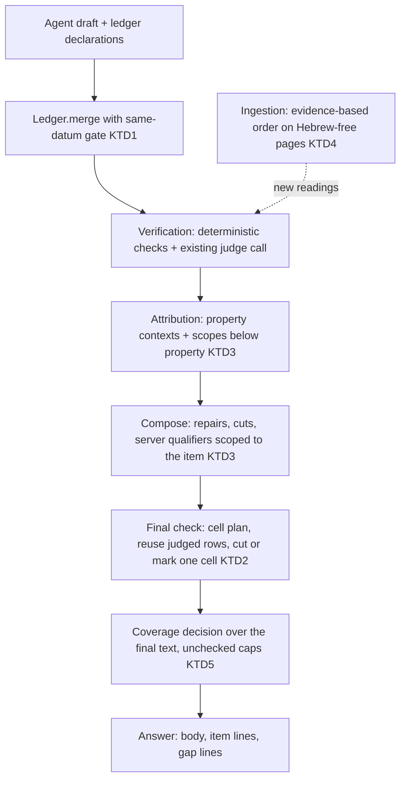
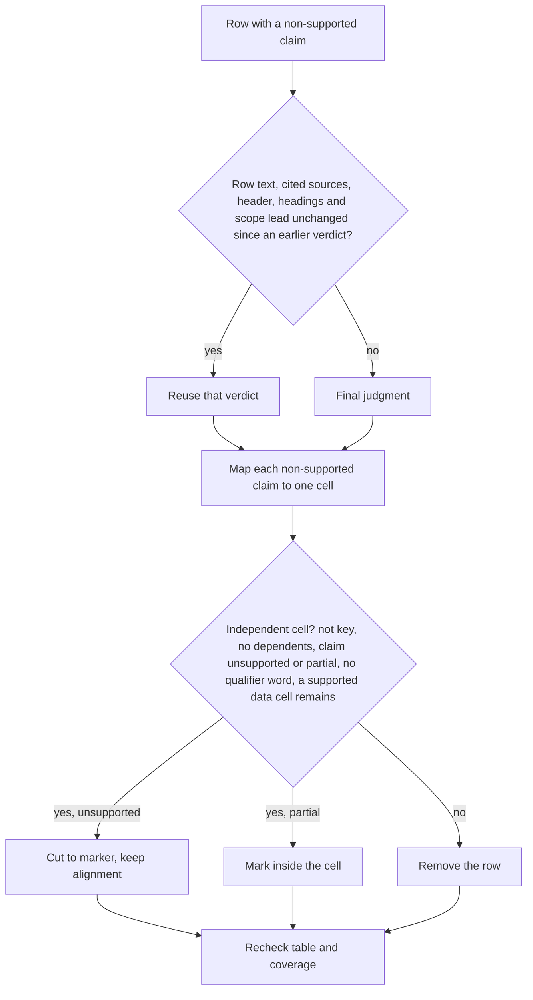

# Keep every supported part and attribute each datum to its own scope - Plan

## Goal Capsule
- **Objective:** an answer keeps every item its sources support, with the item's conditions and its plan, alternative, contract, parcel or comparison side. It loses only the part that is unsupported, and it never presents a datum of another property, plan or alternative as the asked one's.
- **Means:** a same-datum gate in the item ledger (KTD1), cell-level outcomes in the final check (KTD2), attribution checked against scopes below the property (KTD3), cell order decided at ingestion from evidence (KTD4), and gap lines and completeness from one complete coverage decision (KTD5).
- **Authority:** Product Contract requirements (R) win on behavior; KTDs win on mechanism; units cite and never amend either.
- **Stop conditions:**
  - Stop if a fix would need a new model call per cell or claim.
  - Stop if it would need a change to the RAG models or the OCR engine.
  - Stop if it would change or delete stored office data without the user's explicit approval.
  - Stop if a protection test (a wrong datum still removed or flagged) cannot be kept.
- **Execution profile:** Opus diagnoses and decides; Sonnet implements and reviews; Haiku runs simple tasks. Models are set explicitly on every subagent.
- **Who finishes:** the `lfg` pipeline. After implementation come simplify, review, measurement, record, PR update and CI. There is no merge and no deploy.

---

## Product Contract

### Summary
Round 20 fixes four mechanisms the round-19 measurement left: different items merged because their quotes overlap, whole table rows removed for one unsupported cell, data attributed to the wrong plan, contract, parcel or side inside the right property, and a reversed cell order on pages without Hebrew. It also fixes the false "read and not used" lines traced on the round-19 runs, and it stops an unchecked coverage decision from counting as complete. Measurement counts wrong removals and wrong attributions that pass, together.

### Problem Frame
On the round-19 final build the answers lost supported data and passed wrongly attributed data in ways that sit below property identity:
- **The ledger.** Two different items were merged into one fill when one quote contained the other. Value, condition, date and position were never compared. A fill ended with one datum's quote and another datum's value, and a closed decision could pass to a different item.
- **The final check.** It removed a whole table row when one cell's claim was partial. The row was judged again only because an unrelated line above the table had changed. The supported cells were lost, and the gap line then denied what the other row stated. A comparison row was removed for an approximate count ("about N" against "N") because the approximation qualifier was never written for a count.
- **Attribution.** Data passed with the wrong plan, contract, parcel or side although the property was right:
  - a building-rights table of one plan was presented under another plan's column;
  - a footnote of one lot group became the condition of another lot group's items;
  - the server attached a qualifier from one sentence to a value of another appraisal in a shared sentence;
  - a per-parcel value was written under the other parcel.
- **Name and address.** The judge removed correct data when the question named the property by name and the unit was labelled by street address, although stored document evidence links the two.
- **Cell order.** On pages with no Hebrew, ingestion reversed the word order of number-only lines and table rows. A table's annual and quarterly columns were swapped in the answer.
- **Gap lines.** False "read and not used" lines had distinct causes:
  - a maqaf compound split differently on the two sides;
  - counts written in words;
  - a two-level table header;
  - a judge "missing" text equal to the whole request component.
- **Unchecked coverage.** An item whose coverage could not be checked left its component counted as complete.

### Key Decisions
- **Overlapping quotes do not make two items one.** Governs R1-R4. (session-settled: user-directed — chosen over the round-19 structural overlap merge: it merged different data and lost items)
- **The final check removes only the problematic cell or claim when the rest of the row is independent and supported.** Governs R5-R8. (session-settled: user-directed — chosen over whole-row removal on any partial claim: supported data was lost)
- **Attribution is checked below property identity, against the cited cell or passage.** Governs R9-R13. (session-settled: user-directed — chosen over property-level-only attribution: wrong-plan and wrong-side data passed)
- **Cell order is decided by evidence, with no blanket reversal and no OCR change.** Governs R14-R15. (session-settled: user-directed — chosen over a blanket reversal of Hebrew tables or an OCR replacement: a user constraint)
- **An incomplete coverage check cannot make an answer complete.** Governs R18. (session-settled: user-directed — chosen over the round-19 behaviour where an unchecked item does not cap its component: the user requires the limitation shown)
- **No new evaluation set this round.** All exposed sets are regression. Governs R21. (session-settled: user-directed — chosen over a new held-out set per fix: an independent evaluation follows later)

### Requirements

**Item identity**
- R1. Two items are the same item only when they state the same datum at the same position: the same headline values, compatible dates (equal where both give one), the same source block, and no condition of one that the other lacks. Overlapping or nested quotes alone never make them one.
- R2. One wide quote can hold several items. Each keeps its own value, condition, date and position.
- R3. A later answer version may reword an item and replace it. Two items of the same version are never merged unless they state the same datum.
- R4. A closed decision belongs to its own item. A condition check counts as done for an item only when it was done on that item's own condition spans.

**Final check**
- R5. When one cell or claim of a table row is unsupported or partial, and the rest of the row is independent and supported, only that cell or claim is cut, qualified or marked. The row keeps its column alignment and its relation to the headers.
- R6. A row is removed whole only when the problem changes the meaning of the rest of the row, or when no safe partial keep exists.
- R7. A verdict reached before the final check is reused when the row's text and cited sources are unchanged. A change elsewhere in the answer does not by itself re-judge or remove a row.
- R8. After every cut or mark, the final table and the request coverage are checked again. No model call is added per cell.

**Attribution below property**
- R9. Each claim is checked against the scope it is attributed to: a plan, an alternative, a stage, an approved or proposed state, a contract, a parcel or lot group, or a comparison side. It is checked against the cell or passage that supports it. A mismatch proven by the source is cut or repaired; an undecided one goes to the judge as a neutral fact.
- R10. The server attaches a condition or qualifier only from the item's own scope and only to a sentence that states that item. When a sentence speaks of several scopes, the server writes a labelled note or nothing.
- R11. In a comparison each datum keeps its side, also when its sentence cites several sources.
- R12. A property name and its address are linked only by stored document evidence: the unit's own title block, aliases or identity card. That link is given to the judge as a fact, and doubt about a name or title never removes or approves a datum by itself.
- R13. Wrong removals and wrong attributions that pass are measured together. Fewer removals counts as success only when wrongly attributed data does not rise.

**Cell order**
- R14. A line or table row is kept in the order its stored positions show when the line and its page have no Hebrew letter. Hebrew lines and tables keep today's handling.
- R15. Stored office data is not rewritten without the user's explicit approval. The corrected reading is proven against the page and the stored positions in a private check before any re-read.

**Gap lines and completeness**
- R16. A "read and not used" line names a specific missing detail. A citation does not prove a detail was given, and a failed wording match does not prove it was omitted.
- R17. Coverage reads compound words, counts written as words, numbered lists and two-level table headers as the answer writes them.
- R18. When the coverage check of an item could not be completed, its component is not counted as complete on that check. The answer states the limitation precisely. A model repair is not requested for it.

**Constraints and measurement**
- R19. The RAG product models and the OCR engine are unchanged. There is no mandatory manual approval and no deletion of existing data. The separate test DB is used, private data stays out of git, and the PR is updated without merge or deploy.
- R20. Each traced failure is reproduced first, in generic synthetic tests and in private checks against the real documents.
- R21. After the fixes, the regression sets run on one final build in repetitions, with a same-day control on the round-19 build. All exposed sets (the diagnostic set, v18, v20, v21, v22) are regression.
- R22. Each run reports:
  - full and correct answers;
  - wrong answers;
  - required items kept;
  - items removed wrongly;
  - wrong attributions that passed;
  - wrong gap lines;
  - every turn that failed on a timeout, with its input size, steps and call time;
  - full answers twice: as measured, and without the turns whose only shortfall is a component capped for an unchecked item (listed with the reason);
  - time and cost.
  The report also checks that cases which already worked still work.

### Acceptance Examples
- AE1. **Covers R1-R2.** A paragraph states two payments, each with its date, inside one quoted sentence. The agent declares two items with nested quotes in one batch. Both stay separate, each with its value and date.
- AE2. **Covers R1, R4.** Two items with the same value and different conditions are separate. A not-applicable decision on one is not carried to the other.
- AE3. **Covers R3.** Version 1 declares one item; version 2 rewords it with a narrower quote of the same datum. One item remains, with version 2's wording and its history.
- AE4. **Covers R5-R7.** A two-row table: one cell of row A is the model's own unsupported note; the rest is supported. A line above the table is removed for another reason. Row A stays, the unsupported cell is cut to the marker, and the columns stay aligned.
- AE5. **Covers R6.** A row whose key cell names the wrong unit loses the whole row, because the remaining cells would describe the wrong unit.
- AE6. **Covers R9.** A building-rights figure from plan B's table appears in plan A's column. The cell is cut or repaired, and plan A's own figures stay.
- AE7. **Covers R10.** A footnote marked on lot group A's contract does not become the condition of lot group B's items, and the server writes no such condition.
- AE8. **Covers R12.** A question names a property by name; the unit is labelled by its address; the unit's title block holds both. The judge receives the stored link as a fact, and the values are not removed as another property's.
- AE9. **Covers R14.** A number-only line on a page with no Hebrew is read left to right, as its stored word positions show. The same line on a Hebrew page keeps today's order.
- AE10. **Covers R18.** An item whose coverage could not be checked leaves its component partial, with a line saying the check could not be completed.

### Success Criteria
- On the regression sets, against the same-day round-19 control:
  - wrong removals of required items fall;
  - wrong attributions that pass do not rise;
  - wrong gap lines fall;
  - full answers, counted without the turns capped only for an unchecked item, do not fall.
- Every traced mechanism has a synthetic test that fails on the round-19 build, plus a protection test that a wrong datum is still removed or flagged.

### Scope Boundaries
- No change to the RAG models, the OCR engine or the number of model calls per turn.
- No re-read of stored documents in this round, and no reader-version bump. The ingestion fix applies to documents read after it lands. A re-read of the affected pages waits for the user's approval and a backup.
- No new held-out set. An independent evaluation follows later.

#### Deferred to Follow-Up Work
- A stored re-read of the affected pages (one file, 13 pages), after approval and backup, with the `READER_VERSION` bump and a per-document reprocess path.
- Stored measurements derived from reversed rows. They are corrected by that re-read, not at read time.
- Footnote binding for DOCX and scanned pages, which store no superscript geometry.

---

## Planning Contract

### Key Technical Decisions
- KTD1. **A same-datum gate in the ledger.** Governs R1-R4. (session-settled: user-directed — chosen over the round-19 structural overlap merge: it merged different data and lost items)
  - **The gate:** `twin_of` and `_near` keep their structural search. Before any merge a `same_datum` test must hold:
    - equal headline-value sets, with no containment;
    - an aggregate never absorbs its parts;
    - compatible dates: equal where both items give a date;
    - the same source block (the datum's position);
    - no condition of one with words the other lacks.
  - **Frozen fingerprint:** the datum fingerprint (headline values from value and quote, dates, condition words, source block) is computed once, at an item's first insertion, and stored on the `Item`. `_declare` never recomputes it; a later declaration is matched by `same_datum` against the stored fingerprint. The evidence-keyed structures (`validate`'s seen set, `_resolve`'s closed set) stay evidence-level.
  - **Same key:** an item with the same evidence key and a different datum is a separate item. Its key adds a datum fingerprint (headline values, dates, condition words). It is not dropped as a duplicate.
  - **Rewording:** a later-version rewording of the same datum goes through `_declare` as today.
  - **Superseded items:** an agent item of an earlier version that the latest version does not list is closed as superseded, and not scored in `outcomes`, when the latest version declares an item of the same component on the same or a nested quote with a different fingerprint (a corrected value, or a condition added). It never produces a gap line.
  - **Closed decisions:** they move only through a twin that passed the gate.
  - **Server items:** one is dropped only beside a same-datum agent item.
  - **Condition deferral:** a wide item skips its own condition check only when a covered narrow item of the same component states the same datum. That narrow item's condition spans must contain the wide item's, and both must be given by the same sentence.
  - **Unchanged:** `engine.LedgerItem` (its schema is pinned).
- KTD2. **Cell-level outcomes in the final check.** Governs R5-R8. (session-settled: user-directed — chosen over whole-row removal on any partial claim: supported data was lost)
  - **Cell plan:** `_Final` maps each non-supported claim to one cell of its row (`meaning._row_cells` against the header).
  - **Independent cell:** a cell is independent when:
    - it is not the row's key cell;
    - no other approved claim depends on it;
    - its claim is unsupported or partial (its defect is no more than that cell's own content);
    - the cut text holds no qualifier word;
    - at least one approved data cell remains.
  - **Key cell:** the first column, or in a comparison the side's label from the header.
  - **Outcomes:**
    - an unsupported independent cell is cut to the existing marker, through a `CutGroup` and an exact `ClaimRecord`, as `plan_edits` does;
    - a partial independent cell keeps the "partly verified" mark inside the cell;
    - otherwise the row is removed as today.
  - **Reuse:** a verdict is reused when the row text, its cited sources, the table header row, the heading chain and any lead line that names a scope (KTD3) are unchanged. Only surrounding lines that carry no header or scope are left out of that memory.
  - **Last pass:** a cut made in the last pass is accepted without a new judgment when every remaining cell's claim was supported in this or an earlier verdict.
  - **Fixes on the way:**
    - `PARTIAL_MARK` goes at the end of the last cell, not after the closing bar;
    - `_is_duration_or_count` no longer blocks an approximate count's qualifier.
  - **Judge contract:** policy rule 35 asks the judge to give a table row's claims per cell. `JUDGE_VERSION` goes to 20.
- KTD3. **Scopes below the property.** Governs R9-R13. (session-settled: user-directed — chosen over property-level-only attribution: wrong-plan and wrong-side data passed)
  - **Scope reading:** a scope reader derives scopes at read time from a unit's own openers. These are a lettered or numbered paragraph naming a plan id, a parcel or lot group, a contract, an alternative, a stage, or an approved or proposed state, and a table heading or caption naming one. A scope holds until the next opener of the same kind. Nothing is stored.
  - **Referent check:** a claim's referent comes from its own words, then its column or row label, then its block lead. It is compared with the scope of its cited block and with the cited value's recorded measurement subject.
  - **Outcomes:**
    - **Different:** a cut or repair of that part: a table cell through the cell-level path of KTD2; a claim outside a table as its own sentence or clause through the same `CutGroup` and `ClaimRecord` path.
    - **Unknown:** a neutral fact line for the judge in the existing call.
    - **Same:** nothing.
  - **Server qualifiers:**
    - `_check_conditions` attaches a condition only to a sentence that cites the item's own source and states the item.
    - In a sentence that speaks of several scopes or contexts, it writes a labelled note or skips when a sibling sentence already states the condition.
    - A deterministic `other_item` hint is kept, not discarded, when the clause is absent from the item's scope and present in another.
    - A judge "missing" whose quote is the item's whole value is rejected.
    - An agent-declared condition not found in the item's own scope is not attached.
  - **Footnotes:**
    - **Binding:** a footnote binds to the scope of its mark, using stored word geometry (a superscript mark is smaller than its line) on text-layer pages.
    - **When binding fails:** no server-written condition is attached, and the judge gets a fact.
  - **Name and address:**
    - **Header:** the judge's source header shows the unit's distinguishing names.
    - **Fact line:** a same-property fact line names the stored evidence (title block, aliases, identity card subject fields; never the addressee or the appraiser's office). It is written when the question's name resolves to the evidence's context.
  - **Version:** `JUDGE_VERSION` goes to 20 with KTD2. `UNITS_VERSION` and `CARD_VERSION` are unchanged.
- KTD4. **Cell order at ingestion, from evidence.** Governs R14-R15. (session-settled: user-directed — chosen over a blanket reversal or a read-time reorder: a read-time reorder splits quoting, anchors and stored cell indexes into two orderings)
  - **Text lines:** the guard sits in `fix_text_lines`, which both `_text_layer` and `orient_pages` call: a line with no Hebrew letter keeps its stored left-to-right order when its page has no Hebrew letter, even when the document's default orientation is visual. Lines with Latin letters are already read left to right and are unchanged.
  - **Table rows:** `logical_row` keeps the column order only when the row and its page have no Hebrew letter and the table gives a left-to-right cue: header cells with Latin letters, or years or quarters ascending left to right. A numbers-only table with no such cue keeps today's handling.
  - **Reader version:** `READER_VERSION` is not changed in this round. A bump would make the default reprocess re-read every stored PDF of the office. The bump belongs to the deferred, user-approved re-read, after a backup, together with a per-document reprocess path.
  - **Private proof:** a read-only check lists the affected stored blocks and tables. Its pass criterion is the page image: the first column's position and the order of the first row match the rendered page.
  - **No re-read now:** existing readings are not re-read in this round.
- KTD5. **One complete coverage decision.** Governs R16-R18. (session-settled: user-directed — chosen over the round-19 behaviour where an unchecked item does not cap its component: the user requires the limitation shown)
  - **Word groups:** coverage normalises the maqaf the same way on both sides. A numbered-list item is matched on its text, never on its list number. A count written as a word counts when it stands directly before the noun the source writes after the digit.
  - **Table candidates:**
    - a two-level header is merged column by column;
    - a row's value comes from the column whose header shares a request word.
  - **Missing text:** `valid_missing` rejects a missing text that equals the whole component. It also knows the request's subject and its standalone question.
  - **Partial components:** the limit line names the part that was not located, never the whole component.
  - **Unchecked items:** an item whose check could not be completed makes its component partial in `VerifyReport._resolve`, with the line "the check could not be completed". It never becomes a repair request.
- KTD6. **Reproduce first.** Governs R20. Synthetic office-B sequences reproduce each traced shape and fail on the round-19 build before any fix. Private pure-function checks replay the traced turns from the stored runs.
- KTD7. **No model, OCR or call change.** Governs R19. (session-settled: user-directed — chosen over model or OCR changes: a user constraint)
- KTD8. **Measurement on one final build with a same-day control.** Governs R21-R22. (session-settled: user-directed — chosen over a new set per fix or excluding failed turns: all exposed sets are regression and failed turns count)
  - **Runs:**
    - v21 ×2, v20 ×2, v22 ×2;
    - the diagnostic set ×2, v18 ×1;
    - a concurrent control on the round-19 build (`5e4cd37`): v21, v20, v22, the diagnostic set and v18, ×1 each.
  - **Grading:** blind. Each grader gets one run of each build.
  - **Attribution audit:** a referent audit lists every attributable datum with the referent claimed and the referent in the source. Graders count wrong attributions that passed, alongside wrong removals.

### High-Level Technical Design

Directional view of where each decision acts in the turn:

Final check on a table row with one failing claim (directional):

### Assumptions
- The judge can give a table row's claims per cell within its existing call when asked by a policy rule. Where it still returns one whole-row claim, the row falls back to today's handling.
- Scope openers in these appraisals are explicit: a lettered or numbered paragraph, or a table heading that names a plan id, parcel, lot group, contract or alternative. A unit without such openers has no scopes, and nothing changes there.
- Stored word spans exist for text-layer pages. Footnote binding is limited to them.

### Sequencing
1. U8 reproductions and private checks.
2. U1, the ledger.
3. U2, the final check.
4. U3, attribution scopes.
5. U5, gap lines and completeness.
6. U4, ingestion order. It is independent and may run any time after U8.
7. U6, real-model proofs.
8. U7, measurement, record and learning.

U2, U3 and U5 share `backend/app/chat/verify.py`, so they run one after another.

### Risks
- **Stricter merging adds items.** Same-version items that state different data no longer merge (a same-datum duplicate still merges), so the item count rises and more lines may be written. Mitigation: the gate merges every same-datum pair, the aggregate rule is tested, and gap lines are measured.
- **Cell cuts can leave a misleading row.** Mitigation: the independence rules, a protection test that a key-cell problem removes the row, and a recheck of coverage after every cut.
- **Scope readers can invent scopes.** Mitigation: scopes only from explicit openers, unknown when absent, and only a proven mismatch cuts. Tests use the naming variety seen in real units.
- **The unchecked cap could cap many answers** if a source is often absent from the workspace. Mitigation: count such turns on the regression runs and report them. The cap is a pure function of the final state.
- **Provider latency varies by day.** Mitigation: a concurrent control, and failed turns counted.

---

## Implementation Units

### U8. Reproductions of the round-20 shapes
- **Goal:** each traced mechanism fails on the round-19 build in a synthetic sequence and is replayed in a private check.
- **Requirements:** R20. KTD6.
- **Dependencies:** none.
- **Files:**
  - `backend/scripts/generate_fixtures.py` (a round-20 renderer).
  - `backend/tests/fixtures/round20/` (synthetic PDFs and `manifest.json`).
  - `backend/tests/integration/test_round20_sequences.py`.
  - Private checks under `real_documents/tests/round20/`, never committed.
- **Approach:**
  1. Write synthetic documents (all names, addresses and figures invented) for:
     - two payments in one quoted sentence;
     - same values with different conditions;
     - nested agent quotes in one batch;
     - a table row with one unsupported cell and a removed line above the table;
     - a row whose key cell names the wrong unit (protection);
     - a two-plan rights table;
     - a footnote marked on one lot group;
     - per-parcel values;
     - a unit titled by name and labelled by address;
     - a Hebrew-free page inside a Hebrew visual-order document, with a number-only line, a table with Latin headers, and a numbers-only table with no left-to-right cue;
     - the gap-line shapes (maqaf compound, counts in words, two-level header, whole-component missing);
     - an unchecked item.
  2. Each failing shape is a strict xfail naming its owning unit; each protection is a plain test.
  3. Private checks replay the traced round-19 turns' ledger declarations, final-check verdicts, attribution and coverage decisions from the stored runs.
- **Patterns to follow:** `backend/tests/integration/test_round19_sequences.py`, `write_round19` in `backend/scripts/generate_fixtures.py`.
- **Test scenarios:**
  - Covers AE1, AE2, AE4, AE6, AE7, AE8, AE9 and AE10, each as a strict xfail on the round-19 build.
  - Protection: a row whose key cell names another unit is still removed whole.
  - Protection: a value of another parcel stated under the asked parcel is still flagged.
- **Verification:** every xfail fails for the stated reason on the round-19 build; every protection passes.

### U1. Same-datum gate in the ledger
- **Goal:** distinct items stay distinct; a rewording of the same datum is one item.
- **Requirements:** R1-R4. KTD1.
- **Dependencies:** U8.
- **Files:**
  - `backend/app/chat/items.py`: `twin_of`, `_near`, `merge`, `_declare`, `validate`, `outcomes` condition deferral.
  - `backend/app/chat/verify.py`: merge call sites, if they need the datum fingerprint.
  - Tests: `backend/tests/unit/test_items.py`, `backend/tests/unit/test_coverage.py`.
- **Approach:**
  1. Add a datum fingerprint (headline values, dates, condition words) and a `same_datum` test.
  2. Gate every merge, every transfer of a closed decision and every server-item drop on it.
  3. Key a same-quote, different-datum item apart instead of dropping it as a duplicate.
  4. Scope the condition deferral to the same component and the same datum, with contained spans and the same giving sentence.
- **Execution note:** red first; the private replay of the 203 round-19 turns must show the two harmful merges gone and the rewordings still merged.
- **Patterns to follow:** the prototype under `real_documents/tests/round15/diag/` (r20_proto scripts); round-19 `_declare` and history.
- **Test scenarios:**
  - Covers AE1. Two values in one paragraph, narrow then wide quote in one batch: two items.
  - Several payments inside one quote, declared separately: one item each, with its date.
  - Covers AE2. Identical values with different conditions: two items; a closed decision on one does not move.
  - Two items with nested quotes in the same batch: two items, independent of order.
  - Covers AE3. Version 2 rewords version 1's item with a narrower quote of the same datum: one item, version 2's wording, history kept.
  - An aggregate item beside its parts: the aggregate does not absorb a part.
  - A server candidate beside an agent item of a different datum: both kept.
  - Condition deferral: a narrow covered item of another component does not skip the wide item's condition check.
  - Version 1 declares a condition-less item; version 2 declares the same quote with a condition: one open item, version 1's closed as superseded, and no gap line for it.
  - Two items with the same value, date and condition on different source blocks: two items.
  - Protection: a true duplicate (same datum, same quote, same block, same version) is still one item.
- **Verification:** the U8 ledger sequences pass; the existing ledger tests pass; the private replay shows no merge of different data.

### U2. Cell-level outcomes in the final check
- **Goal:** the final check keeps every supported cell and removes a row only when no safe partial keep exists.
- **Requirements:** R5-R8. KTD2.
- **Dependencies:** U8.
- **Files:**
  - `backend/app/chat/final_check.py`: `_Final.decide`, the pass loop.
  - `backend/app/chat/verify.py`: `VerifyReport.edit`, `PARTIAL_MARK` placement, `_is_duration_or_count`, `unit_key`, `unit_claims`, `plan_edits`, `CutGroup`, `ClaimRecord`, the judge policy rule 35, `JUDGE_VERSION`.
  - Tests: `backend/tests/unit/test_final_check.py`, `backend/tests/unit/test_verify_units.py`, the `JUDGE_VERSION` asserts in `test_coverage.py`, `test_verify_cache.py`, `test_verify_professional.py`, `test_verify_reread.py`.
- **Approach:**
  1. Map each non-supported claim of a row to one cell. Identify the key cell (the first column, or the side label in a comparison).
  2. Cut or mark an independent cell, reusing the cut machinery.
  3. Fall back to row removal otherwise.
  4. Reuse an earlier verdict when the row text and its cited sources are unchanged.
  5. Accept a last-pass cut whose remaining cells were supported.
  6. Place `PARTIAL_MARK` inside the last cell, and let an approximate count's qualifier be written.
  7. Recompute coverage after every cut (the round-19 one decision).
- **Patterns to follow:** `plan_edits`, `_cut_groups`, `claim_records`, `_citation_point` for in-cell server text.
- **Test scenarios:**
  - Covers AE4. A row with one unsupported note cell, after an unrelated line above the table was removed: the row stays and the cell is cut, with columns aligned.
  - A partial independent cell: kept, with the mark inside the cell, and no extra cell.
  - Covers AE5. The key cell is wrong: the row is removed.
  - Two failing cells in one row, both independent: both cut, the row kept.
  - A comparison table with sides as columns: the side label is the key; a wrong side cell is cut.
  - A row whose only data cell fails: the row is removed.
  - An approximate count ("about 59" against "59"): qualified, not removed.
  - The coverage decision after a cut: an item whose cell was cut becomes omitted, and a true omission still gets its line.
  - The line above the table that names the row's plan is removed: the row is judged again, not reused.
  - Protection: an unsupported number in a cell is still cut.
- **Verification:** the U8 final-check sequences pass, and the existing final-check and verify tests pass with `JUDGE_VERSION` 20.

### U3. Attribution below the property
- **Goal:** each claim is checked against its scope and its cited cell or passage, and server qualifiers come only from the item's own scope.
- **Requirements:** R9-R13. KTD3.
- **Dependencies:** U8, U2.
- **Files:**
  - `backend/app/chat/contexts.py`, or a new `backend/app/chat/scopes.py`: scope reading from openers and footnote marks.
  - `backend/app/chat/verify.py`: `_context_check`, `_cited_cells`, `_check_conditions`, `_source_parts` (the judge header), ownership facts, rule 34/35 text.
  - `backend/app/chat/items.py`: `_attributed`, `_giving_parts`, `source_items`.
  - `backend/app/chat/conditions.py`.
  - Tests: `backend/tests/unit/test_appraisal_context.py`, `backend/tests/unit/test_verify_units.py`, `backend/tests/unit/test_conditions.py`, `backend/tests/unit/test_items.py`.
- **Approach:**
  1. Read scopes from explicit openers and table headings.
  2. Bind footnotes to their mark's scope from stored word geometry.
  3. Compare a claim's referent with its cited block's scope and the value's recorded subject. Different cuts or repairs that part through U2; unknown adds a judge fact.
  4. Scope server condition attachment to the item's own sentence and source. Keep the `other_item` hint. Reject a whole-value "missing". Never attach an agent-declared condition absent from the item's scope.
  5. Add the unit's distinguishing names and the stored name/address link to the judge header and facts.
- **Execution note:** test each scope rule against the naming variety seen in the real units (the private checks), not only the synthetic shape.
- **Patterns to follow:** round-19 `Contexts.compare`, `MSG_OWNER_*` facts, `unit_key` and `_ownership_note`.
- **Test scenarios:**
  - Covers AE6. Plan B's rights figure in plan A's column: cut or repaired; plan A's figures kept.
  - Covers AE7. A footnote marked on lot group A: no condition attached to lot group B's items.
  - A per-parcel value written under the other parcel (the subject is in the bullet lead): flagged and cut.
  - A sentence about two appraisals with a value of one: the server writes no qualifier into it; a sibling sentence that states the condition is enough.
  - Covers AE8. A unit titled by name and labelled by address: the judge gets the stored link fact, and nothing is removed.
  - A unit with no scope openers: no scope decision and no change.
  - Protection: a cited cell that names another plan is still cut.
  - Protection: the addressee's or the appraiser's address never links a name to a unit.
- **Verification:** the U8 attribution sequences pass; the private replay of the traced turns gives the expected decisions; existing context and condition tests pass.

### U5. Gap lines and complete coverage
- **Goal:** gap lines name a specific missing detail, and an unchecked item never leaves its component complete.
- **Requirements:** R16-R18. KTD5.
- **Dependencies:** U8, U1, U2.
- **Files:**
  - `backend/app/chat/items.py`: `_word_groups`, `_words`, `_have`, `_raws`, the row value choice.
  - `backend/app/chat/verify.py`: `valid_missing`, `_resolve`.
  - `backend/app/chat/coverage.py`: `gap_sentence`, `item_line`, `reason_of`.
  - Tests: `backend/tests/unit/test_items.py`, `backend/tests/unit/test_coverage.py`, `backend/tests/unit/test_verify_units.py`.
- **Approach:**
  1. Normalise the maqaf the same way in item words and block words.
  2. Accept a count word before the source's noun.
  3. Merge two-level headers column by column, and pick a row's value column by a request word.
  4. Reject a missing text equal to the whole component, and know the subject and standalone question.
  5. Make a partial component's limit line name the missing part.
  6. Cap a component with an unchecked item at partial, with the precise line and no repair request.
- **Test scenarios:**
  - Twins told apart by a direction word the answer writes as a maqaf compound: covered.
  - Floors written as words in the answer, digits in the source: covered.
  - Items the answer states as a numbered list: covered, matched on their text.
  - A two-level header row candidate: its value comes from the column the request names, and the identifier column is skipped.
  - A judge "missing" equal to the whole component: rejected; the line names no whole-component absence.
  - Covers AE10. An unchecked item: the component is partial, the line says the check could not be completed, and no repair request is written.
  - Protection: an item the answer does not state still gets its line, naming the missing detail.
- **Verification:** the U8 gap sequences pass; the private replay of the six traced v22 lines shows them gone and the true omissions still written.

### U4. Cell order at ingestion
- **Goal:** new readings keep the true order of number-only lines and tables on pages with no Hebrew.
- **Requirements:** R14-R15. KTD4.
- **Dependencies:** U8.
- **Files:**
  - `backend/app/extraction/hebrew.py`: `fix_line`, `fix_text_lines`.
  - `backend/app/extraction/tables.py`: `logical_row`, `logical_boxes`.
  - `backend/app/extraction/pdf.py`: `_text_layer`, its table branch.
  - `READER_VERSION` in `backend/app/extraction/pdf.py`.
  - Tests: `backend/tests/unit/test_tables.py`, `backend/tests/unit/test_geometry.py`, `backend/tests/unit/test_hebrew_text.py`.
  - A private dry-run check under `real_documents/tests/round20/`.
- **Approach:**
  1. Pass the page's script to the line repair and the table row repair.
  2. Keep left-to-right order when the line or row and its page have no Hebrew letter. For tables, the cell boxes must also show it.
  3. Bump the reader version.
  4. Add a read-only check that lists the affected stored blocks and tables and compares the corrected order with the stored word positions and the page image.
- **Execution note:** red first on synthetic Hebrew-free pages. Update the tests that pin today's reversal only for Hebrew-free inputs, and keep them for Hebrew inputs.
- **Test scenarios:**
  - Covers AE9. A number-only line on a page with no Hebrew: left to right.
  - The same line on a Hebrew page: unchanged.
  - An English table on a page with no Hebrew: columns in box order.
  - A Hebrew table: unchanged.
  - A numbers-only table with no left-to-right cue on a Hebrew-free page: today's handling.
  - A mixed page (Hebrew text, English table): unchanged, as a stated residual.
  - A trailing-minus number on a Hebrew-free line: the sign stays with its number.
- **Verification:** the ingestion tests pass; the private dry-run shows every affected line's and table's corrected order matching the page image.

### U6. Real-model proofs
- **Goal:** the mechanisms are shown on the real model, opt-in, three repetitions each.
- **Requirements:** R20.
- **Dependencies:** U1, U2, U3, U5.
- **Files:** `backend/tests/integration/test_round20_real_model.py`.
- **Approach:** follow `test_round19_real_model.py`. Records go under `real_documents/eval/round20/real-model/`.
- **Test scenarios:**
  - Two payments in one quote both kept.
  - A table row kept with its unsupported cell cut.
  - Plan A's column without plan B's figures.
  - A footnote condition kept on its own lot group only.
  - A name/address unit kept.
  - Report-only: whether an injected wrong-plan value is cut or flagged.
- **Verification:** the two-payment and table-row sequences pass 3 of 3, showing the judge's per-cell claims work in its existing call; the other sequences are recorded and reported, whatever the counts.

### U7. Measurement, record and learning
- **Goal:** the final build is measured against a same-day control, and the round is recorded.
- **Requirements:** R21-R22. KTD8.
- **Dependencies:** U1-U6.
- **Files:**
  - `docs/evaluation/conversational-rag.md` (round 20 section).
  - A learning under `docs/solutions/logic-errors/`.
  - Private runs and grades under `real_documents/`.
- **Approach:**
  1. Rebuild and recreate the stack. Check the `JUDGE_VERSION` constant inside the containers.
  2. Run the traced turns alone first.
  3. Run the sets of KTD8 with the concurrent control.
  4. Grade blind with the round-19 rubric plus a per-datum referent audit.
  5. Report every run and every failed turn with its input size, steps and call time.
- **Test expectation:** none -- measurement and documentation.
- **Verification:** every run and grade is recorded. The report shows full answers, wrong answers, required items kept, wrong removals, wrong attributions that passed, wrong gap lines, time and cost, against the control.

---

## Verification Contract
- **Host pytest only,** through the serialized wrapper (`/private/tmp/claude-501/-Users-arigabay-Code-Rag/7760d0eb-869a-4d0c-af31-bb217b3720da/scratchpad/pt18.sh`), against the throwaway `rag_test` DB.
- **Never** run pytest in Docker, run two pytest processes at once, or touch the office database.
- **Each unit:** its unit tests and the U8 sequences.
- **Before review:** the full `tests/unit` and `tests/integration`, plus `ruff check app tests`.
- **Real-model tests:** opt-in with `-m real_model`; the key is read from `.env` and never printed.
- **Rebuild:** through the `migrate` service, then force-recreate. Check `JUDGE_VERSION` 20 inside the containers before measuring.

## Definition of Done
- Every U8 xfail is removed because its fix landed, and every protection test still passes.
- The full suite and CI are green.
- The PR description carries the round-20 section and any unapplied review findings.
- No merge, no deploy.
- The measurement report shows:
  - every run;
  - every failed turn;
  - wrong removals together with wrong attributions that passed;
  - the comparison with the same-day control.
- The round-20 evaluation section and the learning are written without customer data.
- Experimental code from abandoned approaches is removed from the diff.

## Sources & Research
- Private diagnosis, read only: `real_documents/tests/round15/diag/r20_ledger.md`, `r20_final_row.md`, `r20_attribution.md`, `r20_cells_gaps.md`.
- Round 19 learning: `docs/solutions/logic-errors/attribution-needs-positive-evidence-three-states-and-one-coverage-decision.md`. Its rule that "overlapping quotes of one component are one fill" is superseded by KTD1 and is updated with the round-20 learning.
- Round 18 and earlier learnings:
  - `docs/solutions/logic-errors/meaning-was-lost-in-verification-not-the-model-and-conditions-need-their-own-check.md` (cut only the failing clause; every protection keeps a test that it still removes).
  - `docs/solutions/logic-errors/server-rules-overriding-the-model-and-layout-only-unit-identity-break-multi-appraisal-answers.md` (a name separates two units only if the other unit's text does not write it).
- Code anchors (current tree):
  - `backend/app/chat/items.py`: `Ledger._declare`, `twin_of`, the condition deferral in `outcomes`.
  - `backend/app/chat/final_check.py`: `_Final.decide`.
  - `backend/app/chat/verify.py`: `VerifyReport.edit`, `unit_claims`, `_resolve`, `JUDGE_VERSION`.
  - `backend/app/extraction/tables.py`: `logical_row`.

## U9 — post-measurement fixes
Eight deterministic fixes after the first blind pairs of round 20. Two shapes came from round-20 code (F1, F2); the others are older mechanisms. None adds a model call, changes a judge prompt (`JUDGE_VERSION` stays) or touches the RAG models or the OCR.

- **F1 — an absence cell is not a qualifier.** `row_cut_safe` no longer applies the qualifier guard to a failing span that states an absence (`states_absence`), so only that cell is cut and the supported cell of the row stays. A qualifier inside a cell ("15% (excluding VAT)") still sends the row out whole. The final check reads the same function. The brief's second exemption (a failing claim that covers the whole cell) was left out: an existing test pins a cell that is wholly a condition as sending the row out whole.
- **F2 — bracketed note marks and the duplicate annotation.** A star mark in brackets (`(***)`, `( ***)`) is the bare stars in the note-start and cell-mark patterns. A note whose mark another item's quote carries, and the item's own quote and row do not, is not the item's condition, even when the marked row is in another table. The same condition is written into one unit once (`_check_conditions` by unit and flat condition quote, `edit()` by position and text). Rule 3 of the brief (a mark that no row of the item's table carries is never its condition) was left out: it contradicts an existing test that pins the opposite for a table whose extraction lost the mark.
- **F3 — label digits are not amounts.** `_LABEL_BEFORE` gains the form, regulation, floor, basement, parking-level and elevation nouns and two prefix letters; the new nouns label a number of up to three digits only. `parse_source` reads a footnote mark (a line-opening one or two digits followed by a Hebrew word with no unit, or "word N :") as an identifier.
- **F4 — the period word of a noun.** In `attached`, a period word that has a Hebrew word between it and a percent after it belongs to the noun, not to the percent. Adjacent forms and `_of_rate` are unchanged. The rule reads the answer only: `parse_source` keeps the old source-side reading (`noun_period=False`), and a number followed by a counted noun (apartments, rooms, units) after a floor noun stays a quantity.
- **F5 — a supported claim the judge saw too little of.** One deterministic rescue runs before a judge-failed claim is cut or removed (`rescue_judged`), and before an `unstated_number` unit is removed (`rescue_unstated`). A source cited by the unit, by another unit of its block, or (for an unstated number) anywhere in the answer holds the claim when all its numbers and its content words stand in one sentence or table row, the negations agree, and neither the context check nor the scope check finds it different. The claim is kept, the source is cited and the unit carries the partly-verified mark, never fully verified. Not covered: claims with no number, absence statements, a table row's key cell, and claims the judge needed more context for.
- **F6 — a period stated in another table of the same appraisal.** `Fetcher.attesting` also searches the turn's sources of the same version and a shared context for a number of five digits or more (or with a thousands separator); the blocking period problem becomes a non-blocking citation.
- **F7 — the bold list label stays.** When the first sentence of a list item is removed and a sibling stays, `_sentence_cuts` starts the cut after the bold label.
- **F8 — an inflected summary label.** `quote_in_blocks` accepts a block word that starts with a quote word of three letters or more when every headline number of the quote stands in the block.
