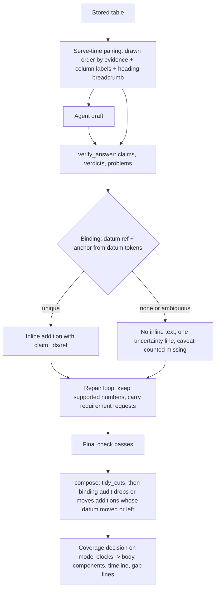

# Bound Server Additions and Kept Verified Data - Plan

## Goal Capsule

- **Objective:** an appraiser who asks the assistant gets answers in which every condition, unit, period and caveat sits on the datum it belongs to, verified data is not dropped by the repair loop, and stored tables are read in the right column order. The result is measurably more full and correct answers than the round-20 build, with fewer errors that the system itself adds.
- **Means:**
  - **Binding:** every server-written addition is bound to an explicit datum and an exact place, or it is not written inline (KTD1, KTD2).
  - **Repair:** the repair loop keeps verified numbers (KTD5).
  - **Stored tables:** they are served in evidence-based order with column labels, read the same way by the agent and the verifier (KTD6).
  - **Proof:** each change is proven by a bounded A/B before any full measurement (KTD8).
- **Authority:**
  - The Requirements (R) win on product behavior.
  - The KTDs win on mechanism.
  - The session-settled KTDs are not reopened.
  - A unit overrides neither.
- **Stop conditions:**
  - **A settled decision proves unworkable:** stop and report.
  - **The focused A/B does not meet the gate in KTD8:** stop and report what improved and what did not. Do not start the full measurement.
  - **A step would delete or replace customer data, or re-read stored documents:** stop and ask.
- **Execution profile:**
  - **Implementation:** Sonnet subagents.
  - **Diagnosis, decisions and the A/B verdict:** Opus.
  - **Mechanical runs and searches:** Haiku.
  - **Tests:** pytest only on the host, through the serialized wrapper against the throwaway test DB.
- **Who finishes:** the LFG pipeline updates PR AriGabay/rag#2. No merge and no deploy.

---

## Product Contract

### Summary

Round 20 cut whole-row removals to zero, but its blind measurement showed that the server still writes wrong meaning:
- conditions attached to a sibling item;
- a column-header period on a capitalised total;
- "another property" removal notes on correct claims;
- false "read and not used" lines.

It also showed that the repair loop drops verified data, and that one stored table is served in reversed cell order. This round binds every server addition to its datum and place, keeps verified data through repair, serves tables correctly, and proves each change on the same drafts and sources before measuring end to end.

### Problem Frame

The private diagnosis (four traces over the round-20 final and control runs) found the following:
- **Wrong server text, without a missing link.** In every traced case of wrong server text, the right datum and place were already knowable from the workspace: the ledger item's own tokens, the list lead, the resolved comparison sides, and the stored value's period. The server anchors instead by the last source number in a sentence, by word proximity, or by a column header.
- **No check on server text.** Nothing checks server text after it is written. The final check reuses draft verdicts and excludes server spans from its key.
- **The repair loop drops verified data.** Its rewrite wording ("omit what was not verified"), its tool-free repair rounds, and the requirement requests that do not reach the rewrite round all push the model to drop data. Every repair-round drop in the final runs followed a judge "partial", a wrong context check, or a VAT request.
- **One table with columns swapped.** It is stored with reversed row cells under a left-to-right header and served without column labels. In one run the first draft was right and the judge "corrected" it into the wrong answer.

Wrong server additions ran at 0.23 per turn in the final build and 0.20 in the control. Item gap lines were wrong 13 times in 18, and removal notes 12 times in 18.

### Requirements

**Bound server additions**
- R1. A server addition inside the answer (qualifier, condition note, scope note, citation, partial mark, cut marker) names the datum it belongs to and is placed inside that datum's own clause or cell. A number appearing in the same sentence or source is not evidence of binding.
- R2. When no unique datum and place exist, the server writes nothing inline. The datum stays. One focused uncertainty line names the datum and what could not be bound. That line does not make the answer complete.
- R3. Essential conditions stay with their datum. Never hide a caveat, weaken an attribution check, or show a datum without a condition its source attaches to it.
- R4. A removal note, conditional note, coverage note or request note states what actually happened to the specific claim or request. It never says "another property" unless the attribution check decided different.

**Meaning, attribution and completeness**
- R5. Each datum and claim keeps an explicit link to its meaning, property and appraisal unit, component, lot or stage, date, unit, period, basis and conditions, and to its exact source (version, page, section or table, row and column when present, headings, footnote). An undecided detail stays unknown.
- R6. Data are never merged because of an equal number or an overlapping quote. A condition never moves between data because they share a paragraph, table or appraisal.
- R7. Grounding, calculation and completeness are decided separately, on the same claim and evidence ids. The answer body, the components table, the timeline and the gap messages read one current decision. Execution instructions ("attach a source to every figure") are not information to search or a component to cover.
- R8. A gap line names a specific missing detail. Different wording does not prove an omission, and a cited source does not prove coverage.
- R9. A verdict is reused only while the claim, its defining lead lines (unit, period, VAT, basis, scope) and its evidence are unchanged.

**Repair and model input**
- R10. The repair loop never drops a number the verification supported. It keeps the number and states what was not verified. A number judged contradicting, or decided as another property, is not kept.
- R11. The agent and the verifier read a stored table the same way: cells in their drawn order when evidence shows it, each cell paired with its column label, the lot or section heading carried with a chunk. No stored data is rewritten.

**Measurement and delivery**
- R12. Each change is proven by an A/B on the same sources and drafts before any full measurement. The full measurement compares the control and the new build in the same environment, on the same material, in repetitions.
- R13. The report gives:
  - full answers;
  - wrong answers;
  - correct items;
  - omissions;
  - wrong server additions;
  - missing caveats;
  - wrong attribution;
  - timeouts;
  - time and cost.

  It names the measured code and build and the model split.
- R14. A table with a cut cell and an in-cell mark is checked in the browser with synthetic data.

### Key Decisions

- **No change to the RAG models or the OCR in this round.** (session-settled: user-directed — chosen over swapping or tuning models: the user excluded it without an experiment that justifies it.) Governs R10, R11.
- **No sweeping rewrite: a bounded corrected path compared with the existing one on the same sources and drafts.** (session-settled: user-directed — chosen over replacing the verification pipeline wholesale: the user requires causal evidence per edit.) Governs R12.
- **A server addition only with its datum and place determined, otherwise context or focused uncertainty.** (session-settled: user-directed — chosen over keeping the last-number, proximity and same-source heuristics with more guards: the user named these heuristics as the failure.) Governs R1, R2.
- **Focused tests and short real-model repetitions first. Full measurement only after a clear improvement.** (session-settled: user-directed — chosen over a full measurement straight after implementation: time, cost and causality.) Governs R12.
- **No deletion or replacement of stored data, and no re-read without approval.** (session-settled: user-directed — chosen over re-reading the stored pages with reversed cell order: a replacing action without approval.) Governs R11.
- **All exposed sets are regression.** (session-settled: user-directed — chosen over calling a recycled set independent: honesty of measurement.) Governs R13.
- **A browser check with synthetic data.** (session-settled: user-directed — chosen over waiting for a cloud answer with a table in office B: office B has no cloud answers.) Governs R14.

### Acceptance Examples

- AE1. **Covers R1, R6.**
  - **Given** one sentence states two data, each with a source condition.
  - **When** the server writes the conditions.
  - **Then** each condition lands in its own datum's clause, and neither is written after the other datum.
- AE2. **Covers R1, R2.**
  - **Given** a list item whose share fraction (n/m) makes every sibling line look like it gives the item.
  - **When** the item's condition is checked.
  - **Then** it binds only to the line holding the item's own value tokens. If no line does, no inline note is written and one uncertainty line names the item.
- AE3. **Covers R5.**
  - **Given** a table whose column header says "monthly" and whose total row is a capitalised value.
  - **When** the meaning check reads the total.
  - **Then** no monthly period is attached to the total, and the row's own period beats the header.
- AE4. **Covers R4.**
  - **Given** a claim removed for another lot of the same property.
  - **When** the removal note is written.
  - **Then** it names the lot scope and does not say "another property".
- AE5. **Covers R10.**
  - **Given** a judge "partial" verdict on a sentence whose number was supported.
  - **When** the repair round runs.
  - **Then** the number stays in the answer, with what was not verified stated.
- AE6. **Covers R11.**
  - **Given** a stored Hebrew-free table with left-to-right evidence.
  - **When** the agent reads it.
  - **Then** each cell carries its column label in drawn order, and the verifier reads the same pairing.
- AE7. **Covers R8.**
  - **Given** an answer that states an item in a numbered list, inflecting its label.
  - **When** coverage runs.
  - **Then** no "read and not used" line is written for it, and a truly omitted item still gets one.
- AE8. **Covers R2, R7.**
  - **Given** a follow-up question in the same conversation.
  - **When** the new answer is verified.
  - **Then** no condition from the previous answer is carried onto a datum of the new one.

### Scope Boundaries

- No change to the OCR, the RAG models, or stored readings. No re-read of stored documents.
- No re-index of stored chunks, so the tiny-chunk ranking problem stays.
- No new mandatory manual approval in the normal path.
- Permissions, exact references, standards, conversation history and the time selector stay as they are.

#### Deferred to Follow-Up Work

- **Re-reading the stored file with reversed cell order:** this needs the user's approval and a backup. Serve-time pairing (U8) is the interim.
- **Merging tiny chunks into their table or heading chunk:** this needs a re-index.
- **An unknown unit-id refusal that lists the valid ids:** a search fix with no requirement in this round.
- **An independent evaluation:** it needs material not used in development. None is available now, because every set comes from the same file.

### Success Criteria

- **The focused A/B meets the gate in KTD8.**
- **On the full regression, the new build's full answers beat the same-day control** beyond the round-20 run-to-run spread.
- **AE6 holds on the stored table that was read in reversed order:** its cells are served in drawn order with their column labels.
- **On the full regression, the new build beats the same-day control** on wrong server additions and on wrong answers, beyond the run-to-run spread seen in round 20.
- **The full regression shows no loss in the following,** beyond that spread:
  - required items correct;
  - wrong removals;
  - wrong attribution;
  - data of another property or lot passed;
  - timeouts.
- **In the acceptance tests:**
  - no condition or unit is attached to a neighbouring item;
  - no data of another property or lot passes;
  - the completeness repair deletes no supported information.

---

## Planning Contract

### Key Technical Decisions

- KTD1. **One binding record, on the existing carriers.** Every server addition carries a reference to its datum: a ledger item id, a claim id or a V#. It also carries an anchor expressed in model-text coordinates (`origins()`), never in post-splice offsets.
  - **Carriers:**
    - `ServerSpan.claim_ids`, which exists but is exported only for partial marks;
    - the `ref` tuple of `Doc.splice` and `edit`, which today passes `()` for every qualifier, scope, condition and citation note;
    - the ledger `Item` and `Datum`.
  - **Where the anchor comes from:** the datum's own tokens, meaning its headline forms (including share fractions n/m), `Value.written` for a cited V#, or the claim's cell.
  - **What it replaces:** `verify._value_number` (the last source number), proximity, and same-source number matching. (session-settled: user-directed — chosen over guarded heuristics: the user named them as the failure.) Governs R1, R2.
  - **Rejected alternative:** a new parallel structure. Rejected because the carriers exist and the learnings require extending the representation.
- KTD2. **No unique anchor means no inline text.** The datum stays, and one focused uncertainty line is written per answer.
  - **The line's content:** it names the datum by its own words and the condition or unit that could not be placed.
  - **Limits:** it names at most three data. When more are unbound, it names three and states the count of the rest and the kind of detail not placed. Every unbound datum counts as a missing caveat in completeness, never as coverage, and nothing is dropped silently.
  - **Where it renders:** in the existing gap paragraph area, not inline.
  - **Not affected:** removals and cuts are already claim-bound and keep their rules. An unbound addition never triggers a removal (the learnings: unknown never removes).
- KTD3. **Meaning ownership reads structure, not position.** "Adjective + של + amount" is owned by that amount. A column-header period applies only to recurring row kinds, and a row's own period beats the header. English period words and the "שטח בנוי" order are part of the lexicon.
  - **Conditional tag:** it confirms provenance with the same meaning reader before saying a value is uncertain. Its wording says "set by the agent, not found in the source" instead of "not certain".
  - **Unread reads:** `Fetcher._read` returns a distinct not-read state at all three call sites, so "not read" never becomes "not stated".
- KTD4. **A deterministic audit of server spans inside composition.** It runs as a step of `coverage.compose_components`, right after `tidy_cuts` and before `tidy_blank_lines`. Every final-check pass and the closing fixed-point recomposition therefore run the same audit from the same state, and `assert_fixed_point` keeps holding. No new judge call.
  - **Dropped:** an addition whose datum is no longer in the answer at its anchor.
  - **Moved:** an addition whose datum moved.
  - **Not touched:** one whose datum survives.
  - **Verdict keys:** they gain the block's defining lead lines (unit, period, VAT, basis, scope), so changing such a line invalidates the verdict and an unrelated line does not. Test both directions.
  - **`tidy_cuts`:** it no longer drops a repeated identical line under a different heading.
- KTD5. **The repair loop keeps verified numbers.**
  - A judge "partial" on a supported number becomes a mark, not a rewrite request that omits it.
  - The rewrite wording keeps verified numbers and states what was not verified.
  - Open requirement requests reach the rewrite round.
  - Tools stay on in repair unless the request quotes a passage holding a value of the asked kind.
  - **Not kept by this rule:**
    - a number judged contradicting;
    - a number decided as another property;
    - a number with another VAT basis that would lose its basis.
  - **Relation to the existing restore:** `lost_supported` and `restore_lost` (round 16) restore claims judged supported. They did not cover the traced drops: a judged-partial number, a wrong context check, a VAT request. The new keep-rule extends that restore to these cases and does not replace it.
  - **Why it needs the A/B:** these change model input, so KTD8 must show they help.
- KTD6. **Stored tables are paired at serve time, in one shared function used by the agent's tools and by the verifier's source text.**
  - **Cell order:** a stored table is treated as reversed only when all of these hold:
    - its stored `cell_boxes` x-order is descending;
    - its cells and headers hold no Hebrew letter;
    - the `tables.reads_left_to_right` cue (a Latin header, years or quarters ascending) holds on the table read in drawn order.
    A table with no boxes, or with ascending boxes, is served unchanged. Round 20 changed extraction without a `READER_VERSION` bump, so stored readings come in two generations; this conjunction tells them apart.
  - **Stored index:** the shared function returns, for each served cell, its stored column index. `take_value`, the table-cell quote checks and the anchor stubs resolve a column label to that stored index, so values and highlighted boxes stay right.
  - **Row chunks:** a `table_row` or `table` search hit is re-rendered at serve time from the stored table rows through the same function. The stored chunk text and embeddings are not touched.
  - **Labels:** each cell is served with its column label.
  - **Breadcrumb:** the lot or section heading is carried in the source envelope.
  - **Stored data:** nothing stored is rewritten (session-settled: user-directed — chosen over a re-read: a replacing action without approval).
  - **First step:** a read-only count of stored tables by class (reversed-stored, drawn-stored, no boxes). A small population is stated as a limit on generalisation.
- KTD7. **The gap-line fixes are only those proven offline to flip wrong lines and keep every correct one:**
  - the `bool(groups)` guard in `quote_in_blocks` is dropped;
  - the quote's words are asked before the label words when a value has no number;
  - same-row rivals are excluded by normalised quote, with no label-word fallback;
  - abbreviation tokenisation is fixed;
  - a section number is skipped as a value;
  - `missing_detail` uses whole tokens;
  - one datum under two quotes is attributed through a cited source of the same unit;
  - value_partial ignores stray 1–2 digit groups.
  - **Rejected:** distinct-word groups alone, because they hide a correct line.
- KTD8. **The A/B and its gate are fixed before any run.**
  - **The comparisons:**
    1. A public synthetic replay of the acceptance shapes through old and new paths.
    2. A private deterministic replay of the drafts captured on the round-20 build (KTD9), with verdicts keyed by claim text and unjudged units counted.
    3. A short real-model A/B: a fixed focused turn list (the traced failure turns plus guard turns that already worked) × 3 repetitions on the control (round-20 final build) and on the new build, in the same environment, graded blind.
  - **The focused list:** at least 20 turns, fixed before the first run: the traced failure turns, plus guard turns that already worked, plus at least one turn on the reversed-stored table.
  - **Gate for the full measurement — the new build must show all of these against the control on the focused list:**
    - at least 40% fewer wrong server additions, and the cut is larger than the spread among the control's own three repetitions;
    - missing caveats (including uncertainty lines that replaced an inline note) not higher than the control by more than one per run on average;
    - full answers not lower than the control by more than one per run on average;
    - no more wrong removals of required items;
    - required items correct not lower by more than one per run on average;
    - no new attachment of a condition or unit to a neighbouring item;
    - no data of another property or lot passed;
    - timeouts not more than one above the control.
  - **Single events:** a single graded wrong removal or wrong attachment that also appears in at least one control repetition does not fail the gate.
  - **The full regression after the gate:** v21, v20, v22 and the diagnostic set × 2, and v18 × 1, for both builds, same day, blind pairs.
- KTD9. **Draft capture for replay.** Diagnostics record each round's full draft and, per cited source id, its stable locator: version_id, reading_id, block_start and block_end, table_index, row_index, chunk_id, table_part and kind. A replay rebuilds each source's text from stored data through the old and new serve paths, without the model.
  - **Storage:** the capture stays in `message_diagnostics`, behind the existing diagnostics permission and document-visibility checks.
  - **No drafts exist today:** earlier runs stored problems and digests, not drafts. So the capture code lands first on the round-20 build, and the focused list runs once with capture on. That run is the control's first repetition and the material for the private replay. It counts in the real-model budget.

No Bake-off. The binding carrier exists, and the serve-time pairing is one mechanism. Neither leaves two structurally distinct, costly-to-reverse options.

### High-Level Technical Design

### Assumptions

- The diagnosis traces are representative of the remaining failures. The focused turn list covers every traced mechanism.
- No independent set exists. Every set in hand comes from one file used in development.
- The round-20 final build (`ebc9957`; measured as `78ea5e9`, with the same answer-level decisions) is the right control.

### Sequencing

U1 (capture and harness) comes first, so every later unit is proven through it. Then come the server-side fixes: U2 first, then U5 and U6, which use U2's binding. U3, U4 and U7 are independent of each other and of U2. U8 and U9 change model input. U10 adds the browser check and the real-model sequences. U11 runs the A/B gate and then the full measurement.

### Risks

| Risk | Mitigation |
|---|---|
| Not writing unbound text hides needed caveats | KTD2 counts them as missing caveats; R13 reports missing caveats beside wrong additions |
| Serve-time order flips a table that must not flip | Evidence-only rule; synthetic tables that must not flip; no change without evidence |
| Repair changes raise timeouts or step limits | The A/B tracks timeouts and steps; tools-on only when the request lacks a value passage |
| The A/B population is fitted to the diagnosis | Guard turns that already worked are in the list; the report says all material is regression |
| Verdict keys with lead lines raise judge cost | Measure judge calls per turn in the A/B |

### Sources

- Private diagnosis: `real_documents/tests/round21/diag/t1_edit_paths.md`, `t2_server_additions.md`, `t3_model_side.md`, `t4_search_gaps.md`. They are not in git.
- Learnings:
  - `docs/solutions/logic-errors/overlap-is-not-identity-keep-the-supported-cell-and-attribute-below-the-property.md`
  - `docs/solutions/logic-errors/attribution-needs-positive-evidence-three-states-and-one-coverage-decision.md`
  - `docs/solutions/logic-errors/meaning-was-lost-in-verification-not-the-model-and-conditions-need-their-own-check.md`
- Code:
  - `backend/app/chat/compose.py` (`ServerSpan`)
  - `backend/app/chat/verify.py` (`_value_number`, `_check_conditions`, `VerifyReport.edit`, `row_cut_safe`, `key_context`)
  - `backend/app/chat/final_check.py` (`_run`, `split`)
  - `backend/app/chat/items.py` (`blocks_of`, `quote_in_blocks`, `_word_groups`)
  - `backend/app/chat/meaning.py` (`attached`, `parse_source`, `Fetcher._read`)
  - `backend/app/chat/coverage.py` (`tidy_cuts`, coverage notes)
  - `backend/app/chat/engine.py` (`REPAIR`, `REWRITE`, `text_completion_only`)
  - `backend/app/chat/tools.py` (`_envelope`, read table)
  - `backend/app/extraction/tables.py` (`reads_left_to_right`)

---

## Implementation Units

### U1. Draft capture and the A/B replay harness

- **Goal:** replay the same drafts and sources through the old and new verification paths, and record drafts so later replays need no model.
- **Requirements:** R12, KTD8, KTD9.
- **Dependencies:** none.
- **Files:**
  - `backend/app/chat/engine.py` (diagnostics: full draft per round, with its cited ids)
  - `backend/tests/integration/test_round21_sequences.py` (new; the acceptance shapes)
  - `backend/tests/integration/test_chat_engine.py`
- **Approach:**
  1. Record each draft round's full markdown and cited ids in the existing diagnostics.
  2. Build the public synthetic replay on the existing seam: `Workspace(ctx=None)` plus `add_source`, then `verify_answer`, `report.edit` and compose/finalize, with a scripted judge, as in `test_round20_sequences.py`.
  3. The private replay script lives under `real_documents/` and is never committed.
  4. After the capture lands, run the focused list once on the round-20 build with capture on (KTD9).
- **Patterns to follow:** `backend/tests/integration/test_round20_sequences.py`; `backend/tests/unit/test_verify_edit_ladder.py`.
- **Test scenarios:**
  - A two-round turn records both drafts and their cited ids in diagnostics.
  - Diagnostics stay readable only with the existing diagnostics permission.
  - Each acceptance shape has a sequence that fails on the round-20 path and records the failing server text: AE1, AE2, AE3, AE4, AE5, AE6, AE7 and AE8, plus equal values in two components, a footnote-marked note, and several lots.
  - A captured source's locator rebuilds the same text through the old serve path.
- **Verification:** each sequence reproduces its failure on the current code before the fix units land.

### U2. Binding record and datum-anchored conditions

- **Goal:** every inline server addition carries its datum ref and an anchor inside that datum's clause or cell. Without one, it writes nothing inline.
- **Requirements:** R1, R2, R3, R6; KTD1, KTD2.
- **Dependencies:** U1.
- **Files:**
  - `backend/app/chat/compose.py`
  - `backend/app/chat/verify.py` (`_value_number` callers, `_check_conditions`, `edit`, qualifier and scope notes)
  - `backend/app/chat/items.py` (the covering unit of an item chosen by the item's own value tokens, including n/m; the list lead in the condition check)
  - `backend/app/chat/conditions.py` (quote only the operator clause)
  - `backend/tests/unit/test_verify_units.py`, `backend/tests/unit/test_items.py`, `backend/tests/unit/test_conditions.py`
- **Approach:**
  1. Export `claim_ids` and a datum ref for every addition kind.
  2. Replace both `_value_number` callers with an anchor search over the datum's own tokens inside its unit.
  3. Make a condition note's quote the operator clause only.
  4. Choose an item's covering unit by overlap with its value tokens, never by `parts[0]`.
  5. Add the uncertainty line kind and its cap.
- **Test scenarios:**
  - Covers AE1. Two data with their own conditions in one sentence: each note lands in its own clause.
  - Covers AE2. Share-fraction siblings: the note binds to the line with the item's tokens. With no such line, there is no note and one uncertainty line.
  - Two equal values in two components, in one unit: the anchor is ambiguous, so there is no inline text, and the uncertainty line names both.
  - A list lead states a condition for all items: each item counts the condition as present and no note is written.
  - The uncertainty line is capped at three data and never marks a component complete.
  - A footnote-marked note binds only to the row carrying its mark.
  - More than three unbound data: the line names three, states the count of the rest, and every one counts as a missing caveat.
  - Covers AE8. A follow-up answer's conditions and uncertainty lines come only from its own verification, never from the previous answer.
- **Verification:** the U1 sequences for AE1, AE2 and AE8 pass, and no existing condition test loses a needed note.

### U3. Meaning ownership and honest conditional wording

- **Goal:** periods, bases and conditional tags are owned by the right datum, and "not read" never becomes "not stated".
- **Requirements:** R3, R5; KTD3.
- **Dependencies:** U1.
- **Files:**
  - `backend/app/chat/meaning.py` (`attached`/`_owner`, `parse_source` header-period scope, the lexicon, the `Fetcher._read` not-read state at its three callers)
  - `backend/app/chat/calc.py` and `backend/app/chat/tools.py` (provenance confirmation for the conditional tag)
  - `backend/app/chat/verify.py` (conditional note wording)
  - `backend/tests/unit/test_meaning.py`, `backend/tests/unit/test_calc.py`
- **Approach:**
  1. Own "adjective + של + amount" by the amount.
  2. Apply the header period only to recurring row kinds, and let a row's own period beat the header.
  3. Add the English period words and the "שטח בנוי" order.
  4. Return a not-read sentinel from `_read`, and handle it at all three call sites.
  5. Confirm the conditional tag with the meaning reader, and reword it.
- **Test scenarios:**
  - Covers AE3. A monthly header with a capitalised total row: no monthly period on the total.
  - A row stating "annual" under a monthly header: the row's period wins.
  - "השנתית של 1,200,000" gives the period to 1,200,000, not to an earlier number.
  - A header "Monthly" is read as a month period.
  - A basis written "שטח בנוי 500 מ״ר" is read as built area.
  - A read that raises an error gives the not-read state, never "the source is silent".
  - A value with a clear reading, a locator and a quote gets no "not certain" tag.
- **Verification:** the U1 AE3 sequence passes, and the round-20 source-side meaning tests stay green.

### U4. Honest notes and safe tidying

- **Goal:** removal, coverage and request notes say what happened to the specific claim, and tidying never deletes a supported repeated line.
- **Requirements:** R4, R8; KTD4.
- **Dependencies:** U1.
- **Files:**
  - `backend/app/chat/verify.py` (`REMOVAL_SENTENCES`: a sentence of its own for scope_mismatch, and a note bound to the removed claim)
  - `backend/app/chat/coverage.py` (`tidy_cuts`, and a coverage note that is not written when the document is cited)
  - `backend/app/chat/resolve.py` (the request note uses the area basis)
  - `backend/tests/unit/test_coverage.py`, `backend/tests/unit/test_resolve.py`, `backend/tests/unit/test_verify_units.py`
- **Test scenarios:**
  - Covers AE4. A scope_mismatch removal note names the lot scope, never "another property".
  - A removal note quotes the removed claim's own head and its failure.
  - The same bullet under two lot headings survives tidying.
  - A cited document with an empty query lookup produces no "not covered" coverage note.
  - A per-dwelling basis produces no "value per area" request note.
- **Verification:** each wrong note shape traced in the diagnosis has a test that fails before the change and passes after it.

### U5. Context check for named and located sides

- **Goal:** a claim whose evidence is in the located unit, or in a side the request named, is never removed as "another property".
- **Requirements:** R4, R6.
- **Dependencies:** U1, U2.
- **Files:**
  - `backend/app/chat/verify.py` (`_check_evidence`, `_context_check`: the asked-set filter, `REQ_CONDITION_OTHER` only with a binding)
  - `backend/tests/unit/test_verify_units.py`, `backend/tests/integration/test_chat_attribution.py`
- **Test scenarios:**
  - A comparison where the named side's name stands in its own cited passage: the claim is kept.
  - Evidence in the located unit: no DIFFERENT and no removal.
  - Evidence that really belongs to another property is still removed, with the note "another property".
  - A condition request for another item is sent only when the item binding is unique.
- **Verification:** the round-19 and round-20 attribution tests stay green.

### U6. Binding audit and verdict keys

- **Goal:** server text that lost its datum is dropped or moved, and verdicts are invalidated by a changed defining line.
- **Requirements:** R9, R1; KTD4.
- **Dependencies:** U2.
- **Files:**
  - `backend/app/chat/final_check.py`
  - `backend/app/chat/verify.py` (`unit_key`/`key_context`, so they include the block's lead lines of unit, period, VAT, basis and scope)
  - `backend/tests/unit/test_final_check.py`
- **Test scenarios:**
  - A condition note whose datum was cut by the final check is removed.
  - A note whose datum moved within the unit follows it.
  - A changed list lead that sets the period invalidates the verdict of its items.
  - An unrelated context line above the table does not invalidate the verdict, so the round-20 row-keeping behavior is kept.
  - The audit runs inside `compose` after `tidy_cuts`: when it drops a span, `assert_fixed_point` still passes and a second pass changes nothing.
- **Verification:** final-check tests and round-20 sequences stay green, and judge calls per turn do not rise in the A/B.

### U7. Gap-line matching

- **Goal:** "read and not used" lines appear only for items the answer really omits.
- **Requirements:** R8, R7; KTD7.
- **Dependencies:** U1.
- **Files:**
  - `backend/app/chat/items.py` (`quote_in_blocks`, `_word_groups`, `_value_check` order, rival exclusion, the section-number value, value_partial)
  - `backend/app/chat/coverage.py` (`missing_detail` tokens)
  - `backend/tests/unit/test_items.py`, `backend/tests/unit/test_coverage.py`
- **Test scenarios:**
  - Covers AE7. An item stated in a numbered list with an inflected label is covered.
  - A quote with no number matches a prefixed form in the answer.
  - Two twins whose quotes differ only by a list marker are one rival set.
  - The quote words are asked first when the value has no number.
  - An abbreviation with a quote mark (`בע"מ`) matches.
  - A value that is a section number is skipped.
  - A duration that matches only stray small digits is not "given in part".
  - One datum under two quotes, stated with one cited source: covered.
  - A truly omitted item still gets its line.
  - An execution instruction ("attach a source to every figure") never becomes a component or a gap line.
- **Verification:** the private replay confirms the KTD7 fixes flip only wrong lines.

### U8. Serve-time table pairing and envelope

- **Goal:** the agent and the verifier read stored tables in drawn order with column labels, and chunks carry their lot heading.
- **Requirements:** R11; KTD6.
- **Dependencies:** U1.
- **Files:**
  - `backend/app/chat/tools.py` (read table, `table_row` and `table` hit text, `take_value` column resolution, `_envelope`)
  - `backend/app/chat/anchors.py` (cell anchors through the stored column index)
  - `backend/app/extraction/tables.py` (shared order evidence)
  - the source text builder the verifier reads
  - `backend/tests/unit/test_tables.py`, `backend/tests/integration/test_chat_reading_tools.py`
- **Approach:**
  1. Run the read-only count of stored tables by class first.
  2. Write one shared serve function that returns each served cell with its label and stored column index. The tool output, the row-chunk hit text and the verifier's source text all call it.
  3. Resolve `take_value` and the anchors through the stored column index.
  4. Make no change to stored rows, chunk text or embeddings.
- **Execution note:** prove it on a synthetic Latin-header fixture and on tables that must not flip before touching serving.
- **Test scenarios:**
  - Covers AE6. A Hebrew-free table with ascending years is served left to right, each cell with its column label. The verifier sees the same pairing.
  - A Hebrew table and a table without evidence are served unchanged.
  - A drawn-stored table with a Latin header and ascending boxes is not flipped.
  - A Hebrew right-to-left table with descending boxes is not flipped.
  - A negative number written with a trailing minus in a reversed-stored row is served with its sign.
  - A search hit on a row of the reversed-stored table and a table read of the same table give the same cell-to-label pairing.
  - `take_value` on the reordered table returns the value under the requested label, and its anchor indexes the right `cell_boxes` entry.
  - A chunk under a lot heading carries the heading in its envelope.
- **Verification:** the read-only count and the synthetic tests are recorded, and no stored row changes.

### U9. Repair loop that keeps verified numbers

- **Goal:** repair rounds keep supported numbers, carry open requirements, and use tools when needed.
- **Requirements:** R10, R3; KTD5.
- **Dependencies:** U1, U2.
- **Files:**
  - `backend/app/chat/engine.py` (`REPAIR`, `REWRITE`, `REPAIR_LAST` wording; requirement requests carried into rewrite; tools-on rule)
  - `backend/app/chat/verify.py` (`text_completion_only` condition; a judge partial on a supported number becomes a mark)
  - `backend/tests/integration/test_chat_engine.py`, `backend/tests/integration/test_round21_sequences.py`
- **Test scenarios:**
  - Covers AE5. A judge partial on a supported number: the number stays and is marked.
  - A contradiction or a DIFFERENT decision still removes or repairs as today.
  - An open requirement request reaches the rewrite round.
  - Tools stay on when the request quotes no passage with a value of the asked kind.
  - A VAT request keeps the number with its basis.
- **Verification:** the scripted repair sequences pass, and the A/B shows no rise in timeouts or step limits.

### U10. Browser check and real-model sequences

- **Goal:** prove the cut cell and the in-cell mark in the browser, and the binding behavior against the real model.
- **Requirements:** R14, R12.
- **Dependencies:** U2–U9.
- **Files:**
  - `frontend/e2e/answer-fixtures.ts` (a synthetic GFM table answer with a cut cell and an in-cell partial mark)
  - `frontend/e2e/chat-table-cells.spec.ts` (new)
  - `backend/tests/integration/test_round21_real_model.py` (new)
- **Test scenarios:**
  - The table renders right to left with the marker in the cut cell and the mark inside its cell.
  - The answer details show the cut and the mark at a 375px width.
  - Real model, 3 attempts each: two data with conditions in one sentence; a capitalised total next to a monthly rate; several lots; a follow-up question.
- **Verification:** the e2e spec passes in the browser, and the real-model summaries are written with every attempt.

### U11. A/B gate and full measurement

- **Goal:** decide by the KTD8 gate, then measure end to end.
- **Requirements:** R12, R13.
- **Dependencies:** U10.
- **Files:**
  - `docs/evaluation/conversational-rag.md` (the round-21 section, generic)
  - private run data under `real_documents/`
- **Test expectation:** none — measurement and documentation.
- **Approach:**
  1. Fix the focused turn list and the gate before the first run.
  2. Run the short A/B, grade it blind, and apply the gate.
  3. Run the full regression only when the gate passes.
  4. Report every run, timeout, cost and the measured build.
- **Verification:** the report states what improved, what regressed and what was not proven.

---

## Verification Contract

| Gate | Command or method | Applies to |
|---|---|---|
| Unit and integration tests | `env -u DATABASE_URL -u OWNER_DATABASE_URL .venv/bin/pytest` through the serialized host wrapper against the throwaway `rag_test` | U1–U9 |
| Real-model sequences | `pytest tests/integration/test_round21_real_model.py -m real_model`, 3 attempts each | U10 |
| Lint | `ruff check app tests` from `backend/` | all code units |
| Browser e2e | Playwright spec in `frontend/e2e/` against office B with synthetic fixtures | U10 |
| Private replay | drafts captured on the round-20 build (KTD9), sources rebuilt from locators, old against new, verdicts keyed by claim text | U1–U9 |
| A/B gate | KTD8 thresholds on the focused list × 3 per build | U11 |

---

## Definition of Done

- Every acceptance example has a passing test, and each failed on the round-20 code first.
- The KTD8 gate result is recorded. The full measurement ran only if the gate passed.
- The report gives the R13 measures for every run, including timeouts, cost and the measured build.
- No customer content is in git, and no stored data was deleted, replaced or re-read.
- Experimental code from abandoned attempts is removed from the diff.
- The PR is updated without merge or deploy.
