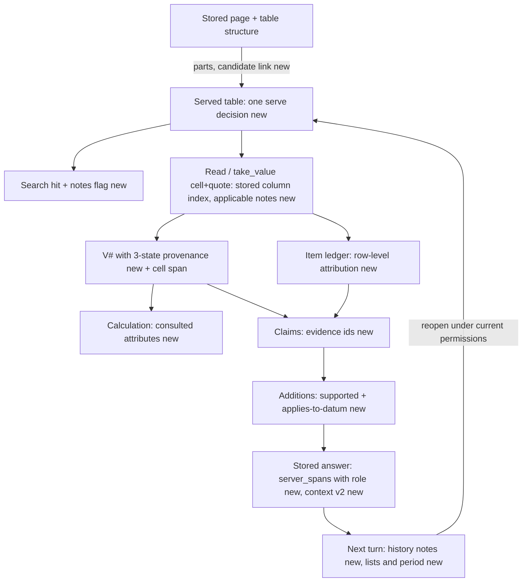
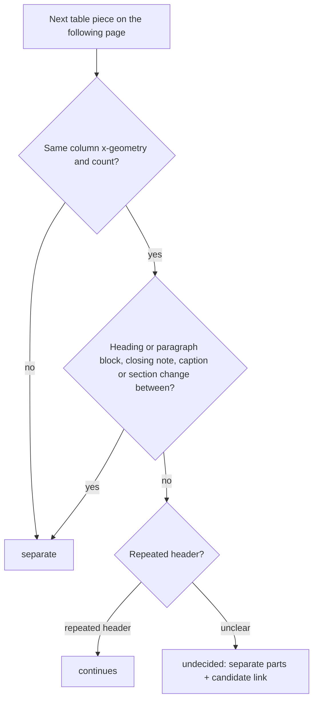
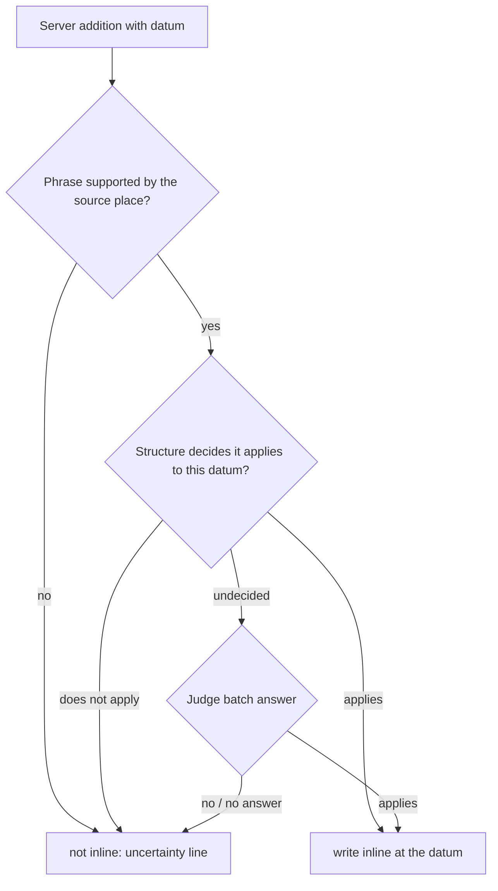

# Meaning kept from the document to the next turn - Plan

## Goal Capsule

- **Objective.** A user who asks about an appraisal gets an answer whose every datum keeps the meaning the document gave it. That covers its table, row and column, its scope, conditions, period and number, and the meaning lasts into the next turn of the conversation. The improvement repeats across measured runs, with no more wrong answers and no hidden gaps.
- **Means.**
  - Complete the missing links in the existing evidence records (Source, V#/C#, item ledger, claims, ServerSpan, locators, slots) instead of re-deriving meaning from rendered text (KTD1).
  - Replace each narrow rule that the diagnosis proved wrong with one structural or evidence-based decision. Then remove the narrow rule from active code (KTD2).
- **Authority.**
  1. The user's round-22 request and the settled decisions in Key Decisions and KTDs.
  2. This plan's R-IDs.
  3. KTDs on mechanism.
  4. Units.
  - Project rules in `CLAUDE.md` (data safety, host-only pytest, model split) bind every unit.
- **Stop conditions.** Stop and report rather than proceed when:
  - a change would delete or rewrite stored customer data or re-read stored documents;
  - a replacement cannot be shown to cover the family its narrow rule served;
  - the pre-registered gate (R25) fails and no diagnosed cause is fixable within scope.
- **Execution profile.** Gradual migration, one mechanism at a time, each proven on synthetic property tests and a private replay before the next. Opus diagnoses and decides; Sonnet implements and reviews; Haiku runs simple searches and checks.
- **Finishes and ships.** The orchestrating session commits each unit, updates PR AriGabay/rag#2, and reports. It does not merge or deploy.

---

## Product Contract

### Summary
This round keeps the meaning of every datum along the whole path, from the stored table or paragraph through search, reading, calculation and the composed answer to the next conversation turn. It fixes eight confirmed mechanisms (review findings a–h) and two measured failure families (false "conditional result" notes, numbers in words). It also replaces the narrow rules those mechanisms rested on.

### Problem Frame
Round 21 bound every server addition to a datum and a place. A full measurement still showed meaning lost at other joints, and the review findings reproduced most of them:
- **Tables.** Two separate tables merge across a page break, so the costs rows inherit the income table's headers and scale. A stored reversed table shows one column order to the agent and another to the citation viewer. Table notes reach only the last chunk.
- **Answers.** Coverage is decided by word presence, so "not found for plot A" counts as stating plot A. A condition can be anchored on an equal value of another row.
- **History.** It drops every server addition, conditions included. It also keeps a single list, so "the second payment" can bind to the second plot.
- **Calculations and numbers.** The commonest false server addition is a "conditional result" note that says a value "was not found in the source" when only its meaning label was unconfirmed. Numbers written in words above ten are not read.
- **Search.** It ignores its own candidate limit.

- **Verification.** A judge call that times out withholds supported claims, so a correct answer can be lost (F2).

All of these are product failures, whichever stage owns them.

Findings map to units:
- **Tables:** a (table merge) → U3, f (column identity across paths) → U4, g (table notes) → U5.
- **History:** b (history drops conditions) → U11, e (one list kept) → U12.
- **Search:** c (candidate limit) → U2.
- **Answers:** d (word-presence coverage) → U6, h (anchored but misattributed addition) → U8.
- **Measured families:** F2 (judge timeout) → U7, F3 (false conditional notes) → U9, F5 (numbers in words) → U10.

### Key Decisions
- **Diagnosis before change; no model, database, RAG library or OCR swap.** OCR work is out of scope; table structure, cell order and document context are in scope. (session-settled: user-directed — chosen over swapping or tuning models or OCR: the user wants the mechanisms diagnosed and fixed.) Governs R1, R24.
- **Gradual migration; a replaced narrow path leaves active code once its replacement is proven.** No parallel fallback keeps deciding. (session-settled: user-directed — chosen over a sweeping rewrite or kept fallbacks: proof per replacement and a single active decision.) Governs R2, R3.
- **Existing infrastructure, completed links; no parallel evidence system and no pre-extraction of every fact.** (session-settled: user-directed — chosen over a new parallel representation: reuse Source, values, ledger, claims, locators.) Governs R4, R5.
- **A meaning-changing server addition passes two separate checks: supported by the source, and applies to this datum.** Anchoring and stability are not proof, and there is no model call per cell. (session-settled: user-directed — chosen over anchor/stability audits and per-cell calls.) Governs R13, R14.
- **Coverage needs a claim that really answers the component.** (session-settled: user-directed — chosen over word, number or quote presence.) Governs R16, R17.
- **Table continuation by structure; column and cell identity independent of display order on every path.** (session-settled: user-directed — chosen over shape-based merging and serve-only reversal.) Governs R6, R7, R8.
- **History keeps meaning-bearing server text, marked as system notes, and explicit conversation state replaces Markdown re-derivation.** (session-settled: user-directed — chosen over stripping all server text and relying on truncated history or summaries.) Governs R19, R20, R21.
- **No deletion or replacement of stored data; no re-read of stored documents without explicit approval and a backup.** (session-settled: user-directed — chosen over rewriting stored tables in place: data safety.) Governs R9.
- **Staged measurement with a locked control and a pre-registered threshold.** All exposed sets are regression. (session-settled: user-directed — chosen over unit-test counts or replay-only claims.) Governs R25, R26.
- **Deterministic parsing stays deterministic where reliable.** Each decision is classified as structure/evidence, semantic, or unknown. (session-settled: user-directed — chosen over blanket regex deletion or moving every decision to the model.) Governs R3, R14.

### Requirements

**Mechanism discipline**
- R1. Each of findings a–h, F2, F3 and F5 is reproduced at the level it fails (function, integrated path, or unproven risk) before its fix, with a synthetic reproduction kept as a test.
- R2. A narrow rule this round replaces is removed from the active decision path once its replacement passes its property tests and the private replay. A read-compatibility shim for stored legacy rows is the only allowed survivor, and only with no new caller.
- R3. Number, date, unit, structure and permission parsing stays deterministic where reliable. Every decision states whether it is decided by structure or evidence, by a semantic check, or stays unknown.

**Evidence and meaning contract**
- R4. The datum, the answer claim and the source place are kept as separate linked records:
  - **Datum:** metric kind, property, component, lot or stage, date, unit, period, area basis, VAT, status and conditions.
  - **Answer claim:** what is said, its evidence ids, and the assumptions, calculations and check results it carries.
  - **Source place:** version, reading, appraisal unit, page, block, table, row, column, and text range or box when available.
  An undecided detail stays unknown.
- R5. Search, reading, verification, calculation, display and history read the same links instead of re-deriving a datum's meaning from text at each stage. A previous answer is never a factual source.

**Document structure and search**
- R6. A table continues across a page only on structural evidence of continuity, with no section, appraisal-unit or new-table boundary between the parts. When undecided, the parts stay separate with a candidate-continuation link that no consumer crosses.
- R7. A cell keeps the same identity (stored column index, header label, box, locator) on every path:
  - search hit, read, take_value cell and quote;
  - verification and rereading;
  - citations and the source viewer.
  Display order never changes it.
- R8. A table note or heading applies only to the cells or scope it governs: a marked note to rows that carry the mark, an unmarked note to its own table. Every consumer completes that context before a conclusion depends on it.
- R9. Stored readings keep working without a re-read. A stored table whose rows span pages applies its caption scale, notes and section to rows of a later page only on evidence.
- R10. Search honours its candidate limit. Search time, candidate count and evidence recall are recorded per call and measured before and after.
- R11. Absence is concluded only from a completed read of the region the datum belongs to, never from the top search results.
- R12. Appraisal units inside one physical file stay distinct. No property is locked by a shared filename word or by passage counts.

**Answer building and verification**
- R13. A server addition that changes a datum's meaning is written inline only when the source supports the phrase AND it applies to that specific datum. Otherwise it is not written inline, and one uncertainty line names exactly what was not decided.
- R14. "Applies to this datum" is decided first by structure: the row or cell of the cited value, the row label and designators including single letters and numbers, the V# subject, and the place of the condition span. A semantic check, batched into existing verification calls, decides only what structure cannot.
- R15. A calculation's condition names only attributes the operation actually used, says exactly what was not confirmed, and never says a value was not found in the source when the value stands there.
- R16. A component is covered only by a claim that states it positively for that datum, with its conditions. A negation, an explanation that nothing was found, and another item's datum never cover it.
- R17. Correct information is not removed for parallel wording, a number written in words, or a count the answer derives from a cited enumeration.

**Read and check states**
- R18. A failed read, a read skipped for budget, a partial read and a completed read with no finding are distinct recorded states. Only the last may produce absence wording, and only for the region read. A check that failed for a technical reason is never shown as a contradiction or as proof of absence.

**Conversation memory**
- R19. History given to the model keeps the conditions, corrections, attributions and caveats that change a datum's meaning, marked so they cannot be taken as source facts. UI markers, citations and diagnostics may be dropped.
- R20. Conversation state keeps several named lists with ids, titles, items, the source message and the source documents. "השני", "שניהם", "ה-12", "אותו מגרש" and "ומה לגבי המועד" bind to the right list or field, and a clarification is asked only when ambiguity remains.
- R21. A follow-up changes only what the user changed:
  - a metric change keeps the property;
  - a professional or standards question does not drop the property;
  - an explicit period from the previous turn carries to a follow-up about the same property that names no time.
  History shortening or summarization never replaces explicit state.
- R22. Every carried list, period and note is gated by the current permissions of the documents behind it. A dropped list never renumbers another.

**Preserved capabilities**
- R23. The following stay intact:
  - Decimal calculation, office isolation and source-version checks;
  - conversation history and the standards store;
  - the time selector, which prefers the latest datum matching the context by the relevant date and shows earlier data for comparisons.
  A standard is never shown as the source of a property datum.
- R24. No change to the product's models, database, RAG library or OCR.

**Measurement**
- R25. The final build beats a locked same-day control on a threshold fixed before the comparison (KTD12), across repeated balanced runs. It must not raise wrong answers and must not hide gaps. Time, cost and uncertainty are reported.
- R26. All exposed sets are reported as regression. Without new unused material, the report states that generalization is not proven.

**Interface**
- R27. In the browser, on synthetic data:
  - a citation opens at the area that grounds the claim, with its header and note;
  - the answer keeps its meaning after refresh;
  - tables, in-cell marks, RTL, mobile width and a two-list follow-up render correctly.

### Acceptance Examples
- AE1. **Covers R6.** **Given** an income table ending page 3 and a costs table starting page 4 with a section heading between them and equal column counts, **when** the document is read, **then** they are two tables. A real continuation with a repeated header and no block between them stays one table.
- AE2. **Covers R7.** **Given** a stored reversed table, **when** the agent takes the cell "Rent / Q2" and the user opens the citation, **then** the viewer shows the row "Rent" and column "Q2", not the stored neighbour.
- AE3. **Covers R13, R14.** **Given** plot A's row (300, note «only with an approved plan») and plot B's row (300, no note), **when** the answer states plot B's 300, **then** no condition is written on it.
- AE4. **Covers R16.** **Given** a component "end date for plot A", **when** the answer says the end date for plot A was not found, **then** the component is not covered and the gap line stays.
- AE5. **Covers R19, R21.** **Given** an answer "השווי הוא 100 ₪ (התנאי לפי המקור: בכפוף להשלמת הפיתוח)", **when** the user asks "ומה לגבי השוכר?", **then** the next turn's model input still carries the condition as a system note on that datum, and the property is unchanged.
- AE6. **Covers R20.** **Given** an answer with a plots list and a payments list, **when** the user asks "ומה לגבי התשלום השני?", **then** it binds to the second payment. "השני" alone with two plausible lists asks one question naming both.
- AE7. **Covers R15.** **Given** a value from a table cell whose row label does not name its kind, **when** the agent computes V1×12, **then** no conditional note is written. When the row label states a different kind, the note says which attribute was not confirmed and that the value stands in the source.
- AE8. **Covers R17.** **Given** a source «שנים עשר תשלומים», **when** the answer writes «12 תשלומים», **then** the claim stands. «6 מועדי תשלום» over a cited six-row table is accepted as a derived count.

### Scope Boundaries
- OCR quality and new extraction of document fields are out of scope.
- Re-reading stored documents with the new table rules needs explicit approval and a backup. It is offered at the end, not done.
- Narrow-rule families that need new extraction stay as they are this round, each with a recorded reason (KTD11):
  - date history and forecast wording;
  - identity naming rules;
  - unit and duration noun lists beyond the number reader;
  - attribution by say-verbs;
  - `rescue_unstated`, a measured round-20 safety rule.

#### Deferred to Follow-Up Work
- A re-read of the office's multi-page stored tables (16 of 946 tables span pages) under the new continuation rule, after approval.
- New, unused evaluation material for an independent measurement.

---

## Planning Contract

### Key Technical Decisions
- KTD1. **Complete links on existing records rather than adding a store.**
  - Claims gain evidence links to V#/I#/cell spans.
  - ServerSpan gains a role derived from its kind in one table.
  - Answers persist a context v2 (lists, period) beside the existing context.
  - New table structures gain part boundaries and a candidate link.
  Every new field is optional, with explicit "absent" semantics for stored rows. (Governs R4, R5.)
- KTD2. **Replace, prove, remove.**
  1. Each replacement lands behind its property tests.
  2. It is run through the private replay on the round-21 captured drafts and must show harmed = 0.
  3. The narrow path is then deleted in the same unit.
  The one survivor is the Markdown list extractor, as a read-only shim inside the legacy-context reader. (session-settled: user-directed — chosen over keeping old paths as fallbacks: one active decision per question.)
- KTD3. **Table continuation is three-valued: continues, separate, undecided.**
  - Decided where the block order is known: the PDF walker and the positions re-read share one boundary helper.
  - Evidence for "separate": an intervening heading or paragraph block that is not page furniture, a closing note under the first part, a different caption, a section change, or a different column x-geometry. Page furniture is a normalized line that recurs at the same page position on a large share of pages; the detection reuses the furniture idea in `chat/units.py`.
  - Evidence for "continues": a repeated header and no intervening block.
  - Undecided keeps parts separate with a candidate link.
  - No reader-version bump.
  - The positions alignment matches a stored merged table to the concatenation of consecutive re-read parts, so old readings keep their boxes without keeping the old merge rule.
  - For a stored table whose rows span pages, the evidence is the stored heading and paragraph blocks above the table's first row on the later page, minus page furniture. With no separating block, the caption scale and notes apply to the later page's rows. With one, the later-page cells carry scale and notes as unconfirmed, so a value is conditional, never silently read at scale 1.
  - An in-memory dry run of the new walker over the private original files under `real_documents/` reports counts per decision (continues, separate, undecided) against the old rule's merges. It writes nothing to the database and is not a re-read of stored readings. (Governs R6, R9.)
- KTD4. **One serve decision for a stored table.** It is a pure function of the stored structure and the page Hebrew context, taken from the stored page text of the rows' pages. It is called by tools, `anchors`, `documents.get_blocks` and the take_value quote path. Locators always carry the stored column index. A cell-box backfill cannot flip it: the decision ignores boxes when page context and the cell cue already decide. (Governs R7.)
- KTD5. **Notes bind by scope and are completed at the consumer from the stored structure.**
  - Search hits gain a short "table has notes (marks)" flag, not the note text.
  - take_value (cell and quote), condition spans and verification read the applicable notes from the structure.
  - Search latency stays bounded. (Governs R8.)
- KTD6. **"States this datum positively" is one clause-level decision**, reused by `_part_stated`, item coverage and gap lines.
  - A clause must hold the datum's value or distinctive designators, including single letters and numbers.
  - It must not carry a negation or absence on them, and must not belong to another item's row.
  - The six absence detectors collapse into the shared negation reader plus the claim's own kind. The deterministic backstop is kept for uncited "not found" sentences in a judge-failed turn. (Governs R16, R11.)
- KTD7. **Item-to-sentence attribution at row or cell level.**
  - A sentence gives an item only when it cites the item's source and its clause names the item's row: label or designator, or the V#/cell span of that row.
  - The "applies to this datum" check reuses that decision.
  - When structure is undecided, the question is asked inside `verify_answer`, next to the qualifier-edit planning and before the judge batches, one question per undecided addition in the existing batch. The verdict is stored in the report, keyed by addition kind, datum and anchor claim id. The audit and composition read it as data and make no judge call. An addition with no recorded verdict gets the uncertainty line. (Governs R13, R14.)
- KTD8. **Three-state provenance for a value's defining attributes:** stated-matching, stated-different, silent-compatible.
  - The calculator records which leaf and attribute an operation consulted.
  - Only a stated-different attribute that the operation consulted, or a unit nothing states, makes the result conditional.
  - The note names the attribute and says the value stands in the source. (Governs R15.)
- KTD9. **One number reader in `answering/numread.py`.**
  - Hebrew number words: compounds, tens, hundreds, gendered and construct forms.
  - It replaces the three word tables.
  - A derived-count channel accepts a count only when a cited enumeration (table rows, ledger items, cited V#s) has exactly that size AND the counted noun names that enumeration's kind (its row-label type, caption noun or item kind). It then registers the count as a derived figure; otherwise the count goes to the judge. (Governs R17.)
- KTD10. **History notes are structured.**
  - Meaning-bearing roles render into the next turn's history as labelled system-note lines naming the datum they belong to: «הערת מערכת על "<datum>": …».
  - The notes form their own block per earlier answer, built from the stored server spans, capped by count and with their own character budget. They are visible to the agent and to resolve, so the 600- and 400-character cuts of the answer prose never drop a note.
  - The document-derived part of each note passes through the prompt sanitizers (`prompt_text` / `prompt_attr`), is length-capped, and is labelled as quoted source text, not an instruction.
  - UI and citation roles are dropped.
  - A replacement-only answer leaves a one-line stand-in.
  - The summary builder gets a version. A version-triggered rebuild writes the new summary from stored rows and keeps the superseded summary text and its meta in `summary_meta`. A rebuild folds at most the existing 40-message window, and the office database is backed up before the first rebuild. No row is deleted.
  - Notes are never evidence for a later claim. (Governs R19.)
- KTD11. **This round replaces:**
  - the absence detector family and `compose.is_absence_claim`;
  - `property_data` (by source kind and claim kind);
  - `lost_supported` / `adds_content` (by claim ids across repair rounds);
  - `slots.extract_items` (by context v2; its Markdown list reading survives only as the legacy shim of KTD2);
  - `parser._has` (whole-word);
  - the five VAT readers (one reader);
  - the three number-word tables;
  - `_part_stated` and word-presence coverage.

  **Deferred:**
  - say-verb attribution, which needs stance coverage evidence first;
  - `rescue_unstated`, a measured round-20 safety rule;
  - date wording, identity naming, and duration/count noun lists.

  Each replacement needs a failing synthetic reproduction of its rule family before it lands (for example two VAT readers deciding a form differently, a reworded verified claim lost by word share, a standards-only datum passing). A rule without one moves to the deferred list. The PR records each deferral with its reason. (Governs R2.)
- KTD12. **Pre-registered gate.** The control is build d581463 plus U0, no other change.
  - Material: the round-21 sets v21, v20, v22 and diag (2 runs each) and v18 (1 run). Also the new synthetic follow-up and attribution chains in office B.
  - Runs are balanced: on each harness pair, control and final alternate first.
  - Graded in blind pairs.
  - **Before the gate is locked,** the control-vs-control paired difference of each criterion is computed from the round-21 control runs (two runs per set), and the noise band is twice its standard deviation.
  - **Passes when all hold:**
    - wrong answers ≤ control (R25);
    - the new attribution and follow-up chains pass: no neighbour attachment, no condition lost in the follow-up, every list binding right;
    - wrong server additions, wrong removals of required items and wrong gap lines each fall by more than their noise band;
    - required items correct and missing caveats are not worse than control beyond their noise band;
    - failed turns are not higher than control beyond their noise band.
  - A miss inside a noise band is reported as inconclusive, not as a pass or a regression.
  - The expected effect per mechanism is written down before the runs.
  - Each mechanism counter is reported separately. (Governs R25.)
- KTD13. **Judge-failure policy (F2).**
  - The existing single retry of a failed judge batch keeps its place. What is new is a reserved slice of the verification deadline for it, so a late batch is not starved.
  - A claim still unchecked stays withheld, as the fail-closed final check requires. Its technical reason is recorded and shown as "not checked", never as a contradiction or an absence.
  - Keeping and marking unchecked claims was considered and rejected: it would show unverified content on exactly the turns where the provider is failing. (Governs R18.)
- KTD14. **Conversation state v2.**
  - Up to 3 lists from the last 6 done messages. Each list carries: an id, a title, a kind noun, items with optional V#/I#/unit references, a total count, the message id and the document ids.
  - Lists are built at compose time from the answer's own structure (numbered lists, table rows, ledger items), never parsed later.
  - Binding order:
    1. a list named by the user's noun;
    2. the only plausible list;
    3. conversation recency;
    4. a clarification.
  - "Both" binds only to a two-item set.
  - A professional or standards question leaves the property in place; the next property follow-up uses it, and the standards answer never cites the property as its source.
  - An explicit period from the previous question carries to a follow-up that names no time and keeps the property, and expires on a property change. This supersedes round-11's "nothing carried" rule for that case only.
  - The resolve schema gains an item set, and its cache version is bumped. (Governs R20, R21, R22.)

### High-Level Technical Design

The meaning record along the path. New links are marked "new".

Table continuation decision:

Addition gate:

### Assumptions
- No new unused evaluation material exists, so generalization is not claimed (R26).
- The round-21 captured drafts and runs remain available privately for replay and for the control.
- The provider's timeouts vary by load. Failed turns are compared within the same run window only.

### Sequencing
- **Instrumentation and cheap wins:** U0 first. The control is built from it. Then U1 and U2.
- **Tables:** U3–U5 next.
- **Answer-side meaning:** U6–U10 and U13.
- **Conversation:** U11–U12.
- **Finish:** U14 (measurement), U15 (browser) and U16 (docs) last.
- Each unit runs its own property tests and the private replay before the next one starts. The replay holds the model's output fixed, so it proves server-side units only. U5, U11 and U12 change what the model reads or writes and also run their opt-in real-model sequences before the next unit starts.

---

## Implementation Units

| U | Title | Main files | Depends |
|---|---|---|---|
| U0 | Measurement fields without behaviour change | `backend/app/platform/search.py`, `backend/app/chat/tools.py`, `backend/app/chat/verify.py` | — |
| U1 | Whole-word parser match | `backend/app/answering/parser.py` | U0 |
| U2 | Search candidate limit | `backend/app/platform/search.py` | U0 |
| U3 | Table continuation by structure | `backend/app/extraction/tables.py`, `pdf.py`, `backend/app/platform/positions.py` | U0 |
| U4 | One table identity across paths | `backend/app/extraction/tables.py`, `backend/app/chat/tools.py`, `backend/app/chat/anchors.py`, `backend/app/platform/documents.py` | U3 |
| U5 | Notes by scope, completed at the consumer | `backend/app/chat/tools.py`, `backend/app/chat/items.py`, `backend/app/extraction/chunking.py` | U4 |
| U6 | Positive-statement coverage and one absence reader | `backend/app/chat/coverage.py`, `items.py`, `verify.py`, `compose.py`, `backend/app/answering/normalize_text.py` | U0 |
| U7 | Read and check states, judge-failure policy | `backend/app/chat/tools.py`, `verify.py`, `coverage.py` | U6 |
| U8 | Row-level attribution and the applies-to-datum check | `backend/app/chat/items.py`, `verify.py`, `coverage.py`, `compose.py` | U6, U5 |
| U9 | Three-state provenance and honest conditional notes | `backend/app/chat/tools.py`, `calc.py`, `verify.py` | U0 |
| U10 | One number reader and derived counts | `backend/app/answering/numread.py`, `backend/app/answering/verify.py`, `backend/app/chat/verify.py`, `calc.py` | U0 |
| U11 | History keeps meaning | `backend/app/chat/compose.py`, `api.py`, `engine.py` | U8 |
| U12 | Conversation state v2 | `backend/app/chat/slots.py`, `resolve.py`, `intent.py`, `api.py`, `compose.py`, `timeframe.py` | U11 |
| U13 | Remaining narrow-rule replacements | `backend/app/chat/verify.py` | U6, U9 |
| U14 | Staged measurement | private harness, `backend/tests/integration/test_round22_*` | U1–U13 |
| U15 | Browser checks | `frontend/e2e/*` | U4, U12 |
| U16 | Evaluation doc and learning | `docs/evaluation/conversational-rag.md`, `docs/solutions/` | U14, U15 |

### U0. Measurement fields without behaviour change
- **Goal:** Record what the gate needs before anything changes.
- **Requirements:** R10, R18, R25.
- **Dependencies:** none.
- **Files:**
  - `backend/app/platform/search.py`
  - `backend/app/chat/tools.py`
  - `backend/app/chat/verify.py`
  - `backend/app/chat/timing.py`
  - `backend/tests/unit/test_timing.py`
  - `backend/tests/unit/test_search.py`
- **Approach:**
  1. Add the candidate count and seconds per search call to the stage clock record.
  2. Add judge `not_checked` counts by cause.
  3. Add per-target read state: attempted, failed-with, budget-skipped.
  4. Add a counter of multi-page stored tables served.
  Fields go into diagnostics timing only.
- **Patterns to follow:** `StageClock.tool` records; `message_diagnostics.resolution["timing"]`.
- **Test scenarios:**
  - A search call records its candidate count and seconds.
  - A judge batch that times out records `not_checked` with cause `timeout`.
  - A read stopped by the tool budget records `budget_skipped` for its target.
  - The answer text and decisions are byte-identical with and without the fields: replay the round-21 drafts.
- **Verification:** The private replay shows no decision change, and the control image is built from this commit.

### U1. Whole-word parser match
- **Goal:** The no-model fast path reads vocabulary words as words, not substrings.
- **Requirements:** R2, R3.
- **Dependencies:** U0.
- **Files:**
  - `backend/app/answering/parser.py`
  - `backend/tests/unit/test_parser.py`
- **Approach:** Replace the substring test with the prefix-aware phrase match the parser already uses for places. Remove the old helper.
- **Test scenarios:**
  - «נטו» as a word sets net area; «בנטו» still matches.
  - «נטושות» does not set net area.
  - Each vocabulary list (area, property, VAT) has one positive and one embedded-substring negative case.
- **Verification:** Parser tests pass, the private replay shows harmed = 0, and no caller of the old helper remains.

### U2. Search candidate limit
- **Goal:** The lexical stage returns at most the requested candidates; time and recall are measured.
- **Requirements:** R10.
- **Dependencies:** U0.
- **Files:**
  - `backend/app/platform/search.py`
  - `backend/tests/unit/test_search.py`
  - `backend/tests/integration/test_search_limit.py`
- **Approach:** Separate the IDF passage count from the limit. Add a boundary test with a recording fake connection.
- **Test scenarios:**
  - A limit of 40 over a pool of 10,000 binds 40.
  - A limit equal to the pool size, a limit above the pool size, and an empty pool.
  - A small-scope search keeps its 200 limit.
  - An all-stopword query.
  - Fused ranking stays deterministic, ties broken by chunk index and id.
- **Verification:** The boundary test passes. U0 fields show the candidate count before and after on the replayed searches. Recall is compared in U14.

### U3. Table continuation by structure
- **Goal:** Separate tables stay separate, real continuations stay one, and stored readings keep their boxes.
- **Requirements:** R6, R9, R1.
- **Dependencies:** U0.
- **Files:**
  - `backend/app/extraction/tables.py`
  - `backend/app/extraction/pdf.py`
  - `backend/app/platform/positions.py`
  - `backend/tests/unit/test_tables.py`
  - `backend/tests/unit/test_positions.py`
- **Approach:**
  1. Add one boundary helper that the PDF walker and the positions re-read both call, with the evidence of KTD3.
  2. Record parts and the candidate link in the new structure.
  3. Make positions alignment match a stored table against the concatenation of consecutive re-read parts.
  4. For stored multi-page tables (no parts recorded), apply KTD3's stored-table evidence rule.
  5. Run the in-memory dry run of KTD3 and report the counts privately.
  6. Remove the shape-only continuation rule.
- **Execution note:** Start from the synthetic reproduction in the diagnosis (income/costs) as a failing test.
- **Test scenarios:**
  - Covers AE1. Income and costs tables with a heading between them become two tables.
  - Equal headers with a caption change become two tables.
  - A note closing the first table makes the next piece separate.
  - A repeated header with nothing between continues.
  - A three-page table continues as one table.
  - A noisy header spelling with nothing between is undecided, with separate parts and a candidate link.
  - No consumer sums, takes a header or inherits scale across a candidate link.
  - Positions re-read of a stored merged table aligns by concatenation and keeps its boxes.
  - A stored two-page genuine continuation with a thousands caption and no block above the later page's rows applies the scale to both pages.
  - A stored two-page table with a heading above the later page's rows gives its later-page cells an unconfirmed scale and a conditional value, never scale 1.
  - A running page-header line above a continuation with a repeated header does not split it.
- **Verification:** Table and positions tests pass, the old rule is gone, and the replay shows no change for stored single-page tables.

### U4. One table identity across paths
- **Goal:** A cell has the same row, column and box for the agent, the verifier and the viewer.
- **Requirements:** R7, R9.
- **Dependencies:** U3.
- **Files:**
  - `backend/app/extraction/tables.py`
  - `backend/app/chat/tools.py`
  - `backend/app/chat/anchors.py`
  - `backend/app/platform/documents.py`
  - `backend/tests/unit/test_tables.py`
  - `backend/tests/unit/test_anchors.py`
  - `backend/tests/integration/test_source_viewer.py`
- **Approach:**
  1. Make the serve decision one function of the structure and the stored page text (KTD4).
  2. Apply it in the citation context and in the block view.
  3. Route a take_value quote that holds a table cell to the cell identity.
  4. Locators keep the stored column index.
- **Test scenarios:**
  - Covers AE2. The viewer row and column for an agent-taken cell of a reversed table match the agent's labels.
  - A Latin-only table on a Hebrew page follows the ingestion direction.
  - A Hebrew table with descending boxes stays as stored.
  - Backfilling cell boxes does not change the decision.
  - A served-text quote of a cell anchors to that cell with its column identity.
  - Measurements and dates read through the same decision.
- **Verification:** The same cell gives identical row/column/box on all paths in one integration test.

### U5. Notes by scope, completed at the consumer
- **Goal:** No conclusion depends on a note the consumer did not see, and no note reaches a cell it does not govern.
- **Requirements:** R8.
- **Dependencies:** U4.
- **Files:**
  - `backend/app/chat/tools.py`
  - `backend/app/chat/items.py`
  - `backend/app/chat/verify.py`
  - `backend/app/extraction/chunking.py`
  - `backend/tests/unit/test_tools_notes.py`
  - `backend/tests/unit/test_items.py`
- **Approach:**
  1. Bind each note to its scope: marked notes to rows with the mark, unmarked notes to the table.
  2. Give search hits a notes flag.
  3. Complete notes from the structure in take_value (both paths), condition spans and verification.
- **Test scenarios:**
  - A row chunk hit from a long table shows the notes flag.
  - The take_value quote path and the cell path give the same scale for the same cell.
  - Condition spans for a value in a row chunk include its marked note.
  - A marked note does not reach rows without the mark.
  - A paragraph quote outside a table gets no table notes.
  - A note of another table never applies.
- **Verification:** Unit tests pass, the replay shows only changes where a governed note was missing, and an opt-in real-model sequence shows the notes flag does not change the agent's reading of a value.

### U6. Positive-statement coverage and one absence reader
- **Goal:** Coverage and gap lines rest on a positive statement about the datum.
- **Requirements:** R16, R11, R17, R2.
- **Dependencies:** U0.
- **Files:**
  - `backend/app/chat/coverage.py`
  - `backend/app/chat/items.py`
  - `backend/app/chat/verify.py`
  - `backend/app/chat/compose.py`
  - `backend/app/answering/compose.py`
  - `backend/app/extraction/normalize_text.py`
  - `backend/tests/unit/test_coverage.py`
  - `backend/tests/unit/test_items.py`
  - `backend/tests/unit/test_absence.py`
- **Approach:**
  1. Build the clause-level decision of KTD6 and use it in `_part_stated`, item coverage (value check, figures path, coverage-all) and the heading test.
  2. Make single letters and numbers distinctive designators inside the coverage-local clause decision (`chat/coverage.py`, `chat/items.py`). The shared `normalize_text` module changes only for the negation reader; its stopwords and query tokens stay as they are, so search is not affected.
  3. Collapse the absence detectors into the shared negation reader plus the claim kind, keeping the backstop for uncited "not found" sentences in a judge-failed turn.
  4. Delete the replaced lists and functions.
- **Test scenarios:**
  - Covers AE4. "End date for plot A not found" does not cover the component.
  - A paraphrased positive statement covers it.
  - A number in words covers it.
  - Plot B's datum does not cover plot A's item, even with a stray «(א)».
  - "לא נמצאו חריגות; מועד הסיום 2026" covers the date and is not an absence.
  - "3.2 מועד סיום לא נקבע" is a sentence, not a heading.
  - A judge-failed turn's uncited "not found" sentence is still caught by the backstop.
  - Property variants: renamed plots, reordered sentences, item counts of 2 and 7.
- **Verification:** Replay on round-21 drafts gives harmed = 0. Wrong gap lines graded in round 21 are reduced. No duplicate absence vocabulary remains.

### U7. Read and check states, judge-failure policy
- **Goal:** Technical failures are never presented as content facts.
- **Requirements:** R18, R11.
- **Dependencies:** U6.
- **Files:**
  - `backend/app/chat/tools.py`
  - `backend/app/chat/verify.py`
  - `backend/app/chat/coverage.py`
  - `backend/app/chat/final_check.py`
  - `backend/tests/unit/test_read_states.py`
  - `backend/tests/integration/test_round22_failures.py`
- **Approach:**
  1. Record the per-target read state from U0 in the workspace.
  2. Allow absence wording only from a completed read with no finding.
  3. Apply KTD13.
- **Test scenarios:**
  - A budget-skipped component gets "not read", never "not found".
  - A failed read gets the technical wording.
  - A partial read names the unread region.
  - F2 reproduction: a judge batch that times out after the agent used most of the deadline still gets its retry inside the reserved slice.
  - A claim still unchecked is withheld, recorded with its cause, and shown as "not checked".
  - Nothing unchecked is shown as a contradiction or as absence.
  - The fail-closed final check is unchanged.
- **Verification:** Integration tests pass, and the U0 counters show causes.

### U8. Row-level attribution and the applies-to-datum check
- **Goal:** A condition or qualifier is written only on the datum it applies to.
- **Requirements:** R13, R14, R12.
- **Dependencies:** U6, U5.
- **Files:**
  - `backend/app/chat/items.py`
  - `backend/app/chat/verify.py`
  - `backend/app/chat/coverage.py`
  - `backend/app/chat/compose.py`
  - `backend/tests/unit/test_applies_to_datum.py`
  - `backend/tests/integration/test_round22_sequences.py`
- **Approach:**
  1. Build the KTD7 attribution and use it for item coverage and condition placement.
  2. In the addition audit, check that the addition applies to its datum before it stays.
  3. Ask undecided additions inside `verify_answer` as KTD7 places them, and store the verdicts in the report.
  4. The audit reads the stored verdict; with none, it writes the uncertainty line.
- **Test scenarios:**
  - Covers AE3. An equal value in another row gets no condition.
  - Two rows carrying the same condition both get it.
  - One sentence merging two rows gets the condition once, with its scope.
  - An unrelated paragraph inserted before the table changes nothing.
  - Reordering search results does not move a condition between properties.
  - An undecided addition with a judge timeout gives the uncertainty line.
  - Covers R12. A shared word in the file name, or one appraisal unit having more passages, does not lock the property of another unit in the same file.
- **Verification:** The round-21 neighbour cases replay with no neighbour attachment, and replay harmed = 0.

### U9. Three-state provenance and honest conditional notes
- **Goal:** No false "conditional result" notes; real mismatches still conditional.
- **Requirements:** R15.
- **Dependencies:** U0.
- **Files:**
  - `backend/app/chat/tools.py`
  - `backend/app/chat/calc.py`
  - `backend/app/chat/verify.py`
  - `backend/tests/unit/test_calc.py`
  - `backend/tests/unit/test_take_value_resolve.py`
- **Approach:** Implement KTD8. Record consulted attributes in the calculation outcome. Rewrite the note wording per attribute. Remove the binary certainty route.
- **Test scenarios:**
  - Covers AE7. V1×12 over a silent-label cell is not conditional.
  - A stated-different kind consulted by an additive check is conditional, and its note names the kind.
  - A unit nothing states is conditional.
  - Agent-set VAT, period or basis contradicted by the source still blocks.
  - The note never says the value was not found when the cell holds it.
- **Verification:** Replay shows the round-21 false conditional notes gone with harmed = 0.

### U10. One number reader and derived counts
- **Goal:** Numbers in words and derived counts do not remove supported claims.
- **Requirements:** R17.
- **Dependencies:** U0.
- **Files:**
  - `backend/app/answering/numread.py`
  - `backend/app/answering/verify.py`
  - `backend/app/chat/verify.py`
  - `backend/app/chat/calc.py`
  - `backend/app/measurements/values.py`
  - `backend/app/answering/units.py`
  - `backend/tests/unit/test_numread.py`
  - `backend/tests/unit/test_verify_units.py`
- **Approach:**
  1. Implement KTD9.
  2. Point every caller at the one reader and delete the other tables.
  3. Read claim-side number words.
  4. Register a matching enumeration count as a derived figure.
- **Test scenarios:**
  - Covers AE8. «שנים עשר», «שבעה עשר», «עשרים וחמישה», «חמישים», «מאה» read correctly.
  - Ordinals and names are not amounts.
  - «6 מועדי תשלום» over 6 cited rows is accepted.
  - The same count over 5 rows goes to the judge.
  - A count with no enumeration is not accepted.
  - «6 מגרשים» over six payment rows goes to the judge.
- **Verification:** One reader remains, and replay harmed = 0.

### U11. History keeps meaning
- **Goal:** The next turn sees the meaning the user saw.
- **Requirements:** R19, R22, R5.
- **Dependencies:** U8.
- **Files:**
  - `backend/app/chat/compose.py`
  - `backend/app/chat/api.py`
  - `backend/app/chat/engine.py`
  - `backend/tests/unit/test_chat_compose.py`
  - `backend/tests/integration/test_round21_sequences.py`
  - `backend/tests/integration/test_round22_sequences.py`
- **Approach:**
  1. Add the kind→role table.
  2. Render meaning-bearing roles as system-note lines on their datum (KTD10).
  3. Add the replacement stand-in.
  4. Bump the summary builder version.
  5. Rewrite the round-21 AE8 protection test to the new contract: conditions present only as marked notes, never as answer text.
- **Test scenarios:**
  - Covers AE5. The condition survives into the next turn's history as a note.
  - A condition on a datum after character 600 of the answer reaches the agent, and after character 400 reaches resolve.
  - A condition with angle-bracket tags or imperative wording stays inert, quoted and length-capped.
  - A summary rebuild keeps the superseded summary in its meta.
  - Citations and markers are dropped.
  - An all-replacement answer leaves a stand-in.
  - A note of a hidden document's row leaves with the row.
  - Notes are not accepted as evidence by verification.
  - Old rows without spans pass unchanged.
- **Verification:** Integration sequences pass, the summary of an old conversation is rebuilt with the old one kept, and an opt-in real-model sequence shows the model does not copy a system note into its answer as a source fact.

### U12. Conversation state v2
- **Goal:** Follow-ups bind to the right list, field and period.
- **Requirements:** R20, R21, R22, R23.
- **Dependencies:** U11.
- **Files:**
  - `backend/app/chat/slots.py`
  - `backend/app/chat/resolve.py`
  - `backend/app/chat/intent.py`
  - `backend/app/chat/api.py`
  - `backend/app/chat/compose.py`
  - `backend/app/chat/timeframe.py`
  - `backend/tests/unit/test_slots.py`
  - `backend/tests/unit/test_resolve.py`
  - `backend/tests/integration/test_round22_followups.py`
- **Approach:**
  1. Implement KTD14.
  2. Build lists at compose time.
  3. Gate each list by its documents.
  4. Extend the resolve schema with item sets.
  5. Keep the Markdown extractor only inside the legacy reader.
- **Test scenarios:**
  - Covers AE6. "התשלום השני" binds to the payments list.
  - "השני" with two lists asks one question.
  - "ה-12" binds in a 15-item list and is ignored for years, block numbers and percents.
  - "שניהם" over two items binds both; over three items it asks.
  - A metric change keeps the property.
  - A standards question leaves the property in place, and the next property follow-up uses it.
  - An explicit period carries to a no-time follow-up and expires on a property change.
  - With the latest switch on, an explicit period still wins.
  - Hiding a list's document drops that list only.
  - Old answers resolve through the legacy shim.
- **Verification:** Follow-up integration chains pass in office B, an opt-in real-model sequence binds lists correctly on the real resolve call, and no new caller of the Markdown extractor exists.

### U13. Remaining narrow-rule replacements
- **Goal:** Replace the narrow rules KTD11 lists that U6–U10 did not.
- **Requirements:** R2, R23.
- **Dependencies:** U6, U9.
- **Files:**
  - `backend/app/chat/verify.py`
  - `backend/tests/unit/test_verify_claims.py`
  - `backend/tests/unit/test_verify_units.py`
- **Execution note:** Start each replacement from a failing synthetic reproduction of its rule family (KTD11); a rule without one moves to the deferred list.
- **Approach:**
  1. `property_data` decides by source kind and claim kind.
  2. Repair-round loss uses claim ids and parent links instead of word share.
  3. The five VAT readers become one.
  4. Delete the replaced code.
- **Test scenarios:**
  - A sentence citing only a standard that states a property datum is caught.
  - A standard's provision is not a property datum.
  - A repair that rewords a verified claim keeps it by id.
  - A repair that drops a verified claim restores it.
  - All VAT forms that were read before are still read, including «לפני/אחרי מע״מ», «+מע״מ» and negations.
- **Verification:** Replay harmed = 0, and each replaced path has no caller.

### U14. Staged measurement
- **Goal:** Measure the final build against the locked control (KTD12).
- **Requirements:** R25, R26, R1.
- **Dependencies:** U1–U13.
- **Files:**
  - `backend/tests/integration/test_round22_real_model.py`
  - private harness, captured drafts and blind-pair grades under the gitignored `real_documents/`
- **Approach:**
  1. **Stage 1:** the private replay of fixed drafts on the final code.
  2. **Stage 2:** fixed sources with free drafting, using the harness oracle, for omissions.
  3. **Stage 3:** end-to-end sets with follow-up chains on the final build, balanced and blind-paired.
  4. Report each mechanism counter, time and cost.
- **Test scenarios:**
  - Round-22 real-model sequences (opt-in) for AE1–AE8 shapes, 3 runs each.
- **Verification:** The gate result is reported as pass or fail with its uncertainty, and every failure is counted.

### U15. Browser checks
- **Goal:** The display keeps meaning, verified in a browser with synthetic data.
- **Requirements:** R27.
- **Dependencies:** U4, U12.
- **Files:**
  - `frontend/e2e/chat-citations-meaning.spec.ts`
  - `frontend/e2e/answer-fixtures.ts`
- **Approach:** Use injected stored answers in office B: a reversed table citation, a marked note, refresh, a two-list follow-up, and mobile and RTL.
- **Test scenarios:**
  - A citation opens at the cell with its header and note.
  - After refresh, marks and notes are unchanged.
  - The two-list follow-up shows the bound item.
  - Mobile width has no page overflow.
- **Verification:** The spec passes in the built-in browser and in Playwright.

### U16. Evaluation doc and learning
- **Goal:** Record what was proven and what was not.
- **Requirements:** R25, R26.
- **Dependencies:** U14, U15.
- **Files:**
  - `docs/evaluation/conversational-rag.md`
  - `docs/solutions/logic-errors/`
- **Approach:** Write a generic round-22 section and one learning. No customer content.
- **Test expectation:** none -- documentation.
- **Verification:** A scan of every committed file in the round's diff and of the PR body text finds no customer names, addresses or values. PR findings are written as synthetic shapes, never as quoted real answers.

---

## Verification Contract

| Gate | Command or method | Applies |
|---|---|---|
| Unit and integration tests | `cd backend && env -u DATABASE_URL -u OWNER_DATABASE_URL .venv/bin/pytest`, run only through the serialized host wrapper on the throwaway test database | every unit |
| Lint | `cd backend && .venv/bin/ruff check app tests` | every unit |
| Private replay | the round-21 captured drafts through the changed tree, harmed and fixed counts | U0, U1, U3–U13 |
| Real-model sequences | `pytest -m real_model tests/integration/test_round22_real_model.py` | U14 |
| Browser | `cd frontend && npx playwright test e2e/chat-citations-meaning.spec.ts`, plus a manual pass in the built-in browser | U15 |
| End-to-end gate | KTD12 on the rebuilt local stack | U14 |

---

## Definition of Done
- Every unit's tests pass and the full suite passes on the host.
- Findings a–h, F2, F3 and F5 each have a reproduction test that now passes.
- Every replaced narrow path is absent from active code, except the legacy list shim.
- The KTD12 gate result is reported honestly, with counts per mechanism, time, cost and uncertainty.
- The PR body carries the round-22 section, the deferred rules with their reasons, and the unapplied review findings.
- No customer content in git. No stored data deleted or re-read.
- Abandoned experimental code is removed from the diff.
