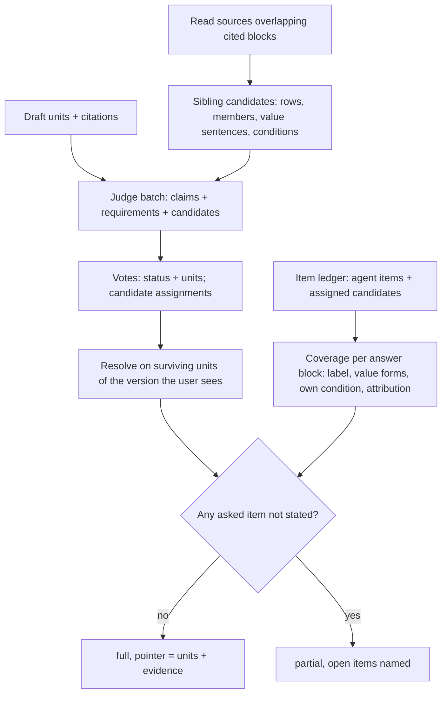
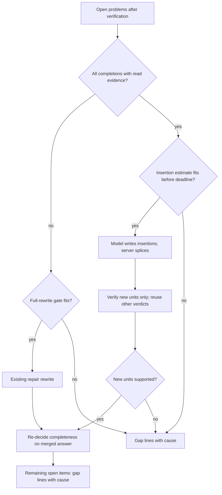
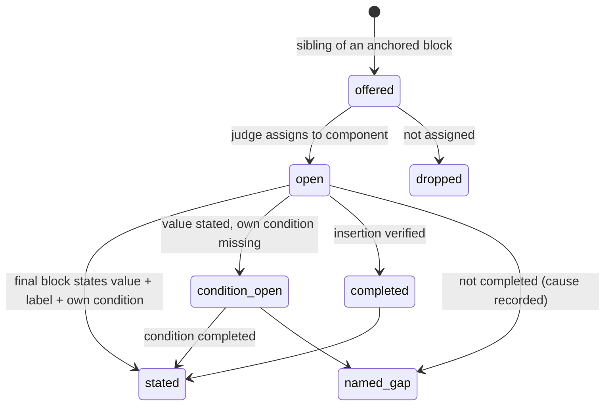
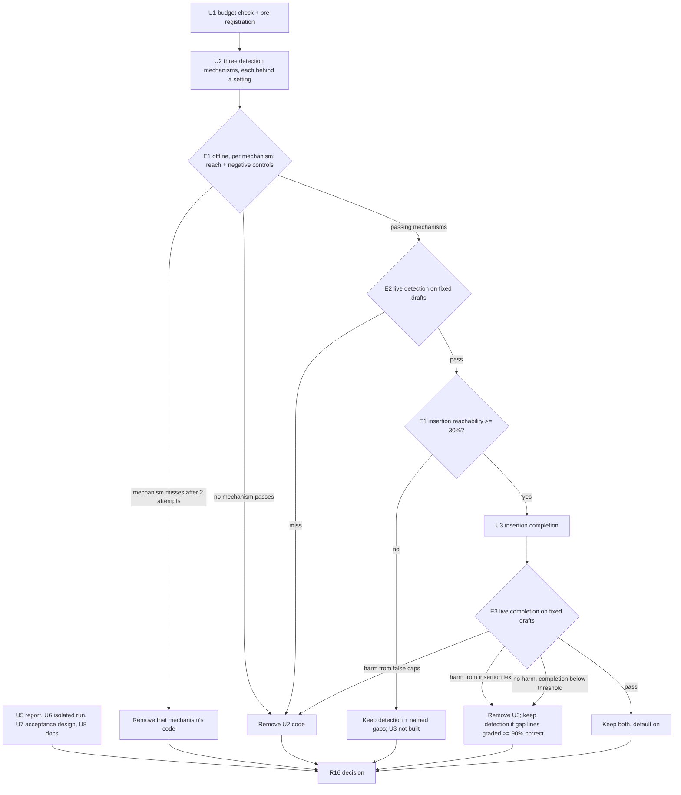

# Honest completeness, completion from read evidence, and pilot readiness - Plan

## Goal Capsule

- **Objective.** An appraiser who asks for a set of data (members, rows, annual amounts, a value and its condition) gets the parts the system already read in the answer. A part that could not be given is named with the reason. Before a controlled pilot, an office can run the system on a real model, report a problematic answer with everything needed to diagnose it, and work from instructions that state the measured limits.
- **Means.**
  - The completeness decision checks the final answer against what the read source holds next to what the answer used, inside the existing judge call (KTD1, KTD2, KTD3).
  - A detected gap is completed from the read evidence by a short insertion the model writes (KTD5, KTD6).
  - A gated, pre-registered experiment decides what stays (KTD8, KTD11).
  - Minimum operational pieces: a problem report (KTD9), an isolated real-model run (KTD10), an acceptance test and pilot instructions.
- **Authority.**
  1. The user's round-25 request and the session-settled Key Decisions.
  2. This plan's R-IDs.
  3. KTDs on mechanism.
  4. Units.
  - Project rules in `CLAUDE.md` bind every unit: public repository, data safety, host-only pytest, model split, PR update without merge or deploy.
- **Stop conditions.** Stop and report rather than proceed when:
  - an action would delete or replace appraisals, conversations, permissions, review decisions or stored data, or re-read stored documents;
  - a migration would be applied to the office database without a fresh `scripts/backup.sh` backup;
  - a paid run would push cumulative product-model spend past USD 15. Finish the unpaid work and report the estimated cost and exact scope instead;
  - an experiment misses its pre-registered threshold after its permitted attempts. Its change is removed, not tuned further;
  - a settled decision proves infeasible.
- **Execution profile.**
  - Opus diagnoses, sets the experiment rules, adjudicates grades and decides.
  - Sonnet implements units and reviews code and documents.
  - Haiku runs searches, test runs and small documentation edits.
  - Every subagent gets an explicit model.
  - One mechanism at a time: synthetic reproduction first, then the change behind a setting, unit and integration tests, the offline experiment, the live fixed-draft experiment, then keep or remove.
- **Finishes and ships.** The orchestrating session commits each unit and updates PR AriGabay/rag#2. It reports the outcome with exactly one of the three decisions in R16. No merge, no deploy, no automatic next round.

---

## Product Contract

### Summary

Make the completeness verdict prove itself on the final answer. When the turn read a table, list or passage and the answer used part of it, each further item the user asked for and the answer leaves out is detected and named. It is then completed from the text already read through a short model-written insertion that fits the turn's remaining time. Gate both changes on a small pre-registered experiment. Add the minimum operational pieces for a controlled pilot, each verified on a real model and synthetic data, and close the round with one of three decisions.

### Problem Frame

The round-25 reclassification traced each of the 202 required items missing from the last end-to-end measurement (106 final arm, 96 control) to its first loss point. The evidence is private, under `real_documents/tests/round25/diag/`.

| First loss point | Count |
|---|---:|
| (a) Missing or damaged in storage | 0 |
| (b) Never located | 36 |
| (c) Located but the needed context was not read (15 continuation cursors not followed, 10 outline entries not opened, 7 search snippets missing the sentence, 1 read skipped as already returned) | 33 |
| (d) Read but never written into the draft | 100 |
| (e) Written, then lost in verification or repair | 33 |
| (f) Wrongly graded missing | 0 |

Class (d) is half of the loss. Its shape: the answer gives a headline or a neighbouring figure from the same block and drops the rest. Examples are a total instead of its members, averages instead of annual amounts, a condition left out, table rows read and not written, and per-plot rows merged without attribution. In 52 cases the number is entirely absent, in 27 the headline is given and a member, component or condition is not, and 21 are textual.

Nothing asked for the missing parts because the completeness signals said the answer was complete:
- **The requirements trace said `full`.** It did so for 65% of the mapped class-(d) items, 61% across all classes.
- **The item ledger rarely listed the omitted part.** It listed it in only 25% of class-(d) cases.
- **`covered` did not mean "in the answer".** When the ledger did list the part, it was marked `covered` in 76% of cases, because the flag recorded use somewhere rather than presence in the final text.
- **Repairs were refused for time.** The repair gate refused in about a third of the turns that had open problems.
- **Gap lines did not name the item.** Only 6% of the missing items were named by a gap line.

The code map shows why:
- A `full` vote can never carry support (`valid_support`, `validated_support` in `backend/app/chat/verify.py`).
- Server-derived items never cap a `full` (`is_server_item` in `VerifyReport._resolve`).
- Candidate siblings are offered only from cited or ledger sources, with a request-word filter and caps (`items.candidates` in `backend/app/chat/items.py`).
- The ledger's `covered` audit accepts weaker attribution than `CONCEPTS.md` describes (`_attributed`, `_check_block`).
- A refused repair gate writes "read and not used" lines with no completion attempt (`backend/app/chat/engine.py`).
- The repair prompt gets only a source quote, not the item's label or value.
- A component the trace calls `full` never gets a gap line (`coverage.component_outcomes`).

Earlier rounds set the method. Round 24 kept none of its four fixes because each had no consumer or no reachable path (`docs/solutions/logic-errors/cell-context-for-the-judge-did-not-pay-off-measure-the-loss-before-the-fix.md`). A tools-off completion repair was once admitted in 0 of 34 turns (`docs/solutions/logic-errors/decide-fixes-on-paired-replays-and-check-every-consumer-of-a-loosened-test.md`). So reachability on recorded material is checked before anything is built on.

The product is not ready for a pilot operationally either:
- there is no way to report a problematic answer;
- regenerating an answer deletes its diagnostics;
- no real-model run on an isolated stack has been recorded;
- there are no pilot instructions.

### Key Decisions

- **Completeness is decided on the final answer, with a pointer to the answer part that fills each requirement and its evidence.** For list, aggregate and comparison requests it is also decided against the relevant items of the read sources that the answer omits, and a detected gap triggers a bounded completion from already-read evidence before any new search. (session-settled: user-directed — chosen over keeping the judge's first `full` verdict: false completeness blocked every repair.) Governs R1, R2, R6.
- **No new default judge calls, and the existing structures are reused:** requirements trace, `TurnRequirements` votes, item ledger, read sources, repair round. (session-settled: user-directed — chosen over a new completeness engine or an extra judge pass: rounds 22-24 showed parallel systems and extra judge calls did not pay off.) Governs R1, R2, R5.
- **An old `full` or `covered` never outranks a proven gap in the current answer, and completeness is re-decided after any completion.** (session-settled: user-directed — chosen over carrying the first verdict: it hid the gap from repair.) Governs R1, R6.
- **Instructions such as "attach sources" are performance requirements, not information to search.** (session-settled: user-directed — chosen over treating them as data to locate: earlier rounds reported them as missing information.) Governs R4.
- **Equivalent wording and valid calculations count as given, without literal matching to the source or a reference.** (session-settled: user-directed — chosen over literal matching: it produces false gaps.) Governs R3.
- **Meaning is kept.**
  - A value stays paired with its label, property, period, unit and conditions.
  - A calculation is judged by its inputs, assumptions and formula.
  - Judge disagreement or a timeout is not a contradiction in the source.
  - A gap line never counts as a completion.

  (session-settled: user-directed — chosen over replacing omissions with warning lines: a warning returns no information.) Governs R3, R7, R8.
- **Before broad change, a small decisive experiment is locked** on existing sources and drafts, with negative controls, numeric acceptance against the baseline and bounded attempts. End-to-end measurement runs only if the experiment justifies it. (session-settled: user-directed — chosen over changing first and measuring after: unmeasured changes regressed before.) Governs R9, R10.
- **Product models, OCR and the database are not replaced.** Stored appraisals, conversations, permissions and review decisions are not deleted or replaced without approval, and the store is not re-read in full. (session-settled: user-directed — chosen over wholesale replacement as a fix: the loss is in the decision logic, not in storage, where class (a) is 0.) Governs R6, R11, R12.
- **Customer data and keys stay out of code, tests, docs and git history.** (session-settled: user-directed — chosen over committing evaluation material: the repository is public.) Governs R9, R13.

### Requirements

**Completeness decision**

- R1. A component is reported complete only when units that survive in the answer version the user sees fill it, and the decision records those units and the evidence they cite.
- R2. When the answer draws on a read table, list or passage that holds further items the request asks for, each such item that the final text does not state makes the component incomplete and is named as an open item. This includes an item's own condition.
- R3. An item counts as stated when the final text gives its value with its own label, period, unit and condition, in any equivalent wording or number form, or as a valid calculation. A value paired with the wrong label, period, property or condition does not count.
- R4. Performance requirements (citations, layout, style) are judged on the form of the answer and never trigger a search or an information gap.
- R5. A narrow question is not expanded. Sibling rows, members and sentences count as asked only for a component that asks for a set: a list, every or each, a breakdown, a comparison, or a period range. They must also be assigned to it by the existing judge call, with words standing in both the request and the item. A request for one total of several items is a single datum (AE2). A single-datum component can be held incomplete only by its own datum's condition, never by a sibling.

**Completion of a detected gap**

- R6. A detected gap whose evidence the turn already read is completed from that evidence without a new search, inside the turn's time limit. The added text is written by the model and verified, and completeness is re-decided on the merged answer.
- R7. When a detected gap is not completed, the answer names the item (its source label and place) and the cause. It never states that the datum is absent, and such a line never counts as a completion. The causes are:
  - time;
  - step budget;
  - no further repair round;
  - invalid completion output;
  - the completion failed verification;
  - context not read.
- R8. A completion never removes or rewrites a unit that was already verified. Verdicts of unchanged units are reused, and a completion that fails verification leaves the earlier answer as it was.

**Measurement discipline**

- R9. A change to the completeness decision or to completion stays in the active path only after a pre-registered fixed-draft experiment meets its numeric thresholds. The experiment includes negative controls and mutations, and each experiment gets at most two attempts. A change that misses is removed from the code, not left behind a disabled setting.
- R10. Paid runs stay within the remaining budget (USD 15 in total, about USD 12.2 already spent, to be re-verified). Any run beyond the remainder is reported with its estimated cost and exact scope before it starts.

**Pilot operations**

- R11. A user can report a problematic answer of their own. The report keeps the message, conversation, cited source and run ids and a snapshot of the run's diagnostics, so a later retry or deletion does not lose it. An office admin sees only their own office's reports, and the export carries no document or answer text.
- R12. A recorded real-model run on an isolated stack with synthetic data covers the whole path, never touching the office database:
  - upload, processing progress, question, answer, opening a cited source with highlighting;
  - follow-up, refresh, retry and report;
  - cross-office denial;
  - a forced failure with a clear message and retry.
- R13. A pilot acceptance test is fixed before any run:
  - **Categories:** facts, standards, calculations, conditions and exceptions, tables, comparisons, multi-appraisal files, time preference, follow-ups, topic switch and return.
  - **References:** written from the sources, with plausible alternative readings, never taken from the system's answer.
  - **Metrics:** correctness, completeness, property attribution, conditions kept, calculations, reference usefulness, conversation continuity, time and cost, measured separately.
  - **Material:** regression and unseen material are separated, and the unseen material it still needs is listed exactly.
- R14. Pilot operating instructions and a proven-limitations document exist. Each stated limit carries a measured number or is marked unmeasured.
- R15. The pilot gates (allow and block) are defined before the acceptance test runs and are never changed after seeing results.
- R16. The round ends with exactly one decision, by the rule in R15: ready for a limited pilot under the tested conditions, blocked by a defined defect, or not enough evidence to decide.

### Acceptance Examples

- AE1. Covers R2, R5.
  - **Given:** the user asks for the building rights by component; the turn read a table with four component rows; the answer states only their total and cites the table.
  - **When:** completeness is decided.
  - **Then:** the component is incomplete and the four rows are open items, which the completion then states with their labels.
- AE2. Covers R5.
  - **Given:** the user asks for the total building rights only; the same table was read.
  - **When:** completeness is decided.
  - **Then:** the component is complete with the total, and no row is an open item.
- AE3. Covers R3.
  - **Given:** the answer writes "2.67 million" where the source writes 2,674,200, with the same label.
  - **When:** completeness is decided.
  - **Then:** the item is stated.
  - **Variant:** if the answer pairs that value with another row's label, the item is not stated.
- AE4. Covers R2, R3.
  - **Given:** the source states a value "subject to approval of the plan" and the answer states the value without the condition.
  - **When:** completeness is decided.
  - **Then:** the item is given but its condition is not; it is an open condition item, completed by stating the condition next to the value. The value is never removed for it.
- AE5. Covers R6, R7.
  - **Given:** a detected gap and too little time left even for an insertion.
  - **When:** the answer is finished.
  - **Then:** it names the item and says it was read and not completed for lack of time; the component stays incomplete.
- AE6. Covers R11.
  - **Given:** a user reports an answer and then retries it.
  - **When:** an admin opens the report.
  - **Then:** the report still holds the snapshot and ids, and its message link is empty.

### Success Criteria

- On the fixed-draft experiments, the thresholds pre-registered in U1 are met (detection in E2, completion in E3) with no rise in wrong pairing or lost conditions.
- The isolated real-model run passes every step of R12, with screenshots and run ids recorded privately.
- The final report states which mechanism caused the loss, what was replaced in the active path, what improved, what regressed and the pilot decision, with the numbers behind each. Improvements are stated as shown on exposed (regression) material until the unseen set of U7 runs.

### Scope Boundaries

- Class (b) locating and class (c) reading (continuation cursors, outline entries, snippet windows) are not changed this round. Some of them are named as gap causes (R7).
- Class (e) losses in verification are not reworked. The round-23 confirming-reading policy stays as it is.
- No change to OCR, ingestion, the letter-spacing detector, the product model or the judge model.
- Retry keeps deleting the old message. The report snapshot (R11) is what preserves the record.

#### Deferred to Follow-Up Work

- Following unread continuation cursors and unopened outline entries before writing (class c, 33 items). Taken up only if this round's experiment justifies another round.
- The pilot acceptance end-to-end run (final vs control, two repetitions), if the remaining budget cannot cover it. The cost estimate and exact scope go to the user (R10).
- Fixing the letter-spacing detector at ingestion (needs owner approval to re-read stored documents).

---

## Planning Contract

### Key Technical Decisions

- KTD1. **Detect omitted asked items inside the existing requirements judge call.**
  - **Today:** the call is offered sibling candidates and may assign them to components. An assigned candidate already enters the ledger as an open item that caps `full` while unstated (`add_candidate_items`, round 18 U6).
  - **The change:**
    - a wider offer (KTD2 anchors, set components only);
    - an assignment counts only from a vote that sees the component's surviving unit;
    - policy text telling the judge to assign candidates even when it votes `full`.
  - **Cost:** no new call is made. Only the `<candidates>` block and the policy text change, and `JUDGE_VERSION` is bumped. Inherits the first two Key Decisions' labels (Governs R1, R2, R5). (session-settled: user-directed — chosen over a separate completeness judge pass or a new engine: no new default judge calls.)
- KTD2. **Anchor siblings on the evidence of the units that fill the component, including overlapping read sources.**
  - **Today:** anchors are the sources cited by surviving units plus ledger sources (`items.candidates`).
  - **Added:** a read source becomes an anchor when it returned the same block, or an overlapping block range, of the same document version, reading and appraisal unit as a cited source. An example is the same table returned under another S#. Matching on the appraisal unit keeps a multi-appraisal file's identical row labels from pulling in another unit's rows.
  - **Unchanged:** the limits of 4 sources and 20 candidates per source, the request-word filter and `valid_candidates` (judge assignment with words in both).
  - **Set components only:** sibling candidates are offered only for a component that asks for a set (R5). A cue list in `backend/app/chat/request.py` decides this from the frozen component and request text, with the request analysis's child components counting as a set. Single-datum components get only their own datum's condition check (KTD3).
  - **Caps:** a server-derived candidate caps `full` only when the judge assigned it in a vote whose units include a surviving unit of that component. Each batch scores only its own units, so an assignment from a batch that cannot see the component's answer never caps. A server item the judge did not assign never caps, as today.
  - **Rationale:** the loss is "same block, other part". This anchors exactly that block, without reading the whole turn's material into the call.
  - **Measurement before widening:** E1 measures how many of the class-(d) parts the widened anchors reach. If the reach falls short, the one pre-written second attempt also anchors uncited read sources of the same appraisal unit and section. Its cost is measured the same way.
- KTD3. **Condition completeness.** An item whose own source states a condition (negation, "only", an exception, "subject to", a status, a method, or a time or component limit, from `condition_spans`) counts as stated in full only when the giving block also states that condition in equivalent words. Otherwise its state is `partial` with the condition missing. That feeds the existing `CONDITION_FOUND_CHECK` completion route rather than a new one. Today condition words are checked only when a rival item shares the signature. The value is never removed for a missing condition, per `CONCEPTS.md` "Item ledger".
- KTD4. **`covered` requires attribution to the item's own source for value-bearing items.**
  - **Removed:** the `audit` fallbacks that accept an uncited block, and the `_attributed` rule that accepts any passage of the same unit holding a value of 4 or more digits. For a value-bearing item they now count only when the block states the item's own row or label words and its headline number forms.
  - **Unchanged:** number-form equality (`_number_forms`) and the round-23 rule that an uncited table body row inherits its table's citation.
  - **Rationale:** these two rules produced most of the 76% false `covered`. The E1 negative controls measure the false-gap cost on answers graded complete before the change is kept.
- KTD5. **Completion by insertion, written by the model.**
  - **When:** every open problem of an attempt is a completion with read evidence (`text_found`, `condition_found`, or a capped item from KTD1 or KTD3).
  - **What the model returns:** only the sentences or rows to add, each naming the existing unit it follows (or the component's list it extends) and citing the item's source. Its instructions carry, per item, the label, value, own condition and verbatim quote, which today's repair prompt does not send.
  - **What the model returns, checked:** a strict schema validator. A reply that rewrites existing text, or names an anchor outside the shown units, is rejected as `invalid_output`, with no fallback to a full verification.
  - **Placement:** anchors are the unit indexes shown to the model.
    - A sentence goes after its anchor.
    - A list member becomes a new bullet at the anchor's level.
    - When the anchor is a table, the insertions become bullets directly after the table. Tables are never edited cell by cell in this round.
    - If the anchor unit is gone, the insertion follows the component's last surviving unit; if there is none, it goes at the end of the body, before the gap paragraph (the `restore_lost` ladder).
  - **Progress:** the step shows its own Hebrew progress label, saying that missing items from the read sources are being added. A second label covers verifying the additions. The existing "repairing claims" wording is not reused.
  - **Verification:** the server splices into the answer text before composing, so `assert_fixed_point` holds. It runs the deterministic checks over the merged answer, which catch duplicates and same-datum conflicts with existing sentences. Only the new units go to the judge, batched with their neighbouring units as context. Verdicts of unchanged units are reused through `VerdictCache`.
  - **Who sets `full` after insertion:** a server rule, with no re-vote. It applies only to a component whose status below `full` came entirely from named open items (caps, judge-support items, condition items). Such a component becomes `full` when every one of those items is now stated in the merged text (KTD4 coverage). A component whose judge vote is itself `partial`, with a free-text missing part, keeps `partial` and its component gap line after insertion. E3 reports those components separately from item-level completions. This is the conservative direction: an older vote never raises a status above what the merged text proves.
  - **Other problems:** problems that are not completions keep the existing full-rewrite repair.
  - **Rejected alternative:** a server-composed value row. It would be server text covering a ledger item, which `model_units` and `CONCEPTS.md` "Server addition" forbid, and it would need a new span kind and audit.
  - **Rejected alternative:** a full rewrite. It costs as long as the original answer step, which is why the gate refuses.
- KTD6. **Time gate for insertion.**
  - **Admission:** an insertion is admitted only when both of its fixed costs fit:
    - the insertion step must end before `deadline`;
    - one judge call for the new units must then fit the verify allowance. Its cost is taken from the measured first-call p99 behind `JUDGE_FIRST_CALL_MIN_SECONDS`, about 40 s.
  - **The estimate:** the insertion step's estimate is a fixed cost, provisionally 20 s and then set from E3's measured times, not a per-item formula. It is recorded.
  - **Full rewrites:** the existing `1.5 × answer_seconds` gate stays for them.
  - **Failure:** if the new units cannot be verified in time, nothing is spliced. An insertion that times out or fails validation leaves the verified answer unchanged (R8) and turns its items into cause-named gap lines (R7).
  - **Reachability:** before U3 is built, E1 counts how many recorded turns with detected gaps had a gate window that admits the insertion. A tools-off completion was once admitted in 0 of 34 turns, so this is checked first.
- KTD7. **Gap lines name item and cause, and incomplete components get them.** These lines are part of detection (U2) and stay whenever any detection mechanism is kept. Only the two completion causes (`completion_invalid_output`, `completion_failed_verification`) belong to U3.
  - A component capped by KTD1 or KTD3 is `partial`, so it reaches `component_outcomes` and its item lines, as `UNMET` components do today.
  - Item lines keep naming the source row label and place (`item_line`) and gain the cause per item from the attempt record:
    - `not_completed_time`
    - `not_completed_steps`
    - `not_completed_settled`: a requirement-only problem gets no second round
    - `completion_invalid_output`
    - `completion_failed_verification`
    - `context_not_read`
  - A line never states the value. A server span never covers an item (`model_units` unchanged).
- KTD8. **Each mechanism sits behind its own setting until its experiment decides.**
  - **Settings:**

    | Setting | Mechanism |
    |---|---|
    | `chat_sibling_anchors` | KTD1, KTD2 |
    | `chat_condition_check` | KTD3 |
    | `chat_own_attribution` | KTD4 |
    | `chat_insert_completion` | KTD5, KTD6 and the two completion causes |

  - **Gap lines:** the KTD7 gap lines are on whenever any of the three detection settings is on.
  - **Measurement:** E1 measures each detection mechanism alone (one ablation arm each) and in combination. E2 runs the combination of the mechanisms that passed E1.
  - **Pass:** the default becomes on and the setting stays as an operator off-switch.
  - **Miss:** the code is removed. The plan does not leave an unused path, which is the round-24 lesson.
- KTD9. **The problem report is a snapshot.**
  - **Table:** a new `answer_reports` table (migration 0024).
    - Identity: office, reporter, conversation id and message id (both `ON DELETE SET NULL`), category, a short note and created time.
    - Snapshot: a structural copy of the message's diagnostics, built by an allowlist. It keeps:
      - problem kinds, checks and reasons as codes;
      - statuses and component outcomes;
      - timings and the `repair_gate` record;
      - cited source ids;
      - structural locator fields (document, version and reading ids, block, table and row indexes, page);
      - counts.

      It keeps no drafts, answer text, quotes, labels, row or cell text, or failure free text. The reporter's note is the only free text in the row.
    - Run ids: message id, the build's commit sha and the model ids.
  - **Why structural:** the snapshot survives a retry, so diagnosis needs no copy of customer text. A deleted conversation leaves no answer or document text behind, and a developer who needs text rebuilds it from the locators inside the office.
  - **Access:** RLS gives owner insert and owner-or-admin read, the same shape as `message_diagnostics` (0008). The office is taken from the session (`app/deps.get_ctx`). The admin cannot read messages under owner-only RLS, so everything the admin sees lives in the report row.
  - **Admin views:**
    - **Detail view:** category, note, message status, created time and the structural snapshot. It shows only document ids visible to the admin (`_visible_ids`), and the read is audited like `chat.diagnostics.read`.
    - **Export:** the structural snapshot without the note, with the same visibility filter. This is what an office sends to the developer.
  - **Concurrency:** a report takes the same advisory lock as retry. Racing a retry or a conversation delete yields 404 or 409, never a foreign-key error.
  - **Message states:**
    - running → 409;
    - done, failed, clarification and cancelled answers → allowed;
    - a user message → 404;
    - a second report by the same user → updates the first.
  - **Tests:** the new table joins the test `_TABLES` list.
  - **Rationale:** retry deletes the message and cascades to its diagnostics (`chat/api.py` retry). Snapshotting at report time keeps the evidence without changing retry. Changing retry would itself change stored conversations.
- KTD10. **The isolated stack is a standalone compose project with its own name, ports and volumes.**
  - It runs the same images and seeds the synthetic eval office C through `backend/scripts/seed_eval_office.py`, with explicit URLs.
  - **Standalone file:** `docker-compose.isolated.yml` is a complete compose file, not an override. It has its own `name`, host ports and named volumes, and the same Dockerfiles. It is used alone with `-f`. The installed Compose is 2.7.0, which has no `!override`, and layering on the base file would merge the office ports 5433, 8000 and 3000. `docker compose config` must show none of those ports before `up`.
  - **Environment:** the env file lives at `real_documents/tests/round25/ops/isolated.env`, which is already gitignored. It holds the provider key copied from `.env`, with fresh database and session secrets. `isolated_stack.sh` passes it with `--env-file` and refuses to start unless `git check-ignore` confirms the path. The key is never printed.
  - **Frontend:** it is built with the default `BACKEND_URL=http://backend:8000`, a service name that resolves inside the isolated project's own network. The walkthrough confirms in the network log that requests reach the isolated backend.
  - **Seed scripts:** they gain a guard. They print the target, require a stack marker (`RAG_STACK=isolated`) or an explicit confirmation flag, and refuse the office ports and the office database name otherwise.
- KTD11. **Experiments are private, pre-registered and graded blind.**
  - **Where:** under `real_documents/tests/round25/`, never committed.
  - **Locking:** each experiment's rules, populations and thresholds are written with a sha256 before its first result.
  - **Grading:** Sonnet graders judge against the source, without the arm and without the system's claim of completeness. Opus adjudicates disagreements, and undecidable cases are reported.
  - **Replay limit:** read-but-uncited source texts are not in `message_diagnostics`. They are rebuilt from the harness run records the round-25 diagnosis used, plus office-DB block text read-only through `tests/support/replay.rebuild_source_text`.
  - **Labelled regression:** all E1-E3 material is exposed. Results are reported as in-sample regression evidence, never as generalisation, until the unseen set of U7 runs.
  - **Design and evaluation halves:** the set-request cue list and any word filter are written only from control-arm class-(d) cases. The thresholds are evaluated on the final-arm population.
  - **Data boundary:** as in rounds 21-24, real-document text from office A goes only to two places. One is the product model provider, under that office's cloud-sending setting, for the live judge and insertion calls. The other is Claude subagents of this session for grading. Neither the text nor the grades leave `real_documents/`.
- KTD12. **Spend is accounted from recorded costs.**
  - Cumulative spend is re-verified first from the round ledgers and run cost records. The provider-side balance is checked only if a read-only usage view is reachable without printing a key. Otherwise the ledger total is reported as the verified figure, with that limit stated.
  - **Plan of spend against a remainder of about USD 2.8, re-verified in U1:**

    | Item | Cap (USD) | Note |
    |---|---:|---|
    | E1 | 0 | offline, two attempts allowed |
    | E2 dry run | 0 | counts rendered characters only |
    | E2 | 1.2 | one attempt |
    | E3 | 0.8 | one attempt; it measures the insertion step itself, so there is no separate paid dry run |
    | Operational run | 0.3 | |
    | Reserve | ~0.5 | provider retries only |

    A second paid attempt is not available. The acceptance end-to-end is not in this budget, so without new budget the R16 decision cannot be "ready". The final report gives that run's cost estimate and scope, as R10 requires.

Bake-off: not run. Two completion mechanisms survived research, insertion and full rewrite. Choosing between them is judgment on known costs, since the gate refuses rewrites for time, not something further development would settle. Reversing it is a settings change, not a data-shape commitment.

### High-Level Technical Design

The completeness decision with the sibling check, for one information component:

The repair decision after verification:

Item state transitions within one turn, as decided on each answer version:

The round's gating sequence:

### Assumptions

- The harness run records of the round-23 closure measurement hold the returned text of every tool call, as the round-25 diagnosis used them. If they do not, E1 rebuilds read sources from the office DB block ranges recorded in `timing.reads`. Its population is then limited to needs whose read range is recorded, and the shrinkage is reported.
- The requirements judge assigns offered candidates when it votes `full`, since assignments are accepted on any vote status. E2 measures this. Before E2 the plan does not assume the judge does so often.
- About 40 distinct final-arm turns carry the 55 final-arm class-(d) needs. The E2 and E3 sizes and costs are set by dry runs, not by this estimate.
- The eval documents seeded by `seed_eval_office.py` are synthetic, as the script's own guard for office C implies. U6 confirms this before upload.
- The user's uncommitted working-tree changes (`.gitignore`, `backend/pyproject.toml`, `backend/uv.lock`, `backend/extrenal_api/`) are theirs and unrelated. They are never staged, committed or modified.

### Sequencing

- U1 comes first.
- U2 comes next. Its experiments E1 and E2, with E1's insertion reachability, decide whether U3 starts.
- U4 accompanies U2 and U3.
- U5, U6, U7 and U8 do not depend on the experiments and can be built in parallel by separate workers on disjoint files.
- U8's limitations text waits for the experiment numbers.
- U6's walkthrough runs on the final code.
- **Migration 0024 and the office database.** The office stack's `backend` and `worker` wait for `migrate`, which runs `alembic upgrade head`. So the first office-stack rebuild after `0024_answer_reports.py` is in the built code applies it to the office database. That rebuild comes after a fresh `scripts/backup.sh` logged in the ledger. Prefer finishing E2 and E3, which use the office-stack harness, before U5's migration lands in the built code.

---

## Implementation Units

### U1. Budget check and pre-registration of E1-E3

- **Goal:** know the true remaining budget and lock the experiments before any result exists.
- **Requirements:** R9, R10.
- **Dependencies:** none.
- **Files (private, never committed):**
  - `real_documents/tests/round25/prereg.md` and `prereg.sha256`
  - `real_documents/tests/round25/ledger.md`
  - `real_documents/tests/round25/exp/` (harness scripts, populations, results)
- **Approach:**
  1. Re-total product spend from the round 21-24 ledgers and run cost records. Report the verified remainder and its source.
  2. Fix the populations, using ids only.
     - **E1 and E2:** the 55 final-arm class-(d) needs.
     - **Negative controls:** 30 turns drawn with seed 20261029 from final-arm turns whose required needs were all graded correct.
     - **Narrow-question stratum:** at least 10 of the 30 must be single-datum questions whose cited block holds sibling rows or members sharing a request word. They are drawn first with the same seed, from both arms if needed.
     - **E3:** the needs E2 detects.
  3. Fix the mutations. They are built on 15 negative-control turns that state at least two members of one block:
     - m1: delete one stated member;
     - m2: reword it equivalently (number form, word order, synonym);
     - m3: swap the values of two members;
     - m4: drop a stated own condition.
  4. Write the thresholds below verbatim into `prereg.md`, hash it, and only then run anything.
- **Pre-registered thresholds (baseline = the same harness with both settings off):**
  - **E1, offline, no model calls.** It is reported per mechanism (KTD2, KTD3, KTD4 alone) and for their combination. It counts reach, meaning the missing part of a class-(d) need is offered as a candidate or listed as an item.
    - Reach, for the combination: NEW ≥ OLD + 30 percentage points, and NEW ≥ 50%.
    - Each mechanism is kept only if it adds reach or it is the condition check for the class-(d) needs whose missing part is a condition, and it passes its own negative-control bound.
    - Cost guard: the median added `<candidates>` characters per requirement batch is ≤ 3,000.
    - Insertion reachability, which decides whether U3 is built: among recorded final-arm turns where the NEW decision would detect a gap, the recorded `repair_gate` window admits the KTD6 insertion estimate in ≥ 30% of turns. The 40 s judge allowance and a 20 s provisional step cost are used, as E3 itself measures the step.
    - Single-datum guard: zero sibling caps on the narrow-question stratum (count). Each stratum question's set or single classification by the cue list is graded blind against the question text.
    - Negative controls, per mechanism: items covered OLD and not covered NEW on graded-complete answers are ≤ 3% of their items. Each one is graded blind.
    - Attempts: at most 2 (offline). The second is only the pre-written KTD2 widening, or a fix of a defect named in writing before the rerun.
  - **E2, live, the existing judge call with the shipped packing, N = 2 calls per arm per case, one attempt.** Detected means the component is not `full` and an open item overlaps the missing part.
    - Detection: a case counts as detected only when both calls detect it, and the same rule applies to both arms. One-one splits are reported separately. NEW detects ≥ OLD + max(8, 25% of eligible) needs.
    - False caps: NEW on negative-control components (a cap in either call) ≤ OLD + 2 and ≤ 10%. On the narrow-question stratum, zero sibling caps in any call.
    - Mutations, NEW, any call: m1 caught ≥ 80%; m2 false ≤ 10%; m3 counted stated = 0; m4 caught ≥ 70%.
    - Budget: ≤ USD 1.2, set by a dry-run estimate. If over, the 30 negative-control turns are cut to 20 first, then the needs are sampled with the fixed seed.
  - **E3, live, completion on the E2-detected gaps, fixed drafts, N = 1, one attempt.** Completions are graded blind against the source. Each wrong addition is attributed either to a false cap (U2) or to the insertion text (U3) before the keep or remove decision.
    - Correctly completed and kept in the final answer: ≥ 40% of the eligible detected gaps.
    - Wrong additions (pairing, lost condition, wrong attribution or calculation): ≤ 10% of completions, and 0 kept wrong pairings.
    - Verified content lost: 0.
    - Median insertion plus verification ≤ 30 s.
    - Gate fit: the insertion fits the recorded gate window in at least twice as many turns as a full rewrite.
    - Budget: ≤ USD 0.8.
    - **Partial pass:** detection alone is kept (U3 removed) in two cases: completion below threshold without harm, or harm traced to the insertion text. Its named gap lines must then be graded correct ≥ 90%. Harm traced to false caps removes U2 as well.
    - Components that keep a judge `partial` with a free-text missing part (KTD5) are reported separately and are not counted as completions.
- **Execution note:** the hash is written before the first E1 number is computed. Any later change is an amendment that records the reason and leaves thresholds unchanged, as round 24's Amendment 1 did.
- **Test expectation:** none -- private experiment material, no product behaviour.
- **Verification:** `prereg.sha256` matches, `ledger.md` states the verified remainder, and no result file predates the hash.

### U2. Sibling check in the completeness decision

- **Goal:** a component is `full` only when no asked item from the block the answer used is left unstated, value-bearing items need their own attribution, and an item with its own condition needs that condition.
- **Requirements:** R1, R2, R3, R4, R5, R7. Implements KTD1-KTD4 and the KTD7 gap lines, each mechanism behind its own setting (KTD8).
- **Dependencies:** U1.
- **Files:**
  - Modify: `backend/app/chat/items.py`, `backend/app/chat/verify.py`, `backend/app/chat/coverage.py`, `backend/app/chat/request.py` (set-request cue), `backend/app/config.py`
  - Test: `backend/tests/unit/test_items.py`, `backend/tests/unit/test_coverage.py`, `backend/tests/unit/test_gap_audit.py`, `backend/tests/unit/test_request.py`, `backend/tests/integration/test_chat_completeness.py`
  - Create: `backend/tests/unit/test_sibling_check.py`
- **Approach:**
  1. Extend the anchors in `items.candidates` per KTD2. Matching goes by document, version and block range through the `Source` fields, as `_same_window` did in round 23.
  2. In `add_candidate_items`, accept an assignment into the ledger only from a vote whose units include a surviving unit of that component. Accepted candidates cap in `VerifyReport._resolve` as today, and `is_server_item` items stay out of caps.
  3. Add the condition requirement per KTD3 in `_check_block` and `_value_check`. The outcome is `partial` with `missing` naming the condition, so `_check_requirements` emits the existing condition problem.
  4. Narrow the `audit` fallbacks and the ≥ 4-digit `_attributed` rule per KTD4, for value-bearing items only.
  5. Record the pointer, meaning the deciding units and their cited evidence ids, on `decision.rests_on`. This is already partly there, and U4 completes it.
  6. Update the requirements-policy text so a `full` vote still assigns candidates. Bump `JUDGE_VERSION`.
  7. Write the KTD7 gap lines with the causes that do not depend on insertion (`not_completed_time`, `not_completed_steps`, `not_completed_settled`, `context_not_read`). Let partial components reach `component_outcomes`.
  8. Add the set-request cue list to `request.py`, written from control-arm cases only (KTD11).
- **Patterns to follow:** `items._raws`, `items.candidates`, `valid_candidates`, the `condition_spans` and `rival_rows` logic, and the round-23 `_same_window` overlap test in `verify.py`.
- **Test scenarios:**
  - Covers AE1. A table of four component rows read; the answer gives the total citing the table; the judge (scripted) assigns the rows to the component. The status is `partial` and the four rows are open items naming their labels.
  - Covers AE2. The same table and a total-only request; the scripted judge assigns nothing. The status is `full` and no open item exists.
  - The table is returned under S3 and S7 (same block range), and the answer cites only S7. S3's rows are offered as candidates once, without duplicates.
  - A read source from another block of the same document is not an anchor under the first attempt.
  - Covers AE3. The answer writes "2.67 million" for 2,674,200 with the row label: covered. The same number under a neighbouring row's label: not covered (row status).
  - Covers AE4. The source row states the value with "subject to approval"; the answer states the value only. The item is `partial` with the condition missing, a condition problem is emitted, and the value is not removed.
  - A negation carried by the datum itself ("not including VAT") repeated in the answer counts as the condition stated.
  - An uncited paragraph states the item's number and label. With the change it is not covered for a value-bearing item; a table body row without its own citation is still covered through the table's citation.
  - A server-derived `source`-origin item that the judge did not assign never caps.
  - A batch whose units do not include the component's surviving unit assigns a sibling. That assignment does not cap.
  - A bound file holds two appraisal units whose tables share row labels, and the answer cites unit 1's table. Unit 2's rows are never offered.
  - Single-datum question ("what is the value of the apartment?"), with the source's table holding further rows that share a request word. No sibling is offered and the status is `full`. The value's own condition, if the source states one, can still open a condition item.
  - An instruction component ("attach sources") never gets candidates, never caps for information, and is decided by form as today.
  - A comparison answer with two units: each side's siblings are checked against that side's block only. No row of property A becomes an item of property B.
  - A follow-up turn that narrows to one member: the other members are not asked for and never cap.
  - With the settings off, every existing test in `test_items.py`, `test_coverage.py` and `test_gap_audit.py` passes unchanged.
  - Each setting alone: only its own mechanism changes decisions (one test per setting on the AE1 and AE4 fixtures).
  - A capped component gets an item line naming the row label, its place and the cause `not_completed_time` when no completion ran. The line never states the value.
  - The cue list classifies "what are the components of the building rights" and "compare the two values" as sets. It classifies "what is the total" and a plural noun inside a single-datum question as single.
- **Verification:**
  - The scenarios pass with the settings on.
  - With the settings off, the existing tests pass unchanged, and the private E1 harness gives identical decisions on the E1 population for the base commit and the settings-off build.
  - E1 then E2 run per U1, and the result is recorded in the ledger.

### U3. Completion by insertion and its time gate

- **Goal:** a detected gap with read evidence is completed by a short model-written insertion that fits the remaining time, or is named with its cause.
- **Requirements:** R6, R7, R8. Implements KTD5, KTD6 and the two completion causes of KTD7, behind `chat_insert_completion` (KTD8).
- **Dependencies:** U2 with E2 passed, and E1 insertion reachability ≥ 30% (U1).
- **Files:**
  - Modify: `backend/app/chat/engine.py`, `backend/app/chat/verify.py`, `backend/app/chat/coverage.py`, `backend/app/chat/compose.py` (only if the splice needs a document helper), `backend/app/config.py`
  - Test: `backend/tests/unit/test_coverage.py`, `backend/tests/unit/test_chat_timing.py`, `backend/tests/integration/test_chat_limits.py`, `backend/tests/integration/test_chat_completeness.py`
  - Create: `backend/tests/unit/test_insert_completion.py`, `backend/tests/integration/test_chat_insert_completion.py`
- **Approach:**
  1. A new repair contract `INSERT`, next to `REPAIR` and `REWRITE` in `engine.py`.
     - Schema: a list of insertions, each with an anchor unit index or component list, text and citations.
     - Prompt: each open item's label, value, own condition, source id and verbatim quote.
     - Progress: its own two progress steps (KTD5).
  2. Gate per KTD6. The estimate constants are recorded in `repair_gate` (U4).
  3. Splice the insertions into the verified answer as model text, per the KTD5 placement rules, before composing.
  4. Verify through the ordinary path. Unchanged units reuse `VerdictCache`, and only new units are judged. `restore_lost` is unaffected because no verified unit changes.
  5. If any insertion fails verification, drop only that insertion. Its item becomes a gap line with cause `completion_failed_verification`.
  6. Re-decide completeness on the merged answer (`coverage.compose_components`).
  7. Add the two completion causes to the item gap lines of KTD7, and keep `item_line`'s rule of never stating the value.
- **Patterns to follow:**
  - `REWRITE` and `text_completion_only` for the completion-only test;
  - `restore_lost` for splicing model text and re-verifying;
  - the `test_chat_limits.py` gate tests (monkeypatched time constants) for gate behaviour.
- **Test scenarios:**
  - Covers AE1. Four open row items; the scripted agent returns four insertions anchored after the total. The final answer states the rows with labels and citations, the component is `full`, and the pointer names the inserted units.
  - The scripted agent returns a full rewrite instead of insertions. It is rejected as a schema mismatch, the verified answer is unchanged, and the items get gap lines with the cause.
  - One of two insertions is unsupported by the judge. Only it is dropped, the other is kept, and the dropped item's line names `completion_failed_verification`.
  - An insertion contradicts an existing verified sentence (another value for the same label). It fails verification and the existing sentence is untouched.
  - An insertion duplicates a datum already stated in other words. It is not counted twice, and the coverage decision is unchanged.
  - The anchor unit was cut earlier in the attempt. The insertion is appended to the component's block, not lost.
  - Covers AE5. Gate: with `insertion_estimate` larger than the remaining time, no call is made. Items get `not_completed_time` lines and `repair_gate.refused_by` records `time`.
  - Gate: with time enough for an insertion but not a rewrite, the insertion is admitted. A test with monkeypatched clocks proves the two gates differ.
  - The agent times out mid-insertion. The verified answer stands, the items are named with the cause, and no partial text appears.
  - A mixed attempt (one failing claim and one completion). The existing full-rewrite repair is used, not insertion.
  - The setting is off. The existing repair behaviour is unchanged (existing `test_chat_limits.py` and `test_verify_cache.py` cases).
  - The final check's `assert_fixed_point` reproduces the saved text after an insertion (integration).
  - Server re-decision: a component held `partial` by two open row items, where both are stated after insertion, becomes `full` with no new vote. A component whose judge `partial` names a missing part that no inserted item states stays `partial`.
  - A list-member insertion becomes a bullet at the anchor's level. An insertion anchored on a table lands as bullets directly after the table, and the table is unchanged.
  - While an insertion runs, the message shows the insertion progress label, not the repair label.
  - Time: the judge allowance for the new units does not fit after the step. Nothing is spliced and the items get `not_completed_time`.
  - A requirement-only problem after the first repair round (`settled`) gets the cause `not_completed_settled`, not a silent omission.
- **Verification:** the scenarios pass, E3 runs per U1, and the keep or remove decision is applied per KTD8.

### U4. Completeness and completion records in the turn diagnostics

- **Goal:** a measurement and a problem report can show, per component, why it was decided complete or not and what happened to each open item.
- **Requirements:** R1, R7, R11.
- **Dependencies:** U2. Extended with U3.
- **Files:**
  - Modify: `backend/app/chat/verify.py` (`requirements_trace` decision record, `item_diagnostics`), `backend/app/chat/engine.py` (`repair_gate` record)
  - Test: `backend/tests/unit/test_verify_confirm_record.py` (pattern), new `backend/tests/unit/test_completeness_record.py`, `backend/tests/integration/test_chat_confirm_diagnostics.py` (pattern)
- **Approach:**
  1. Per component decision, record the pointer (units and evidence ids), the open items that capped it (id, label prefix, source id, kind: sibling or condition) and the anchor sources offered.
  2. Per attempt, record the gate inputs for insertion (estimate, window, decision), the number of insertions offered, kept and dropped with reasons, and the seconds taken.
  3. Bound every list as the existing records are bounded (`CONFIRM_RECORD_KEPT` pattern) and keep label and quote prefixes short.
- **Test scenarios:**
  - A capped component records its two open items with source ids and kind `sibling`.
  - An insertion attempt records estimate, window, decision `admitted`, 2 offered, 1 kept, 1 dropped `unsupported`.
  - A refused insertion records `refused_by: time` and no call.
  - The record survives the diagnostics round trip through `GET .../diagnostics` (integration).
- **Verification:** the record keys appear in `message_diagnostics.resolution` of a scripted turn, and the E3 harness reads them without parsing prose.

### U5. Report a problematic answer

- **Goal:** a user can flag their own answer and an admin can diagnose it later, even after a retry, without exposing document or answer text in the export.
- **Requirements:** R11. Implements KTD9.
- **Dependencies:** U4 for the richer snapshot. It works without U4.
- **Files:**
  - Create:
    - `backend/alembic/versions/0024_answer_reports.py`
    - `backend/app/chat/reports.py` (or a section of `backend/app/chat/api.py`, decided by its size)
    - `backend/tests/integration/test_migration_0024.py`
    - `backend/tests/integration/test_answer_reports.py`
    - the `_TABLES` list in `backend/tests/conftest.py` gains the new table
    - `frontend/e2e/answer-report.spec.ts`
  - Modify:
    - `backend/app/routes.py`, `backend/app/chat/api.py`
    - `frontend/components/chat/Message.tsx`, `frontend/components/chat/ChatApp.tsx`, `frontend/lib/api.ts`
    - an admin screen under `frontend/components/` (the existing admin settings area)
    - `docs/api-contract.md`
- **Approach:**
  1. Migration 0024, with an upgrade and a downgrade:
     - the table per KTD9, with an index on (office_id, created_at);
     - RLS policies mirroring `message_diagnostics` (0008), with owner insert;
     - `message_id` and `conversation_id` set NULL on delete.
  2. `POST /api/chat/messages/{id}/report` with category (`wrong`, `missing`, `wrong_source`, `wrong_property`, `other`) and a note of at most 1,000 characters.
     - Owner only, assistant message only, any final status including failed. Other users get 404.
     - It builds the structural snapshot of KTD9 from the message's diagnostics through the allowlist, with build sha and model ids.
     - A second report of the same message by the same user updates the existing one.
  3. `GET /api/admin/answer-reports` (office admin) lists reports newest first, with id, category, message status and created time.
  4. `GET /api/admin/answer-reports/{id}` returns the detail view of KTD9, audited like `chat.diagnostics.read`.
  5. `GET /api/admin/answer-reports/{id}/export` returns the export of KTD9.
  6. The user's UI, built on the existing `Dialog` in `frontend/components/ui.tsx`:
     - **Where:** a "דווח על תשובה" action beside copy and regenerate on done and clarification answers. It also appears inside the failed and cancelled message blocks regardless of whether the message is last, and never on a running message.
     - **Dialog:** the five categories have Hebrew labels and none is preselected. Submit is disabled until one is chosen. The 1,000-character limit on the note is visible.
     - **Submitting:** submit is disabled with progress text while sending. 409, 404 and 422 each get their own inline error text.
     - **Success:** the report id is shown with a copy control and announced through an `aria-live` region.
     - **Reported state:** a reported message shows a marker on the action, which reopens the dialog prefilled so a resubmit reads as an update.
  7. The admin UI: a list (newest first; category, status, created time, copyable id). It has an empty-state line and the label "ההודעה אינה קיימת עוד" ("the message no longer exists") when the message link is empty. A detail view and a download of the export complete it.
  6. The build sha is exposed to the backend through an environment value set at image build. Its absence is recorded as `unknown`.
- **Execution note:** start with the failing migration test (downgrade to 0023, seed, upgrade) and the permission test. Applying 0024 to the office database requires `scripts/backup.sh` first (`CLAUDE.md`), and that step is logged in the ledger.
- **Patterns to follow:**
  - `cancel_message` in `chat/api.py` and its tests in `test_chat_permissions.py`;
  - `get_diagnostics` for visibility and audit;
  - `test_migration_0023.py` for the migration test;
  - `e2e/chat-gaps-removals.spec.ts` for route-mocked Playwright.
- **Test scenarios:**
  - The owner reports a done answer. The report stores the ids, category, note and snapshot, and the API returns its id.
  - Covers AE6. Report, then retry the message. The report remains, `message_id` is NULL and the snapshot is intact.
  - Deleting the conversation keeps the report with NULL links.
  - A failed answer can be reported, and its snapshot holds the failure cause as a code.
  - A running message gets 409.
  - A user message or a clarification of another user gets 404.
  - Another user of the same office gets 404 on POST. The office admin can list and export it. An admin of another office gets 404 on both.
  - Every key of the snapshot and the export is in the allowlist.
  - A value test: a diagnostics row whose locators carry a row label and a quote, and whose drafts carry answer text. None of those strings appears anywhere in the stored snapshot or the export JSON. The note appears in the detail view and not in the export.
  - An admin who cannot see one cited document gets the detail view and export without that document's id.
  - A report races a retry of the same message (two concurrent requests). One wins and the other gets 404 or 409, never 500.
  - The note is truncated or rejected above 1,000 characters (422). An empty category gets 422.
  - Reporting twice updates rather than duplicates.
  - A user who lost access to a cited document's group can still report their message. The admin export lists source ids only, so no content is revealed.
  - The migration downgrade removes the table cleanly. The upgrade on a seeded 0023 database keeps existing rows.
  - Playwright: the action opens the dialog, submit stays disabled until a category is chosen, and submit shows the report id. The action is present on a failed message that is not the last one, and the regenerate button still works.
- **Verification:** migration and integration tests pass on `rag_test`. The Playwright spec passes. The isolated run (U6) files a real report and the admin export from it holds no text.

### U6. Isolated real-model stack and the operational walkthrough

- **Goal:** prove the whole user path on a real model with synthetic data, without touching the office stack, and record what fails.
- **Requirements:** R12. Implements KTD10.
- **Dependencies:** U5. The final run uses the final code of U2 and U3 as kept.
- **Files:**
  - Create: `docker-compose.isolated.yml`, `scripts/isolated_stack.sh`, `docs/operations/isolated-real-model-run.md`
  - Modify: `backend/scripts/seed_eval_office.py`, `backend/scripts/seed_demo.py` (target guard)
  - Test: `backend/tests/unit/test_seed_guard.py`
- **Approach:**
  1. Write the standalone compose file of KTD10 (built through its own `migrate` service, then a constant check inside the container).
  2. `isolated_stack.sh` provides `up`, `seed`, `walkthrough-notes` and `down`. `down` stops the containers, while removing the isolated volumes is a separate explicit argument that names them.
  3. Seed office C and an office B user for the cross-office check. Confirm the uploaded files are the synthetic eval documents before upload.
  4. Walk through the path in the built-in browser and record each step privately under `real_documents/tests/round25/ops/`, with screenshots and run ids:
     - upload and processing progress;
     - a question in each of three categories (fact, table, condition);
     - opening a cited source and checking the highlight lands on the cited block;
     - a follow-up and a topic switch and return;
     - a page refresh mid-answer and after;
     - retry, then filing a report and exporting it as admin;
     - the office-B user denied on the office-C conversation, message, diagnostics and report;
     - a forced failure: the isolated backend with an impossibly short turn limit, checking the failure text and that retry works after restoring the limit.
  5. Keep cost under the KTD12 cap.
- **Execution order:** the `docker compose config` port check and the seed guard come before any `up` or seed.
- **Test scenarios:**
  - The seed guard refuses the default office target without explicit confirmation. It accepts the isolated target. It prints the target it will write to.
  - The rendered isolated compose config lists no host port 5433, 8000 or 3000, and no office volume name.
  - The rest is the walkthrough, not automated tests.
- **Execution note:** this is environment work, so smoke verification beats unit coverage. Never run pytest inside these containers.
- **Verification:**
  - Every walkthrough step is recorded pass or fail, with run ids.
  - A failing step becomes a named defect for the R16 decision.
  - The office stack's containers and database are untouched (checked by container list and the office DB's row counts before and after, read-only).

### U7. Pilot acceptance test and pilot gates

- **Goal:** a test that can decide pilot readiness, fixed before it runs, and an exact list of the unseen material it still needs.
- **Requirements:** R13, R15.
- **Dependencies:** none.
- **Files:**
  - Create: `docs/evaluation/pilot-acceptance.md` (public: method, categories, metrics, gates, no customer content)
  - Private: `real_documents/tests/pilot/` (question set, references and alternatives, sha256)
- **Approach:**
  1. Fix the categories per R13, with a minimum count per category.
  2. Write the reference rules: written from the source by reading it, each with plausible alternative readings, and the grader never shown the system's answer as truth.
  3. Grade each metric separately per R13, with timeouts and failures counted in the user-experience result.
  4. Build the regression set from exposed material only, labelled regression.
  5. Write the unseen-material request: document types and counts, the categories they must cover, and who writes the references (an appraiser).
  6. Write the gates per R15.
- **Pilot gates (written into the public doc before any run):**
  - **Allow a limited pilot** only when all of these hold:
    - the acceptance end-to-end ran against control under identical conditions with two repetitions;
    - correct required items, wrong answers and missing or removed required items are each not worse by the paired interval (as `eval/score.py`);
    - failed or timed-out turns are ≤ 5% of turns;
    - cited references open the right place with highlighting in ≥ 95% of sampled citations;
    - follow-up and topic-return continuity is correct in ≥ 90% of sampled turns;
    - the U6 walkthrough passed every step;
    - no defect is open in permissions, data exposure or wrong-property attribution.
  - **Blocked** by any of:
    - a permission or data-exposure defect;
    - a report or diagnostics loss;
    - wrong pairing in kept text above the E3 bound;
    - a failure without a clear message;
    - a walkthrough step that fails without a workaround.
  - **Not enough evidence:** neither condition holds, including when the acceptance end-to-end was not run.
- **Test expectation:** none -- documentation and private material. The gates are checked by the final report.
- **Verification:** the public doc is committed before any acceptance run, and the private set's sha256 is recorded in the round ledger.

### U8. Pilot instructions, proven limitations, evaluation record and learning

- **Goal:** an office can run the pilot from written instructions that state the measured limits honestly, and the round's result is recorded for later readers.
- **Requirements:** R14, R16.
- **Dependencies:** U5 and U6 for the procedures. E1-E3 for the numbers.
- **Files:**
  - Create: `docs/operations/pilot.md`, `docs/solutions/logic-errors/<round-25 learning>.md` (written through `ce-compound`)
  - Modify: `docs/evaluation/conversational-rag.md` (round-25 section), `README.md` (link), `CONCEPTS.md` (refine "Item ledger" and "Read and not used" only if the kept code changes their meaning)
- **Approach:**
  1. Instructions:
     - enabling cloud sending for the pilot office with its acknowledgement;
     - what to ask and how to check a source;
     - what a gap line means;
     - how to report an answer and where its id is;
     - what the admin sends to the developer (the redacted export only);
     - how to retry.
  2. Limitations, each with its measured number from the latest measurement or marked unmeasured:
     - located-but-not-read parts;
     - never-located parts;
     - time-limit refusals;
     - turn time;
     - tables split across pages.
  3. The evaluation section records, with numbers: the mechanism, what was replaced in the active path, what improved, what regressed, the cost and the decision.
- **Test expectation:** none -- documentation.
- **Verification:** no customer text in any committed file (manual check plus a grep for office-A identifiers kept privately). Every limit carries a number or "unmeasured".

---

## Verification Contract

| Gate | Command or check | Applies to |
|---|---|---|
| Backend tests | `cd backend && env -u DATABASE_URL -u OWNER_DATABASE_URL .venv/bin/pytest` through the serialised wrapper `real_documents/tests/round23/closure/tools/pt.sh` against `rag-testdb-r23` (port 5437); never two at once; never in a compose container | U2-U6 |
| Lint | `cd backend && uv run ruff check .` | U2-U6 |
| Frontend | `cd frontend && npm run typecheck && npm run lint && npm run build`; `npx playwright test e2e/answer-report.spec.ts` | U5 |
| Migration | `test_migration_0024.py` (downgrade to 0023, seed, upgrade) on `rag_test`; office DB only after `scripts/backup.sh` | U5 |
| Image | rebuild through `docker compose build migrate frontend`, force-recreate backend, worker, frontend; check a changed constant (`JUDGE_VERSION`, the new settings) inside the container before any measurement. Once migration 0024 is in the built code, run `scripts/backup.sh` (logged) before any office-stack rebuild (Sequencing) | E2, E3, U6 |
| Experiments | E1-E3 per `real_documents/tests/round25/prereg.md` (hash checked) | U2, U3 |
| CI | GitHub CI on PR AriGabay/rag#2 (ruff, pytest, frontend build) read through `gh pr checks` | all |
| Privacy | no file under `real_documents/` staged; no customer text, address, name or key in a committed file | all |

## Definition of Done

- U1 ledger states the verified remainder, and the prereg hash predates every result.
- U2 and U3 are each kept with a passing experiment or removed from the code. No dead path, unused setting or experimental helper is left in the diff.
- U4 records are present for every kept path.
- U5 migration, API, UI and tests pass. The office DB migration was applied only after a backup, or not applied with the reason stated.
- U6 walkthrough is recorded step by step. Every failure is a named defect.
- U7 public doc and gates are committed before any acceptance run. The missing unseen material is listed.
- U8 instructions and limitations carry measured numbers. The evaluation section and the learning are written.
- PR AriGabay/rag#2 is updated with the round's commits and a body that records residual findings. Not merged, not deployed.
- The final report answers the five questions in the Success Criteria and states exactly one R16 decision with its evidence. If the acceptance end-to-end was not funded, it gives the cost estimate and exact scope.
- The user's unrelated working-tree changes are untouched.

---

## Risks

| Risk | Mitigation |
|---|---|
| The judge rarely assigns candidates when it votes `full`, so detection does not move | E2 measures exactly this before U3 is built. A miss removes U2 (KTD8) |
| Wider anchors and stricter `covered` create false gaps that push answers to expand narrow questions | R5 bound (judge assignment with words in both); E1 negative controls and E2 false-cap threshold; m2 mutation |
| Insertions break meaning (wrong anchor, contradiction, duplicate) | Model-written text verified like any claim; only new units judged; failing insertions dropped individually (R8); E3 wrong-addition bound |
| The replay cannot rebuild read-but-uncited sources | Assumption fallback to recorded read ranges with population shrinkage reported (KTD11) |
| Budget too small for a deciding end-to-end | Caps per experiment (KTD12); the end-to-end is deferred with an explicit estimate (R10) |
| Migration on the office DB | Backup first; downgrade tested; additive table only |
| Seed scripts writing to the office stack | Guard (U6) |

## Sources

- Diagnosis (private): `real_documents/tests/round25/diag/missing_reclass.md` and `.jsonl`; earlier `real_documents/tests/round23/closure/diag24/`.
- Code map: `backend/app/chat/verify.py` (`_resolve`, `valid_support`, `validated_support`, `valid_candidates`, `_check_requirements`, `restore_lost`), `backend/app/chat/items.py` (`candidates`, `_raws`, `_attributed`, `_check_block`, `_value_check`, `Ledger.outcomes`), `backend/app/chat/coverage.py` (`component_outcomes`, `item_line`, `compose_components`), `backend/app/chat/engine.py` (repair gate, `REPAIR`, `REWRITE`), `backend/app/chat/compose.py` (`SERVER_KINDS`), `backend/app/chat/api.py` (retry, diagnostics), `backend/alembic/versions/0008_message_diagnostics.py`.
- Learnings:
  - `docs/solutions/logic-errors/cell-context-for-the-judge-did-not-pay-off-measure-the-loss-before-the-fix.md`
  - `docs/solutions/logic-errors/a-second-judge-reading-keeps-a-claim-only-on-explicit-support-of-that-claim.md`
  - `docs/solutions/logic-errors/decide-fixes-on-paired-replays-and-check-every-consumer-of-a-loosened-test.md`
  - `docs/solutions/logic-errors/server-additions-need-a-bound-datum-and-place-and-fixes-come-from-replaying-real-drafts.md`
  - `docs/solutions/logic-errors/read-evidence-never-reached-the-answer-and-units-need-agreeing-page-structure.md`
  - `docs/solutions/logic-errors/completeness-belongs-to-the-answer-version-and-omissions-need-an-item-ledger.md`
- Glossary: `CONCEPTS.md` ("Item ledger", "Read and not used", "Server addition", "Absence statement").
