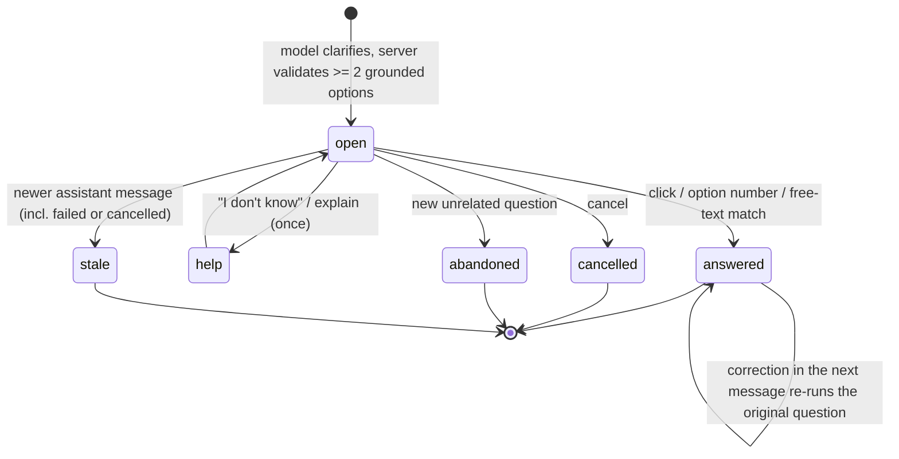
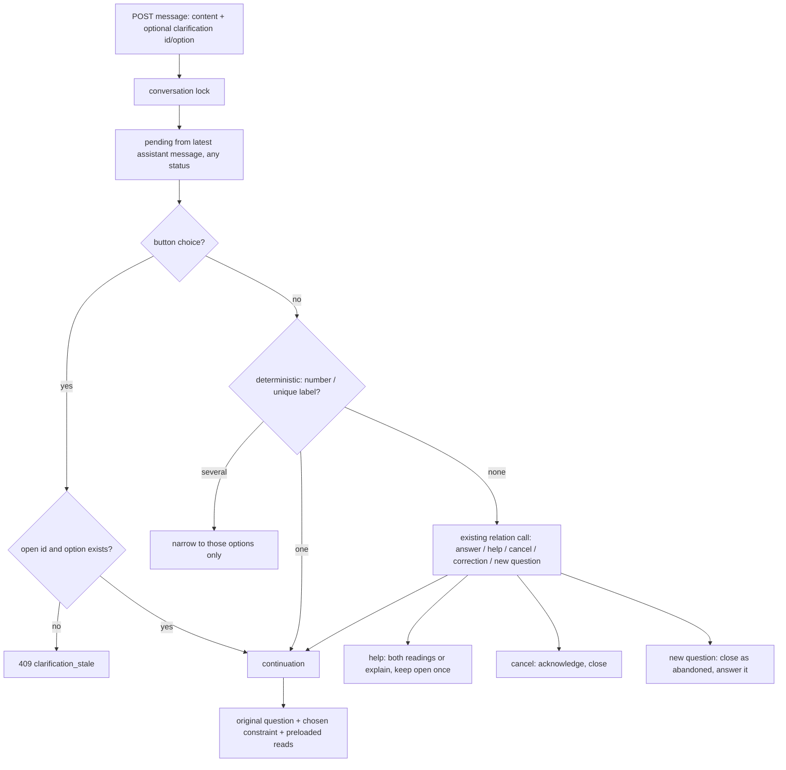

# Grounded clarifications that continue the original task - Plan

## Goal Capsule

- **Objective.** When an appraiser's question has two or more reasonable readings that lead to materially different answers, the assistant asks one short question with grounded choices, then answers the original question with the choice applied. It does not ask when the answer is clear, does not ask the same thing twice, and never shows the same candidate list again after a choice.
- **Means.**
  - Extend the existing model-led clarification, the conversation's pending slot and the chat message rendering (KTD1-KTD5).
  - Bind the reply to the clarification it answers, on the server (KTD3).
  - Continue the stored original question with the choice (KTD4).
  - Measure the final answer on a real model on the isolated stack (U7).
- **Authority.**
  1. The user's round-26 request and the session-settled Key Decisions.
  2. This plan's R-IDs.
  3. KTDs on mechanism.
  4. Units.
  - `CLAUDE.md` binds every unit: public repository, data safety, host-only pytest, model split, PR update without merge or deploy.
- **Stop conditions.** Stop and report rather than proceed when:
  - a change would delete or replace stored conversations, permissions or data;
  - a paid run would push cumulative product spend past USD 15;
  - the design would need the server to invent unit options without the model, which round 15 rejected because it caused loops;
  - a settled decision proves infeasible.
- **Execution profile.**
  - Opus designs, decides and writes the measurement set.
  - Sonnet implements units and reviews.
  - Haiku runs searches and test runs.
  - Every subagent gets an explicit model.
  - Red test first for every behaviour change, synthetic Hebrew data only.
- **Finishes and ships.** The orchestrating session commits each unit and updates PR AriGabay/rag#2 with what changed, what was measured, whether answers after clarification improved, and what remains limited. No merge, no deploy.

---

## Product Contract

### Summary

Turn today's free-text clarification into a structured clarification. It is one question, a short reason and two to four grounded options with stable ids, and free text is always accepted. The server stores it in the conversation's pending slot, validates the reply against it, and continues the stored original question with the choice. The chat shows the options as accessible buttons. A real-model measurement on synthetic documents judges the final answers.

### Problem Frame

A clarification today is an ordinary answer with `answer.status == "clarification"` and a question string (`backend/app/chat/engine.py` `FinalAnswer.clarification_question`). It has no id and no options. The candidate units the model offered are kept in `answer.context.pending` for one message (`backend/app/chat/api.py` `_pending_slot`, `backend/app/chat/slots.py`). The reply is bound only by heuristics: a small relation call in `resolve.validate` plus ordinal and name matching in `entities.among`/`named_unit`. Anything that does not bind becomes a new question.

The research traced the failure family where a user picks a property and gets the same candidate list again to five causes:
1. The model's clarification stored no candidates, so nothing binds.
2. Cards of untitled units show "ללא כותרת" and cannot be told apart by name.
3. A reply binds only when the relation call says `clarification_answer` or the reply is an ordinal, and a failed relation call binds nothing.
4. A reply that matches several candidates re-offers the same list.
5. The pending is read from the latest *done* assistant message, so a failed turn in between can resurrect an older clarification.

The interface has no option buttons. The reply goes through the composer as free text. There is no policy on when a date, an area basis or an averaging method justifies asking. No rule forbids asking the user to choose a "correct" number.

### Key Decisions

- **Extend the existing path; no parallel clarification mechanism.** (session-settled: user-directed — chosen over a separate clarification engine: duplicated state drifts.) Governs R1, R9.
- **Clarify only when two or more reasonable readings remain after checking the message, history, earlier choices and sources, and the choice changes the result.** Otherwise answer directly, or show both readings briefly with sources. (session-settled: user-directed — chosen over always asking or keyword-triggered questions: they delay answers and push work to the user.) Governs R2, R3.
- **A clarification never hides a search, read, calculation or verification failure, and never asks which number is "correct".** That applies to uncertain extraction, conflicting sources or an incomplete search. (session-settled: user-directed — chosen over letting the user arbitrate the system's uncertainty: it hides defects and treats preference as evidence.) Governs R4.
- **A user choice is not document evidence.** A chosen calculation assumption is labelled as the user's. (session-settled: user-directed — chosen over presenting the choice as sourced.) Governs R8.
- **The server validates clarification state and permissions; the UI is not trusted.** (session-settled: user-directed — chosen over UI-only guards: stale buttons and cross-conversation application.) Governs R10, R11.
- **No replacement of models, OCR or database, and no deletion or replacement of existing data.** Migrations only if needed and incremental. (session-settled: user-directed.) Governs R11.
- **Synthetic public examples only; customer data and keys never in code, tests, docs or git.** (session-settled: user-directed.) Governs R13.
- **Usefulness is measured on the final answer after the clarification, with a real model, including cases not used during implementation.** No gain may come from answering less. (session-settled: user-directed — chosen over checking that buttons appear: it proves nothing about answers.) Governs R13, R14.

### Requirements

**When to ask**

- R1. The decision to ask stays with the model, informed by the message, history, earlier choices and the sources it found. It covers any material ambiguity, not a keyword list. Examples: property or appraisal identity, requested date, area basis, averaging method.
- R2. The assistant asks only when at least two reasonable readings remain and they lead to materially different answers. A clear question is answered directly. When both readings fit in a short answer with sources, the assistant shows both instead of asking.
- R3. An explicit user statement beats defaults, including the time-preference switch: a stated date or range is never re-asked.
- R4. The assistant never asks which value is correct for uncertain extraction, conflicting sources or an incomplete search. It reads the right source first and otherwise states exactly what was not decided.

**What is shown**

- R5. One focused question at a time, with a short reason and usually two to four short, distinct options. Free text is always accepted, including "I don't know" or a request to explain.
- R6. Options come from the actual ambiguity. A property or appraisal option carries details grounded in the sources that tell it apart: name, address, date or relevant page range. An option without a distinguishing detail is never shown, and a list of "untitled" items is never offered.
- R7. "All" is offered only when combining the options makes sense. When chosen, the answer keeps each property's data separate and computes no joint average without justification.

**After the choice**

- R8. The answer continues the original question with the choice applied. It reuses what the clarifying turn already found, does not restart the search, and does not ask again while the choice is valid. A chosen assumption is labelled as the user's.
- R9. A reply binds to the clarification it answers: by click, by option number or by free text.
  - A new message that is not an answer is never applied as a choice. It is answered as a new question and the clarification closes.
  - Cancelling closes it.
  - Correcting a choice in the next message re-answers the original question with the corrected choice.
- R10. A resolved ambiguity is not reopened without a relevant change. A further clarification for the same question says what is new. The assistant asks at most two consecutive clarifications for one question and then answers with stated assumptions.
- R11. The server accepts a choice only for the open clarification on the latest assistant message of the same conversation, for a user who may still see it. Stale, answered or foreign choices are refused with a clear message. Double submission yields one turn.
- R12. When the user later changes only the metric or the date, the chosen property stays.

**Interface and measurement**

- R13. The question and options appear inside the chat as accessible buttons that work with RTL, keyboard and mobile. The message box stays available. The choice appears in the conversation, and the progress shows the original request continuing. Buttons of a clarification that is no longer open do nothing.
- R14. A pre-registered measurement on synthetic documents compares the final answers before and after this change on a real model, on development cases and on held-out cases written before implementation. It reports, separately:
  - correctness and completeness of the final answer;
  - unnecessary clarifications on clear questions;
  - repeated questions or lists;
  - turns to an answer, time and cost.

  The measurement counts no gain that comes from answering less.

### Acceptance Examples

- AE1. Covers R2, R6.
  - **Given:** two appraisals of "הכלנית 6" in different neighbourhoods.
  - **When:** the user asks "מה שטח המגרש בכלנית 6?".
  - **Then:** one question with two options naming each neighbourhood and appraisal date, plus free text.
- AE2. Covers R2.
  - **Given:** "הכלנית 6 בנווה אשחר" names one appraisal.
  - **When:** the same question is asked with the neighbourhood.
  - **Then:** no clarification; the answer is direct.
- AE3. Covers R8, R9, R12.
  - **When:** the user clicks the Neve Ashhar option.
  - **Then:** the answer gives that appraisal's plot area without a new candidate list.
  - **Then, on follow-up:** "ומה המועד הקובע?" keeps the property.
- AE4. Covers R9, R10.
  - **When:** while a clarification is open, the user asks an unrelated professional question.
  - **Then:** it is answered, and the old buttons become inactive.
- AE5. Covers R4.
  - **Given:** a table with two conflicting per-square-metre values in one appraisal.
  - **When:** the user asks for the value.
  - **Then:** no question about which number is correct; the answer shows both values with their places and says what is undecided.
- AE6. Covers R7.
  - **When:** the user picks "all" for an average question over two properties.
  - **Then:** each property's figure is given separately, with no joint average unless the user asked for one.
- AE7. Covers R11.
  - **When:** the user double-clicks an option.
  - **Then:** one continuation runs.
  - **When:** the user clicks an option of an older clarification after a newer answer.
  - **Then:** the server answers that the choice is no longer current.

### Scope Boundaries

- The search-only path (offices without cloud sending) has no model to ask, and today produces no clarification. It stays as it is.
- The server-made clarifications that end a turn without a model call (scale contradiction, correction ambiguity, a bare ordinal over several lists) stay as text clarifications with their existing binding in this round.
- The completeness and omission work of round 25 is not part of this round.
- Version 1 asks only about the unit, the period, the area basis and the averaging method (KTD1). Other ambiguities, such as which metric was meant, are answered with both readings briefly. Asking about them waits for a constraint channel.

---

## Planning Contract

### Key Technical Decisions

- KTD1. **A structured clarification inside the existing final answer.**
  - **Shape:** the `FinalAnswer` gains a `clarify` object: `question`, `reason`, `kind`, `options[{key, label, ref}]`, `allow_all`. The existing `clarification_question` string is kept as its text, and the stored `answer.clarification` string keeps its meaning.
  - **Refs per kind:**
    - `unit`: a U# handle;
    - `period`: an ISO start and end;
    - `area_basis` and `method`: the phrase the source uses.
  - **Kinds, version 1:** `unit`, `period`, `area_basis` and `method` (averaging). Each has a constraint channel in the continuation (KTD4). Any other ambiguity is answered with both readings briefly (R2), not asked. There is no kind for choosing a value (R4).
  - **Cost:** no new model call. The policy text in `engine.py` gains the R1-R7 rules, and the schema enforces at most four options.
  - **Rationale:** the model already decides to clarify and already offers units. Giving it a contract keeps the decision where round 15 put it. Server-guessed lists caused the loops round 15 removed.
- KTD2. **The server validates and grounds the options.**
  - **Unit options:** only units the turn offered, listed or read, and the user may see. This reuses `_declare_units` and `offered_candidates`. The server fills their details from the unit identity cards (name, address, date, page range).
  - **Period options:** the range must match a date in the sources the turn read (the existing time records). The server passes it on as a `timeframe.Requested`.
  - **Area-basis and method options:** each phrase must appear in a source the turn read. Otherwise the kind falls back to an answer with both readings.
  - **Dropped options:** an option without a distinguishing detail. Labels are deduplicated.
  - **Fewer than two valid options:** the turn keeps the text question with no buttons and records why. It still stores a pending record with no options and the turn's touched documents (the existing `clarified` mechanism), so a typed unique name still binds. The question must not list the options that were dropped.
  - **Repeated question:** a clarification that repeats a kind already resolved for the same original question gets one re-prompt step: "the user chose X; answer". This extra call happens only in that violating case. A third consecutive clarification is refused the same way (R10). A narrowing among the options a reply matched is exempt.
  - **Further guards:**
    - options must be pairwise distinct, and identical copies of one document collapse into one option;
    - for unit, area-basis and method options, a label that is only numbers or values is rejected; a period label may be a date or year that matches a source date, and a label that parses as a money or area value is rejected (R4);
    - a unit clarification is rejected when the turn's unit is already pinned by the message or the conversation;
    - a period clarification is rejected when the only ambiguity is which date and the time preference already decides it (R3).
- KTD3. **The pending slot carries a clarification record, and the reply binds on the server.** No migration is needed.
  - **The record:** `answer.context.pending` v3 holds `{kind: "clarification", id, original_question, time_mode, anchor_date, clarify_kind, options[{id, label, detail, ref}], allow_all, round, help_count, reads}`.
    - Option ids are stable hashes of kind and ref, not display order.
    - `slots.VERSION` goes to 3 with a reader for v2 rows.
    - The parameter pending (a missing rate) keeps its own binder.
  - **One state function:** a single function derives the clarification state from the conversation's rows. Send validation and `_turn_input` both use it, so a button click and typed text always see the same state.
  - **The reply's binding is durable:** it is stored on the user row's `answer` JSON as `{clarification_id, option_id, outcome}` and stripped from the public view. Retry and the run path read it, so a retried continuation keeps its choice.
  - **The send body:** `SendBody` gains an optional `clarification {id, option_id}`.
  - **Under the conversation lock:**
    - The pending is taken from the latest assistant message of the conversation, in any status. A failed or cancelled turn after the clarification makes it stale, which fixes cause 5.
    - A button choice must match an open id and an existing option in the addressed conversation; otherwise the server returns 409 `clarification_stale`. An id from another conversation also gets 409. 404 is kept for a conversation the user cannot access.
    - A typed reply binds deterministically first: option number, or a unique label or detail match.
    - Otherwise the existing relation call in `resolve.validate` decides. It gains the relations `clarification_help`, `cancel` and `correction_of_choice`, in the same call.
    - A failed relation call still binds deterministically (cause 3).
    - A reply matching several options narrows to exactly those options, never to the same full list (cause 4).
  - **Outcomes:** the user row records `answered`, `cancelled`, `abandoned` or `help`.
    - An answered record keeps the sibling options, so a correction can re-bind.
    - A help reply re-emits the pending on its assistant message, with a new id, the same option ids and `help_count` 1.
    - A bare number binds as an option only when it is the whole message.
    - Free text that names none of the options ("none of these") is treated as new information for the original question. The clarification closes as answered with free text. If the model then asks again, that counts as the second consecutive clarification.
- KTD4. **Continuation runs the stored original question with the choice.**
  - The turn's question becomes `original_question`, with the chosen option as a resolved constraint:
    - unit: the declared unit scope, skipping the candidate lookup;
    - period: an explicit period, which overrides the switch (R3);
    - area basis or method: a user-choice note the policy shows as the user's assumption.
  - The pending record keeps the clarifying turn's resolved request (metric, scale, basis, subject). The continuation starts from it with only the chosen constraint changed, rather than re-resolving the original text.
  - The continuation's user row text and the constraint are built from the stored option (kind, ref), never from the text the client sent. Document-derived labels pass through the existing prompt-text sanitisation and never as instructions.
  - The pending record's `reads` (at most six locators of what the clarifying turn read, by recency) is always filled, and the continuation always preloads from it. `answer.sources` cannot serve, because it holds only cited sources and a clarification cites none. Every document behind an option or a preloaded read counts in `_answer_documents` for visibility.
  - The continuation uses the original question's time mode and anchor date. A click does not change the conversation's time switch.
  - If a chosen unit's document is no longer visible, the continuation answers "no longer available" without data.
  - If the office lost cloud sending after the question, the send is refused with a clear message, because the search-only path cannot apply a choice.
  - "All" runs the question per unit, with a policy rule against a joint average without justification.
  - A correction re-runs the same original question with the corrected option.
  - `help` (I don't know, explain) answers briefly with both readings, or explains, and keeps the clarification open once.
- KTD5. **The interface reads clarification state from the server.**
  - **Message payload:** the assistant message carries `clarify {id, question, reason, options[{id, label, detail}], allow_all, state}`, where state is `open`, `answered`, `closed` or `stale`. The state is computed from the conversation's rows on every message list and poll, not per row.
  - **Rendering:** `Message.tsx` renders the question and reason once, then the options as a labelled button group with number hints. They work by keyboard, in RTL and on narrow screens.
    - The block replaces the existing "נדרשת הבהרה" lead line when `clarify` is present. The text-only fallback keeps the old line.
    - Options are enabled only while the state is `open` and no turn is running or being sent.
    - `answered` shows the chosen option marked and the others dimmed. `closed` and `stale` show all options disabled with a short state label.
  - **A click:** sends `clarification {id, option_id}`, and the server writes the user row's text from the stored option.
    - The local thread marks the clarification `answered` at once, and focus moves to the composer.
    - A 409 `clarification_stale` removes the optimistic bubble, shows "השאלה כבר לא פתוחה" next to the buttons and marks them stale. A choice-carrying send never offers "resend as text".
  - **Double submit:** existing guards (client id, the running-turn 409, the conversation lock).
  - **Composer:** stays enabled.
  - `chatTypes.ts` declares the new fields.
- KTD6. **Measurement is pre-registered, on synthetic documents, with dev and held-out cases.**
  - **Material:** a public synthetic fixture set. The existing eval offices hold two "הכלנית 6" appraisals, and new DOCX fixtures add:
    - a bound file with three appraisals, two of them without titles;
    - one property with two dated appraisals;
    - a comparables table with areas, for simple vs weighted average;
    - gross and net area bases.
  - **Seeding:** the fixtures are seeded into the isolated office C.
  - **Cases:** about 30 conversations, half development and half held out. The held-out half is written by Opus before implementation and not shown to implementers.
  - **Paired control:** each ambiguous case also has a twin where the question states the unit or period. The final answer after ask, click and continue must match the twin's answer. This is the primary correctness measure.
  - **Rates:** the share of clear questions that are clarified (unnecessary), and the share of ambiguous ones that are asked, with no claim from answering less.
  - **Runs:** two runs per case per arm. A third is used only if the budget re-check allows.
  - **Arms:** base `4d13711` vs this round, same harness, real model.
  - **Grading:** final answers are graded blind against the fixtures' known truth.
  - **Acceptance:** fixed in the private pre-registration before the first run.
  - **Cost:** measured on synthetic office C at about USD 0.004 per turn (the round-25 walkthrough). The cost is about 30 conversations x 2.5 turns x 2 arms x 2 runs, plus the twins, which comes to about USD 1.5. The cap is USD 1.8 against a remainder of about USD 2.75, re-verified first. If the first 10 conversations project above the cap, the remaining cases run once per arm; this rule is pre-registered.
  - **Held-out material:** the held-out conversations share the public fixtures, so they are reported as "held-out conversations on shared fixtures". One held-out fixture document, synthetic and written by Opus, stays private and appears only in held-out cases. Its cases are reported separately.
  - **Commitment:** the held-out cases and the pre-registration stay in `real_documents/tests/round26/` and are never staged. Their SHA-256 values are committed in a public sha file (the `check_set_sha` convention in `backend/eval/chat_eval.py`) before the first paid run.

Bake-off: not run. The open technical choices are model-led versus deterministic triggers (settled by the user: general capability, model-led per round 15) and slot JSON versus a new table (no requirement needs atomic cross-row state that the conversation lock does not already give). Neither needs further development to choose.

### High-Level Technical Design

The clarification lifecycle:

The reply path:

### Assumptions

- The relation call in `resolve.validate` can take three more relations without losing accuracy on the existing ones. This is measured by the existing resolve tests and by the U7 cases.
- Preloading at most six read sources from the clarifying turn fits the tool budget. Larger sets are cut by recency.
- The eval office C stack, `scripts/isolated_stack.sh`, is the measurement environment. The budget remainder is re-verified from the app's usage records before the first paid run.
- The user's uncommitted files (`.gitignore`, `backend/pyproject.toml`, `backend/uv.lock`, `backend/extrenal_api/`) are not touched.

### Sequencing

U1 comes first: fixtures, pre-registration and the baseline run on the base code. Then U2 and U3, which share `engine.py`, `resolve.py` and `api.py`, so they run in sequence. U4 depends on U3, U5 on the U3 payload, U6 on U2-U5, and U7 runs last on the final code.

---

## Implementation Units

### U1. Synthetic fixtures, measurement cases, pre-registration and baseline

- **Goal:** public synthetic material that exercises each ambiguity kind, a locked measurement, and the base code's results before any change.
- **Requirements:** R13, R14.
- **Dependencies:** none.
- **Files:**
  - Create:
    - `backend/tests/fixtures/clarify_v1/` (DOCX fixtures, generated)
    - `backend/scripts/generate_clarify_fixtures.py`
    - `backend/eval/clarify_v1_dev.yaml` (development cases, public)
  - Private, never staged: held-out cases, the private held-out fixture, pre-registration and results under `real_documents/tests/round26/`. Their hashes go in `backend/eval/clarify_v1.sha256`, committed before the first paid run.
  - Create: `backend/eval/clarify_driver.py` (or an extension of `chat_eval.py`). It runs each case's reply policy, typed text on both arms plus a button choice on the new arm, and records the base arm's typed equivalent of each click.
  - Modify: `backend/scripts/seed_eval_office.py`, to upload `clarify_v1` with the existing guard.
- **Approach:**
  1. Generate the fixtures with known truth:
     - a bound file of three appraisals, two untitled, told apart by address and date;
     - one property with two appraisals of different valuation dates;
     - a comparables table with areas and per-square-metre values;
     - gross and net areas;
     - a conflicting-value table, which must not trigger a clarification (AE5).
  2. Write cases as conversations: the first question, the user's reply policy (click option X, type "2", free text, "לא יודע", "כולן", an unrelated question, a correction), and the expected final answer facts.
  3. Include clear questions that must not be clarified.
  4. Lock the thresholds and hash them before the first run.
  5. Run the base arm on the isolated stack and record per-case results.
- **Pre-registered acceptance (fixed in U1 before any run; numbers below are the plan's):**
  - Counts per cell are fixed in U1 (dev and held-out, ambiguous and clear), and every rule is stated as a count:
    - final answers correct and complete on ambiguous cases, matched against the twin control, in at least k of n, with k fixed before the run and above the base arm's count;
    - zero unnecessary clarifications on the clear held-out cases, and not more than the base on dev;
    - repeated candidate list or repeated question after a choice: 0;
    - the held-out rate not lower than the dev rate by more than one case.
  - Exact counts are reported, never percentages alone.
  - Median turns to answer on ambiguous cases: at most 2.
  - Cost: within the cap set from a dry count.
- **Test expectation:** none -- measurement material. The fixture generator gets a smoke check that each file opens and holds its truth strings.
- **Verification:** the hash predates results, and the baseline results are recorded.

### U2. Structured clarification contract, policy and validation

- **Goal:** the model asks with a structured, grounded question only when needed, and never about which value is correct.
- **Requirements:** R1-R7, R10. Implements KTD1, KTD2.
- **Dependencies:** U1.
- **Files:**
  - Modify:
    - `backend/app/chat/engine.py` (`FinalAnswer`, `POLICY` clarification lines, the re-prompt for repeated kinds)
    - `backend/app/chat/entities.py` (`offered_candidates`, distinguishing details)
    - `backend/app/chat/contexts.py` (card details for untitled units)
  - Test: `backend/tests/unit/test_clarification_contract.py` (new), `backend/tests/integration/test_chat_clarification.py` (new), `backend/tests/integration/test_chat_context.py`
- **Approach:**
  1. Add the schema and policy rules: R2 both-readings, R3 explicit beats default, R4 never ask which value, R6 details, R7 "all".
  1a. First write the regression tests for causes 1 and 2 of the repeated list in `backend/tests/integration/test_chat_clarification_regressions.py`, and see them fail against the base.
  2. In the server validation, ground unit options in `_declare_units`, fill their details from identity cards, ground period, area-basis and method options per KTD2, drop options without details, and fall back to text (with a pending record) when fewer than two remain.
  3. Add the repeat and consecutive guard with one re-prompt step.
  4. Fix the untitled-card fallback that shows "ללא כותרת" when a card has an address or date.
- **Patterns to follow:** the existing `_declare_units`, `offered_candidates`, `_candidates_text`; `tests/support/scripted_agent.py` (`final(..., "clarification", ...)`).
- **Test scenarios:**
  - Covers AE1. A scripted clarification with two unit options gets server-filled details (neighbourhood, date) and stable option ids.
  - An option naming a unit the turn never saw is dropped; with one option left there are no buttons and the text question is kept.
  - Two untitled units with different addresses become options labelled by address and date, never "ללא כותרת".
  - Covers AE5. A value-kind clarification is rejected by the schema; the conflicting-value turn answers with both values.
  - A repeated kind for the same original question triggers one re-prompt and the answer uses the stored choice; a third consecutive clarification is refused the same way.
  - Settings and policy do not change a clear question's answer (characterization on an existing completeness fixture).
  - A period clarification is rejected when the time preference already decides the date. A unit clarification is rejected when the unit is already pinned.
  - A period option whose dates appear in no read source is dropped. An area-basis option whose phrase appears in no read source falls back to both readings.
  - The fallback with fewer than two options stores a pending record, so a typed unique name still binds.
- **Verification:** the scenarios pass, and existing chat tests are unchanged.

### U3. Persistence, reply binding and continuation

- **Goal:** a choice binds to its clarification on the server and the original question is answered with it, without a new search or a repeated question.
- **Requirements:** R8-R12. Implements KTD3, KTD4.
- **Dependencies:** U2.
- **Files:**
  - Modify:
    - `backend/app/chat/slots.py` (pending v3, reader for v2)
    - `backend/app/chat/api.py` (`SendBody.clarification`, `_turn_input` latest-message rule, 409 stale, outcome record)
    - `backend/app/chat/resolve.py` (deterministic binding first; relations help, cancel, correction; narrowing)
    - `backend/app/chat/engine.py` (continuation: original question, constraint, preloaded reads, "all" per unit, help answer)
    - `docs/api-contract.md`
  - Test: `backend/tests/unit/test_slots.py`, `backend/tests/unit/test_resolve.py` (or the module's existing tests), `backend/tests/integration/test_chat_clarification.py`, `backend/tests/integration/test_chat_context.py`
- **Approach:**
  0. First write the regression tests for causes 3, 4 and 5 of the repeated list, and see them fail against the base.
  1. Write the record into the pending slot.
  2. Bind in the order of KTD3.
  3. Continue with KTD4.
  4. Record the outcome on the next user message's context.
  5. Keep the unit when a later turn only changes metric or date, through the existing slot carry.
- **Test scenarios:**
  - Covers AE3. A click choice runs the original question scoped to the chosen unit: no candidate list, no lookup call, preloaded sources used.
  - "2" and a free-text address bind to the same option; a reply matching two options narrows to those two only.
  - The relation call fails: an option number still binds.
  - Covers AE4. An unrelated question closes the clarification as abandoned and is answered; a later click on its buttons gets 409 stale.
  - Cancel closes it with a short acknowledgement.
  - "לא יודע" answers with both readings briefly and keeps it open once.
  - A correction in the next message ("לא, התכוונתי לכרם הזית") re-answers the original question for the corrected unit.
  - Covers AE7. A double click yields one turn. A choice for another conversation's clarification gets 409 `clarification_stale`, and a conversation the user cannot access gets 404. A choice after the user lost access to the unit's document gets "no longer available" without data.
  - Retrying the continuation keeps the chosen option and the original time mode.
  - A click does not change the conversation's time switch.
  - A help reply re-emits the options with a new clarification id, and the old id is stale.
  - A bare "2" inside a sentence is not taken as an option.
  - An office that lost cloud sending refuses the choice with a clear message.
  - A failed turn after a clarification makes it stale, so the older clarification is not resurrected.
  - Covers AE6. "All" answers per unit, with no joint average.
  - The follow-up "ומה המועד הקובע?" after a choice keeps the unit; an explicit date in the original question is never asked about.
  - A v2 pending row from an older conversation still binds as before (reader).
  - A period choice runs the original question with an explicit period that overrides the time switch, and leaves the switch unchanged.
  - An area-basis choice and a method choice each produce an answer that labels the choice as the user's assumption.
  - A click whose client text differs from the stored option continues with the stored option.
  - The continuation preloads the clarifying turn's reads, with no new search call.
- **Verification:** the scenarios pass, and existing context, entity and follow-up tests pass.

### U4. The repeated-candidate-list family

- **Goal:** the five traced causes stay closed. Their tests are written red against the base in U2 and U3, and this unit confirms they are all green together.
- **Requirements:** R6, R9, R10.
- **Dependencies:** U3.
- **Files:**
  - Modify: `backend/app/chat/entities.py`, `backend/app/chat/resolve.py`, `backend/app/chat/api.py` (the `clarified=[]` fallback), `backend/tests/integration/test_chat_context.py` (the test that encodes a re-ask on a shared word)
  - Test: `backend/tests/integration/test_chat_clarification_regressions.py` (new)
- **Approach:** U2 fixes causes 1 and 2, and U3 fixes causes 1, 3, 4 and 5. This unit changes the old test of the shared-word re-ask, which now narrows instead of re-asking the same list. It removes the `clarified=[]` hard-code in `api._context` and confirms all five regression tests green.
- **Test scenarios:** one per cause:
  - no stored candidates;
  - untitled cards;
  - relation-call failure;
  - several matches;
  - failed turn in between.

  Each asserts that the reply never yields the same candidate list.
- **Verification:** each of the five tests was red against the base (recorded in U2 and U3) and is green here.

### U5. Clarification interface

- **Goal:** the question and options are usable buttons in the chat, and the choice continues visibly.
- **Requirements:** R5, R9, R11, R13. Implements KTD5.
- **Dependencies:** U3 payload.
- **Files:**
  - Modify: `frontend/components/chat/Message.tsx`, `frontend/components/chat/ChatApp.tsx`, `frontend/lib/api.ts`, `frontend/lib/chatTypes.ts`, `frontend/components/chat/chat.css`
  - Test: `frontend/e2e/clarification.spec.ts` (new, route-mocked like `chat-gaps-removals.spec.ts`)
- **Approach:**
  1. Read `node_modules/next/dist/docs` first (`frontend/AGENTS.md`).
  2. Build a button group with the reason line, number hints and keyboard focus order, laid out for RTL and narrow screens.
  3. Disable it unless the state is `open`.
  4. A click sends the label and the ids.
  5. Show a progress line that names continuing the original request.
  6. Handle the 409 stale message inline.
- **Test scenarios:**
  - Options render as buttons and reach by Tab.
  - After a successful click the group is marked answered at once, and a second option cannot be clicked while the continuation runs.
  - After Enter on an option, focus is on the composer.
  - After a 409 the optimistic bubble is gone, the buttons are disabled, and no resend link is shown.
  - Enter on a focused option sends the label and the ids, and the composer stays enabled.
  - A stale clarification's buttons are disabled.
  - A 409 shows an inline message.
  - Refresh restores the state.
  - A double click sends once.
  - Mobile width (375 px) has no horizontal overflow.
- **Verification:** the Playwright spec passes, typecheck and lint are clean.

### U6. Concepts, contract and operator notes

- **Goal:** the vocabulary and API contract describe the clarification as built.
- **Requirements:** R9-R11.
- **Dependencies:** U2-U5.
- **Files:** `CONCEPTS.md` (a "Clarification" entry; refine "Conversation slots" and "Candidate units"), `docs/api-contract.md`, `docs/operations/pilot.md` (how clarifications behave).
- **Test expectation:** none -- documentation.
- **Verification:** no customer content, and the entries match the code.

### U7. Real-model measurement and browser test on the isolated stack

- **Goal:** evidence that answers after clarification improved without unnecessary questions.
- **Requirements:** R14, R13.
- **Dependencies:** U2-U5.
- **Files:**
  - private results under `real_documents/tests/round26/`
  - a public summary in `docs/evaluation/conversational-rag.md` (round-26 section)
- **Approach:**
  1. Rebuild the isolated stack with `APP_BUILD_SHA`, check a changed constant, and seed `clarify_v1`.
  2. Run the development and held-out cases on both arms.
  3. Grade final answers blind against the fixture truth, with Opus adjudicating disagreements.
  4. Report per the pre-registration.
  5. Run the browser test on the same stack: ambiguous question, click, continuation, refresh, stale button, mobile width.
- **Test expectation:** none -- measurement. The browser checks are recorded step by step.
- **Verification:** the pre-registration hash predates the results, every rule is computed mechanically, and the spend stays within the cap.

---

## Verification Contract

| Gate | Check | Applies to |
|---|---|---|
| Backend tests | `cd backend && env -u DATABASE_URL -u OWNER_DATABASE_URL .venv/bin/pytest` via the serialized wrapper `real_documents/tests/round25/tools/pt.sh`, against `rag-testdb-r23`; never in a container, never two at once | U2-U4 |
| Lint | `cd backend && uv run ruff check app tests scripts` | U1-U4 |
| Frontend | `cd frontend && npm run typecheck && npm run lint`; `npx playwright test e2e/clarification.spec.ts` | U5 |
| Image | the isolated stack rebuilt through its `migrate` service; a changed constant checked inside the container | U7 |
| Measurement | per the private pre-registration (hash checked) | U7 |
| CI | `gh pr checks` on PR AriGabay/rag#2 | all |
| Privacy | nothing under `real_documents/` staged; synthetic data only in committed fixtures | all |

## Definition of Done

- U1-U7 implemented, with each behaviour proved red then green.
- The measurement reported against its pre-registered rules, including any rule that failed.
- The PR body states what changed, what was measured, whether answers after clarification improved, and what remains limited.
- No dead code from abandoned attempts.
- The user's unrelated working-tree changes untouched.
- Not merged, not deployed.

## Risks

| Risk | Mitigation |
|---|---|
| The model clarifies too often after the new policy | Clear-question cases with a pre-registered ceiling; the "both readings" rule |
| Extra relations degrade the relation call | Deterministic binding first; the existing resolve tests; the U7 cases |
| Preloaded reads exceed the tool budget | Bounded to six by recency |
| Old pending rows | Slot reader for v2; test |
| Measurement too small to generalise | Reported as development and held-out on synthetic material only; no claim beyond it |
| The pending record v3 is unreadable by older builds | Rolling the build back after conversations exist loses those pending slots; stated in the PR, no rollback planned |
| Extra relations in the resolve call | The existing resolve tests run unchanged; the U7 cases include follow-ups of every older relation kind |

## Sources

- Research: the existing path and the five causes of the repeated list (`backend/app/chat/api.py` `_pending_slot`, `_turn_input`, `_context`; `slots.py`; `resolve.py` `validate`, `bind_pending`, `_take`; `entities.py` `among`, `named_unit`, `offered_candidates`; `contexts.py` card titles; `engine.py` `FinalAnswer`, `POLICY`, `_declare_units`, `_candidates_text`).
- The legacy precedent: `backend/app/answering/state.py` `PendingClarification`, `answering/api.py` (409 on a changed pending), `answering/interpret.py`.
- Learnings: `docs/evaluation/conversational-rag.md` rounds 4, 9, 10, 11, 15, 22 (hard-evidence triggers, model-led clarification, one-message pending, ordinal binding, time preference); `docs/solutions/logic-errors/*hebrew-follow-up-entity-lookup*`, `*time-ranked-answers*`.
